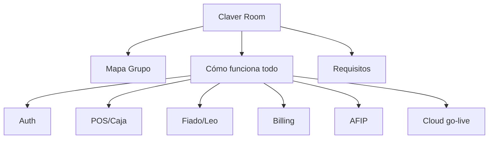

# Claver Docs · Claver Room

**Un solo lugar** para entender cómo funciona Claver y el Grupo: diagramas de flujo, requisitos de marcha, implementación, desarrollo y packs vendibles.

> No es un dump de archivos. Es la **sala de control del conocimiento**.

---

## Entrá por acá (Room)

| Prioridad | Página | Para qué |
|-----------|--------|----------|
| 1 | [Mapa del Grupo Claver](/dashboard/documentacion/room/mapa-grupo) | ERP · Cloud · Leo · Grow · Partners |
| 2 | [Cómo funciona todo](/dashboard/documentacion/room/como-funciona-todo) | Runtime completo con diagramas |
| 3 | [Requisitos de funcionamiento](/dashboard/documentacion/room/requisitos-funcionamiento) | Env, jobs, hardware, go-live |
| 4 | [Auth + multi-tenant](/dashboard/documentacion/room/flujo-auth-multitenant) | JWT, empresaId, roles |
| 5 | [POS → caja → stock](/dashboard/documentacion/room/flujo-pos-caja) | Mostrador |
| 6 | [Fiado → Leo → WhatsApp](/dashboard/documentacion/room/flujo-fiado-leo) | Ancla de calle |
| 7 | [Billing y SKUs](/dashboard/documentacion/room/flujo-billing-skus) | Trial, ancla, MP, partners |
| 8 | [AFIP](/dashboard/documentacion/room/flujo-afip) | CAE y fiscal |
| 9 | [Go-live Cloud](/dashboard/documentacion/room/flujo-go-live-cloud) | Venta → operación |

---

## Audiencias

### Analista / implementador
[Guía del analista](/dashboard/documentacion/analista/guia-implementacion) · [Checklist go-live](/dashboard/documentacion/analista/checklist-go-live) · [Proceso Cloud](/dashboard/documentacion/operaciones/claver-cloud-proceso-implementacion)

### Desarrollador
[Getting started](/dashboard/documentacion/developer/getting-started) · [Arquitectura](/dashboard/documentacion/developer/arquitectura) · [Multi-tenant](/dashboard/documentacion/developer/multi-tenant) · [API overview](/dashboard/documentacion/developer/api-overview)

### Operaciones
[Deploy](/dashboard/documentacion/operaciones/deploy-runbook) · [Health](/dashboard/documentacion/operaciones/health-check) · [Troubleshooting](/dashboard/documentacion/operaciones/troubleshooting)

### Comercial / partner
[Roadmap vendedor](/dashboard/documentacion/comercial/roadmap-venta-vendedor) · Flujos Room de fiado/Leo y billing · Packs en `docs/GO_LIVE_PRD.md`

### Usuario final (manuales)
No confundir con esta wiki técnica: usá [Capacitación / manual](/dashboard/capacitacion/manual-usuario).

---

## Funcional y automation

- [POS](/dashboard/documentacion/funcional/sistema-pos) · [Tesorería](/dashboard/documentacion/funcional/tesoreria) · [AFIP](/dashboard/documentacion/funcional/afip-integracion)
- [Automation Hub](/dashboard/documentacion/funcional/automation-hub) · [Workers](/dashboard/documentacion/funcional/automation-workers)

---

## Convención

| Ubicación | Uso |
|-----------|-----|
| **`content/docs/`** (esta wiki) | Canónico, diagramas, verificado |
| **`docs/`** en el repo | Laboratorio, auditorías, drafts |
| **Claver Room** (`room/*`) | Flujos de funcionamiento del sistema y del Grupo |

Toda página Room debe tener **al menos un diagrama Mermaid** y una sección de enlaces a código/API cuando aplique.
