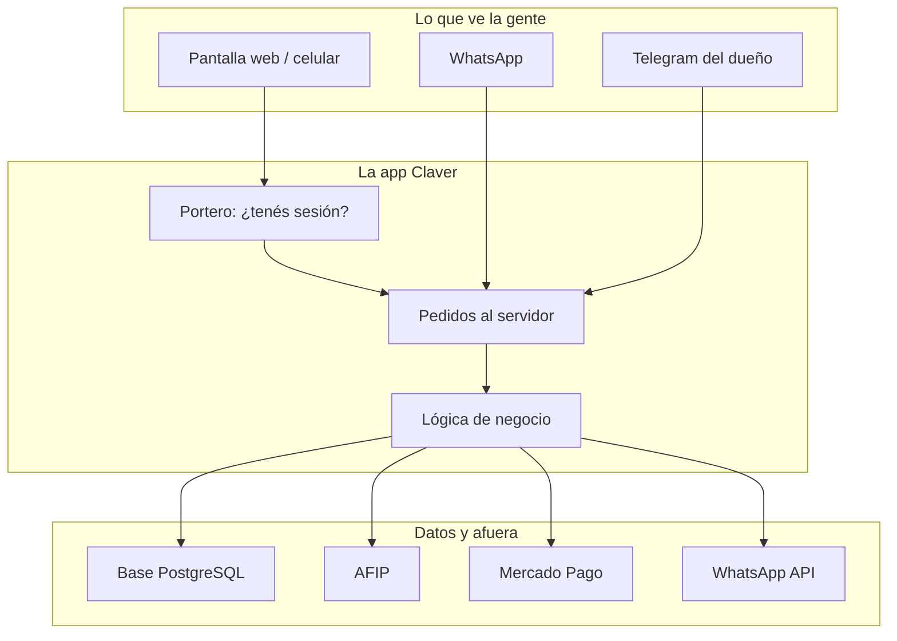
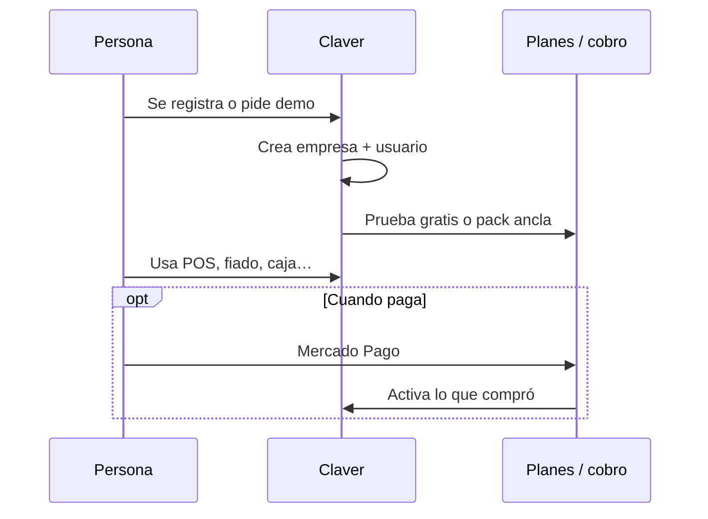
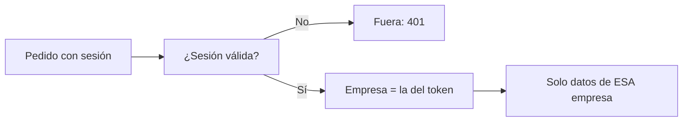
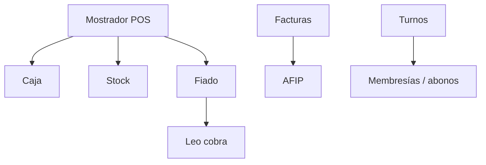

# Cómo funciona todo

Si solo tenés tiempo para **una** página técnica, es esta.

> **Idea clave:** cada comercio es un “departamento” cerrado. El login te da un pase (JWT) con el número de empresa. Todo lo que pedís después se filtra por ese número.

## 1. Las capas (como una hamburguesa)

## 2. Vida de un comercio nuevo

## 3. La regla de oro de seguridad

**Nunca** se devuelven datos de otro local. Si un desarrollador olvida filtrar por empresa, es un bug grave.

## 4. Qué módulos se hablan entre sí

## 5. Flujos para profundizar

| Si querés entender… | Andá a |
|---------------------|--------|
| Login y permisos | [Login y datos seguros](/dashboard/documentacion/room/flujo-auth-multitenant) |
| Vender en el local | [Mostrador](/dashboard/documentacion/room/flujo-pos-caja) |
| Fiado y WhatsApp | [Fiado y Leo](/dashboard/documentacion/room/flujo-fiado-leo) |
| Qué se paga | [Planes y SKUs](/dashboard/documentacion/room/flujo-billing-skus) |
| Factura fiscal | [AFIP](/dashboard/documentacion/room/flujo-afip) |
| Instalar un cliente | [Go-live](/dashboard/documentacion/room/flujo-go-live-cloud) |

## 6. Stack (solo lo útil)

| Capa | Tecnología | En criollo |
|------|------------|------------|
| Web | Next.js 15 | La app en el navegador |
| UI | Tailwind + shadcn | Botones y pantallas |
| Auth | JWT | Tu “pase” de sesión |
| Datos | Prisma + PostgreSQL | Tablas del negocio |
| País | es-AR, pesos, IVA | Hecho para Argentina |

Más detalle de código: [Arquitectura](/dashboard/documentacion/developer/arquitectura).
