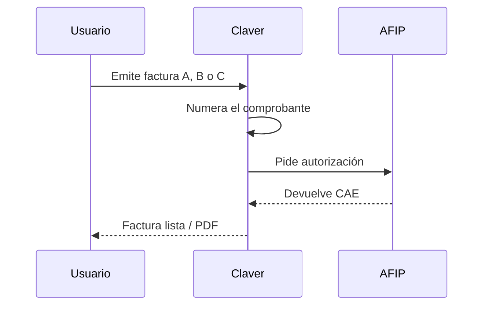
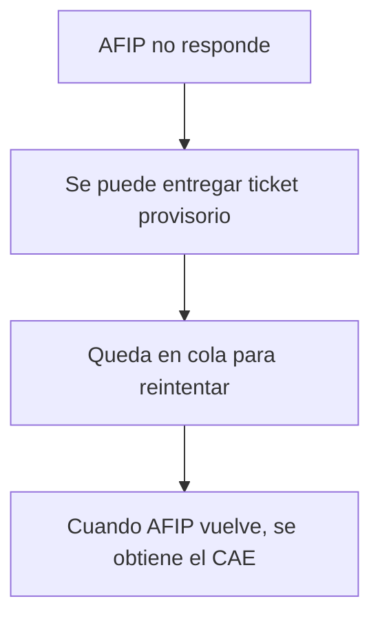

# Factura AFIP sin misterio

No todo ticket es factura. En Argentina el comercio elige:

- **Ticket interno** — control de caja, sin CAE.  
- **Factura electrónica** — AFIP autoriza con un código (CAE).

> En la demo casi siempre se usa homologación (ambiente de prueba). En producción va el certificado real del cliente.

## Camino de una factura

## Homologación vs producción

| Ambiente | Cuándo |
|----------|--------|
| **Homologación** | Demos, capacitación, pruebas |
| **Producción** | Cliente real facturando |

Para producción hace falta, entre otras cosas:

- Certificado digital del contribuyente  
- Punto de venta dado de alta  
- Numeración prolija (sin pisarse entre cajas)

## Si AFIP anda lento o caído

Ese diseño evita frenar la fila del local. Hay que validar el nivel de madurez en cada go-live.

## Checklist corto con el cliente

1. ¿Monotributo o responsable inscripto?  
2. ¿Necesita factura siempre o solo a veces?  
3. ¿Ya tiene certificado y punto de venta?  
4. ¿Quién entrena al cajero en el botón correcto?

Guía más larga: [AFIP en la wiki](/dashboard/documentacion/funcional/afip-integracion).
