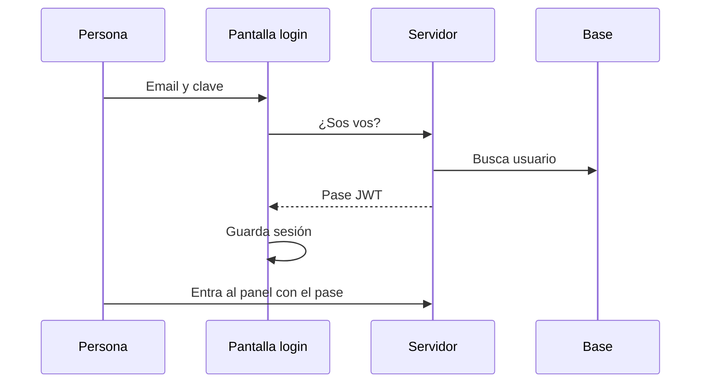
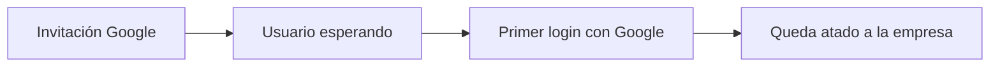
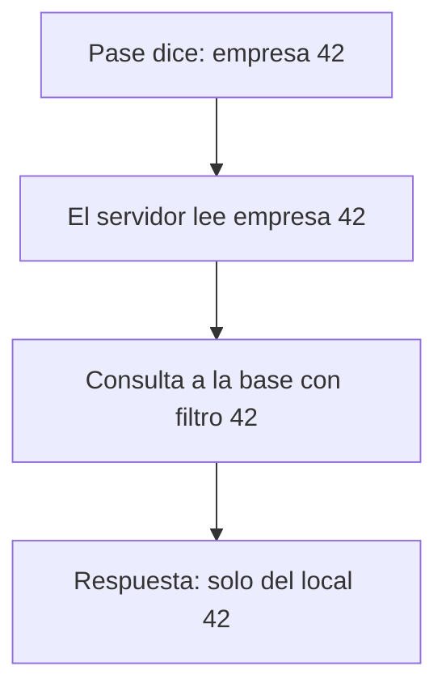

# Login y datos seguros

## En criollo

1. La persona se loguea.  
2. El sistema le da un **pase** (token) con su empresa y su rol.  
3. Cada pedido al servidor revisa ese pase.  
4. Solo se leen y escriben datos de **su** comercio.

> Si fallara este candado, no hay producto. Por eso es la primera regla de desarrollo.

## Cómo entra alguien

## Google (invitados)

Útil cuando el dueño invita empleados con Gmail:

No se puede “colarse” a una empresa solo con un número mágico.

## El filtro que no se negocia

## Roles y menú

| Rol típico | Ve sobre todo |
|------------|----------------|
| Dueño / admin | Todo el pack + usuarios |
| Cajero | POS, caja, clientes básicos |
| Contador (si aplica) | Impuestos / export |

El **rubro** del comercio también achica el menú (un kiosco no necesita pantalla de veterinaria).

Más técnico: [Multi-tenant](/dashboard/documentacion/developer/multi-tenant) · [Identidad](/dashboard/documentacion/developer/identity-and-access).
