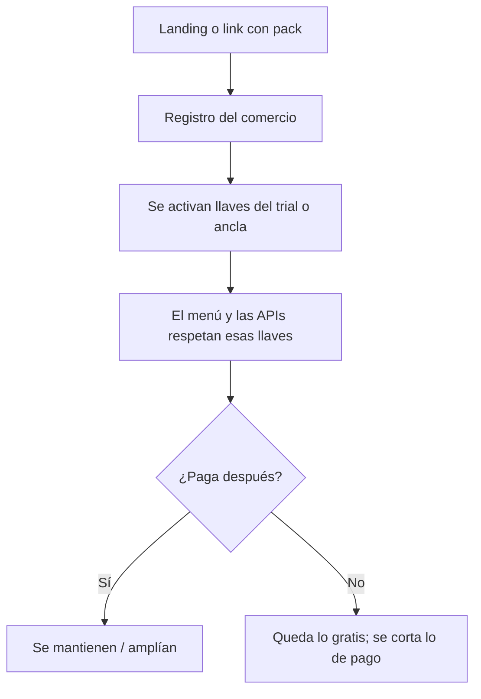
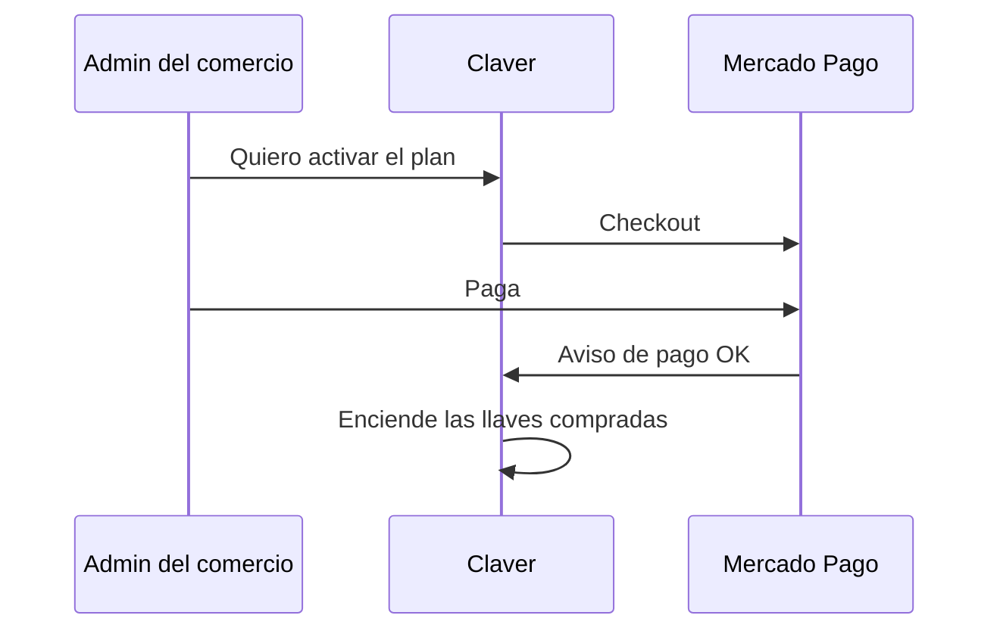
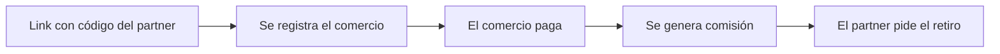

# Planes, trial y qué se activa

Pensalo como **llaves del tablero**:

- Algunas llaves se regalan para enganchar (ejemplo: libreta fiado).  
- Otras se prueban 7 o 14 días.  
- Otras se abren cuando Mercado Pago confirma el pago.

## Del click de “quiero probar” al uso

## Ancla gratis vs trial

| Tipo | Ejemplo | Qué pasa al vencer el trial |
|------|---------|------------------------------|
| **Ancla gratis** | Fiado de barrio | La libreta **sigue** |
| **Trial de pago** | POS completo 14 días | Se pide suscripción para seguir |

> Si vendés “fiado gratis para siempre”, el sistema no debería castigar al comercio borrándole la libreta cuando vence el POS de prueba.

## Pago de la suscripción Claver

Importante de producto: al pagar, hay que **activar de verdad** el producto (no solo anotar “pagó” en una tabla).

## Partners

Comisión **solo si hay pago real**. No es red de reclutamiento.

## Si una API dice “no tenés el pack”

Es normal: el endpoint de fiado, por ejemplo, exige la llave de fiado. El mensaje debería invitar a activar el plan, no solo fallar en silencio.
