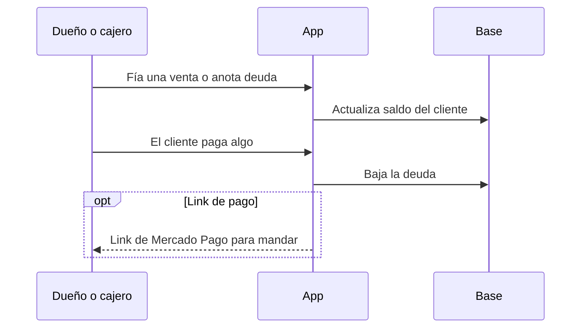
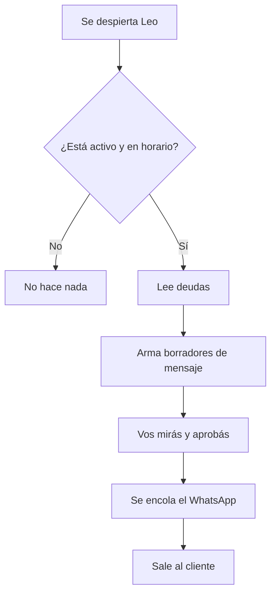

# Fiado y cobrar con Leo

El dolor de siempre: *“Me deben y no quiero pelearme por mensaje.”*

Claver tapa eso en dos capas:

1. **Libreta digital** — anotar y ver saldos.  
2. **Leo** — prepara mensajes de cobro; **vos aprobás** antes de mandar.

> Leo no es un robot suelto que escupe spam. Es un ayudante con freno de mano (aprobación humana).

## 1. La libreta

En la lista de deudores ves **quién debe y cuánto**, no un Excel eterno.

## 2. Leo en acción

## 3. Qué hace falta para que “sirva”

| Pieza | Por qué |
|-------|---------|
| Deudas cargadas de verdad | Si la libreta está vacía, Leo no tiene con qué trabajar |
| Leo activado | El pack / empleado digital tiene que estar on |
| WhatsApp configurado | Si no, queda en modo simulado o cola |
| Dueño que apruebe | Confianza y tono del barrio |
| Un recordatorio del sistema (cron) | Para que corra solo cada tanto |

## 4. Frase de venta (si lo explicás)

> “Cargás el fiado en dos toques. Leo te arma el WhatsApp amable. Vos tocás aprobar. Si cobrás un solo fiado viejo, el mes se paga solo.”

Más fondo: guía Leo en el repo (`docs/funcional/LEO_COBRANZA.md`) y canales WA/Telegram.
