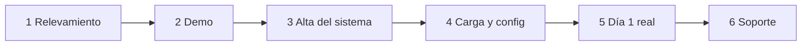
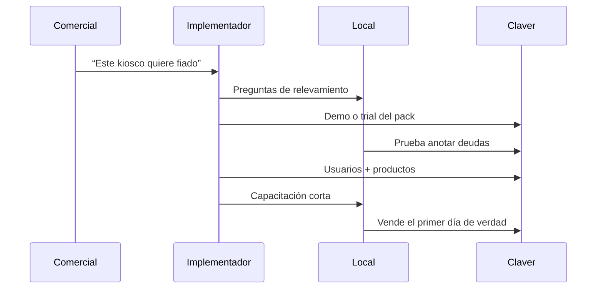
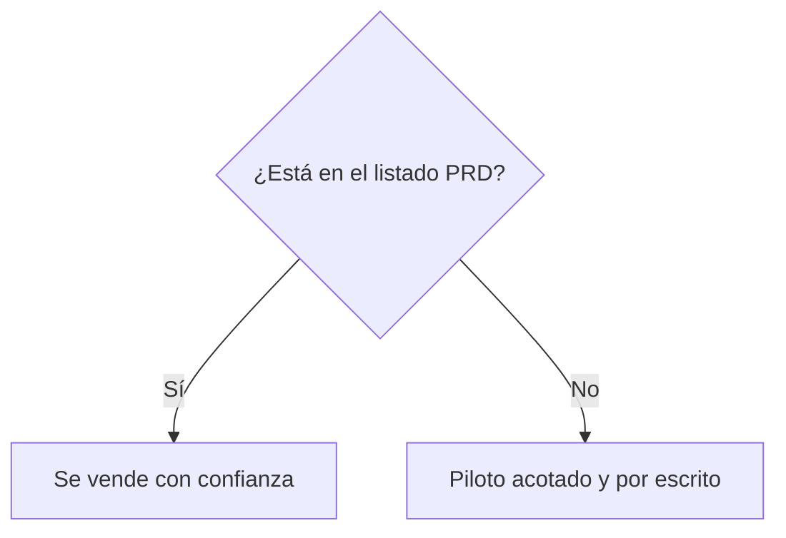

# Poner un cliente en marcha

Esto es para quien **implementa**: analista, partner o vos mismo con un piloto.

> **Regla de oro:** solo prometé como “listo” lo que está en packs PRD. El resto es piloto por escrito.

## Los 6 pasos

## Qué pasa en cada paso

| Paso | En criollo | Resultado |
|------|------------|-----------|
| **1 Relevamiento** | ¿Qué rubro? ¿Cuántas cajas? ¿AFIP? ¿Fiado? | Alcance claro |
| **2 Demo** | 15 minutos en *su* dolor | “Ah, esto me sirve” |
| **3 Alta** | Empresa, usuarios, pack | Entran con usuario propio |
| **4 Config** | Productos, clientes, formas de pago | Pueden operar |
| **5 Go-live** | Primer turno acompañado | Confianza |
| **6 Soporte** | Dudas y ajustes | No se sienten solos |

## Secuencia típica

## Qué vender y qué no

Ejemplos de promesa limpia:

- Sí: libreta fiado + POS de kiosco  
- Sí con setup: AFIP producción  
- No como “listo total”: telemetría de surtidores, 40 verticales mágicas  

## Salud del cliente (cuando algo “no anda”)

Revisá en este orden:

1. ¿Está logueado el usuario correcto?  
2. ¿El pack / llave está activa?  
3. ¿Caja abierta (si vende)?  
4. ¿AFIP / MP / WhatsApp configurados si ese flujo los usa?  

Runbooks detallados viven en `docs/claver-cloud/runbooks/`.
