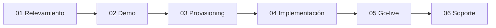
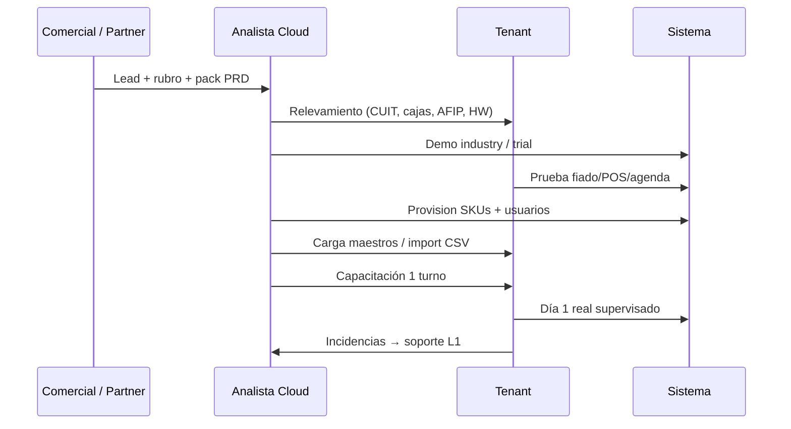
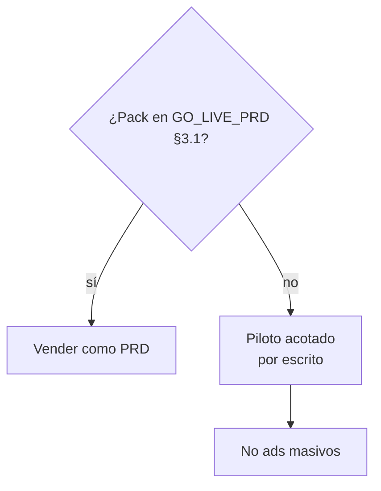
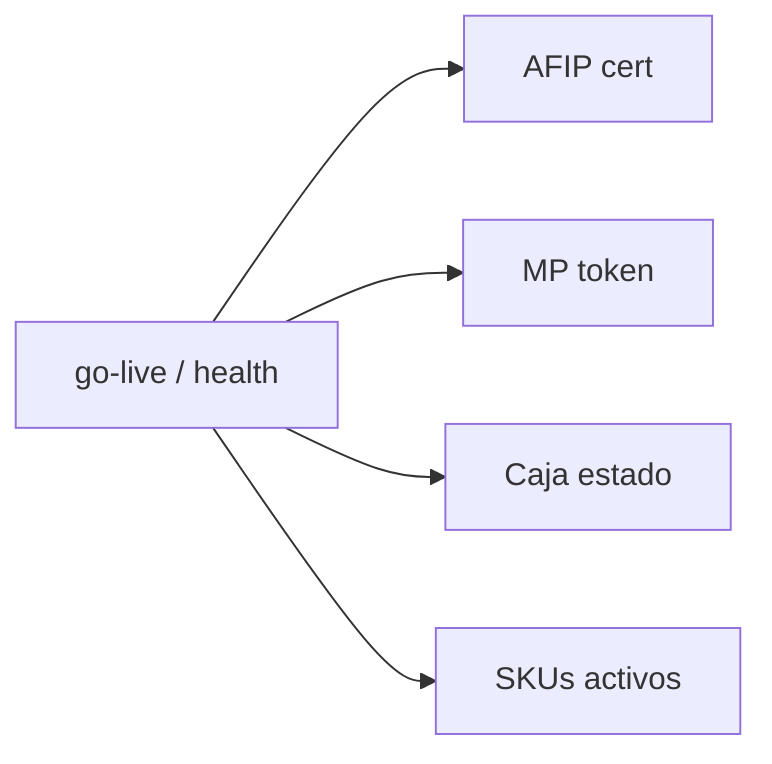

# Flujo: Go-live Claver Cloud

## Pipeline comercial → operación

## Detalle por etapa

## Solo packs PRD en promesa de venta

## Health del tenant

Runbooks: `docs/claver-cloud/runbooks/01` … `06` · [Proceso CCA](/dashboard/documentacion/operaciones/claver-cloud-proceso-implementacion).
