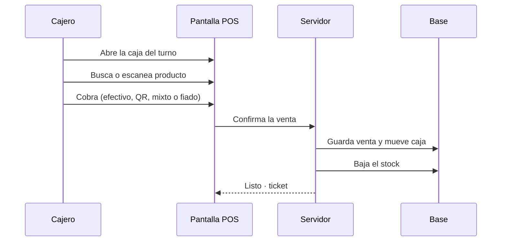
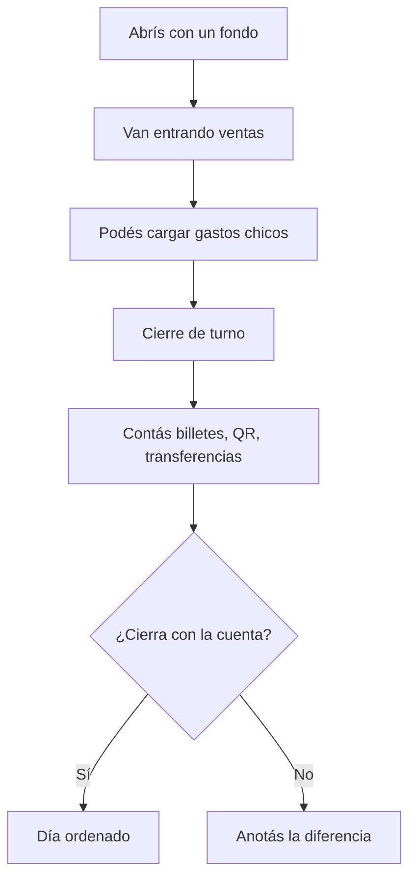
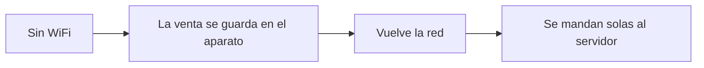
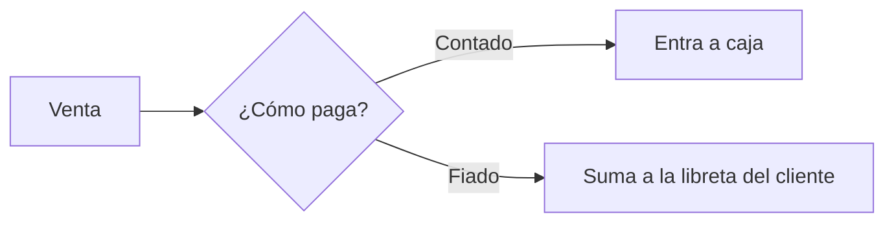

# Vender en el mostrador

Esto es lo que pasa cuando alguien dice: *“cobrame esto”*.

## El camino feliz

## Caja: abrir, vender, cerrar

> **Tip de implementación:** entrená el cierre el primer día. Si no cierran caja, el sistema “vende” pero el dueño no confía.

## Si se corta internet

Hay base para trabajar offline. En go-live serio hay que **probar** el escenario en ese local (no prometer magia sin prueba).

## Fiado desde el mismo mostrador

Seguí con: [Fiado y Leo](/dashboard/documentacion/room/flujo-fiado-leo) · detalle POS: [sistema-pos](/dashboard/documentacion/funcional/sistema-pos).
