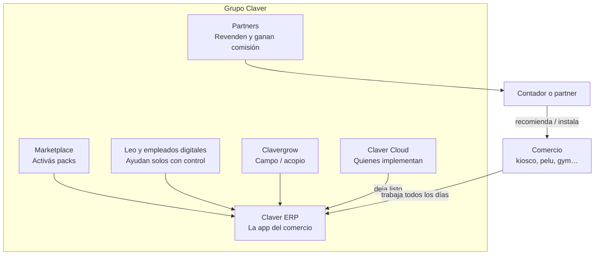

# ¿Qué es el Grupo Claver?

Pensalo como un **edificio con varios pisos**. No tenés que usar todos. Usás el piso que te resuelve el día.

> **En una frase:** el comercio opera en el ERP; Cloud lo pone en marcha; Leo le ayuda a cobrar; los partners lo revenden con comisión si el cliente paga.

## Foto del grupo

## Cada pieza, en criollo

| Pieza | ¿Para quién? | ¿Qué problema tapa? |
|-------|----------------|---------------------|
| **Claver ERP** | El dueño y el cajero | Vender, stock, fiado, caja, turnos, facturas |
| **Claver Cloud** | El equipo que implementa | De la venta al “ya está andando” |
| **Leo** | Dueños con gente que debe | Recordar y cobrar sin pelearse por WhatsApp |
| **Clavergrow** | Agro | Balanza, contratos, pizarra (otra línea) |
| **Marketplace** | Todos | Encender packs: fiado, cobrá, gym… |
| **Partners** | Quien trae clientes | Comisión **solo si el cliente paga** el producto |

## Lo que NO es (para no vender humo)

- No es magia de surtidores de nafta el día 1.
- No es “hacé una red tipo Amway”: se gana por **cliente que paga**, no por reclutar vendedores.
- No todos los rubros del menú están listos para venderse como “100% PRD”.

## ¿Qué leo después?

1. [Cómo funciona todo](/dashboard/documentacion/room/como-funciona-todo) — el mapa técnico simple  
2. [Qué necesitás para que ande](/dashboard/documentacion/room/requisitos-funcionamiento) — checklist  
3. [Poner un cliente en marcha](/dashboard/documentacion/room/flujo-go-live-cloud) — si implementás  
