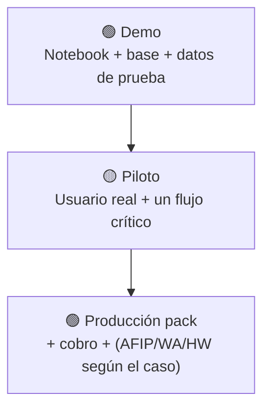
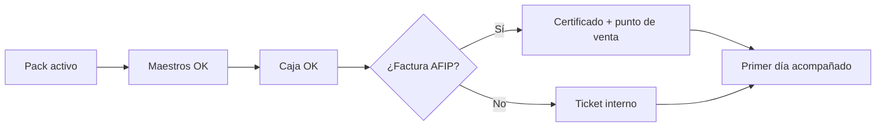

# Qué necesitás para que ande

No hace falta memorizar 40 variables de entorno. Usá este **semáforo**.

> **Truco:** si solo querés **mostrar** el sistema, con base de datos + demo alcanza. Si querés **cobrar y facturar de verdad**, sumás Mercado Pago, AFIP y (si aplica) WhatsApp.

## 1. De menor a mayor

## 2. Checklist demo (cualquiera puede)

| ¿Tenés…? | ¿Para qué? |
|----------|------------|
| Node y el repo | Correr la app |
| Base PostgreSQL | Guardar datos |
| Migraciones / seed o demo de rubro | Ver productos y clientes de ejemplo |
| Un usuario dueño | Entrar al panel |

## 3. Checklist piloto en un local real

| ¿Tenés…? | ¿Para qué? |
|----------|------------|
| Comercio creado con su CUIT | Identidad del tenant |
| Pack correcto (ej. fiado + POS) | Que vea lo que le vendiste |
| Productos y clientes cargados | Operar de verdad |
| Caja y formas de pago | Cerrar el día |
| 30–60 min de capacitación | Que no te llamen por “dónde está el botón” |

## 4. Checklist producción seria

| Capacidad | Qué sumar |
|-----------|-----------|
| Cobrar la suscripción Claver | Mercado Pago de la plataforma |
| Links de cobro a deudores | MP del comercio (o transferencia) |
| WhatsApp real | Twilio o Meta configurado |
| Factura electrónica | Certificado AFIP del cliente |
| Ticket rápido | Impresora térmica (opcional pero cambia la vida) |
| Leo automático | Crons + Leo activo + deudas cargadas |

## 5. Hardware: solo si el negocio lo pide

| Aparato | Cuándo tiene sentido |
|---------|----------------------|
| Celular o PC con Chrome | Siempre |
| Pistola de códigos | Kiosco / ferretería con muchos SKUs |
| Impresora de tickets | Fila de clientes |
| Balanza con etiqueta | Carnicería / fiambrería |
| Impresora fiscal | Cuando el contador lo exige |

## 6. Semáforo rápido

| Color | Significa |
|-------|-----------|
| 🟢 | Listo para el uso prometido |
| 🟡 | Funciona con salvedades (avisar al cliente) |
| 🔴 | No vender como listo (ej. surtidor IoT) |

## Seguí acá

- [Deploy](/dashboard/documentacion/operaciones/deploy-runbook)  
- [Go-live Cloud](/dashboard/documentacion/room/flujo-go-live-cloud)  
- [Cómo funciona todo](/dashboard/documentacion/room/como-funciona-todo)  
