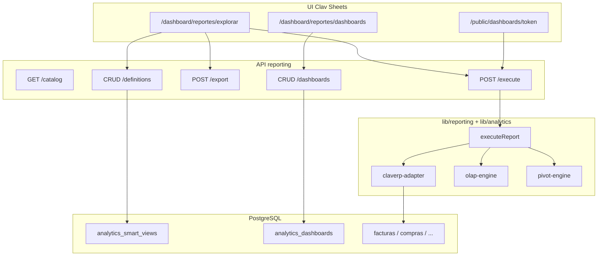

# Auditoría ClavERP — Analytics & Reporting

> **Fecha de referencia:** julio 2026  
> **Propósito:** inventario completo de lo construido en analytics/reporting, pensado para contexto de ChatGPT u otros asistentes sin omitir funciones.  
> **Repo:** `pos-system-argentina` (Next.js 15, Prisma, PostgreSQL multi-tenant)

---

## Resumen en una línea

Hay **dos motores** conviviendo:

1. **`lib/analytics/`** — KPIs financieros (VNR/MBR/ticket), OLAP SQL, RLS, auditoría de acceso
2. **`lib/reporting/` + UI Clav Sheets** — explorador drag-drop, pivot, gráficos, dashboards, plantillas, export Excel, embed público

Más un **ecosistema legacy** (`lib/kpis/`, estadísticas dashboard) que aún convive.

---

## 1. Base de datos (Prisma)

| Modelo | Tabla | Campos / propósito |
|--------|-------|-------------------|
| `AnalyticsSmartView` | `analytics_smart_views` | Reportes guardados: `codigo`, `nombre`, `tipoVista` (plano/pivot/grafico), `definicion` JSON, `connectorId`, `esPublica`, `esFavorita` |
| `AnalyticsDashboard` | `analytics_dashboards` | Dashboards: `layout` JSON, `widgets` JSON, `esDefault` |
| `ReporteCatalogoCampo` | — | Catálogo semántico persistido (seed desde código) |
| `ReporteAuditoriaAcceso` | — | Log de acceso a reportes: usuario, rol, filtros hash, acción, origen, éxito/error |

### `AnalyticsSmartView` (detalle)

- `empresaId`, `usuarioId?`, `codigo` (único por empresa), `nombre`, `descripcion?`
- `connectorId` default `"claverp"`
- `tipoVista`: `plano` | `pivot` | `grafico`
- `definicion`: JSON `ReportDefinition`
- `esPublica`, `esFavorita`

### `AnalyticsDashboard` (detalle)

- `empresaId`, `usuarioId?`, `nombre`, `descripcion?`
- `layout`: JSON grid `[{ i, x, y, w, h, smartViewId? }]` (hoy UI guarda `[]`)
- `widgets`: JSON `[{ id?, smartViewId, titulo, tipoGrafico? }]`
- `esDefault`

### `ReporteAuditoriaAcceso` (detalle)

- `reporteCodigo`, `reporteNombre`, `reporteCategoria`, `clasificacionCritica`
- `accion`: `view` | `export` | `print` | `schedule` | `api_read`
- `formatoExport?`, `periodoDesde?`, `periodoHasta?`
- `filtrosJson`, `filtrosHash` (SHA-256), `resultadoHash?`, `registrosDevueltos?`
- `origenModulo`, `origenRuta`, `origenTipo`: `ui` | `api` | `scheduled_job` | `bi_embed`
- `userAgent?`, `ipOrigen?`, `sessionId?`, `sucursalId?`, `duracionMs?`, `exito`, `errorCodigo?`

---

## 2. Capa `lib/analytics/` (motor analítico core)

### `kpi-engine.ts`

- **`calculateAnalyticsKpis(params)`** — calcula:
  - `ventasNetasReales` (VNR)
  - `margenBrutoDinero` / `margenBrutoPorcentaje` (MBR)
  - `ticketPromedioBruto` / `ticketPromedioNeto`
  - `countTransaccionesComerciales`
- **Parámetros:** `RoleContext`, rango fechas (`fechaDesde`, `fechaHasta`), `metodoCosto`: `"PPP"` | `"REPOSICION"`
- **Fuente:** facturas emitidas con tipos AFIP (1/6/11/201/206/211, ND, NC), filtradas por RLS
- **Implementación:** `findMany` + loop en memoria (no SQL agregado aún)
- **Filtro fecha:** `fechaCAE` entre desde/hasta

### `olap-engine.ts`

| Función | Descripción |
|---------|-------------|
| `shouldUseOlapTimeSeries(def)` | Detecta si un gráfico puede usar OLAP |
| `resolveOlapQuery(def, empresaId)` | Arma `TimeSeriesQuery` desde `ReportDefinition` |
| `queryTimeSeries(q)` | SQL con `generate_series` + gap-filling (PostgreSQL) |
| `timeSeriesToChartRows(points, ejeX, seriesKey)` | Convierte serie a filas de gráfico |

- **Fuentes OLAP:** `ventas`, `compras`
- **Medidas:** `total`, `subtotal`, `iva`, `cantidad`
- **Granularidad:** `day`, `month`
- **Nota:** ventas OLAP usa `createdAt`; KPIs usan `fechaCAE` (criterio distinto)

### `rls-guard.ts`

| Función | Descripción |
|---------|-------------|
| `rlsFacturas(ctx)` | Filtro multi-tenant + vendedor por `vendedorId` |
| `rlsClientes(ctx)` | Igual para clientes |
| `canViewCosts(ctx)` | Vendedor no ve costos |

- Rol `gerente_sucursal`: stub (`TODO` mapeo PV/sucursal)

### `audit-logger.ts`

- **`logReportAccess(params)`** — persiste en `ReporteAuditoriaAcceso` con SHA-256 de filtros
- **Acciones soportadas:** `view`, `export`, `print`, `schedule`, `api_read`
- No lanza error si falla el log (no bloquea el reporte)

### `tracking.ts`

- **`trackSubSaasSignup(slug, empresaId)`** — stub (`console.log`), llamado desde `app/api/auth/signup/route.ts`

---

## 3. Capa `lib/reporting/` (Clav Sheets / semantic layer)

### Semantic (`semantic/types.ts` + `catalog.ts`)

- Schema Zod **`ReportDefinition`**: filtros, dimensiones, medidas, pivot, chart, `camposPlano`, `limit`
- **Operadores filtro:** `eq`, `neq`, `gte`, `lte`, `gt`, `lt`, `in`, `contains`
- **Agregaciones:** `sum`, `count`, `avg`, `min`, `max`
- **Vistas:** `plano`, `pivot`, `grafico`
- **Gráficos:** `bar`, `line`, `pie`, `area`, `radar`, `scatter`

**`CLAVERP_SOURCES` (7 fuentes):**

| ID | Etiqueta |
|----|----------|
| `ventas` | Ventas (facturas) |
| `clientes` | Clientes |
| `productos` | Productos |
| `compras` | Compras |
| `stock_movimientos` | Movimientos de stock |
| `pedidos_venta` | Pedidos de venta |
| `contabilidad_mayor` | Libro Mayor |

- **`CLAVERP_CATALOG_SEED`** — ~40 campos semánticos
- **Funciones catálogo:** `seedReportCatalog()`, `getCatalog()`, `getCatalogField()`, `listCatalogFields()`, `assertFieldAllowed()`

### Conector (`connectors/claverp-adapter.ts`)

- **`fetchClaverpSource(empresaId, def)`** — switch por fuente:
  - `fetchVentas`
  - `fetchClientes`
  - `fetchProductos`
  - `fetchCompras`
  - `fetchStockMovimientos`
  - `fetchPedidosVenta`
  - `fetchContabilidadMayor`
- Límite default: **10.000 filas**
- Filtros fecha/estado/cliente/proveedor en `applyFiltersDate`
- Conectores distintos de `claverp` → error `Conector no implementado`

### Motor query (`engine/`)

| Archivo | Funciones |
|---------|-----------|
| `query-engine.ts` | **`executeReport(rawDef, empresaId, rol)`** — orquesta plano / pivot / gráfico + OLAP opcional |
| `pivot-engine.ts` | **`buildPivot(input)`** → `{ filas, columnas, celdas, totales }` |
| `aggregators.ts` | **`aggregateValue()`**, **`groupRows()`** |
| `drill-down-resolver.ts` | **`drillStackToFilters`**, **`mergeDefinitionWithDrill`**, **`buildTransactionalDetailDefinition`**, **`parseChartClick`**, **`parsePivotRowClick`**, **`pushDrillFilter`** |

**Flujo `executeReport`:**

1. Valida `ReportDefinition` con Zod
2. `assertFieldAllowed` por dimensión/medida/filtro/campo plano
3. `fetchClaverpSource` (Prisma)
4. Según `vista`:
   - **plano** → columnas + filas directas
   - **pivot** → `groupRows` + `buildPivot`
   - **grafico** → agregación + OLAP si aplica + `buildChartData`

### Persistencia

| Servicio | Funciones CRUD |
|----------|----------------|
| `definitions-service.ts` | `listReportDefinitions`, `getReportDefinition`, `createReportDefinition`, `updateReportDefinition`, `deleteReportDefinition` |
| `dashboards-service.ts` | `listDashboards`, `getDashboard`, `createDashboard`, `updateDashboard`, `deleteDashboard` |
| `restore-definition.ts` | **`restoreExplorerFromDefinition(def)`** — restaura estado explorador sin resetear pivot |

### Export

- **`buildExcelFromResult(result, titulo)`** (`export/excel-builder.ts`) — Excel multi-hoja con ExcelJS

### Entitlements (`sheets-entitlements.ts`)

| Función | Rol |
|---------|-----|
| `resolveSheetsTier` | Resuelve lite/pro por suscripción o feature `clav_sheets` |
| `getSheetsEntitlement` | Estado completo + uso mensual |
| `requireSheetsAccess` | Gate lectura |
| `requireSheetsExecute` | Gate ejecución |
| `requireSheetsExport` | Gate export |
| `requireSheetsSave` | Gate guardado (cuenta reportes existentes) |
| `trackSheetsUsage` | Registra `UsageEvent` |
| `ensureDemoSheetsSubscription` | Trial demo |
| `sheetsEntitlementStatus` | HTTP status según razón |
| `sheetsEntitlementPayload` | Body JSON para UI |

**SKUs y límites:**

| SKU | Tier | Execute/mes | Export/mes | Reportes guardados |
|-----|------|-------------|------------|-------------------|
| `sheets.lite` | lite | 500 | 20 | 3 |
| `sheets.pro` | pro | ∞ | ∞ | ∞ |

Precios catálogo: Lite $6.900 ARS, Pro $14.900 ARS.

Feature flag rubro: `CLAV_SHEETS` → `clav_sheets`

### Plantillas (`templates/`)

5 plantillas validadas con Zod al boot:

| ID | Nombre | Vista | Fuente | Tier mín |
|----|--------|-------|--------|----------|
| `ventas-mes-rubro` | Ventas por Mes y Rubro | pivot | ventas | lite |
| `top-clientes` | Top Clientes | grafico | ventas | lite |
| `stock-critico` | Stock Crítico | plano | productos | lite |
| `compras-proveedor` | Compras por Proveedor | pivot | compras | lite |
| `resumen-fiscal-iva` | Resumen Fiscal IVA | grafico | ventas | lite |

**Registry:**

- `listSheetTemplates()`
- `getSheetTemplate(id)`
- `getSheetTemplateOrThrow(id)`
- `resolveTemplateDefinition(template)` — refresca filtros de fecha relativos

**Helpers fecha:** `filtrosAnioActual()`, `filtrosUltimosMeses(meses)`

---

## 4. APIs REST

### Analytics

| Ruta | Método | Función |
|------|--------|---------|
| `/api/analytics/kpis` | GET | KPIs VNR/MBR/ticket + `logReportAccess` |

**Query params:** `desde`, `hasta`, `metodoCosto` (`PPP` | `REPOSICION`)

### Reporting (auth JWT + `whereEmpresa`)

| Ruta | Métodos | Función |
|------|---------|---------|
| `/api/reporting/catalog` | GET | Catálogo campos por `fuente` |
| `/api/reporting/execute` | POST | Ejecuta `ReportDefinition` + metering `execute` |
| `/api/reporting/export` | POST | Excel desde definición + metering `export` |
| `/api/reporting/definitions` | GET, POST | Listar / crear SmartViews |
| `/api/reporting/definitions/[id]` | GET, DELETE | Leer / borrar |
| `/api/reporting/dashboards` | GET, POST | Listar / crear dashboards |
| `/api/reporting/dashboards/[id]` | GET, PATCH, DELETE | CRUD dashboard |
| `/api/reporting/dashboards/[id]/share` | POST | JWT público `public_viewer` para embed |
| `/api/reporting/templates` | GET | Lista plantillas |
| `/api/reporting/templates/[id]` | GET | Plantilla + definición resuelta |
| `/api/reporting/templates/[id]/preview` | POST | Preview con datos reales |
| `/api/reporting/entitlement` | GET, POST | Estado plan; POST `trial` / `activate` (admin) |

**POST `/api/reporting/definitions` body:** `codigo`, `nombre`, `descripcion?`, `connectorId?`, `tipoVista`, `definicion`, `publico?`

**POST `/api/reporting/entitlement` actions:**

- `trial` — `ensureDemoSheetsSubscription` (tier lite o pro)
- `activate` — `upsertSuscripcion` con `sheets.lite` o `sheets.pro`

### Público (token `Public Bearer`)

| Ruta | Método | Función |
|------|--------|---------|
| `/api/public/reporting/dashboards` | GET | Layout/widgets del dashboard |
| `/api/public/reporting/definitions/[id]` | GET | Definición de reporte |
| `/api/public/reporting/execute` | POST | Ejecuta solo si `smartViewId` pertenece al dashboard del token |

### Fiscal con auditoría analytics

| Ruta | Uso |
|------|-----|
| `/api/reportes/fiscal/libro-iva-ventas` | `logReportAccess` + `rlsFacturas` |

---

## 5. UI (páginas)

| Ruta | Funcionalidad |
|------|---------------|
| `/dashboard/reportes` | Hub: tabs reportes guardados + dashboards; eliminar; upsell si sin plan |
| `/dashboard/reportes/explorar` | Explorador completo (ver §6) |
| `/dashboard/reportes/explorar?load={id}` | Abrir reporte guardado |
| `/dashboard/reportes/explorar?template={id}` | Cargar plantilla |
| `/dashboard/reportes/plantillas` | Galería plantillas + preview + activar trial |
| `/dashboard/reportes/dashboards/nuevo` | Crear dashboard |
| `/dashboard/reportes/dashboards/[id]` | Editar dashboard, widgets, share, iframe |
| `/public/dashboards/[token]` | Viewer público sin login |

**Sidebar:** feature key `clav_sheets` → entradas "Clav Sheets" y "Plantillas Sheets"

---

## 6. Explorador (`/dashboard/reportes/explorar`)

### Funciones UI

- **Drag & drop** (`@dnd-kit`): campos → filas / columnas / valores / plano
- **3 vistas:** plano, pivot, gráfico (`ViewToggle`)
- **6 tipos gráfico:** bar, line, pie, area, radar, scatter
- **FilterBar:** filtros manuales
- **Drill-down:**
  - Clic en celda pivot (fila / col / celda)
  - Clic en celda plano
  - Clic en gráfico
  - `DrillBreadcrumb` — navegación niveles
  - Botón **"Ver detalle transaccional"** → `DrillDownModal` (hasta 500 filas)
- **Ejecutar** → POST `/api/reporting/execute`
- **Exportar Excel** → POST `/api/reporting/export`
- **Guardar** → POST `/api/reporting/definitions`
- **Entitlement gating:** `SheetsUpsellDialog` si límite execute / export / save
- **GlobalSlicers:** fechas globales + cross-filters como badges

### Handlers drill (explorar)

- `handlePivotRowDrill`, `handlePivotColDrill`, `handlePivotCellDrill`
- `handlePlanoDrill`, `handleChartDrill`
- `openTransactionalDetail` → `buildTransactionalDetailDefinition` + execute

---

## 7. Dashboards BI

### Funciones UI (`/dashboard/reportes/dashboards/[id]`)

- Agregar widget desde SmartViews guardados
- Tipos widget: `kpi` (si `tipoVista === "plano"`) o `chart`
- **`DashboardWidget`:** carga definición → inyecta filtros globales + cross-filters → ejecuta → render `KpiCard` o `ReportChartPanel`
- Drill en widget: cross-filter al clickear gráfico (`addCrossFilter`)
- **Compartir:** token JWT + URL `/public/dashboards/{token}` + snippet iframe
- Grid responsive CSS; `layout` se persiste como `[]` (sin react-grid-layout aún)
- Modo edición: agregar / quitar widgets, renombrar, guardar PATCH

### Viewer público (`/public/dashboards/[token]`)

- GET dashboard vía `/api/public/reporting/dashboards`
- Widgets ejecutan con `Public Bearer` en execute/definitions

---

## 8. Componentes (`components/reporting/`)

| Componente | Función |
|------------|---------|
| `FieldExplorer` | Panel campos + zonas drop (`resolveDropZone`) |
| `FilterBar` | Editor filtros |
| `ViewToggle` | Plano / pivot / gráfico |
| `ReportPlanoTable` | Tabla con drill en celdas |
| `ReportPivotGrid` | Pivot con drill fila/col/celda |
| `ReportChartPanel` | Recharts + drill |
| `DrillBreadcrumb` | Migas drill |
| `DrillDownModal` | Modal detalle transaccional |
| `KpiCard` | Tarjeta KPI con loading |
| `DashboardWidget` | Widget embebido en dashboard |
| `GlobalSlicers` | Filtros fecha + cross-filters |
| `SheetsUpsellDialog` | Monetización / upgrade |
| `SheetsLockedState` | Pantalla bloqueada sin plan |
| `TemplateGalleryCard` | Card plantilla |
| `TemplatePreviewDialog` | Preview plantilla |
| `TemplatePreviewResult` | Render resultado preview |

---

## 9. Hooks y stores

| Archivo | Exporta |
|---------|---------|
| `hooks/use-sheets-entitlement.ts` | `useSheetsEntitlement()` → entitled, tier, usage, plans, refresh |
| `hooks/use-drill-down.ts` | `useDrillDown()` — drill + detalle transaccional (hook completo; explorar usa lógica inline equivalente) |
| `lib/stores/dashboard-bi-store.ts` | `globalDesde`, `globalHasta`, `sucursalId`, `crossFilters` + setters |
| `lib/stores/report-builder-store.ts` | Estado builder + **`buildDefinitionFromBuilder()`** (store creado, **no cableado a ninguna página aún**) |

---

## 10. Tests (Vitest)

| Archivo | Cubre |
|---------|-------|
| `__tests__/analytics/olap-engine.test.ts` | OLAP time series |
| `__tests__/analytics/drill-down-resolver.test.ts` | Drill resolver |
| `__tests__/reporting/pivot-engine.test.ts` | Pivot |
| `__tests__/reporting/restore-definition.test.ts` | Restaurar definición |
| `__tests__/reporting/sheets-entitlements.test.ts` | Entitlements |
| `__tests__/reporting/templates-registry.test.ts` | Plantillas |
| `__tests__/reporting/template-preview.test.ts` | Preview |

---

## 11. Ecosistema relacionado (no Clav Sheets, convive en el ERP)

| Pieza | Qué hace |
|-------|----------|
| `lib/kpis/kpi-service.ts` + `/dashboard/kpis` | Tablero KPI ejecutivo legacy (DSO, morosidad, snapshots) |
| `/api/kpis` | API KPIs legacy |
| `lib/impuestos/estadisticas-service.ts` + `/api/estadisticas/dashboard` | Dashboard operativo Recharts |
| `lib/export/export-service.ts` + `/api/export` | Export CSV multi-entidad |
| `lib/reportes/plantillas-service.ts` | Plantillas HTML `{{variable}}` (módulo viejo) |
| `lib/ai/agents/reportes-agent.ts` | Reportes narrativos IA (cron) |
| `@vercel/analytics` en `app/layout.tsx` | Analytics de tráfico web Vercel (no producto BI) |

**No construido aún (producto "Clav Analytics" monetizable):**

- `/dashboard/analytics`
- `lib/analytics/metrics-registry.ts`
- `GET /api/analytics/metrics`
- `POST /api/analytics/query`
- SKU `analytics.starter` / `analytics.pro`

---

## 12. Diagrama de flujo



**Paralelo analytics core:**

```
GET /api/analytics/kpis
  → rlsFacturas(RoleContext)
  → calculateAnalyticsKpis
  → logReportAccess
```

---

## 13. Inventario de funciones exportadas (checklist)

### `lib/analytics/`

- `calculateAnalyticsKpis`
- `shouldUseOlapTimeSeries`, `resolveOlapQuery`, `queryTimeSeries`, `timeSeriesToChartRows`
- `rlsFacturas`, `rlsClientes`, `canViewCosts`
- `logReportAccess`
- `trackSubSaasSignup`

### `lib/reporting/` engine

- `executeReport`
- `buildPivot`, `aggregateValue`, `groupRows`
- `drillStackToFilters`, `mergeDefinitionWithDrill`, `buildTransactionalDetailDefinition`
- `parseChartClick`, `parsePivotRowClick`, `pushDrillFilter`

### `lib/reporting/` servicios

- Definitions CRUD (5)
- Dashboards CRUD (5)
- `restoreExplorerFromDefinition`
- `buildExcelFromResult`
- `fetchClaverpSource` (+ 7 fetch internos)
- Catálogo (6 funciones)
- Entitlements (10 funciones)
- Templates registry (4 funciones)

### Stores / hooks

- `useSheetsEntitlement`
- `useDrillDown`
- `buildDefinitionFromBuilder`
- `useDashboardBiStore` (8 acciones de estado)

---

## 14. Archivos clave por carpeta

```
lib/analytics/
  audit-logger.ts
  kpi-engine.ts
  olap-engine.ts
  rls-guard.ts
  tracking.ts

lib/reporting/
  connectors/claverp-adapter.ts
  definitions-service.ts
  dashboards-service.ts
  restore-definition.ts
  sheets-entitlements.ts
  export/excel-builder.ts
  engine/query-engine.ts
  engine/pivot-engine.ts
  engine/aggregators.ts
  engine/drill-down-resolver.ts
  semantic/types.ts
  semantic/catalog.ts
  templates/registry.ts
  templates/definitions/*.ts

app/api/analytics/kpis/route.ts
app/api/reporting/**/*
app/api/public/reporting/**/*

app/dashboard/reportes/**
app/public/dashboards/[token]/page.tsx

components/reporting/**
hooks/use-sheets-entitlement.ts
hooks/use-drill-down.ts
lib/stores/dashboard-bi-store.ts
lib/stores/report-builder-store.ts
```

---

## 15. Documentación relacionada en el repo

| Archivo | Contenido |
|---------|-----------|
| `docs/ARQUITECTURA_CLAV_SHEETS.md` | Arquitectura Clav Sheets, FODA vs competencia |
| `docs/MONETIZACION_REPORTES_BI.md` | Monetización, roadmap Clav Analytics |
| `content/docs/funcional/` | Docs usuario (si aplica) |

---

*Generado como inventario funcional del estado del código. No lista gaps ni bugs; para eso ver conversación de auditoría técnica o `docs/qa/`.*