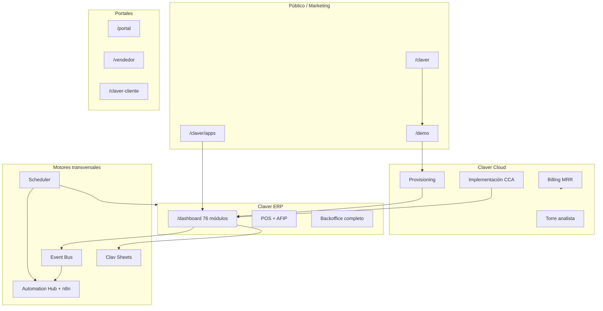

# Auditoría Grupo Claver — Inventario completo construido

> **Fecha:** julio 2026  
> **Repo:** `pos-system-argentina` (monolito Next.js 15)  
> **Propósito:** documento de contexto para ChatGPT / IAs — **qué existe**, sin omitir zonas ni módulos principales.  
> **Complemento:** gaps y bugs en `docs/AUTO_AUDITORIA_INTEGRAL_GRUPO_CLAVER.md`

---

## Resumen ejecutivo

**Grupo Claver** es un ecosistema SaaS argentino empaquetado en un solo monolito:

| Pilar | Qué es | Rutas base |
|-------|--------|------------|
| **Marketing / Grupo** | Landings, marketplace apps, SEO | `/claver/*` |
| **Claver (ERP)** | POS + backoffice 40+ módulos | `/dashboard/*` |
| **Claver Cloud** | Torre analista: provisioning, CCA, billing | `/claver-cloud/*` |
| **Sub-SaaS / Nicho** | Apps verticales empaquetadas | `/claver/apps/*`, `/dashboard/nicho/*` |
| **Portales** | B2B, vendedor ruta, stakeholder, público | `/portal`, `/vendedor`, `/claver-cliente`, `/public/*` |
| **Comercial** | Demos industria, trial, activación SKU | `/demo/*`, `/login` |
| **Automatización** | Hub n8n + virtual workers + crons | `/dashboard/automatizacion`, `/api/cron/*` |
| **Reporting** | Clav Sheets (BI self-service) | `/dashboard/reportes/*` |

**Escala del código (aprox.):**

- **478** rutas API (`app/api/**/route.ts`)
- **91** carpetas de dominio en `lib/`
- **76** módulos de dashboard (`app/dashboard/*`)
- **23** apps de nicho LATAM (`lib/niche/niche-apps-catalog.ts`)
- **11** Sub-SaaS empaquetados (`lib/comercial/sub-saas-catalog.ts`)
- **12** crons (`app/api/cron/*`)

---

## Stack técnico

| Capa | Tecnología |
|------|------------|
| Framework | Next.js 15 App Router, TypeScript strict |
| UI | Tailwind v4, shadcn/ui, Framer Motion, Recharts |
| Estado | Zustand + SWR |
| Auth | JWT (jose), middleware, `useAuthStore` |
| DB | Prisma → PostgreSQL (Supabase) |
| Tests | Vitest |
| Cola jobs | BullMQ (opcional, `REDIS_URL`) + in-process fallback |
| Scheduler | GitHub Actions → `/api/cron/dispatch` (tier free) |
| Locale | es-AR, ARS, CUIT, IVA 21%, AFIP |

---

## Mapa de sitio (zonas)

### 1. Raíz y acceso

| Ruta | Función |
|------|---------|
| `/` | Redirect a login o dashboard |
| `/login` | Auth JWT |
| `/login/register` | Registro empresa + usuario |
| `/offline` | Página offline PWA |
| `/demo` | Listado demos industria |
| `/demo/[industryId]` | Demo vertical con seed |

### 2. Grupo Claver — Marketing (`/claver`)

| Ruta | Función |
|------|---------|
| `/claver` | Hub grupo (`ClaverMatrixHub`) |
| `/claver/apps` | Marketplace Sub-SaaS |
| `/claver/apps/[slug]` | Landing producto empaquetado |
| `/claver/claverp` | Landing ERP flagship |
| `/claver/claverp/modulos` | Catálogo módulos |
| `/claver/claverp/precios` | Precios |
| `/claver/claverp/conexiones` | Integraciones |
| `/claver/claverp/ecommerce` | Ecommerce ERP |
| `/claver/claverp/[slug]` | Landings verticales |
| `/claver/clavergrow` | Línea agro |
| `/claver/ecommerce` | Línea ecommerce |
| `/claver/almacen-rosario` | Pack vertical almacén |
| `/claver/marca` | Brand guide |
| `/claver/contacto` | Contacto comercial |
| `/claver/legales` | Legales |

**Líneas de negocio** (`lib/marketing/claver-services-catalog.ts`): Claver Cloud, Claver (ERP), Clavergrow, Claver Fiado, Clavernet, Claver Logistics, Claver AI, Clav Analytics, Legacy Bridge, Servicios a medida.

### 3. Claver Cloud — Torre (`/claver-cloud`)

| Ruta | Función |
|------|---------|
| `/claver-cloud` | Command center |
| `/claver-cloud/provisioning` | Órdenes de alta tenant |
| `/claver-cloud/provisioning/new` | Nueva empresa |
| `/claver-cloud/implementation` | Proyectos CCA |
| `/claver-cloud/implementation/[id]` | Tablero implementación |
| `/claver-cloud/operations` | Flota tenants |
| `/claver-cloud/operations/[empresaId]` | Ops por tenant |
| `/claver-cloud/operations/reports` | Reportes ops |
| `/claver-cloud/billing` | MRR / suscripciones |
| `/claver-cloud/marketplace` | SKUs marketplace |
| `/claver-cloud/organizations` | Organizaciones |
| `/claver-cloud/tenants/[empresaId]` | Vista tenant |
| `/claver-cloud/superadmin` | Super admin |
| `/claver-cloud/settings` | Config torre |
| `/claver-cloud/settings/assignments` | Asignaciones analistas |
| `/claver-cloud/comercial` | Pipeline comercial |
| `/claver-cloud/comercial/campo` | Vendedor en calle |
| `/claver-cloud/comercial/relevamientos` | Relevamientos |
| `/claver-cloud/protheus-api` | Legacy Bridge API |
| `/claver-cloud/protheus-setup` | Setup Protheus |
| `/claver-cloud/opo-console` | OPO / ontología |
| `/claver-cloud/registros` | Registros sistema |

**Servicios ops** (`lib/ops/`): command-center, implementación CCA, tenant-admin, comercial-pipeline, backoffice-madurez, tenant-lifecycle, ops-notificaciones, provisioning.

### 4. Dashboard ERP (`/dashboard`)

**76 carpetas de módulo.** Sidebar organizado en secciones (`lib/dashboard/sidebar-modules.ts`):

| Sección sidebar | Módulos / rutas destacadas |
|-----------------|---------------------------|
| Principal | Dashboard home, Mis Tareas |
| Claver Nicho | Apps nicho LATAM, App Store |
| Clavergrow | Agro: balanza, contratos, liquidaciones, pizarra, lotes, IoT, cannabis, CPE, portal productor |
| Compras | Facturas compra, proveedores, remitos |
| Ventas | POS, Almacén Rosario, cierre X/Z, facturación, pedidos, presupuestos, clientes, LTV, fiado, listas precio, NC/ND, facturación recurrente |
| Stock | Productos, inventario, transferencias, ajustes, movimientos |
| Financiero | Caja, banco, cuenta partida, CxC, CxP, cheques, cashflow, presupuesto, MercadoPago |
| Contabilidad | Asientos, plan cuentas, balances, períodos, activos fijos, centros costo, inflación |
| Fiscal / Impuestos | IVA, IIBB, padrón, TES, presentación AFIP, PV, series, CITI |
| Servicios / Rubro | Toma pedidos, KDS, mesas, delivery, cartelera, platos, agenda, peluquería, HC, membresías, veterinaria |
| Canales externos | Portal B2B, app vendedor ruta |
| Onboarding | Onboarding IA por rubro |
| IA | Asistente IA, OPO Studio |
| Logística | Envíos, transportistas, distribución, POD |
| Industria | OP, BOM, corte textil, talleres, MRP, calidad, mantenimiento |
| Préstamos | Panel, pagarés, ruteo cobranza |
| Concesionaria | Stock vehículos, CRM leads, revendedores |
| Importación | ROI CIF, embarques |
| Reventas TikTok | Margen flash, links pago, stock viral |
| Picking | Listas, control armado, tablet |
| IoT | Dispositivos, telemetría, alertas |
| Gestión comercial | CRM, aprobaciones, KPIs, Clav Sheets, alertas |
| RRHH | Empleados, liquidación sueldos |
| Capacitación | Manual, parametrización, diagnóstico, documentación |
| Claver interno | Links a torre (analista) |
| Configuración | Parámetros, apariencia, automatización, cotizaciones, soporte, usuarios, tablas, auditoría |

**Filtros sidebar:** `featureKey`, `permisoModulo`, `allowedRubros`, `skuKey`, `claverAnalystOnly`, `requiredCountryFeature`.

### 5. Portales y apps externas

| Ruta | Función |
|------|---------|
| `/portal` | Portal B2B clientes |
| `/portal-proveedores` | Portal proveedores |
| `/vendedor` | App vendedor en ruta (offline sync) |
| `/claver-cliente` | Portal stakeholder |
| `/claver-cliente/tickets`, `/scrum`, `/facturas` | Subpáginas stakeholder |
| `/tienda`, `/tienda/[slug]` | Tienda B2B pública |
| `/ecommerce` | Landing ecommerce (duplicada con `/claver/ecommerce`) |
| `/menu/[empresaId]` | Menú QR público |
| `/agenda-online` | Agenda pública |
| `/display` | Pantalla display/KDS externo |
| `/public/dashboards/[token]` | Dashboard BI embed público |
| `/modulos` | Landing módulos |
| `/marketing` | Marketing legacy |
| `/clavernet` | Portal partners (marketplace devs) |
| `/clavernet/dashboard`, `/marketplace`, `/docs` | Subzonas Clavernet |

### 6. Dashboard analista embebido

| Ruta | Función |
|------|---------|
| `/dashboard/claver/operaciones` | Vista flota |
| `/dashboard/claver/implementaciones` | Implementaciones |
| `/dashboard/claver/asignaciones` | Asignaciones |
| `/dashboard/claver/reportes` | Reportes torre |

---

## Dominios de negocio (`lib/` — 91 carpetas)

### Core ERP

| Carpeta | Responsabilidad |
|---------|-----------------|
| `ventas`, `pos`, `producto`, `stock`, `compras` | Ciclo comercial y stock |
| `caja`, `banco`, `cc-cp`, `cobros`, `pagos`, `cheques`, `tesoreria` | Tesorería y cobranzas |
| `contabilidad`, `costos`, `presupuesto` | GL, PPP, presupuesto |
| `impuestos`, `fiscal`, `afip`, `qr-afip`, `arba` | Fiscal AR (IVA, IIBB, AFIP, CAE) |
| `facturacion` | Emisión comprobantes |
| `fiado` | Libreta fiado / crédito barrio |

### Verticales

| Carpeta | Responsabilidad |
|---------|-----------------|
| `agro` | Acopio, cannabis, CPE, IoT campo |
| `hospitalidad` | Mesas, KDS, delivery, recetas |
| `agenda`, `historia-clinica`, `veterinaria`, `membresias` | Servicios / salud / gym |
| `industria`, `picking`, `logistica`, `mantenimiento`, `calidad` | Industria y logística |
| `consorcios`, `niche` | Apps nicho LATAM |
| `almacen-rosario` | Pack vertical almacén |

### Plataforma y comercial

| Carpeta | Responsabilidad |
|---------|-----------------|
| `auth`, `config`, `platform`, `billing`, `provisioning` | Multi-tenant, SKUs, suscripciones |
| `comercial` | Sub-SaaS, demos industria, trial, activación, funnel |
| `marketplace` | Marketplace SKUs y provision |
| `marketing` | Brand, landings, catálogo servicios |
| `onboarding` | Onboarding IA por rubro |
| `ops`, `claver-cloud`, `soporte` | Torre analista, tickets, CCA |
| `scheduling` | Dispatcher crons (GitHub Actions / premium) |

### Integraciones

| Carpeta | Responsabilidad |
|---------|-----------------|
| `mercadopago`, `mercadolibre`, `woocommerce`, `shopify`, `tiendanube` | Pagos y ecommerce |
| `whatsapp`, `telegram`, `email` | Mensajería |
| `legacy-bridge`, `opo` | Protheus / ontología |
| `integrations` | Catálogo integraciones |
| `iot` | IoT industrial |

### IA, reporting, automatización

| Carpeta | Responsabilidad |
|---------|-----------------|
| `ai` | Agentes IA, alertas, reportes narrativos |
| `analytics` | KPI engine, OLAP, RLS, audit |
| `reporting` | Clav Sheets (semantic layer, pivot, dashboards) |
| `automation` | Hub n8n, virtual workers, playbooks, poll |
| `reportes` | Plantillas HTML legacy |
| `kpis` | Tablero KPI ejecutivo legacy |
| `events` | Event bus (contabilidad, stock, automation) |

### Otros

| Carpeta | Responsabilidad |
|---------|-----------------|
| `crm`, `rrhh`, `aprobaciones`, `alertas`, `dashboard` | Gestión y UI shell |
| `export`, `printer`, `documentos` | Export e impresión |
| `stores` | Zustand (auth, caja, UI, BI) |
| `generative` | Contenido generativo |
| `monitoring` | Observabilidad parcial |

---

## Sub-SaaS empaquetados (11 apps)

Fuente: `lib/comercial/sub-saas-catalog.ts` — landings `/claver/apps/[slug]`

| Slug | Marca | SKU principal |
|------|-------|---------------|
| `cobra` | Claver Cobrá | Cobranzas WhatsApp |
| `fiado` | Claver Fiado | `pos.fiado_barrio` |
| `turnos` | Claver Turnos | Agenda / turnos |
| `tienda` | Claver Tienda | Tienda B2B |
| `presupuestos` | Claver Presupuestos | Presupuestos |
| `menu-qr` | Claver Menú | Menú QR |
| `contenido-ia` | Claver Contenido | IA marketing |
| `bot-wa` | Claver Bot WA | Bot WhatsApp |
| `stock` | Claver Stock | Alertas stock |
| `puntos` | Claver Puntos | Fidelización |

Cada app define: `modoLite`, `dashboardPath`, `publicPath`, `trialDias`, `procesosReciclados`, `serviciosBackend`, scores comerciales.

---

## Apps de nicho LATAM (23)

Fuente: `lib/niche/niche-apps-catalog.ts` — rutas `/dashboard/nicho/[appId]`

Motores: `consorcio`, `cuotas`, `movimientos`, `libreta`, y variantes por vertical.

Ejemplos: Consorcios, Club, Feria, Prestamista, Obras, Gimnasio, Veterinaria, Canchas, y más.

**Provision:** `lib/niche/niche-provision.ts` — activa SKU + config por app.

---

## Ciclo comercial y monetización

### Flujo construido

```
Marketing (/claver) → Demo (/demo) → Registro/Trial → Provisioning (Cloud)
→ Onboarding rubro → Dashboard ERP → Upsell SKUs → Billing MRR
```

### Servicios clave (`lib/comercial/`, `lib/platform/`)

| Servicio | Función |
|----------|---------|
| `industry-demo-service` | Seed demo por industria |
| `retail-onboarding-service` | Onboarding retail |
| `activar-producto-service` | Activación SKU post-login |
| `trial-guard` / `trial-service` | Control trial |
| `comercial-funnel-service` | Funnel eventos |
| `ventas-consulta-service` | Consultas ventas |
| `commercial-service` | SKUs, `SuscripcionModulo`, `UsageEvent` |
| `sheets-entitlements` | Clav Sheets lite/pro |
| `entitlements` (platform) | Gates por módulo (automation, etc.) |

### SKUs destacados

- ERP base, módulos horizontales (`pos.*`, `sheets.lite`, `sheets.pro`)
- Nicho (`niche.*`), Sub-SaaS, packs (`almacen-rosario`)
- Automation (`automation.n8n_hub`)
- Seguridad / datos (`sec.*`, `data.*`) — catálogo con implementación variable
- Legacy Bridge (`bridge.*`)

---

## Automatización (NOP Automation Hub)

### Componentes

| Pieza | Ubicación |
|-------|-----------|
| Event bus → n8n | `lib/automation/event-subscriber.ts`, `n8n-bridge.ts` |
| 15+ eventos NOP | `lib/automation/events-catalog.ts` |
| Virtual workers | `lib/automation/virtual-worker-runner.ts` |
| Playbooks | `lib/automation/playbook-runner.ts` |
| Cola saliente | `lib/automation/outbound-queue.ts` (BullMQ o in-process) |
| Modo poll (firewall) | `lib/automation/poll-buffer.ts`, `GET/POST /api/automation/poll` |
| UI wizard | `/dashboard/automatizacion`, `components/automation/*` |
| Plantillas n8n | `docs/automation/n8n-templates/` (9 JSON) |

### APIs automation

- `/api/automation/config`, `events`, `executions`, `catalog`, `seed`, `test`
- `/api/automation/playbooks/[key]/run`
- `/api/automation/actions/*` (create-task, create-user-virtual, trigger-playbook)
- `/api/automation/webhooks/inbound`
- `/api/automation/poll`

### Crons programados (`app/api/cron/`)

| Ruta | Función |
|------|---------|
| `/api/cron/dispatch` | **Dispatcher único** (tier free: GitHub Actions) |
| `/api/cron/automation-virtual-workers` | Playbooks locales |
| `/api/cron/agentes` | Agentes IA programados |
| `/api/cron/sync-afip` | CAE pendientes |
| `/api/cron/enviar-whatsapp` | Cola WhatsApp |
| `/api/cron/ops-alertas` | Alertas torre |
| `/api/cron/recordatorios` | Turnos agenda |
| `/api/cron/ia-diaria` | IA diaria (premium tier) |
| `/api/cron/cobranzas-ia` | Cobranzas IA (premium) |
| `/api/cron/generative` | Contenido generativo |
| `/api/cron/almacen-rosario` | Pack almacén |
| `/api/cron/premium-intangibles` | Servicios intangibles |

**Scheduler:** `lib/scheduling/` — registry, dispatcher, dedup `CronRunLedger`, workflow `.github/workflows/cron-dispatcher.yml`.

---

## Reporting y analytics

### Clav Sheets (principal BI self-service)

- Explorador drag-drop: `/dashboard/reportes/explorar`
- Dashboards: `/dashboard/reportes/dashboards/[id]`
- Plantillas: 5 verticales + galería
- Export Excel, embed público, entitlements lite/pro
- Detalle completo: `docs/AUDITORIA_ANALYTICS_REPORTING.md`

### Analytics core

- `GET /api/analytics/kpis` — VNR, MBR, ticket
- OLAP series tiempo (ventas/compras)
- Tablero legacy: `/dashboard/kpis` (`lib/kpis/`)

---

## AFIP y fiscal (Argentina)

| Componente | Ubicación |
|------------|-----------|
| WSAA / WSFE / CAE | `lib/afip/` |
| Emisión factura API | `/api/afip/emitir-factura` |
| Sync pendientes | `/api/cron/sync-afip`, `lib/afip/sync-pendientes.ts` |
| QR fiscal | `lib/qr-afip/` |
| IVA / IIBB / TES | `lib/impuestos/` |
| Pre-presentación | `/dashboard/impuestos/pre-presentacion` |
| Libro IVA | APIs fiscal + reporting |

---

## Auth y multi-tenant

| Pieza | Función |
|-------|---------|
| `lib/auth/empresa-guard.ts` | `getAuthContext`, `whereEmpresa` |
| `middleware.ts` | Protección rutas |
| JWT en header `Authorization: Bearer` | APIs |
| Roles | admin, cajero, vendedor, contador, analista, etc. |
| Feature flags | `lib/config/rubro-config-service.ts` |
| Permisos módulo | Por rol en sidebar |

---

## Event bus

`lib/events/event-bus.ts` + handlers:

- Contabilidad automática (ventas, compras, NC)
- Stock (actualización, alertas)
- Costos PPP
- CC/CP, cheques
- Automation → n8n bridge

Bootstrap: `lib/events/bootstrap.ts`

---

## Agentes IA

`lib/ai/agents/` — registry de agentes con schedules cron:

- Alertas stock, reportes narrativos, cobranzas, etc.
- Cron: `/api/cron/agentes`
- UI: `/dashboard/ia`, `/dashboard/agentes`
- OPO Studio: integración ontología (`opo/`, `/claver-cloud/opo-console`)

---

## APIs — panorama

**478 endpoints** bajo `app/api/`, agrupados por dominio:

| Prefijo | Dominio |
|---------|---------|
| `/api/afip/*` | Facturación electrónica |
| `/api/ventas/*`, `/api/compras/*`, `/api/productos/*` | ERP core |
| `/api/caja/*`, `/api/banco/*`, `/api/cuentas-*` | Finanzas |
| `/api/contabilidad/*`, `/api/impuestos/*` | Contabilidad e impuestos |
| `/api/agro/*`, `/api/hospitalidad/*` | Verticales |
| `/api/comercial/*` | Sub-SaaS, activación, funnel |
| `/api/claver/*`, `/api/claver-cloud/*` | Torre y admin |
| `/api/automation/*` | Hub n8n |
| `/api/reporting/*` | Clav Sheets |
| `/api/analytics/*` | KPIs analytics |
| `/api/cron/*` | Jobs programados |
| `/api/onboarding/*` | Onboarding y demos |
| `/api/billing/*` | Facturación SaaS |
| `/api/public/*` | Endpoints públicos (dashboards, menú) |
| `/api/config/*` | Configuración tenant |
| +40 prefijos más | Nicho, IoT, integraciones, etc. |

Patrón estándar API: `getAuthContext()` + `whereEmpresa(empresaId)`.

---

## UI transversal

| Componente | Función |
|------------|---------|
| `components/command-palette.tsx` | Paleta comandos global |
| `components/mobile-bottom-nav.tsx` | Nav móvil |
| `components/trial-banner.tsx` | Banner trial |
| `components/theme-customizer-panel.tsx` | Temas OKLCH |
| `hooks/use-dashboard-shell.ts` | Shell dashboard |
| Sidebar + filtros rubro | `lib/dashboard/sidebar-filters.ts` |
| i18n | next-intl (parcial) |

---

## Tests (`__tests__/`)

Cobertura por dominio (no exhaustiva):

- `automation/` — n8n, poll, playbooks, virtual workers
- `reporting/` — pivot, entitlements, templates
- `analytics/` — OLAP, drill-down
- `scheduling/` — dispatcher
- `comercial/` — trial, sub-saas, activación
- `brand/`, `impuestos/`, `contabilidad/`, `ops/`, `woocommerce/`, etc.

---

## Documentación en repo

| Documento | Contenido |
|-----------|-----------|
| `docs/AUTO_AUDITORIA_INTEGRAL_GRUPO_CLAVER.md` | Auditoría gaps/UX/bugs (jul 2026) |
| `docs/AUDITORIA_GRUPO_CLAVER.md` | Este inventario |
| `docs/AUDITORIA_ANALYTICS_REPORTING.md` | Detalle Clav Sheets + analytics |
| `docs/marketplace/` | Ciclo comercial, runbooks, packs |
| `docs/claver-cloud/runbooks/` | 01-relevamiento → 06-soporte |
| `docs/operaciones/` | CCA, superadmin, roadmap backoffice |
| `docs/automation/` | NOP Automation Hub, n8n templates |
| `docs/comercial/` | Prompts Gemini GTM, sub-saas |
| `Agents.md` | Guía para IAs (stack, patrones) |
| `introspeccion.md` | Estado módulos ERP |

---

## Diagrama ecosistema



---

## Qué NO incluye este documento

Este archivo es **inventario de lo construido**. Para:

- **Bugs pendientes** → `docs/BUGS_REPORT.md`, `docs/AUTO_AUDITORIA_INTEGRAL_GRUPO_CLAVER.md` §7-8
- **Gaps producto** (trial, MFA, backup, etc.) → `AUTO_AUDITORIA` §4-6
- **Roadmap sprints** → `docs/operaciones/ROADMAP-BACKOFFICE-SPRINTS.md`

---

*Última actualización: julio 2026 — generado desde estado del repo `pos-system-argentina`.*