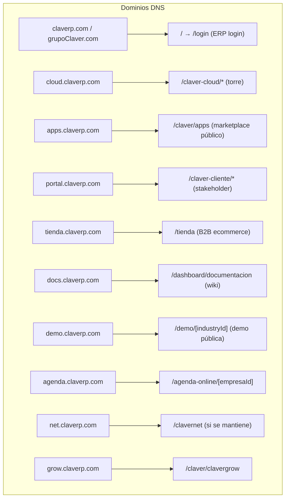
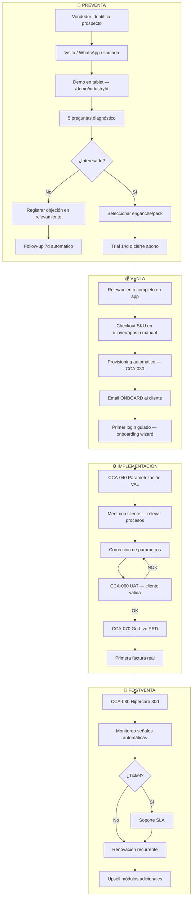
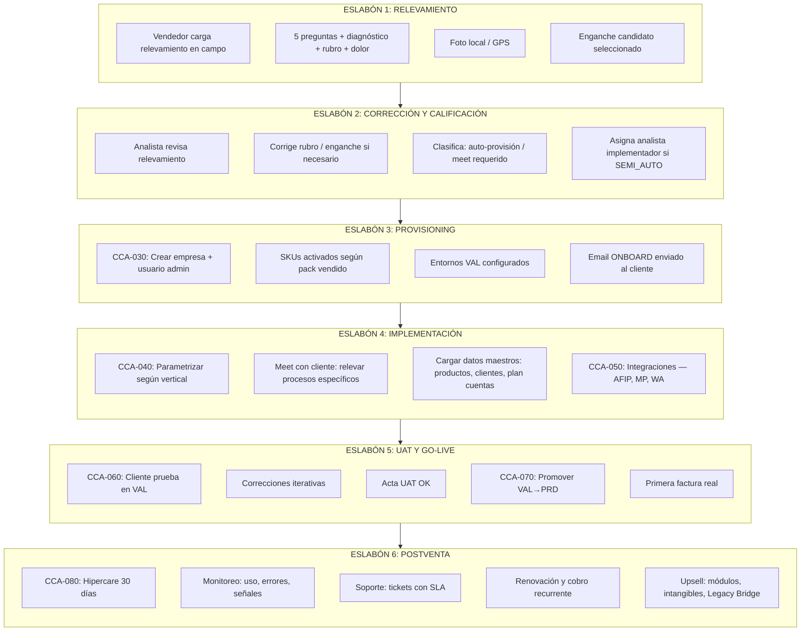

# AUTO-AUDITORÍA INTEGRAL — GRUPO CLAVER
> **Fecha:** 2026-07-03  
> **Auditor:** IA Arquitecto Senior (modo auditor detección errores)  
> **Alcance:** Todo el ecosistema Grupo Claver — ERP, Mini-SaaS, Claver Cloud, portales, marketing  
> **Propósito:** Archivo de referencia para que cualquier IA o humano audite, corrija y evolucione el producto  
> **Estado:** Snapshot completo del entorno en producción/desarrollo

---

## ÍNDICE

1. [Mapa de Sitio y Jerarquía de Páginas](#1-mapa-de-sitio)
2. [Diagrama DNS / Subdominios Propuestos](#2-dns-subdominios)
3. [Auditoría UX/UI por Zona](#3-auditoria-ux-ui)
4. [Auditoría de Procesos Funcionales](#4-procesos-funcionales)
5. [Proceso de Venta Completo — Correcciones](#5-proceso-venta)
6. [Claver Cloud — Proceso por Eslabón](#6-claver-cloud-eslabones)
7. [Errores Técnicos Pendientes](#7-errores-tecnicos)
8. [Bugs de Producto y Feature Gaps](#8-bugs-producto)
9. [Checklist Experiencia Admin Demo](#9-admin-demo)
10. [Plan de Corrección Priorizado](#10-plan-correccion)

---

## 1. MAPA DE SITIO Y JERARQUÍA DE PÁGINAS {#1-mapa-de-sitio}

### Árbol completo de rutas (estado actual del código)

```mermaid
flowchart TB
  ROOT["/ (raíz)"] --> LOGIN["/login"]
  ROOT --> CLAVER["/claver"]
  ROOT --> CLOUD["/claver-cloud"]
  ROOT --> DASH["/dashboard"]
  ROOT --> PORTAL["/portal"]
  ROOT --> VENDEDOR["/vendedor"]
  ROOT --> DEMO["/demo"]
  ROOT --> TIENDA["/tienda"]
  ROOT --> ECOM["/ecommerce"]
  ROOT --> CNET["/clavernet"]
  ROOT --> AGOL["/agenda-online"]
  ROOT --> DISPLAY["/display"]
  ROOT --> MKT["/marketing"]
  ROOT --> MODULOS["/modulos"]
  ROOT --> CLIENTEP["/claver-cliente"]
  ROOT --> OFFLINE["/offline"]

  subgraph GRUPO_CLAVER["🏢 GRUPO CLAVER (público/marketing)"]
    CLAVER --> CL_APPS["/claver/apps"]
    CLAVER --> CL_ERP["/claver/claverp"]
    CLAVER --> CL_GROW["/claver/clavergrow"]
    CLAVER --> CL_ECOM["/claver/ecommerce"]
    CLAVER --> CL_ALM["/claver/almacen-rosario"]
    CLAVER --> CL_MARCA["/claver/marca"]
    CL_ERP --> CL_ERP_MOD["/claver/claverp/modulos"]
    CL_ERP --> CL_ERP_PREC["/claver/claverp/precios"]
    CL_ERP --> CL_ERP_CON["/claver/claverp/conexiones"]
    CL_ERP --> CL_ERP_ECOM["/claver/claverp/ecommerce"]
    CL_ERP --> CL_ERP_SLUG["/claver/claverp/[slug]"]
  end

  subgraph TORRE["☁️ CLAVER CLOUD (torre admin/analista)"]
    CLOUD --> CC_PROV["/claver-cloud/provisioning"]
    CLOUD --> CC_IMP["/claver-cloud/implementation"]
    CLOUD --> CC_OPS["/claver-cloud/operations"]
    CLOUD --> CC_MKT["/claver-cloud/marketplace"]
    CLOUD --> CC_BILL["/claver-cloud/billing"]
    CLOUD --> CC_ORG["/claver-cloud/organizations"]
    CLOUD --> CC_TENANT["/claver-cloud/tenants/[empresaId]"]
    CLOUD --> CC_SUPER["/claver-cloud/superadmin"]
    CLOUD --> CC_SET["/claver-cloud/settings"]
    CLOUD --> CC_PROTO["/claver-cloud/protheus-api"]
    CLOUD --> CC_PROTOS["/claver-cloud/protheus-setup"]
    CLOUD --> CC_OPO["/claver-cloud/opo-console"]
    CLOUD --> CC_COM["/claver-cloud/comercial"]
    CC_PROV --> CC_PROV_NEW["/claver-cloud/provisioning/new"]
    CC_IMP --> CC_IMP_ID["/claver-cloud/implementation/[id]"]
    CC_OPS --> CC_OPS_ID["/claver-cloud/operations/[empresaId]"]
    CC_OPS --> CC_OPS_REP["/claver-cloud/operations/reports"]
    CC_COM --> CC_COM_CAMP["/claver-cloud/comercial/campo"]
    CC_COM --> CC_COM_REL["/claver-cloud/comercial/relevamientos"]
    CC_SET --> CC_SET_ASG["/claver-cloud/settings/assignments"]
  end

  subgraph ERP["📊 DASHBOARD ERP (74 módulos)"]
    DASH --> D_HOME["/ (home dashboard)"]
    DASH --> D_VENTAS["/ventas"]
    DASH --> D_COMPRAS["/compras"]
    DASH --> D_PROD["/productos"]
    DASH --> D_CAJA["/caja"]
    DASH --> D_BANCO["/banco"]
    DASH --> D_CONTA["/contabilidad"]
    DASH --> D_IMP["/impuestos"]
    DASH --> D_HOSP["/hospitalidad"]
    DASH --> D_AGENDA["/agenda"]
    DASH --> D_FIADO["/fiado"]
    DASH --> D_NICHO["/nicho"]
    DASH --> D_AGRO["/agro"]
    DASH --> D_POS["/pos"]
    DASH --> D_CXC["/cuentas-cobrar"]
    DASH --> D_CXP["/cuentas-pagar"]
    DASH --> D_LOGIST["/logistica"]
    DASH --> D_PICK["/picking"]
    DASH --> D_INDUST["/industria"]
    DASH --> D_MEMB["/membresias"]
    DASH --> D_HC["/historia-clinica"]
    DASH --> D_VET["/veterinaria"]
    DASH --> D_PELQ["/peluqueria"]
    DASH --> D_CONCES["/concesionaria"]
    DASH --> D_CRM["/crm"]
    DASH --> D_IA["/ia"]
    DASH --> D_REPORT["/reportes"]
    DASH --> D_ONBOARD["/onboarding"]
    DASH --> D_CONFIG["/configuracion"]
    DASH --> D_USERS["/usuarios"]
    DASH --> D_SOPORTE["/soporte"]
    DASH --> D_DOCS["/documentacion"]
    DASH --> D_CAPAC["/capacitacion"]
    DASH --> D_ALERTAS["/centro-alertas"]
    DASH --> D_CONEX["/conexiones"]
    DASH --> D_CLAVER_INT["/claver/*"]
    D_VENTAS --> D_VENTAS_PRES["/ventas/presupuestos"]
    D_VENTAS --> D_VENTAS_PED["/ventas/pedidos"]
    D_NICHO --> D_NICHO_APP["/nicho/[appId]"]
    D_CONTA --> D_CONTA_PC["/contabilidad/plan-cuentas"]
    D_CONTA --> D_CONTA_BAL["/contabilidad/balance"]
    D_CONTA --> D_CONTA_PER["/contabilidad/periodos"]
    D_CONTA --> D_CONTA_AF["/contabilidad/activos-fijos"]
    D_CONTA --> D_CONTA_CC["/contabilidad/centros-costo"]
    D_HOSP --> D_HOSP_KDS["/hospitalidad/kds"]
    D_CAPAC --> D_CAPAC_MAN["/capacitacion/manual-usuario"]
    D_CAPAC --> D_CAPAC_PAR["/capacitacion/parametrizacion"]
    D_CAPAC --> D_CAPAC_DIA["/capacitacion/diagnostico"]
    D_REPORT --> D_REPORT_PL["/reportes/plantillas"]
    D_REPORT --> D_REPORT_EX["/reportes/explorar"]
    D_AGRO --> D_AGRO_BAL["/agro/balanza"]
    D_AGRO --> D_AGRO_IOT["/agro/iot"]
    D_AGRO --> D_AGRO_CAN["/agro/cannabis"]
    D_AGRO --> D_AGRO_CON["/agro/contratos"]
    D_CONFIG --> D_CONFIG_AUD["/configuracion/auditoria"]
    D_CONFIG --> D_CONFIG_APA["/configuracion/apariencia"]
  end
```



### Hallazgos de jerarquía

| # | Problema | Severidad | Corrección |
|---|---------|-----------|-----------|
| H-001 | `/` hace redirect client-side con JS. Si JS falla, página en blanco | 🟠 ALTO | Usar `redirect()` de Next.js server-side en `page.tsx` o `middleware.ts` |
| H-002 | `/modulos` existe como ruta pero su propósito no es claro vs `/claver/claverp/modulos` | 🟡 MEDIO | Unificar o redirigir a `/claver/claverp/modulos` |
| H-003 | `/ecommerce` (raíz) y `/claver/ecommerce` y `/claver/claverp/ecommerce` — 3 rutas para lo mismo | 🟠 ALTO | Canonical → `/claver/ecommerce`, 301 desde las otras |
| H-004 | `/tienda` como ruta pública sin layout ni protección — solo page.tsx | 🟡 MEDIO | Evaluar si es la tienda del cliente final; si sí, necesita layout y auth |
| H-005 | `/display` es una pantalla suelta sin navegación (¿KDS externo?) | 🟢 BAJO | Documentar propósito, agregar comment en código |
| H-006 | `/clavernet` tiene su propio layout/dashboard/marketplace, duplicando funcionalidad de `/claver` y `/claver-cloud` | 🟠 ALTO | Definir si Clavernet es el portal de partners. Si es obsoleto, deprecar |
| H-007 | `/claver-cliente` sin subrutas listadas — portal stakeholder sin subpáginas | 🟡 MEDIO | Necesita al menos: `/tickets`, `/scrum`, `/facturas` como rutas explícitas |
| H-008 | `/dashboard/claver/operaciones` duplica información de `/claver-cloud/operations` | 🟡 MEDIO | Uno debería ser redirect al otro |
| H-009 | 74 subdirectorios en `/dashboard` — sidebar sobredimensionado para la demo | 🟠 ALTO | Feature flags por rubro deben ocultar módulos no relevantes en demo |
| H-010 | `/dashboard/capacitacion` existe pero no aparece en el Command Palette | 🟡 MEDIO | Agregar al ROUTES array |

---

## 2. DNS / SUBDOMINIOS PROPUESTOS {#2-dns-subdominios}

### Estructura DNS recomendada para producción



### Hallazgos DNS/Routing

| # | Problema | Severidad | Corrección |
|---|---------|-----------|-----------|
| DNS-001 | Todas las rutas corren en un solo Next.js monolito. No hay separación DNS hoy | 🟡 INFO | OK para MVP. Para escala: usar `next.config.js` rewrites o subdominios Vercel |
| DNS-002 | No existe `robots.txt` ni `sitemap.xml` para las páginas de marketing (`/claver/*`) | 🟠 ALTO | Generar `app/robots.ts` y `app/sitemap.ts` con rutas públicas |
| DNS-003 | `/claver` no tiene `metadata` SEO apropiado en layout | 🟡 MEDIO | Agregar `metadata` en `app/claver/layout.tsx` |
| DNS-004 | `/login` no tiene redirect si ya autenticado | 🟠 ALTO | Si token válido → redirect a `/dashboard` |
| DNS-005 | No hay middleware protegiendo `/claver-cloud/*` — depende de client-side auth check | 🔴 CRÍTICO | Agregar guard en `middleware.ts` para rutas `/claver-cloud/*` |

---

## 3. AUDITORÍA UX/UI POR ZONA {#3-auditoria-ux-ui}

### 3.1 Landing Grupo Claver (`/claver`)

| # | Problema UX/UI | Severidad | Corrección |
|---|---------------|-----------|-----------|
| UX-001 | La landing `/claver` carga `ClaverMatrixHub` — componente correcto, pero sin CTA claro "Probar gratis" arriba del fold | 🟠 ALTO | Hero con CTA primario → `/demo/almacen` o `/login?trial=14` |
| UX-002 | No hay testimonios ni logos de clientes actuales | 🟡 MEDIO | Agregar sección social proof con métricas reales |
| UX-003 | `/claver/apps` marketplace — filtros excelentes, pero las cards no tienen estado "ya activo" para usuario logueado | 🟡 MEDIO | Si hay token, mostrar badge "Activo" en SKUs del tenant |
| UX-004 | `/claver/claverp` landing del ERP — no se diferencia claramente de `/claver` | 🟠 ALTO | `claverp` = página producto ERP completo. `claver` = hub grupo. Unificar mensaje |
| UX-005 | La navegación entre `/claver`, `/claver/claverp`, `/claver/clavergrow` no tiene breadcrumb ni tabs | 🟡 MEDIO | Agregar tabs en `ClaverShell` para navegar entre líneas |

### 3.2 Dashboard ERP (`/dashboard`)

| # | Problema UX/UI | Severidad | Corrección |
|---|---------------|-----------|-----------|
| UX-010 | Sidebar con 74 módulos: un almacén de barrio ve "IoT Industrial", "Cannabis", "Picking" | 🔴 CRÍTICO | El feature flag por rubro DEBE ocultar módulos irrelevantes. Hoy el sidebar es inmanejable para demo |
| UX-011 | `layout.tsx` tiene 1120 líneas — monolito de UI que dificulta cambios | 🟠 ALTO | Refactorizar: extraer `SidebarNavigation`, `SidebarSection`, `SidebarItem` |
| UX-012 | No hay empty states con CTA en módulos desactivados | 🟡 MEDIO | Si el usuario llega a `/dashboard/industria` sin SKU → mostrar "Activar módulo" en lugar de tabla vacía |
| UX-013 | El Command Palette no tiene accesos directos a acciones de Claver Cloud para el analista | 🟡 MEDIO | Si `rol === 'analista'`, agregar grupo "Admin Cloud" en palette |
| UX-014 | La página `/dashboard` (home) tiene 65KB (65298 bytes) — renderizado excesivo | 🟠 ALTO | Lazy load de widgets, skeleton loading. Dividir en componentes server/client |
| UX-015 | Mobile bottom nav (`MobileBottomNav`) existe pero solo cubre 4-5 acciones | 🟡 MEDIO | Agregar "Más" con slide-up de módulos activos |
| UX-016 | No hay tour/walkthrough post-primer-login (onboarding in-app) | 🟠 ALTO | Implementar driver.js o shepherd.js para guiar al usuario la primera vez |
| UX-017 | `/dashboard/fiado` es el golden path del almacén pero no tiene acceso directo visible en mobile | 🟡 MEDIO | Pinear en bottom nav cuando `modoLite === 'fiado'` |

### 3.3 Claver Cloud (`/claver-cloud`)

| # | Problema UX/UI | Severidad | Corrección |
|---|---------------|-----------|-----------|
| UX-020 | El landing `/claver-cloud` tiene `page.tsx` de 192 bytes — prácticamente vacío | 🟠 ALTO | Necesita dashboard de analista: tenants activos, tareas pendientes, MRR, alertas |
| UX-021 | No hay navegación lateral en Claver Cloud — cada sección es suelta | 🟠 ALTO | Agregar sidebar con: Dashboard, Provisioning, Implementaciones, Billing, Marketplace, Operaciones, Configuración |
| UX-022 | `/claver-cloud/provisioning/new` sin wizard paso a paso | 🟡 MEDIO | Usar stepper: 1) Datos empresa 2) SKUs 3) Plan 4) Confirmar |
| UX-023 | La pestaña "Protheus API" y "Protheus Setup" son accesibles sin validar si el tenant tiene Legacy Bridge | 🟡 MEDIO | Ocultar si no hay SKU `bridge.*` activo |
| UX-024 | No hay vista unificada "mi pipeline de ventas" para el vendedor | 🟠 ALTO | Crear dashboard vendedor en `/claver-cloud/comercial` con: leads, visitas, conversiones, MRR |

### 3.4 Portales Externos

| # | Problema UX/UI | Severidad | Corrección |
|---|---------------|-----------|-----------|
| UX-030 | `/portal` (B2B) es un solo `page.tsx` de 25KB — todo en una página | 🟠 ALTO | Dividir en subpáginas: catálogo, pedidos, estado de cuenta, perfil |
| UX-031 | `/vendedor` (app ruta) es un solo `page.tsx` de 28KB — monolítico | 🟠 ALTO | Dividir: dashboard del día, pedidos, cobros, clientes, ruta |
| UX-032 | `/claver-cliente` (portal stakeholder) no tiene subpáginas visibles en tree | 🟡 MEDIO | Crear: `/tickets`, `/avance`, `/facturas`, `/sprints` |
| UX-033 | `/tienda` no tiene navegación ni referencia desde ningún otro lugar | 🟡 MEDIO | Definir si es tienda pública del cliente, si sí → necesita su propio layout y link desde portal |
| UX-034 | `/demo/[industryId]` sin listado de industrias disponibles — el visitante no sabe qué demos hay | 🟡 MEDIO | La página `/demo` debe listar las industrias con cards clickeables |

---

## 4. AUDITORÍA DE PROCESOS FUNCIONALES {#4-procesos-funcionales}

### 4.1 Flujos que EXISTEN y funcionan

| Proceso | Estado | Archivos clave |
|---------|--------|----------------|
| Ciclo Order-to-Cash (Presupuesto → Pedido → Factura → Cobro) | ✅ Funcional | `lib/facturacion/`, `app/api/ventas/` |
| Ciclo Procure-to-Pay (OC → Remito entrada → Compra → Pago) | ✅ Funcional | `lib/compras/`, `app/api/compras/` |
| AFIP Electrónica (WSAA + WSFE + QR fiscal) | ✅ Funcional | `lib/afip/` |
| Multi-tenant RLS | ✅ Funcional | `lib/auth/empresa-guard.ts` |
| Provisioning marketplace (SKU → SuscripcionModulo) | ✅ Funcional | `lib/marketplace/provision-service.ts` |
| CCA Implementación (gates) | ✅ Parcial | `lib/ops/implementacion-service.ts` |
| Niche Apps (11 mini-SaaS) | ✅ Funcional | `lib/niche/` |
| Event Bus (stock, contabilidad, caja) | ✅ Parcial | `lib/events/event-bus.ts` |

### 4.2 Flujos ROTOS o INCOMPLETOS

| # | Proceso | Estado | Problema | Corrección |
|---|---------|--------|----------|-----------|
| PF-001 | Onboarding post-registro | 🟠 INCOMPLETO | `/dashboard/onboarding` existe pero no es el primer paso obligatorio tras login — el usuario puede saltarlo | Middleware: si `empresa.onboardingCompleto !== true` → redirect a `/dashboard/onboarding` |
| PF-002 | Trial 14 días | 🔴 NO EXISTE | No hay lógica de trial con countdown y conversión automática | Agregar `fechaFinTrial` en Empresa + banner "X días restantes" + webhook expiración |
| PF-003 | Renovación/cobro recurrente | 🔴 NO EXISTE | El doc 05-postventa lo menciona pero no hay cron de cobro | Implementar con MercadoPago Suscripciones o cron propio |
| PF-004 | Notificación WhatsApp real | 🟠 PARCIAL | La UI muestra "enviar WA" pero usa `window.open(wa.me/...)` — no hay API WA Business | Para MVP es correcto. Para escala: integrar Twilio/360dialog |
| PF-005 | Portal stakeholder — visibilidad de avance CCA | 🟡 PARCIAL | La API existe pero la UI en `/claver-cliente` no renderiza progreso visual | Agregar progress bar CCA en el portal |
| PF-006 | Backup automático | 🔴 NO EXISTE | SKU `sec.backup` se vende pero no hay implementación | Implementar pg_dump scheduled o usar Supabase backup nativo |
| PF-007 | MFA | 🔴 NO EXISTE | SKU `sec.mfa` se vende pero no hay implementación | Implementar TOTP con `otpauth` library |
| PF-008 | NPS automático | 🔴 NO EXISTE | SKU `data.nps` en catálogo sin código | Implementar encuesta post-venta con cron 7d |
| PF-009 | Handoff vendedor → analista | 🟠 PARCIAL | Relevamiento se carga pero no genera tarea en torre automáticamente | Post-relevamiento → crear `MarketplaceTareaAnalista` con tipo `implementacion` |
| PF-010 | Cierre de caja Z fiscal | 🟡 PARCIAL | Existe lógica de cierre operativo pero no genera Z fiscal AFIP | Implementar batch de Z fiscal con WSFE |

---

## 5. PROCESO DE VENTA COMPLETO — CORRECCIONES {#5-proceso-venta}

### Flujo actual (como DEBERÍA ser)



### Errores detectados en el proceso de venta

| # | Error | Severidad | Corrección |
|---|-------|-----------|-----------|
| VE-001 | No hay CRM interno para el vendedor — usa planilla Excel/Notion | 🟠 ALTO | Implementar pipeline en `/claver-cloud/comercial/campo` con estados: Prospecto → Contactado → Demo → Trial → Cerrado |
| VE-002 | El relevamiento se carga en `/claver-cloud/comercial/relevamientos` pero no genera automáticamente un provisioning | 🟠 ALTO | Botón "Convertir a cliente" que crea empresa + provisiona SKUs seleccionados |
| VE-003 | No hay follow-up automático si el prospecto dijo "lo pienso" | 🟡 MEDIO | Tarea calendarizada 7d → WhatsApp/email automático |
| VE-004 | La demo no tiene modo "pantalla completa sin sidebar" para tablet | 🟠 ALTO | Crear modo kiosk/demo: ocultar sidebar, mostrar solo el módulo estrella |
| VE-005 | No hay PDF/propuesta comercial generada automáticamente post-diagnóstico | 🟡 MEDIO | Generar PDF con diagnóstico + pack sugerido + precio → WhatsApp al cliente |
| VE-006 | El vendedor no tiene dashboard de comisiones/MRR personal | 🟡 MEDIO | Agregar tab "Mis números" en la app de vendedor |
| VE-007 | No existe acta de go-live ni firma digital del cliente | 🟡 MEDIO | Template PDF con checklist firmado → stored en tenant |

---

## 6. CLAVER CLOUD — PROCESO POR ESLABÓN {#6-claver-cloud-eslabones}

### Eslabones del proceso y qué debe hacer cada rol



### Estado actual de cada eslabón en Claver Cloud

| Eslabón | Ruta Claver Cloud | Estado | Gaps |
|---------|------------------|--------|------|
| 1 — Relevamiento | `/claver-cloud/comercial/campo` + `/relevamientos` | 🟡 Parcial | No genera tarea automática. No tiene mapa de visitas ni GPS |
| 2 — Corrección | No existe página específica | 🔴 Falta | El analista ve relevamientos pero no hay flujo de corrección → aprobación |
| 3 — Provisioning | `/claver-cloud/provisioning/new` | ✅ Funcional | Funciona pero sin wizard paso a paso |
| 4 — Implementación | `/claver-cloud/implementation/[id]` | ✅ Funcional | Tiene tablero Scrum. Falta checklist por vertical |
| 5 — UAT/Go-Live | No existe como página diferenciada | 🟠 Parcial | UAT se hace "a ojo". No hay acta digital ni sign-off |
| 6 — Postventa | Señales parciales en operations | 🟡 Parcial | No hay dashboard de health del tenant, ni MRR tracking, ni churn alert |

### Documentación requerida por eslabón (instrucciones delegables)

| Eslabón | Doc existente | Doc faltante |
|---------|--------------|-------------|
| 1 | `docs/comercial/roadmap-venta-vendedor-calle.md` | Instructivo con screenshots paso a paso de la app de relevamiento |
| 2 | — | `docs/analista/INSTRUCCIONES_CORRECCION_RELEVAMIENTO.md` |
| 3 | `docs/operaciones/CLAVER_CLOUD_PROCESO_IMPLEMENTACION.md` | Video walkthrough de provisioning |
| 4 | `docs/analista/GUIA_ANALISTA_IMPLEMENTACION.md` | Checklist parametrización por rubro (almacén, veterinaria, etc.) |
| 5 | `docs/operaciones/VAL_PRD_ACTIVACION.md` | Template acta UAT + go-live |
| 6 | `docs/marketplace/05-postventa.md` | Runbook postventa con escalaciones y SLAs por tier |

---

## 7. ERRORES TÉCNICOS PENDIENTES {#7-errores-tecnicos}

### De `BUGS_REPORT.md` (aún pendientes)

| ID | Bug | Severidad | Estado |
|----|-----|-----------|--------|
| A-004 | `Factura.tipo` y `tipoCbte` redundantes | 🟠 ALTO | PENDIENTE |
| A-005 | `condicionIva` sin enum formal | 🟠 ALTO | PENDIENTE |
| A-006 | `MovimientoCaja.medioPago` sin validación | 🟠 ALTO | PENDIENTE |
| A-007 | `precioVenta` Float en vez de Decimal | 🟠 ALTO | PENDIENTE |
| A-008 | `Caja.abiertoPor` String sin FK | 🟡 MEDIO | PENDIENTE |
| A-009 | `/api/portal/verify-cuit` sin rate limiting | 🟠 ALTO | PENDIENTE |
| A-010 | Sin paginación obligatoria en listados | 🟠 ALTO | PENDIENTE |
| A-013 | Sync offline no guarda desglose IVA | 🟠 ALTO | PENDIENTE |
| A-014 | ~30% de rutas POST sin Zod | 🟠 ALTO | PENDIENTE |

### De `defects.txt` (aún pendientes)

| ID | Bug | Severidad | Estado |
|----|-----|-----------|--------|
| 2.1 | Feature flags y menú no siempre alineados | 🟠 ALTO | PENDIENTE |
| 2.2 | Cobertura de tests insuficiente | 🟠 ALTO | PENDIENTE |
| 2.3 | Observabilidad parcial | 🟡 MEDIO | PENDIENTE |

### Nuevos (detectados en esta auditoría)

| ID | Bug | Severidad | Corrección |
|----|-----|-----------|-----------|
| N-001 | TODOs en ~50 archivos de pages — código incompleto en producción | 🟠 ALTO | Auditar cada TODO y resolver o documentar como known limitation |
| N-002 | `app/dashboard/layout.tsx` 1120 líneas — imposible de mantener | 🟠 ALTO | Refactorizar en componentes |
| N-003 | `app/dashboard/page.tsx` 65KB — carga todo al inicio | 🟠 ALTO | Code splitting con `dynamic()` y suspense |
| N-004 | `app/vendedor/page.tsx` 28KB — single page application sin rutas | 🟠 ALTO | Dividir en subrutas |
| N-005 | `app/portal/page.tsx` 25KB — mismo problema | 🟠 ALTO | Dividir en subrutas |

---

## 8. BUGS DE PRODUCTO Y FEATURE GAPS {#8-bugs-producto}

### Productos que se VENDEN pero NO están implementados

| SKU | Nombre | Precio | Estado Implementación |
|-----|--------|--------|----------------------|
| `sec.backup` | Backup Cloud | $20.000/mes | 🔴 Solo catálogo |
| `sec.mfa` | MFA | $7.000/mes | 🔴 Solo catálogo |
| `intang.reactivador_clientes` | Despertador de Clientes | $12.900/mes | 🔴 Solo catálogo |
| `intang.reputation_firewall` | Escudo Reputación | $14.900/mes | 🔴 Solo catálogo |
| `intang.legal_shield` | Legal Shield | $9.900/mes | 🔴 Solo catálogo |
| `intang.subs_tax_scanner` | Cazador Gastos Zombies | $3.000/mes | 🔴 Solo catálogo |
| `data.nps` | NPS Automático | $10.000/mes | 🔴 Solo catálogo |
| `mkt.pixel_ads` | Pixel Ads | $5.000/mes | 🔴 Solo catálogo |
| `releva.formulario_web` | Formulario Web | $4.000/mes | 🔴 Solo catálogo |

> **⚠️ RIESGO COMERCIAL:** Si un vendedor activa estos SKUs, el cliente paga por algo que no funciona. Agregar label "Próximamente" en marketplace y bloquear provisioning.

### Módulos del dashboard sin funcionalidad real

| Módulo | Ruta | Estado |
|--------|------|--------|
| CRM | `/dashboard/crm` | 🟡 Existe UI básica, sin pipeline funcional |
| Calidad | `/dashboard/calidad` | 🟡 Placeholder |
| Mantenimiento | `/dashboard/mantenimiento` | 🟡 Placeholder |
| MRP | `/dashboard/mrp` | 🟡 UI básica, sin cálculos reales |
| Cashflow | `/dashboard/cashflow` | 🟡 Proyección limitada |
| KPIs | `/dashboard/kpis` | 🟡 Widgets estáticos |
| Distribución | `/dashboard/distribucion` | 🟡 Parcial |
| Préstamos | `/dashboard/prestamos` | 🟡 Redirect a fiado |

---

## 9. CHECKLIST EXPERIENCIA ADMIN DEMO {#9-admin-demo}

### Lo que el admin/vendedor NECESITA para una demo épica

| # | Requisito | Estado | Corrección |
|---|----------|--------|-----------|
| AD-001 | Login rápido con usuario demo (1 clic) | 🟡 Parcial | Botón "Demo rápida" en `/login` que auto-llena credenciales demo |
| AD-002 | Dashboard se abre mostrando datos realistas, no vacío | 🟡 Parcial | Seed de datos demo por rubro con ventas del último mes, clientes, stock |
| AD-003 | Sidebar muestra SOLO módulos del rubro seleccionado | 🟠 Falta | El feature flag existe pero no oculta agresivamente los módulos no-rubro |
| AD-004 | Crear factura en menos de 3 clics | ✅ OK | POS rápido funciona |
| AD-005 | Fiado: anotar fiado + enviar WA en menos de 30 segundos | ✅ OK | Flujo optimizado |
| AD-006 | Vista de "quién me debe" con semáforo visual | ✅ OK | Funcional |
| AD-007 | Caja: abrir, operar, cerrar con arqueo en 5 minutos | ✅ OK | Funcional |
| AD-008 | Modo tablet/kiosk para mostrar en mostrador | 🔴 Falta | Crear `/dashboard/pos?mode=kiosk` sin sidebar |
| AD-009 | Tour guiado la primera vez que abre cada módulo | 🔴 Falta | Implementar driver.js |
| AD-010 | Cambiar de rubro en la demo sin re-login | 🟡 Parcial | `/demo/[industryId]` permite cambiar pero no resetea datos demo |
| AD-011 | Compartir enlace de demo por WhatsApp al prospecto | 🟡 Parcial | Enlace existe pero no es branded ni trackeado |
| AD-012 | Dashboard post-demo: métricas del uso (cuánto usó el prospecto) | 🔴 Falta | Implementar tracking de eventos en periodo trial |

---

## 10. PLAN DE CORRECCIÓN PRIORIZADO {#10-plan-correccion}

### Fase 0 — Bloqueantes para salir a vender (1-2 semanas)

| # | Tarea | Archivos | Impacto |
|---|-------|----------|---------|
| F0-1 | Sidebar por rubro: ocultar módulos no relevantes en demo/prod | `app/dashboard/layout.tsx` | UX vendedor en calle |
| F0-2 | Guard server-side en `/claver-cloud/*` | `middleware.ts` | Seguridad |
| F0-3 | Marcar SKUs no implementados como "Próximamente" en marketplace | `lib/marketplace/enganche-catalog.ts`, `claver-apps-marketplace.tsx` | Evitar vender algo roto |
| F0-4 | Login redirect si ya autenticado | `app/login/page.tsx` | UX básica |
| F0-5 | Seed de datos demo realistas por rubro | `prisma/seed-demo.ts` | Demo vendedor |

### Fase 1 — Producto vendible (2-4 semanas)

| # | Tarea | Archivos | Impacto |
|---|-------|----------|---------|
| F1-1 | Trial 14 días con countdown y conversión | Empresa model + banner + cron | Flujo comercial |
| F1-2 | Pipeline vendedor en Claver Cloud | `/claver-cloud/comercial/` | Vendedor profesionalizado |
| F1-3 | Tour guiado post-primer-login | `components/onboarding-tour.tsx` | Retención día 1 |
| F1-4 | Dashboard analista en Claver Cloud home | `/claver-cloud/page.tsx` | Productividad analista |
| F1-5 | Sidebar Claver Cloud con navegación | `/claver-cloud/layout.tsx` | UX torre |
| F1-6 | Refactorizar dashboard layout (1120 LOC) | `app/dashboard/layout.tsx` → componentes | Mantenibilidad |
| F1-7 | Modo kiosk POS | `app/dashboard/pos/page.tsx` | Demo en mostrador |

### Fase 2 — Escala y postventa (4-8 semanas)

| # | Tarea | Archivos | Impacto |
|---|-------|----------|---------|
| F2-1 | Cobro recurrente MercadoPago | `lib/billing/` | MRR real |
| F2-2 | Portal stakeholder completo | `/claver-cliente/` | Delegación postventa |
| F2-3 | Health dashboard por tenant | `/claver-cloud/operations/` | Detección churn |
| F2-4 | Instrucciones delegables por eslabón | `docs/` | Escalar equipo |
| F2-5 | Acta UAT + go-live digital | `lib/ops/` | Proceso formal |
| F2-6 | `robots.txt` + `sitemap.xml` + SEO meta | `app/` | Marketing orgánico |

### Fase 3 — Hardening técnico (continuo)

| # | Tarea | Impacto |
|---|-------|---------|
| F3-1 | Resolver 100% de TODOs en pages | Código limpio |
| F3-2 | Migrar 30% de rutas a Zod | Seguridad API |
| F3-3 | Paginación obligatoria en listados | Performance |
| F3-4 | Float → Decimal en precioVenta | Precisión monetaria |
| F3-5 | Tests de regresión por módulo | Estabilidad |
| F3-6 | Dividir portal/vendedor en subrutas | Mantenibilidad |

---

## APÉNDICE A — Listado completo de rutas del sistema

```
PÚBLICAS (sin auth):
  /login
  /claver                          Hub Grupo Claver
  /claver/apps                     Marketplace AutoPool
  /claver/claverp                  Landing ERP
  /claver/claverp/modulos          Módulos ERP
  /claver/claverp/precios          Precios
  /claver/claverp/conexiones       Integraciones
  /claver/claverp/ecommerce        Ecommerce ERP
  /claver/claverp/[slug]           Páginas dinámicas
  /claver/clavergrow               Landing Agro
  /claver/ecommerce                Landing ecommerce
  /claver/almacen-rosario          Pack almacén
  /claver/marca                    Identidad visual
  /demo                            Listado demos
  /demo/[industryId]               Demo por industria
  /marketing/[slug]                Landing pages dinámicas
  /agenda-online/[empresaId]       Turnos público
  /tienda                          Tienda B2C (¿?)
  /display                         Display externo (KDS)

AUTENTICADAS — ERP (dashboard/*):
  /dashboard                       Home adaptativo
  /dashboard/ventas                Facturación
  /dashboard/ventas/presupuestos   Cotizaciones
  /dashboard/ventas/pedidos        Pedidos de venta
  /dashboard/compras               Compras
  /dashboard/productos             Stock/catálogo
  /dashboard/caja                  Caja
  /dashboard/banco                 Banco
  /dashboard/contabilidad          Contabilidad
  /dashboard/impuestos             IVA/IIBB/TES
  /dashboard/hospitalidad          Gastronomía
  /dashboard/hospitalidad/kds      Cocina
  /dashboard/agenda                Turnos
  /dashboard/fiado                 Libreta fiado
  /dashboard/nicho                 Hub Nicho LATAM
  /dashboard/nicho/[appId]         App de nicho
  /dashboard/pos                   POS rápido
  /dashboard/agro                  Clavergrow
  /dashboard/logistica             Logística
  /dashboard/picking               Picking
  /dashboard/industria             Producción
  /dashboard/membresias            Membresías
  /dashboard/historia-clinica      HC
  /dashboard/veterinaria           Veterinaria
  /dashboard/concesionaria         Concesionaria
  /dashboard/ia                    Asistente IA
  /dashboard/reportes              Clav Sheets
  /dashboard/onboarding            Wizard onboarding
  /dashboard/configuracion         Parámetros
  /dashboard/usuarios              Usuarios/permisos
  /dashboard/soporte               Tickets soporte
  /dashboard/documentacion         Wiki embebida
  /dashboard/capacitacion          Centro capacitación
  /dashboard/centro-alertas        Alertas
  /dashboard/conexiones            Integraciones
  ... y 30+ módulos más

AUTENTICADAS — TORRE (claver-cloud/*):
  /claver-cloud                    Home analista
  /claver-cloud/provisioning       Listado provisioning
  /claver-cloud/provisioning/new   Nuevo tenant
  /claver-cloud/implementation     Implementaciones
  /claver-cloud/implementation/[id] Detalle CCA
  /claver-cloud/operations         Flota ops
  /claver-cloud/operations/[empresaId] Detalle tenant
  /claver-cloud/marketplace        Marketplace admin
  /claver-cloud/billing            Billing MRR
  /claver-cloud/organizations      Organizaciones
  /claver-cloud/tenants/[empresaId] Super admin tenant
  /claver-cloud/superadmin         Panel super
  /claver-cloud/settings           Config cloud
  /claver-cloud/protheus-api       API Protheus
  /claver-cloud/protheus-setup     Setup Protheus
  /claver-cloud/opo-console        Consola OPO
  /claver-cloud/comercial/campo    Vendedor campo
  /claver-cloud/comercial/relevamientos  Relevamientos

AUTENTICADAS — PORTALES:
  /portal                          Portal B2B
  /vendedor                        App vendedor ruta
  /claver-cliente                  Portal stakeholder
  /clavernet                       Red de partners (¿?)
  /ecommerce                       Tienda ecommerce
```

## APÉNDICE B — Métricas de complejidad

| Archivo | Líneas | Bytes | Riesgo |
|---------|--------|-------|--------|
| `app/dashboard/layout.tsx` | 1120 | 45KB | 🔴 Refactorizar urgente |
| `app/dashboard/page.tsx` | ~1800 | 65KB | 🔴 Code split urgente |
| `app/vendedor/page.tsx` | ~700 | 28KB | 🟠 Dividir en subrutas |
| `app/portal/page.tsx` | ~650 | 25KB | 🟠 Dividir en subrutas |
| `app/dashboard/ventas/page.tsx` | ~950 | 38KB | 🟠 Dividir componentes |
| `app/dashboard/onboarding/page.tsx` | ~550 | 22KB | 🟡 Aceptable |
| `app/claver-cloud/tenants/[empresaId]/page.tsx` | ~500 | 20KB | 🟡 Aceptable |
| `globals.css` | ~1200 | 44KB | 🟡 Design system grande pero coherente |

---

> **Este documento es la fuente de verdad para auditoría.** Cualquier IA o humano que revise el proyecto debe leer este archivo primero para entender el estado completo del ecosistema, qué funciona, qué falta y en qué orden corregirlo.
>
> **Próxima auditoría sugerida:** cuando se completen las tareas de Fase 0 (2 semanas).
