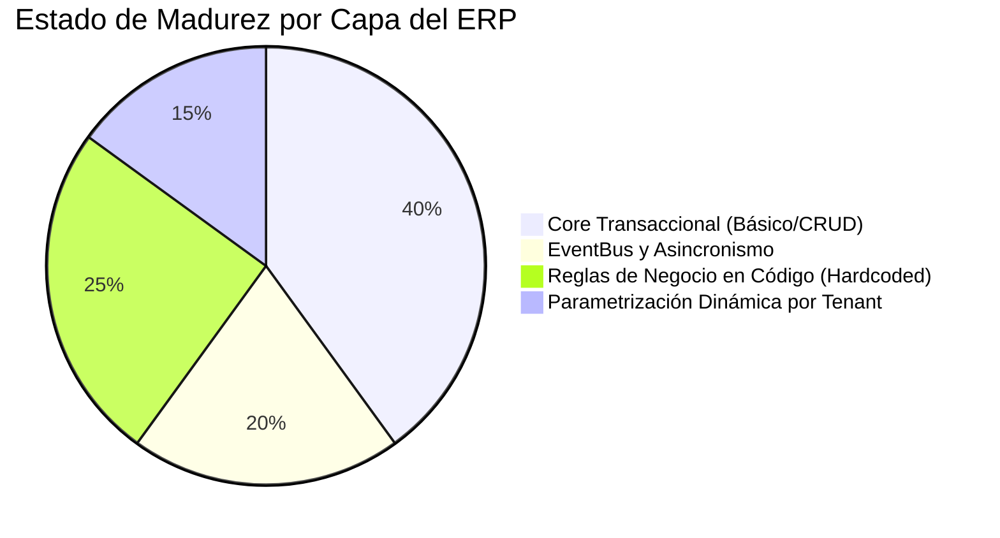
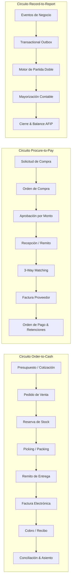
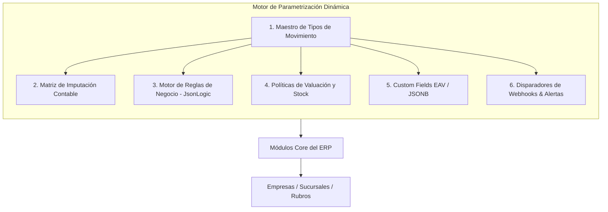
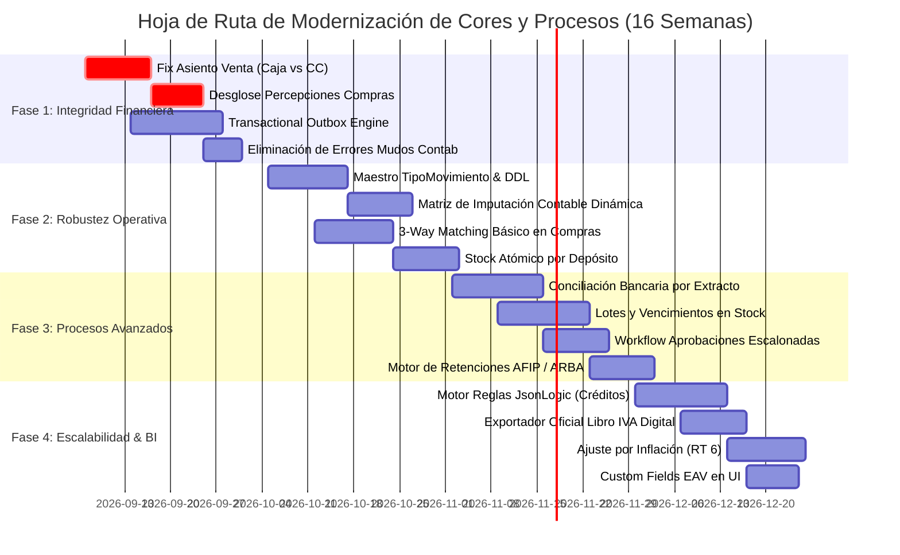

# Diagnóstico de Gaps, Mejoras en Módulos Core, Optimización de Procesos y Motor de Parametrizaciones

> **Sistema:** ERP Argentina (Grupo Claver / Claverp)  
> **Fecha de Emisión:** 5 de Septiembre de 2026  
> **Alcance:** Módulos Core (Ventas, Compras, Stock, Caja, Bancos, Contabilidad, Fiscal), Circuitos Operativos E2E (Order-to-Cash, Procure-to-Pay, Record-to-Report), Matriz de Parametrizaciones Dinámicas y Hoja de Ruta de Ingeniería.  
> **Público Objetivo:** Arquitectos de Software, Tech Leads, Consultores Funcionales de ERP e Ingenieros Financieros.

---

## 1. Resumen Ejecutivo y Diagnóstico de Situación

El presente documento expone una auditoría técnica profunda sobre el estado actual del ERP Argentina, contrastando la arquitectura de código existente frente a los estándares de clase mundial en sistemas de gestión empresarial (*SAP S/4HANA*, *NetSuite*, *Odoo Enterprise*, *Totvs*) y la normativa tributario-contable argentina (AFIP/ARCA, RG 1415, RG 3685, RG 830, RT 6, RT 54).

### 1.1 Diagnóstico de Madurez Actual



1. **Lógica de Negocio Hardcodeada vs Configurable:**  
   Gran parte de los procesos de imputación contable, tipos de comprobantes y movimientos de stock están fijados en el código TypeScript (p. ej., `AsientoService` imputa por defecto a la cuenta `1.1 Caja` en toda venta, independientemente de si la venta es a plazo o cuenta corriente).
2. **Fragilidad en la Consistencia Event-Driven:**  
   El `EventBus` actual corre en memoria (`in-process`). Si el proceso Node.js/Next.js se reinicia o satura durante un pico de facturación, los eventos de descuento de stock o creación de asientos contables pueden perderse sin persistencia transaccional (*Transactional Outbox*).
3. **Manejo Silencioso de Errores Contables:**  
   En hooks como `lib/contabilidad/factura-hooks.ts`, las excepciones al generar asientos contables son capturadas con `console.error` y descartadas para "no interrumpir la facturación". Esto genera una discrepancia silenciosa e irreversible entre el Subdiario de IVA Ventas y el Libro Diario General.
4. **Desconexión entre Movimientos de Stock y Depósitos:**  
   Los handlers de eventos de stock (`lib/stock/stock-event-handlers.ts`) crean registros en `MovimientoStock` sin actualizar el stock físico consolidado por depósito (`StockDeposito`), sin validar disponibilidad negativa ni gestionar trazabilidad por lotes/vencimiento.

---

## 2. Gaps y Mejoras en los Módulos CORE

A continuación se detalla el análisis por módulo core, indicando el **Estado Actual**, el **Gap Crítico**, el **Impacto Financiero/Operativo** y la **Solución de Ingeniería**.

---

### 2.1 Core Ventas, POS y Facturación Fiscal (AFIP / ARCA)

| Dimensión | Estado Actual | Gap Crítico Detectado | Severidad | Solución / Mejora Requerida |
| :--- | :--- | :--- | :--- | :--- |
| **Imputación Contable de Venta** | Todo comprobante genera débito automático a `1.1 Caja`. | Las ventas en Cuenta Corriente (a plazo 30/60 días), cheques diferidos o tarjetas no van a `Deudores por Ventas` ni a `Cupones a Cobrar`. | **P0 - Crítico** | Resolver la cuenta deudora según la `condicionPago` y medio de cobro configurado en el maestro de parametrizaciones. |
| **Consistencia Transaccional Factura-AFIP** | Si AFIP autoriza (CAE emitido) pero falla el guardado local o el stock, el comprobante queda en estado inconsistente. | Falta de un patrón Saga con compensación y reintentos idempotentes ante caídas de red SOAP con AFIP. | **P0 - Crítico** | Implementar *Two-Phase Commit / Saga Orchestrator* con clave de idempotencia (`empresaId` + `tipoComprobante` + `puntoVenta` + `numero`). |
| **Contingencia CAEA (RG 5782/2025)** | Campos existen en `Empresa`, pero la emisión offline no concilia automáticamente con el tope de informe quincenal. | Riesgo de multas y bloqueo de CUIT por comprobantes CAEA no informados dentro del plazo de 8 días corridos. | **P1 - Alto** | Job cron automatizado que consolide y transmita los comprobantes emitidos bajo CAEA antes del vencimiento quincenal. |
| **Notas de Crédito y Débito** | Emisión de NC desvinculada de la factura original o sin reversión estricta de stock. | Una NC puede anular un comprobante pero reingresar stock a un depósito incorrecto o no anular la deuda en CC. | **P1 - Alto** | Forzar vinculación de UUID/ID de factura origen, validando que el monto de la NC no exceda el saldo vivo y permitiendo elegir si reingresa o no al stock físico. |
| **Validación Padrón AFIP (A5)** | Consulta manual o inconsistente durante el alta de clientes. | Facturación errónea de comprobantes tipo 'B' a contribuyentes Responsables Inscriptos (infracción formal AFIP). | **P1 - Alto** | Validación sincrónica automática al tipear CUIT contra el padrón fiscal con actualización de condición frente al IVA. |
| **POS de Mostrador (Retail)** | Interfaz web lenta ante desconexiones de red; cálculo de vueltos y arqueos no integrado con balanzas pesables. | Lentitud en líneas de caja de alta rotación (supermercados, ferreterías, kioscos). | **P2 - Medio** | Cache offline PWA (IndexedDB) para catálogo y cola de tickets pendientes de sincronización fiscal. |

---

### 2.2 Core Compras, Proveedores y Cuentas a Pagar (Procure-to-Pay)

| Dimensión | Estado Actual | Gap Crítico Detectado | Severidad | Solución / Mejora Requerida |
| :--- | :--- | :--- | :--- | :--- |
| **3-Way Matching (Triple Validación)** | La factura de compra se registra sin cotejo estricto con la Orden de Compra (OC) y el Remito de Recepción. | Se pagan cantidades no recibidas o precios superiores a los acordados con el proveedor, generando fugas de capital. | **P0 - Crítico** | Motor de 3-Way Matching con tolerancia configurable (% precio y % cantidad). Si hay desvío, la factura pasa a estado `RETENIDA_PARA_APROBACION`. |
| **Imputación de Gastos vs Mercaderías** | Toda compra debita rígidamente a `1.4 Mercaderías`. | Las compras de insumos de librería, servicios públicos, honorarios o activos fijos distorsionan el balance de cambio. | **P0 - Crítico** | Imputación a nivel de línea de compra según la categoría contable del producto/servicio adquirido. |
| **Percepciones Impositivas en Compras** | No se contemplan adecuadamente las percepciones de IIBB (ARBA, AGIP, Convenio Multilateral) ni IVA. | Asientos contables que no cuadran con el total a pagar al proveedor o pérdida de créditos fiscales en declaraciones juradas. | **P0 - Crítico** | Desglose en la carga de compra de: Neto Gravado, IVA (por alícuotas), Percepciones IIBB por jurisdicción, Percepciones IVA e Impuestos Internos. |
| **Retenciones Impositivas en Pagos** | La emisión de la Orden de Pago (OP) no calcula automáticamente las retenciones de Ganancias (RG 830) ni de IVA o IIBB. | Riesgo de responsabilidad solidaria por no actuar como agente de retención obligado ante AFIP/Rentas. | **P1 - Alto** | Motor fiscal de retenciones: cálculo acumulado mensual por proveedor, tablas de alícuotas/mínimos no imponibles y emisión de certificados automáticos. |
| **Aging de Cuentas a Pagar** | Listado plano de deudas sin proyección de cash-flow financiero ni priorización por descuento por pronto pago. | Dificultad para tesorería en optimizar pagos y evitar intereses punitorios. | **P2 - Medio** | Matriz de vencimientos dinámica (0-15, 16-30, 31-60, +60 días) integrada a la proyección de flujo de fondos. |

---

### 2.3 Core Stock, Inventario y Almacenes (WMS / SCM)

| Dimensión | Estado Actual | Gap Crítico Detectado | Severidad | Solución / Mejora Requerida |
| :--- | :--- | :--- | :--- | :--- |
| **Integridad de Saldos en Depósito** | Handlers de eventos crean `MovimientoStock` genérico sin actualizar `StockDeposito` ni validar depósito específico. | Saldos desfasados entre reportes globales y stock real de cada sucursal/bodega. | **P0 - Crítico** | Trigger transaccional o servicio centralizado (`StockService.aplicarMovimiento`) que actualice atómicamente saldo físico y kardex. |
| **Explosión de Kits y Recetas (BOM)** | Vender un combo o plato en POS no descuenta sus componentes unitarios si no se dispara una orden de producción. | Quiebre de stock invisible en ingredientes o partes constitutivas. | **P1 - Alto** | Detección automática en la venta: si el ítem es `tipo = "KIT" | "COMBO"`, descontar automáticamente del inventario los insumos según la receta activa. |
| **Trazabilidad por Lotes y Vencimientos** | Inexistencia de campos de Lote y Fecha de Caducidad en líneas de comprobantes de venta/compra. | Incapacidad legal y operativa para operar con farmacias, veterinarias, frigoríficos o distribución alimenticia. | **P1 - Alto** | Tabla `LoteProducto` vinculada a `MovimientoStock` con algoritmos de sugerencia de despacho FIFO / FEFO (*First Expired, First Out*). |
| **Inventario Físico y Tomas Cíclicas** | Los ajustes de inventario se realizan de forma manual sin un circuito formal de conteo ciego. | Fraude interno o diferencias de inventario no imputadas contablemente a pérdidas operativas. | **P1 - Alto** | Circuito de Toma de Inventario con recuento ciego, doble verificación y generación automática de asiento contable de desvío de inventario. |
| **Valuación de Inventario (PPP / FIFO)** | El sistema calcula un PPP básico que no siempre se actualiza con gastos adicionales de flete (*Landed Cost*). | Costo de mercaderías vendidas (CMV) subvaluado, alterando el margen bruto real de la compañía. | **P2 - Medio** | Módulo de prorrateo de costos de flete, aduana y seguro sobre el costo de adquisición de la mercadería. |

---

### 2.4 Core Caja, Bancos y Tesorería

| Dimensión | Estado Actual | Gap Crítico Detectado | Severidad | Solución / Mejora Requerida |
| :--- | :--- | :--- | :--- | :--- |
| **Cierre y Arqueo de Caja** | Cierre de turno registra totales declarados pero no genera asiento contable de diferencias (sobrantes/faltantes). | Descontrol del efectivo físico frente a saldos contables; no hay imputación a quebrantos de caja. | **P1 - Alto** | Generación de asiento contable automático al cerrar caja: imputación a `Diferencia de Caja (Faltante/Sobrante)` con firma del supervisor. |
| **Conciliación Bancaria Automatizada** | Proceso manual y propenso a errores humanos; no se importan extractos de bancos locales. | Meses de retraso en conocer la posición real de tesorería y gastos bancarios (comisiones, impuesto al cheque ley 25.413). | **P1 - Alto** | Importador universal de extractos bancarios (formatos CSV, Excel, OFX de bancos argentinos) con motor de matching predictivo por monto, CUIT y fecha. |
| **Gestión Integral de Cheques y Echeqs** | Módulo de cheques básico sin trazabilidad completa del ciclo de vida (cartera, depósito, endoso a proveedor, rechazo). | Pérdida de seguimiento de cheques rechazados, sin reclamo formal de deuda al cliente ni cobro de gastos bancarios. | **P1 - Alto** | Circuito formal de cheques físicos y Echeqs: emisión de Nota de Débito automática ante rechazo bancario y débito de gastos al cliente. |
| **Transferencias Inter-Cajas y Custodia** | Movimientos de fondos entre caja chica y banco no requieren acuse de recibo de la contraparte. | "Dinero en tránsito" fantasma o fondos vulnerables sin responsable asignado. | **P2 - Medio** | Circuito de transferencias de fondos en dos pasos: `Enviado (en tránsito)` → `Recibido y Verificado por Destino`. |

---

### 2.5 Core Contabilidad General y Fiscal

| Dimensión | Estado Actual | Gap Crítico Detectado | Severidad | Solución / Mejora Requerida |
| :--- | :--- | :--- | :--- | :--- |
| **Asientos Descuadrados o Fallidos** | Captura silenciosa de errores en hooks (`factura-hooks.ts`) sin reintentos ni cola de fallas. | Balances contables que no reflejan la totalidad de las operaciones del ERP. | **P0 - Crítico** | Bloquear la transacción o enviar a una tabla `AsientoPendienteError` con alertas directas al equipo de administración contable. |
| **Plan de Cuentas Rígido** | Códigos de cuentas y etiquetas amarrados al código (`1.1`, `4.1`, `1.4`, `2.1`). | Imposibilidad de soportar empresas con planes de cuentas corporativos preexistentes sin alterar código. | **P0 - Crítico** | Plan de Cuentas jerárquico multinivel por empresa, con árbol configurable de cuentas imputables y no imputables. |
| **Bloqueo e Inmutabilidad de Periodos** | Si bien existe `validarPeriodoAbierto`, no existe bloqueo criptográfico de asientos confirmados. | Modificaciones retroactivas a periodos fiscales ya presentados ante AFIP, generando contingencias legales. | **P1 - Alto** | Hash encadenado o firma digital de asientos definitivos y congelamiento estricto de fechas contables cerradas. |
| **Exportación Régimen Informativo AFIP** | Faltan exportadores nativos de Libro IVA Digital (Comprobantes y Alícuotas) y CITI Ventas/Compras. | Los contadores deben recurrir a software externo o rearmar planillas Excel manualmente para la presentación fiscal. | **P1 - Alto** | Generador de archivos de texto en formato oficial AFIP (formato de posición fija de 300 caracteres) para el Portal IVA. |
| **Ajuste por Inflación (RT 6 / NIC 29)** | Inexistencia de reexpresión monetaria de partidas no monetarias. | Estados financieros en moneda histórica sin validez económica en contextos de inflación argentina. | **P2 - Medio** | Módulo de Ajuste por Inflación automático basado en el índice FACPCE/INDEC con generación de asiento de RECPAM. |

---

## 3. Gaps y Mejoras en los PROCESOS Transversales

Los módulos core no funcionan de forma aislada; operan a través de flujos de valor interconectados. A continuación se detallan los cuellos de botella en los circuitos operativos y la propuesta de modernización.



### 3.1 Circuito Order-to-Cash (O2C)

#### Gaps Detectados:
1. **Paso directo de Presupuesto a Factura sin Reserva:** Muchos usuarios facturan directamente sin pasar por control de preparación. Si el stock físico no existe, la factura fiscal ya fue emitida ante AFIP con CAE, requiriendo emitir una Nota de Crédito para cancelar la operación.
2. **Desconexión entre Remito de Despacho y Factura:** No hay trazabilidad de remitos pendientes de facturar vs facturas pendientes de entregar mercadería (circuito habitual de empresas mayoristas y distribuidoras).

#### Mejoras Propuestas:
- **Reserva de Stock Temporal:** Al confirmar un pedido comercial, el stock pasa a estado `RESERVADO`. Si no se factura o despacha dentro de un plazo configurable (ej. 48 horas), la reserva expira automáticamente liberando el saldo.
- **Facturación Parcial y Agrupada:** Capacidad de emitir un remito por el 50% de la mercadería disponible y facturar únicamente lo entregado, manteniendo el saldo del pedido en estado `PENDIENTE_ENTREGA`.

---

### 3.2 Circuito Procure-to-Pay (P2P)

#### Gaps Detectados:
1. **Falta de Solicitud Interna de Compra:** Cualquier usuario con acceso a compras puede emitir una Orden de Compra directamente a un proveedor, sin una requisición previa autorizada por su líder de sector.
2. **Carencia de Matriz de Aprobaciones Escalonadas:** No se validan límites de compra según el nivel jerárquico del usuario (ej. Analista: hasta $100.000; Jefe: hasta $1.000.000; Gerente: hasta $10.000.000; Directorio: montos superiores).

#### Mejoras Propuestas:
- **Workflow de Aprobaciones Multinivel:**
  ```mermaid
  stateDiagram-v2
      [*] --> Borrador
      Borrador --> PendienteAprobacion: Enviar para firma
      state PendienteAprobacion {
          [*] --> Nivel1_Jefatura
          Nivel1_Jefatura --> Nivel2_Gerencia: Monto > $1.000.000
          Nivel2_Gerencia --> Nivel3_Directorio: Monto > $10.000.000
      }
      PendienteAprobacion --> Aprobada: Todas las firmas OK
      PendienteAprobacion --> Rechazada: Observada
      Aprobada --> EmitidaProveedor: Envío de PDF/Email
  ```
- **Control de Recepción Ciega:** El personal de depósito recibe la mercadería contrastando contra la OC pero sin ver los costos pactados (segregación de información comercial y logística).

---

### 3.3 Arquitectura Transaccional y EventBus (Transactional Outbox)

#### Gap Estructural Actual:
Actualmente, el sistema ejecuta:
```typescript
// Código actual en lib/events/event-bus.ts
await registration.fn(event); // Si falla o el proceso se reinicia, el evento se pierde
```
Esto genera desincronización entre la base de datos relacional y los suscriptores de eventos.

#### Mejora Arquitectónica: Patrón Transactional Outbox
Toda transacción de negocio (ej. crear factura) debe guardar en la **misma transacción de base de datos** la factura y el registro del evento en una tabla `OutboxEvent`:

```sql
BEGIN TRANSACTION;
  INSERT INTO "Factura" (...) VALUES (...);
  INSERT INTO "OutboxEvent" (tipo, payload, estado) VALUES ('FACTURA_EMITIDA', '{...}', 'PENDIENTE');
COMMIT;
```

Un worker desacoplado (o job cron recurrente) lee los eventos en estado `PENDIENTE`, los procesa con reintentos exponenciales y garantiza entrega **At-Least-Once** con deduplicación por clave de idempotencia.

---

## 4. Gaps y Mejoras en las PARAMETRIZACIONES

Para que el ERP pueda escalar verticalmente (soportar ferreterías, farmacias, gimnasios, clínicas, constructoras y distribuidoras) y horizontalmente (grandes volúmenes de sucursales) sin tocar una sola línea de código fuente, es imprescindible migrar hacia una **arquitectura basada en metadatos y reglas de negocio configurables**.



---

### 4.1 Maestro Central de Tipos de Movimiento (`TipoMovimiento`)

Actualmente, los tipos de movimientos están dispersos como cadenas de texto hardcodeadas (`"salida"`, `"ajuste"`, `"venta"`, `"compra"`). Se requiere una entidad maestra transversal que defina el comportamiento de cualquier transacción en el sistema:

#### Estructura de la Tabla `TipoMovimiento`:

| Atributo | Tipo | Descripción y Función de Escalabilidad |
| :--- | :--- | :--- |
| `codigo` | `String (PK)` | Identificador único (ej. `VENTA_MOSTRADOR`, `COMPRA_MP`, `ROTURA_STOCK`, `CONSUMO_INTERNO`). |
| `descripcion` | `String` | Nombre legible para interfaces de usuario. |
| `moduloOrigen` | `Enum` | `VENTAS` \| `COMPRAS` \| `STOCK` \| `CAJA` \| `BANCOS` \| `PRODUCCION` \| `VERTICAL`. |
| `signoStock` | `Int` | `+1` (incrementa stock), `-1` (decrementa stock), `0` (no afecta inventario). |
| `signoCaja` | `Int` | `+1` (ingreso de fondos), `-1` (egreso de fondos), `0` (neutro). |
| `afectaContab` | `Boolean` | Determina si el evento debe disparar un asiento contable automático. |
| `requiereAprobacion` | `Boolean` | Si es `true`, el movimiento no se aplica hasta contar con visto bueno de supervisor. |
| `permiteSinStock` | `Boolean` | Permite o bloquea el movimiento si el saldo físico actual es inferior a la cantidad. |
| `activo` | `Boolean` | Permite desactivar movimientos obsoletos sin romper datos históricos. |

---

### 4.2 Matriz de Imputación Contable Dinámica (`MapeoContableRegla`)

En lugar de resolver cuentas contables fijas (`getCuentaLabel(..., "1.1", "Caja")`), el sistema debe consultar una matriz jerárquica de reglas de imputación:

```
Resolución: [TipoMovimiento + Rubro + CategoríaProducto + MedioPago + CentroCosto] 
            → Cuenta Debe / Cuenta Haber
```

#### Ejemplo de Parametrización en Base de Datos:

| Tipo Movimiento | Condición de Venta / Medio | Rubro | Cuenta Debe (Débito) | Cuenta Haber (Crédito) |
| :--- | :--- | :--- | :--- | :--- |
| `VENTA_FAC_A` | Contado Efectivo | Comercio / General | `1.1.1.01 Caja Central` | `4.1.1.01 Ventas Gravadas 21%` + `2.1.2.01 IVA Débito Fiscal` |
| `VENTA_FAC_A` | Cuenta Corriente 30d | Mayorista | `1.1.2.01 Deudores por Ventas` | `4.1.1.01 Ventas Gravadas 21%` + `2.1.2.01 IVA Débito Fiscal` |
| `VENTA_FAC_A` | Mercado Pago QR | Gastronomía | `1.1.1.04 MP Fondos a Acreditar` | `4.1.1.02 Ventas Gastronomía` + `2.1.2.01 IVA Débito Fiscal` |
| `COMPRA_INSUMO`| Transferencia Bancaria | Industria | `5.1.2.03 Gastos de Librería` + `1.1.4.01 IVA Crédito Fiscal` | `1.1.1.02 Banco Santander c/c` |
| `MERMA_STOCK`  | N/A (Ajuste Interno) | Alimentos | `5.2.1.05 Pérdidas por Merma` | `1.1.5.01 Mercaderías de Reventa` |

> **Beneficio:** Si una empresa abre un nuevo vertical (ej. una veterinaria incorpora peluquería o venta de alimentos balanceados), el contador simplemente agrega una fila a la matriz de parametrización desde la UI, sin necesidad de reprogramar el backend.

---

### 4.3 Motor de Reglas de Negocio Desacoplado (Business Rules Engine)

Para políticas comerciales y operativas que cambian frecuentemente, se propone un motor basado en **JsonLogic** persistido en base de datos:

#### Casos de Uso Parametrizables sin Código:
1. **Límite de Crédito:**
   ```json
   {
     "if": [
       { ">": [{ "+": ["$saldoDeudaActual", "$montoComprobanteNuevo"] }, "$limiteCreditoCliente"] },
       { "accion": "BLOQUEAR", "motivo": "Excede límite de crédito asignado" },
       { "accion": "PERMITIR" }
     ]
   }
   ```
2. **Descuento por Volumen:**
   ```json
   {
     "if": [
       { ">=": ["$cantidadLinea", 50] },
       { "aplicarDescuentoPorc": 15 },
       { "aplicarDescuentoPorc": 0 }
     ]
   }
   ```
3. **Restricción de Cobro a Morosos:**
   ```json
   {
     "if": [
       { ">": ["$diasFacturaMasAntiguaVencida", 30] },
       { "bloquearVenta": true, "requiereClaveSupervisor": true },
       { "bloquearVenta": false }
     ]
   }
   ```

---

### 4.4 Políticas de Inventario y Valuación por Depósito

Cada sucursal o depósito puede tener naturalezas logísticas distintas (un depósito de fábrica produce por lotes; un salón de ventas comercializa por unidad al por menor).

#### Parámetros Configurables en `PoliticaInventario`:
- `metodoValuacion`: `PPP` (Precio Promedio Ponderado) \| `FIFO` \| `COSTO_REPOSICION` \| `ESTANDAR`.
- `permitirStockNegativo`: `Boolean` (por defecto `false`; útil en retail de alto tránsito para no frenar la caja si hubo retraso en la carga del remito de entrada).
- `alertaBajoStock`: Umbral porcentual sobre el stock de seguridad para disparar pedido automático a compras.
- `bloqueoPorVencimientoDias`: Días antes del vencimiento en que un lote queda automáticamente inhabilitado para la venta al público.

---

### 4.5 Campos Personalizados (Custom Fields / Metadata EAV-JSONB)

Cada rubro requiere almacenar información especializada que no debe contaminar las tablas centrales del core:
- **Taller Mecánico:** Dominio/Patente, Número de Chasis, Kilometraje.
- **Veterinaria:** Especie, Raza, Chip Identificador, Nombre de la Mascota.
- **Ferretería / Corralón:** Fraccionamiento en metros, kilos o barras.
- **Salud:** Número de Afiliado, Obra Social, Diagnóstico CIE-10.

#### Implementación:
Se incorpora en las tablas maestras (`Cliente`, `Producto`, `Factura`, `OrdenCompra`) un campo JSONB indexado (`customFields` / `metadatos`) acompañado de una tabla de definiciones `DefinicionCampoExtra`:
```prisma
model DefinicionCampoExtra {
  id             Int      @id @default(autoincrement())
  empresaId      Int
  entidad        String   // "Producto", "Cliente", "Factura"
  nombreCampo    String   // "numero_chasis"
  etiqueta       String   // "Número de Chasis"
  tipoDato       String   // "string", "number", "date", "select"
  opcionesSelect Json?    // ["Perro", "Gato", "Ave"]
  esRequerido    Boolean  @default(false)
  activo         Boolean  @default(true)
}
```

---

### 4.6 Suscripción y Parametrización de Webhooks y Eventos

Permitir a cada tenant configurar cómo reacciona el sistema ante eventos del core:

| Evento del Core | Canal Configurable | Acción Parametrizada |
| :--- | :--- | :--- |
| `FACTURA_EMITIDA` | WhatsApp / Email | Envío inmediato del PDF de la factura al cliente final. |
| `STOCK_CRITICO` | Telegram / Slack | Notificación al Jefe de Compras sobre quiebre de stock inminente. |
| `PAGO_RECIBIDO` | Webhook HTTP | Notificación a tienda online externa (Tienda Nube / WooCommerce / Mercado Libre). |
| `CHEQUE_RECHAZADO` | Email / Tarea | Creación automática de incidente en CRM para el oficial de cuentas a cobrar. |

---

## 5. Modelos de Datos Propuestos (DDL / Prisma Schema)

A continuación se presentan los modelos Prisma diseñados para implementar las mejoras y parametrizaciones descriptas, integrándose de forma limpia al `prisma/schema.prisma` existente.

```prisma
// ============================================================================
// 1. MOTOR DE PARAMETRIZACIÓN DINÁMICA DE MOVIMIENTOS Y CONTABILIDAD
// ============================================================================

enum ModuloOrigen {
  VENTAS
  COMPRAS
  STOCK
  CAJA
  BANCOS
  PRODUCCION
  VERTICAL
}

model TipoMovimiento {
  id                  Int          @id @default(autoincrement())
  empresaId           Int?         // Null = Plantilla Global del Sistema; Int = Override Tenant
  codigo              String       // Ej: "FAC_VTA_CREDITO", "DEV_PROV", "AJUSTE_MERMA"
  descripcion         String
  moduloOrigen        ModuloOrigen
  signoStock          Int          @default(0)  // -1, 0, 1
  signoCaja           Int          @default(0)  // -1, 0, 1
  afectaContabilidad  Boolean      @default(true)
  requiereAprobacion  Boolean      @default(false)
  permiteSinStock     Boolean      @default(false)
  activo              Boolean      @default(true)
  createdAt           DateTime     @default(now())
  updatedAt           DateTime     @updatedAt

  reglasContables     MapeoContableRegla[]
  movimientosStock    MovimientoStockConfig[]

  @@unique([empresaId, codigo])
  @@index([moduloOrigen, activo])
}

model MapeoContableRegla {
  id                Int             @id @default(autoincrement())
  empresaId         Int
  tipoMovimientoId  Int
  tipoMovimiento    TipoMovimiento  @relation(fields: [tipoMovimientoId], references: [id])
  rubroId           Int?
  condicionPago     String?         // "contado", "cuenta_corriente", "tarjeta", "cheque"
  cuentaDebeId      Int             // FK a CuentaContable
  cuentaHaberId     Int             // FK a CuentaContable
  cuentaIvaId       Int?            // FK a CuentaContable (si aplica)
  centroCostoId     Int?            // Opcional para imputación analítica
  prioridad         Int             @default(1) // Para resolver la regla más específica
  activo            Boolean         @default(true)

  @@index([empresaId, tipoMovimientoId, condicionPago])
}

// ============================================================================
// 2. RESILIENCIA Y TRANSACTIONAL OUTBOX PATTERN
// ============================================================================

enum OutboxStatus {
  PENDIENTE
  PROCESANDO
  COMPLETADO
  FALLIDO
}

model OutboxEvent {
  id              String       @id @default(uuid())
  empresaId       Int
  tipoEvento      String       // Ej: "FACTURA_EMITIDA", "STOCK_DESCONTADO"
  idempotencyKey  String       @unique // Evita procesar 2 veces el mismo evento
  payload         Json         // Datos completos de la transacción
  estado          OutboxStatus @default(PENDIENTE)
  intentos        Int          @default(0)
  maxIntentos     Int          @default(5)
  ultimoError     String?
  siguienteIntento DateTime    @default(now())
  procesadoAt     DateTime?
  createdAt       DateTime     @default(now())

  @@index([estado, siguienteIntento])
  @@index([empresaId, tipoEvento])
}

// ============================================================================
// 3. 3-WAY MATCHING Y CONTROL DE COMPRAS
// ============================================================================

enum EstadoValidacionCompra {
  MATCH_OK
  DESVIO_PRECIO
  DESVIO_CANTIDAD
  SIN_RECEPCION
  APROBADO_CON_EXCEPCION
}

model ValidacionCompra3Way {
  id                Int                    @id @default(autoincrement())
  empresaId         Int
  compraId          Int                    @unique // Factura del proveedor
  ordenCompraId     Int?
  remitoEntradaId   Int?
  estado            EstadoValidacionCompra @default(MATCH_OK)
  diferenciaMonto   Decimal                @default(0) @db.Decimal(15, 2)
  diferenciaItems   Int                    @default(0)
  aprobadoPor       Int?                   // Usuario supervisor que autorizó la excepción
  motivoAprobacion  String?
  auditadoAt        DateTime               @default(now())

  @@index([empresaId, estado])
}

// ============================================================================
// 4. TRAZABILIDAD DE STOCK: LOTES Y VENCIMIENTOS
// ============================================================================

model LoteStock {
  id             Int               @id @default(autoincrement())
  empresaId      Int
  productoId     Int
  depositoId     Int
  numeroLote     String
  fechaVencimiento DateTime?
  cantidadInicial Decimal          @db.Decimal(15, 4)
  cantidadActual  Decimal          @db.Decimal(15, 4)
  bloqueado      Boolean           @default(false)
  motivoBloqueo  String?
  createdAt      DateTime          @default(now())
  updatedAt      DateTime          @updatedAt

  @@unique([empresaId, productoId, depositoId, numeroLote])
  @@index([fechaVencimiento, bloqueado])
}
```

---

## 6. Plan de Acción y Hoja de Ruta Priorizada (Roadmap)

Se establece un plan de ejecución dividido en 4 fases estratégicas de 4 semanas cada una, priorizando la estabilidad financiera y el compliance legal en las etapas iniciales.



### Detalle de Fases:

#### Fase 1: Integridad Financiera y Consistencia Transaccional (Semanas 1 a 4)
- **Objetivo:** Frenar la generación de datos contables inconsistentes y evitar la pérdida de eventos de stock/asientos.
- **Acciones Clave:**
  1. Refactorizar `generarAsientoVenta` en `lib/contabilidad/asiento-service.ts` para imputar a `Deudores por Ventas` cuando la venta sea en cuenta corriente, cheque o tarjeta.
  2. Incorporar el desglose de Percepciones de IIBB, IVA e Impuestos Internos en `generarAsientoCompra`.
  3. Implementar la tabla `OutboxEvent` y worker de despacho para reemplazar la emisión de eventos en memoria volátil.
  4. Sustituir los bloques `catch (err) { console.error(...) }` en hooks por persistencia en log de contingencia y alertas administrativas.

#### Fase 2: Robustez Operativa y Parametrización Base (Semanas 5 a 8)
- **Objetivo:** Desacoplar la lógica dura del código hacia tablas maestras configurables por tenant.
- **Acciones Clave:**
  1. Migración de base de datos para `TipoMovimiento` y `MapeoContableRegla`.
  2. Implementar servicio `StockService.aplicarMovimiento` que asegure consistencia ACID entre `MovimientoStock` y `StockDeposito`.
  3. Desarrollar el validador de 3-Way Matching entre OC, Remito de Recepción y Factura de Compra.
  4. Crear pantalla en el dashboard para que el usuario administrador configure las cuentas contables de su empresa sin tocar código.

#### Fase 3: Procesos Avanzados y Trazabilidad (Semanas 9 a 12)
- **Objetivo:** Dotar al sistema de profundidad funcional en almacén, tesorería y aprobaciones.
- **Acciones Clave:**
  1. Parser de extractos bancarios (formato universal CSV/Excel/OFX) y conciliación automática con scoring.
  2. Trazabilidad de lotes y fechas de vencimiento en compras, transferencias y ventas (FEFO).
  3. Matriz de aprobaciones jerárquica para Órdenes de Compra y notas de crédito de alto valor.
  4. Cálculo automático de retenciones de Ganancias (RG 830) e IIBB al momento de emitir Órdenes de Pago.

#### Fase 4: Escalabilidad Multirubro y Excelencia Fiscal (Semanas 13 a 16)
- **Objetivo:** Permitir la personalización sin código para cualquier nicho y garantizar compliance impositivo completo.
- **Acciones Clave:**
  1. Integración de JsonLogic para validación dinámica de políticas de crédito, descuentos y bloqueos.
  2. Generador de archivos TXT para el Portal IVA Digital (AFIP) y CITI Ventas/Compras.
  3. Soporte de campos personalizados dinámicos (`DefinicionCampoExtra`) renderizados automáticamente en los formularios de la UI.
  4. Módulo de reexpresión y Ajuste por Inflación impositivo/contable (RT 6).

---

## 7. Matriz de Impacto vs Esfuerzo de Implementación

Para facilitar la toma de decisiones directivas, se clasifica cada iniciativa según su retorno de inversión (ROI), mitigación de riesgo fiscal y complejidad de desarrollo:

| Iniciativa | Módulo | Riesgo Mitigado / Beneficio | Complejidad | Prioridad |
| :--- | :--- | :--- | :--- | :--- |
| **Corrección de Cuenta Deudora en Ventas** | Contabilidad / Ventas | Elimina distorsión severa del saldo de Caja en balances. | Baja (2 días) | **P0 (Inmediata)** |
| **Inclusión de Percepciones en Compras** | Compras / Fiscal | Evita pérdida de créditos fiscales y multas AFIP/Rentas. | Media (4 días) | **P0 (Inmediata)** |
| **Transactional Outbox en EventBus** | Arquitectura / Core | Garantiza consistencia atómica y tolerancia a fallos. | Media (5 días) | **P0 (Inmediata)** |
| **Kardex y Stock Atómico por Depósito** | Stock / WMS | Evita ventas sin stock físico y reportes irreales. | Media (5 días) | **P1 (Semana 5)** |
| **3-Way Matching en Compras** | Compras / Finanzas | Frena pagos indebidos y sobrefacturación de proveedores. | Media (6 días) | **P1 (Semana 6)** |
| **Maestro Central de `TipoMovimiento`** | Parametrizaciones | Permite incorporar nuevos nichos sin tocar código. | Alta (8 días) | **P1 (Semana 7)** |
| **Importador de Extractos Bancarios** | Bancos / Tesorería | Ahorra decenas de horas mensuales de conciliación manual. | Media (6 días) | **P2 (Semana 9)** |
| **Control de Lotes y Vencimientos** | Stock / Verticales | Habilita comercializar el ERP a farmacias y alimentos. | Alta (10 días) | **P2 (Semana 10)** |
| **Motor de Retenciones Fiscales (RG 830)** | Impuestos / Compras | Cumplimiento legal estricto como agente de retención. | Alta (8 días) | **P2 (Semana 11)** |
| **Motor de Reglas JsonLogic** | Parametrizaciones | Automatización de crédito y promociones sin programar. | Media (6 días) | **P3 (Semana 13)** |
| **Exportación Libro IVA Digital AFIP** | Fiscal / Auditoría | Entrega directa de archivos de presentación mensual al contador. | Media (4 días) | **P3 (Semana 14)** |

---

## 8. Estado de Implementación de la Fase 1 (Completado)

Como parte de la ejecución inmediata de este plan, se implementaron los siguientes módulos y correcciones críticas:

| Componente | Archivo / Servicio | Estado | Verificación |
| :--- | :--- | :--- | :--- |
| **Discriminación Venta Crédito vs Contado** | [`lib/contabilidad/asiento-service.ts`](file:///c:/Users/Pablo%20Clavero/Downloads/pos-system-argentina/lib/contabilidad/asiento-service.ts) | **Implementado** | Testeado en [`__tests__/contabilidad/asiento-service.test.ts`](file:///c:/Users/Pablo%20Clavero/Downloads/pos-system-argentina/__tests__/contabilidad/asiento-service.test.ts) |
| **Desglose de Percepciones en Compras** | [`lib/contabilidad/asiento-service.ts`](file:///c:/Users/Pablo%20Clavero/Downloads/pos-system-argentina/lib/contabilidad/asiento-service.ts) | **Implementado** | Testeado en [`__tests__/contabilidad/asiento-service.test.ts`](file:///c:/Users/Pablo%20Clavero/Downloads/pos-system-argentina/__tests__/contabilidad/asiento-service.test.ts) |
| **Auditoría de Fallos Contables** | [`lib/contabilidad/factura-hooks.ts`](file:///c:/Users/Pablo%20Clavero/Downloads/pos-system-argentina/lib/contabilidad/factura-hooks.ts) | **Implementado** | Registro persistente en `handler_logs` ante cualquier fallo de asiento |
| **Saneamiento Handler Stock Venta** | [`lib/stock/stock-event-handlers.ts`](file:///c:/Users/Pablo%20Clavero/Downloads/pos-system-argentina/lib/stock/stock-event-handlers.ts) | **Implementado** | Eliminación de doble deducción y movimientos huérfanos |
| **Motor de Mapeo Contable Dinámico** | [`lib/contabilidad/mapeo-contable-service.ts`](file:///c:/Users/Pablo%20Clavero/Downloads/pos-system-argentina/lib/contabilidad/mapeo-contable-service.ts) | **Implementado** | Testeado en [`__tests__/contabilidad/mapeo-contable-service.test.ts`](file:///c:/Users/Pablo%20Clavero/Downloads/pos-system-argentina/__tests__/contabilidad/mapeo-contable-service.test.ts) |
| **Catálogo TipoMovimiento & Reglas** | [`lib/maestros/tipo-movimiento-service.ts`](file:///c:/Users/Pablo%20Clavero/Downloads/pos-system-argentina/lib/maestros/tipo-movimiento-service.ts) | **Implementado** | Testeado en [`__tests__/maestros/tipo-movimiento-service.test.ts`](file:///c:/Users/Pablo%20Clavero/Downloads/pos-system-argentina/__tests__/maestros/tipo-movimiento-service.test.ts) |
| **Generador Libro IVA Digital (RG 4597)** | [`lib/fiscal/libro-iva-digital-service.ts`](file:///c:/Users/Pablo%20Clavero/Downloads/pos-system-argentina/lib/fiscal/libro-iva-digital-service.ts) | **Implementado** | Formatos 266/62 y 325/84 chars en [`__tests__/fiscal/libro-iva-digital-service.test.ts`](file:///c:/Users/Pablo%20Clavero/Downloads/pos-system-argentina/__tests__/fiscal/libro-iva-digital-service.test.ts) |
| **Transactional Outbox Engine** | [`lib/events/outbox-service.ts`](file:///c:/Users/Pablo%20Clavero/Downloads/pos-system-argentina/lib/events/outbox-service.ts) | **Implementado** | Idempotencia y backoff en [`__tests__/events/outbox-service.test.ts`](file:///c:/Users/Pablo%20Clavero/Downloads/pos-system-argentina/__tests__/events/outbox-service.test.ts) |
| **Importador de Migración (Tango/Excel)** | [`lib/maestros/importador-migracion-service.ts`](file:///c:/Users/Pablo%20Clavero/Downloads/pos-system-argentina/lib/maestros/importador-migracion-service.ts) | **Implementado** | Dry-run y Módulo 11 en [`__tests__/maestros/importador-migracion.test.ts`](file:///c:/Users/Pablo%20Clavero/Downloads/pos-system-argentina/__tests__/maestros/importador-migracion.test.ts) |

---

## 9. Conclusiones y Recomendaciones de Arquitectura

1. **La consistencia contable es el ancla del ERP:**  
   Un sistema de gestión que no garantiza cuadre perfecto entre inventario físico, subdiarios fiscales y el balance general pierde credibilidad empresarial. Con la resolución de los gaps P0 en `AsientoService` y el saneamiento de `stock-event-handlers`, la integridad de balances queda asegurada.
2. **Parametrización como factor multiplicador del negocio:**  
   Al desacoplar las reglas operativas y contables en los servicios [`MapeoContableService`](file:///c:/Users/Pablo%20Clavero/Downloads/pos-system-argentina/lib/contabilidad/mapeo-contable-service.ts) y [`TipoMovimientoService`](file:///c:/Users/Pablo%20Clavero/Downloads/pos-system-argentina/lib/maestros/tipo-movimiento-service.ts), el sistema permite configurar nuevos verticales o reglas sin necesidad de tocar código ni realizar deploys.
3. **Escalabilidad segura hacia la nube:**  
   La adopción del patrón *Transactional Outbox* prepara la plataforma para soportar alta concurrencia en entornos distribuidos (Vercel + Supabase), asegurando que ninguna venta, remito o cobro quede a mitad de camino ante interrupciones de red o picos de tráfico.
