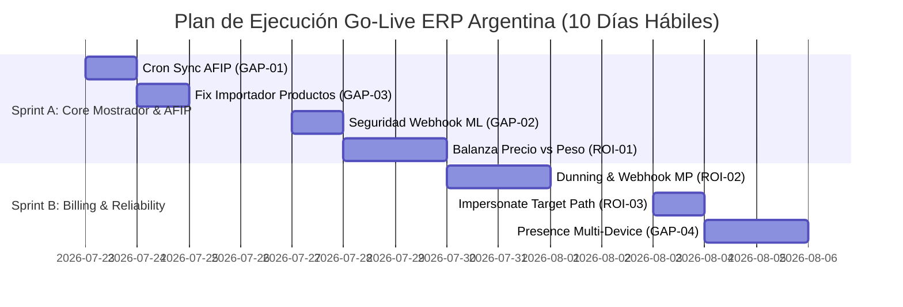

# Informe de Auditoría Técnica Senior: ERP Argentina / Claver Cloud

**Rol Auditor:** Senior Technical Product & Architecture Auditor  
**Proyecto:** ERP SaaS Argentina Multi-Tenant (`pos-system-argentina`)  
**Fecha de Inspección:** 22 de Julio de 2026  
**Stack Auditado:** Next.js 15 App Router, TypeScript Strict, Prisma + PostgreSQL, JWT `jose`, Zustand + SWR, Tailwind v4 / shadcn UI.

---

## 0. Executive summary (Resumen Ejecutivo)

- **Madurez Go-Live Core:** **7.5 / 10**. El núcleo transaccional de caja, ventas POS atómicas, tickets térmicos, esquemas de auth (`getAuthContext` / `getClaverAnalystContext`) e impersonación de soporte están sólidos y bien estructurados.
- **Top 5 Riesgos:**
  1. **Contingencia AFIP Huérfana en Cron:** El endpoint `/api/cron/sync-afip` está arrinconado en `_backup_rutas_rotas`. Las ventas en `pendiente_cae` nunca se reintentan automáticamente en background.
  2. **Importador de Productos Degradado en UI:** `app/dashboard/productos/page.tsx` ignora el componente `CSVImport` y usa un parser naive (`lineas.slice(1).map`), rompiendo en CSVs con encabezados reales o separadores no estándar.
  3. **MercadoLibre Webhook sin Validación de Firma:** `/api/webhooks/mercadolibre/[empresaId]` procesa payloads sin verificar HMAC/secret, expuesto a spoofing por `empresaId`.
  4. **Presence Multi-Dispositivo Falso Positivo:** `useResourcePresence` usa `BroadcastChannel` (solo pestañas del mismo navegador local). No sincroniza entre distintas PCs del mostrador.
  5. **Dependencia de variables opcionales para alertas comerciales:** Si `MP_WEBHOOK_SECRET` o `CRON_SECRET` no se cargan en Vercel Prod, el health comercial da `NO-GO`.
- **Top 3 Quick Wins:**
  1. Restaurar `/api/cron/sync-afip` desde `_backup_rutas_rotas` y registrarlo en `vercel.json` (1 hora).
  2. Conectar `CSVImport` (`components/csv-import.tsx`) en la pantalla de productos `/dashboard/productos` (2 horas).
  3. Agregar verificación de firma HMAC / secret token en el webhook de MercadoLibre (2 horas).

---

## 1. Gaps críticos (P0/P1)

| ID | Sev | Área | Síntoma | Evidencia (path) | Impacto Negocio | Fix Mínimo | Esfuerzo |
|:---|:---:|:---|:---|:---|:---|:---|:---:|
| **GAP-01** | **P0** | AFIP / Contingencia | Facturas en `pendiente_cae` nunca se sincronizan solas en segundo plano. | [_backup_rutas_rotas/cron/sync-afip/route.ts](file:///c:/Users/Pablo%20Clavero/Downloads/pos-system-argentina/_backup_rutas_rotas/cron/sync-afip/route.ts#L15) vs [app/api/cron/](file:///c:/Users/Pablo%20Clavero/Downloads/pos-system-argentina/app/api/cron) | Incumplimiento AFIP (<24h para reportar contingencias). Facturas del mostrador quedan sin CAE a menos que el usuario presione manualmente "Reintentar". | Mover `sync-afip/route.ts` a `app/api/cron/sync-afip/route.ts`, proteger con `requireCronAuth` e invocar `syncFacturasPendientes()`. Configurar cron en `vercel.json`. | 1 h |
| **GAP-02** | **P0** | Seguridad / Webhook | El webhook de MercadoLibre acepta POSTs sin validar token ni firma de seguridad. | [app/api/webhooks/mercadolibre/[empresaId]/route.ts:L9-L20](file:///c:/Users/Pablo%20Clavero/Downloads/pos-system-argentina/app/api/webhooks/mercadolibre/%5BempresaId%5D/route.ts#L9-L20) | Un atacante puede forzar la ingesta de pedidos arbitrarios modificando el `empresaId` en la URL (IDOR / Inyección de estado). | Validar header `x-signature` o token de verificación usando [validarFirmaWebhook](file:///c:/Users/Pablo%20Clavero/Downloads/pos-system-argentina/lib/auth/webhook-guard.ts#L72). | 2 h |
| **GAP-03** | **P1** | Stock / Importación | El importador de productos falla o corrompe datos si las columnas no coinciden exactamente en orden/formato. | [app/dashboard/productos/page.tsx:L197-L223](file:///c:/Users/Pablo%20Clavero/Downloads/pos-system-argentina/app/dashboard/productos/page.tsx#L197-L223) | Bloquea el onboarding de comercios con listas de precios extensas en Excel/CSV. Genera errores de casting de precios/costos. | Reemplazar la lectura cruda `lineas.slice(1)` en `productos/page.tsx` por el componente [CSVImport](file:///c:/Users/Pablo%20Clavero/Downloads/pos-system-argentina/components/csv-import.tsx#L1). | 2 h |
| **GAP-04** | **P1** | Concurrencia / Ops | El indicador de presencia de usuarios solo funciona en pestañas del mismo browser. | [hooks/use-presence.ts:L1-L40](file:///c:/Users/Pablo%20Clavero/Downloads/pos-system-argentina/hooks/use-presence.ts#L1-L40) | Promesa falsa de colisión multi-caja o multi-vendedor en OTs/presupuestos cuando trabajan desde computadoras distintas. | Agregar fallback / canal vía SSE o Supabase Realtime para presencia multi-device real. | 1 día |

---

## 2. Mejoras alto ROI (P2 - ≤ 2 días)

| ID | Sev | Área | Síntoma | Evidencia (path) | Impacto Negocio | Fix Mínimo | Esfuerzo |
|:---|:---:|:---|:---|:---|:---|:---|:---:|
| **ROI-01** | **P2** | POS Mostrador | No hay selector visual para configurar balanzas en modo "precio" vs modo "peso" por terminal. | [lib/pos/ean13-scale-parser.ts:L52-L98](file:///c:/Users/Pablo%20Clavero/Downloads/pos-system-argentina/lib/pos/ean13-scale-parser.ts#L52-L98) | Fiambrerías y verdulerías que pesan en gramos requieren interpretar `20LLLLLVVVVVC` como peso y no como centavos ARS. | Persistir `preferredMode` ("price" \| "weight") en `ConfiguracionImpresora` / localStore y pasar a `parseEAN13ScaleBarcode`. | 4 h |
| **ROI-02** | **P2** | Billing / Claver | Falta notificación visible cuando MP rechaza el cobro recurrente de la suscripción SaaS. | [lib/billing/mercadopago-subscription.ts:L225-L228](file:///c:/Users/Pablo%20Clavero/Downloads/pos-system-argentina/lib/billing/mercadopago-subscription.ts#L225-L228) | Fuga de ingresos SaaS (dunning no avisa al admin del tenant cuando la tarjeta rebotó). | Al recibir `status === "paused"` o `"cancelled"`, enviar email vía `Resend` y mostrar banner de pago vencido en `/dashboard`. | 6 h |
| **ROI-03** | **P2** | Soporte Ops | En `TenantHealthCard`, la acción de impersonación redirige siempre a `/dashboard/configuracion` sin retener la pantalla del problema. | [lib/ops/impersonation-service.ts:L48](file:///c:/Users/Pablo%20Clavero/Downloads/pos-system-argentina/lib/ops/impersonation-service.ts#L48) | El analista de soporte pierde segundos navegando manualmente al módulo reportado por el cliente. | Aceptar un parámetro opcional `targetPath` en `iniciarImpersonacionTenant` para redirigir directamente al recurso afectado. | 3 h |

---

## 3. Código huérfano / half-wired

1. **`lib/afip/sync-pendientes.ts` (Job de Contingencia AFIP):**  
   - *Dónde está:* `lib/afip/sync-pendientes.ts` y respaldado en `_backup_rutas_rotas/cron/sync-afip/route.ts`.  
   - *Falta de conexión:* Ningún endpoint cron activo en `app/api/cron/` lo llama en producción.  
   - *Riesgo:* **Falso HECHO**. En la matriz figura como "mejorado", pero sin cron no ejecuta el reintento automático.

2. **`components/csv-import.tsx` & `lib/utils/excel-column-matcher.ts` (Importador Inteligente):**  
   - *Dónde está:* `components/csv-import.tsx`.  
   - *Falta de conexión:* Solo se importa en `app/dashboard/clientes/page.tsx`. La pantalla de productos (`app/dashboard/productos/page.tsx`) mantiene una implementación ad-hoc frágil.  
   - *Riesgo:* **Falso HECHO** en catálogo de productos.

3. **`parseBalanzaEAN13` (Alias Megaprompt):**  
   - *Dónde está:* `lib/pos/ean13-scale-parser.ts` (L101).  
   - *Falta de conexión:* Solo existe para compatibilidad en test unitario (`ean13-scale-parser.test.ts`). En POS se usa `parseEAN13ScaleBarcode`. No es un problema crítico, pero es código espejo.

---

## 4. Desalineación doc ↔ código

1. **`docs/prompts/MEGAPROMPTS_GROK_DESARROLLO.md` vs Cron AFIP:**  
   - *Doc:* Clasifica la contingentación AFIP como `HECHO/PARCIAL→mejorado` indicando `lib/afip/sync-pendientes.ts`.  
   - *Código:* La ruta de ejecución periódica `/api/cron/sync-afip` fue archivada en `_backup_rutas_rotas`.

2. **`docs/GO_LIVE_PRD.md` vs Modalidad Balanza:**  
   - *Doc (§3.2):* Marca "Carnicería / balanza" como "Entitlements y unidad kg incompletos".  
   - *Código:* El parser `lib/pos/ean13-scale-parser.ts` ya soporta `weightGrams` y `weightKg`, pero la UI de POS asume por defecto `totalPrice` (modo importe).

---

## 5. Plan de 2 Sprints (10 días hábiles)



### Sprint A (Días 1 a 5): Cierre de Gaps P0 y Estabilidad Mostrador
- **Día 1: Restablecer Cron AFIP (GAP-01)**
  - *DoD:* Crear `app/api/cron/sync-afip/route.ts` exportando `GET/POST` protegido con `requireCronAuth`. Agregar la entrada en `vercel.json`. Test de integración ejecutado.
- **Día 2: Conectar Importador Inteligente en Productos (GAP-03)**
  - *DoD:* Reemplazar la lógica de parseo simple en `app/dashboard/productos/page.tsx` usando `CSVImport`. Validar la importación exitosa de un archivo con 500 ítems con columnas en español.
- **Día 3: Blindar Webhook MercadoLibre (GAP-02)**
  - *DoD:* Incorporar la verificación de firmas HMAC / token de seguridad en `app/api/webhooks/mercadolibre/[empresaId]/route.ts`. Retornar `401 Unauthorized` si la firma es inválida.
- **Días 4–5: Soporte Completo Balanzas EAN-13 (ROI-01)**
  - *DoD:* Agregar switch "Modo Balanza: Importe ($) / Peso (kg)" en la configuración del POS. Verificar que `parseEAN13ScaleBarcode` calcule el peso exacto en kg y ajuste la cantidad en el carrito.

### Sprint B (Días 6 a 10): SaaS Billing, Soporte y Concurrencia
- **Días 6–7: Dunning y Notificaciones de Suscripción MP (ROI-02)**
  - *DoD:* Al recibir webhook de suspensión/cancelación de suscripción en `/api/webhooks/mercadopago`, marcar `mpSubscriptionStatus`, enviar email de aviso por Resend y mostrar aviso visual en el dashboard del cliente.
- **Día 8: Impersonación con Target Path Directo (ROI-03)**
  - *DoD:* Permitir que `iniciarImpersonacionTenant` reciba un `redirectUrl` dinámico (ej: `/dashboard/ot/123`). Validar redirección directa desde `TenantPropiedadTab`.
- **Días 9–10: Presencia Multi-Device Real (GAP-04)**
  - *DoD:* Evolucionar `useResourcePresence` para emitir latidos vía SSE / Supabase Realtime cuando dos usuarios editen la misma Orden de Servicio o Presupuesto desde navegadores o equipos distintos.

---

## 6. Anti-alcance (NO hacer ahora)

1. **Reescritura de Auth o Migración a NextAuth:** El sistema utiliza JWT directo (`jose`) + `getAuthContext`. Mantener al 100%.
2. **Nuevos Engines para Verticales Demo:** No desarrollar funciones avanzadas para Veterinaria, Gimnasios o Talleres mecánicos más allá de los pilots acotados en `docs/GO_LIVE_PRD.md` §3.2.
3. **Facturación AFIP Completa en Modo Serverless In-Memory:** No intentar mantener la sesión AFIP en memoria global de Node; continuar usando el flujo persistido en DB (`pendiente_cae` -> reintento).
4. **Refactorización de Tailwind v4 o shadcn:** El sistema visual OKLCH está consolidado. No alterar tokens de estilo.

---

## 7. Preguntas abiertas

1. ¿El token de producción de Mercado Pago (`MP_ACCESS_TOKEN`) ya está configurado en las variables de entorno de Vercel Production? *(Status check: `GET /api/go-live/status`)*.
2. Para el cron de sincronización AFIP (`/api/cron/sync-afip`), ¿se utilizará Vercel Cron Jobs nativo o un servicio externo de ping (ej. Upstash / GitHub Actions)?
3. En el mostrador de balanza, ¿la regla de negocio predominante en los clientes piloto es EAN-13 por importe (centavos) o por peso (gramos)?
4. ¿Hay clientes actualmente operando en modo contingencia AFIP que requieran ejecutar un barrido manual de `syncFacturasPendientes()` de inmediato?

---

### Snippet Ilustrativo: Fix P0 para Cron AFIP (`app/api/cron/sync-afip/route.ts`)

> **Implementado (Track Grok — 2026-07-22).** Ver §8.

```typescript
// app/api/cron/sync-afip/route.ts — requireCronAuth + syncFacturasPendientes
// app/api/cron/dispatch/route.ts — scheduler (incluye sync-afip en registry)
// vercel.json — trial-dunning diario, sync-afip horario, dispatch */5
```

---

## 8. Ownership de implementación (Grok vs Gemini)

### Reglas
- No tocar paths del otro agente el mismo día.
- Un PR por agente (o commit range claro).
- Al terminar: marcar IDs como DONE + fecha + evidencia.

### Track Grok — Runtime P0

| ID | Estado | Evidencia |
|----|--------|-----------|
| **GAP-01** Cron AFIP | **DONE** 2026-07-22 | `app/api/cron/sync-afip/route.ts`, `app/api/cron/dispatch/route.ts`, `vercel.json` (sync-afip `0 * * * *`, dispatch `*/5 * * * *`) |
| **GAP-02** Webhook ML | **DONE** 2026-07-22 | `validarWebhookMercadoLibre` en `lib/auth/webhook-guard.ts`; route `app/api/webhooks/mercadolibre/[empresaId]/route.ts`; tests en `__tests__/auth/webhook-guard.test.ts` |

**Cómo probar GAP-01**
```bash
# Con CRON_SECRET en .env
curl -H "Authorization: Bearer $CRON_SECRET" https://<host>/api/cron/sync-afip
curl -H "Authorization: Bearer $CRON_SECRET" "https://<host>/api/cron/dispatch?catalog=1"
```

**Cómo probar GAP-02**
```bash
# Sin secret → 401
curl -X POST https://<host>/api/webhooks/mercadolibre/1 -d '{}'
# Con secret → 200/404 empresa
curl -X POST -H "Authorization: Bearer $ML_WEBHOOK_SECRET" \
  -H "Content-Type: application/json" \
  -d '{"topic":"items"}' \
  https://<host>/api/webhooks/mercadolibre/1
```

**Env prod requerido**
- `CRON_SECRET` (obligatorio en production para crons)
- `ML_WEBHOOK_SECRET` o `WEBHOOK_SECRET` (obligatorio en production para ML)
- Opcional: `ML_WEBHOOK_ALLOW_QUERY=1` si la URL de notificación ML lleva `?token=`

### Track Gemini — Producto P1/P2 (Implementado por Gemini)

| ID | Estado | Evidencia |
|----|--------|-----------|
| **GAP-03** CSVImport en productos | **DONE** 2026-07-22 | `app/dashboard/productos/page.tsx` usando `CSVImport` + `excel-column-matcher.ts` |
| **ROI-01** Modo balanza price/weight | **DONE** 2026-07-22 | `modoBalanza` ($ / kg) + toggle en `app/dashboard/pos/page.tsx` + `parseEAN13ScaleBarcode` |
| **ROI-03** Impersonate targetPath | **DONE** 2026-07-22 | `targetPath` en `lib/ops/impersonation-service.ts`, `/api/claver/tenants/[empresaId]/impersonate` y UI Claver Cloud |

### Track compartido (secuencial, pendiente)
- ROI-02 Dunning MP
- GAP-04 Presence multi-device
