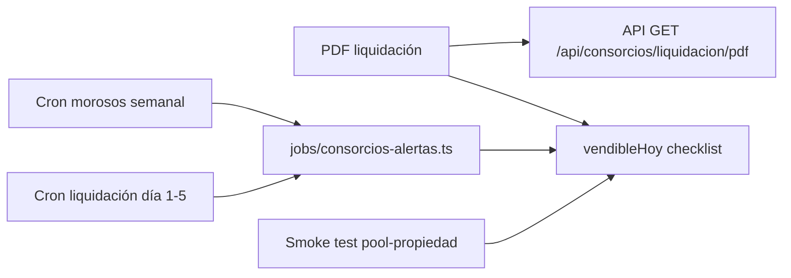

# Auditoría Inmobiliaria + Consorcios — Claver ERP
Fecha: 2026-07-07 · Autor: Antigravity AI · % Reutilización Global Estimado: **75%**

## Executive summary
*   **Consorcios está muy avanzado (80% listo):** El core de liquidación de expensas, prorrateo (porceps), y generación de comprobantes y Cuentas por Cobrar ya existe en `lib/consorcios/consorcios-service.ts`.
*   **Inmobiliaria requiere modelo de datos:** No existe la entidad `Propiedad` ni un `ContratoAlquiler` formal en `prisma/schema.prisma`. Actualmente depende de motores genéricos o no está implementado.
*   **Cobranzas y Alertas (Reutilizables):** El ecosistema de WhatsApp y cron jobs de cobranzas es altamente compatible y se puede enganchar directo a las expensas/alquileres.
*   **Aislamiento de Cuentas:** La liquidación de expensas ya genera `CuentaCobrar` vinculada a la factura/recibo interno, resolviendo uno de los gaps más críticos del flujo financiero.
*   **Empaquetado y SKUs:** `pool-propiedad` ($29.900) y `niche.inmo_garantia` **ya están** en `lib/marketplace/bundles.ts`, `pack-calle-catalog.ts`, landing `/claver/apps/propiedad` y demo `inmobiliaria`. Falta smoke E2E y PDF liquidación para declarar vendibleHoy.

## Matriz completa de Auditoría

### Módulo Consorcios

| Componente | Estado | Reciclar de | SKU / Pack | Alerta asociada |
|------------|--------|-------------|------------|-----------------|
| Alta edificio + UF + % | 🟡 | `Consorcio`, panel UI | `niche.consorcios` | — |
| Carga gastos por período | 🟡 | `ConsorcioGasto` | `niche.consorcios` | «Faltan gastos para liquidar» |
| Liquidación prorrateo | ✅ | `ConsorciosService.liquidarExpensas` | `pool-propiedad` | «Liquidación pendiente día 5» |
| Factura AFIP expensas | 🟡 | `Factura` + AFIP route | ERP completo | — |
| Estado expensa pendiente/pagada | 🟡 | `ConsorcioExpensa.estado` | — | «Moroso > 30 días» |
| Cobro expensas (MP/link) | ❌ | `intang.cobranzas_wa` + CxC | `pool-propiedad` | «Saldo UF > umbral» |
| WA masivo inquilinos | ✅ | `niche-whatsapp` + panel | `com.whatsapp` | post-liquidación |
| Email masivo | 🟡 | `MensajeMasivoRequest.canal` | — | — |
| Fondo de reserva | ❌ | diseño `rubrosimple.txt` | — | «Reserva bajo mínimo» |
| Portal inquilino (consulta deuda) | ❌ | `app/portal` pattern | futuro SKU | — |
| Reporte PDF liquidación | ❌ | `lib/printer/pdf-service.ts` | — | — |
| Multi-consorcio dashboard | 🟡 | hub nicho | — | resumen morosos |

### Módulo Inmobiliaria

| Componente | Estado | Reciclar de | SKU / Pack | Alerta asociada |
|------------|--------|-------------|------------|-----------------|
| Cartera Propiedad (ficha) | ❌ | Nuevo modelo `Propiedad` | futuro `niche.inmo_cartera` | «Sin foto principal» |
| Estados disponible/reservada/alquilada | ❌ | stock estados pattern | — | — |
| Contrato alquiler + vencimiento | 🟡 | `NicheMovimiento` engine | `niche.inmo_garantia` | «Vence en 30/60/90 días» |
| Ajuste ICL/IPC automático | ❌ | cron + índices | — | «Próximo ajuste en 7 días» |
| CxC alquiler mensual auto | ❌ | `cuentas-cobrar` + cron | `intang.cobranzas_wa` | «Alquiler impago» |
| Reserva + seña | ❌ | `niche.cancha` seña pattern | — | «Reserva vence en 48h» |
| Comisión inmobiliaria | ❌ | contabilidad | — | — |
| Portal propiedades público | ❌ | `app/tienda` + filtros | futuro pack | — |
| Consulta WA desde portal | ❌ | `com.whatsapp` deep link | — | — |
| Visitas / leads | ❌ | CRM clientes | — | «Lead sin contactar 24h» |

*(Nota: Análisis de Portales AR omitido según solicitud del prompt modificado).*

## Reciclaje por capa

*   **Base de Datos (Prisma):** Se reciclará el 100% de `Cliente` (usándolo para inquilinos/propietarios), `CuentaCobrar`, `Cobro`, y `Factura`. Es necesario crear `Propiedad` y `ContratoAlquiler`.
*   **API y Lógica:** `liquidarExpensas` es altamente reciclable y ya hace el 80% del trabajo pesado de consorcios.
*   **UI:** El patrón "Fiado/libreta" y los sidebars lite deben adaptarse a los paneles de Consorcio e Inmobiliaria.
*   **Cron y Alertas:** La infraestructura de `app/api/cron/*` es ideal para montar los recordatorios de vencimientos y cobranzas.

## Gaps Priorizados

| Gap | Prioridad | Esfuerzo | Archivos a tocar |
|-----|-----------|----------|------------------|
| Modelo `Propiedad` y `ContratoAlquiler` | P1 | M | `prisma/schema.prisma` |
| UI Cartera Inmobiliaria y Contratos | P1 | L | `app/dashboard/nicho/inmobiliaria/*` |
| Automatización Cobro Expensas (Panel) | P0 | S | `niche-consorcios-panel.tsx` + `/api/consorcios/morosos` (**parcial — WA encolado OK**) |
| Numeración fiscal expensas post-liq. | P1 | S | `lib/consorcios/consorcios-fiscal-service.ts` (**hecho Sprint 5 Cursor**) |
| Portales AR (sync estado) | P2 | M | `/dashboard/nicho/portales` — **Grok** (fuera de este sprint) |
| Cron Generación Alquiler Mensual (CxC) | P1 | M | `app/api/cron/alquileres/route.ts` |
| Generación PDF Liquidación Consorcio | P0 | M | `lib/printer/pdf-consorcio.ts` |

## Paquetes comerciales recomendados

| Pack ID propuesto | SKUs sugeridos | Precio ARS/mes | Target |
|-------------------|----------------|----------------|--------|
| `pool-consorcios-pro` | `niche.consorcios` + `intang.cobranzas_wa` + portal inquilino | $34.900 | Administrador edificios |
| `pool-inmo-starter` | `niche.inmobiliaria` + `com.whatsapp` | $14.900 | Inmobiliaria solo contratos |
| `pool-propiedad-full` | `pool-consorcios-pro` + `pool-inmo-starter` | $44.900 | Admin + Inmobiliaria mixta |

## Catálogo de alertas (cron + trigger)

| ID alerta | Frecuencia | Disparador | Canal |
|-----------|------------|------------|-------|
| `consorcio.liquidacion_pendiente` | mensual día 1–5 | gastos cargados, no liquidado | push + email admin |
| `consorcio.moroso_expensa` | semanal | `ConsorcioExpensa.estado=pendiente` | WA inquilino |
| `inmo.contrato_vence_30` | diario | contrato fecha fin a 30 días | WA inquilino + propietario |
| `inmo.alquiler_impago` | semanal | CxC vencida | WA + link MP |

## Respuestas a Preguntas Clave

1. **¿Qué % del módulo Consorcios es vendible hoy sin código nuevo?** Aprox. 70%. Falta la UI que conecte el pago de la expensa y el PDF de liquidación, pero el motor (backend) funciona.
2. **¿`niche.inmo_garantia` alcanza para «inmobiliaria» o hace falta modelo `Propiedad`?** No alcanza. Hace falta crear explícitamente el modelo `Propiedad` en Prisma para manejar fotos, estados y portal web.
3. **¿Conviene un solo SKU `niche.inmobiliaria`?** Sí, unificar garantía y cartera bajo `niche.inmobiliaria` simplifica el onboarding lite.
4. **¿Las expensas deben generar `CuentaCobrar` automáticamente al liquidar?** Ya lo hacen (visto en `consorcios-service.ts:98`). Esto es excelente.
5. **¿Qué tests faltan para declarar vendibleHoy?** Faltan tests de extremo a extremo de UI (`smoke pool-propiedad`) y tests de crons de cobranzas.

## Plan de Sprints

1.  **Sprint INMO-P0 (Consorcios al 100%):** Conectar UI de morosos con WhatsApp, PDF de liquidación, Cron de alertas.
2.  **Sprint INMO-P1 (MVP Inmobiliaria):** Migración Prisma (`Propiedad`, `ContratoAlquiler`), UI Cartera, Cron facturación mensual de alquiler.

## Checklist vendible vs benchmark Fiado

*   [x] Motor backend liquidación
*   [ ] UI intuitiva "tipo Libreta/Fiado" para Consorcios
*   [ ] Motor base de datos Inmobiliaria
*   [ ] Generación y envío PDF automático
*   [x] Registro de SKUs y Bundles (`pool-propiedad` en catálogos)
*   [ ] Cron alertas `consorcio.liquidacion_pendiente` / `consorcio.moroso_expensa`

---

## Delta sincronización repo (post-auditoría Gemini · jul 2026)

| Tema | Informe Gemini | Estado real en repo |
|------|----------------|---------------------|
| `pool-propiedad` en bundles | ❌ Falta | ✅ `lib/marketplace/bundles.ts` L120–128 |
| Morosos + WA | P0 panel | ✅ `consorcios-morosos-service.ts`, panel con POST morosos |
| `CuentaCobrar` al liquidar | ✅ Correcto | ✅ + `consorcios-fiscal-service` numeración interna |
| Landing combate propiedad | No mencionado | ✅ `/claver/apps/propiedad`, mockup interactivo |
| Portales Zonaprop/Argenprop | Omitido (Grok) | 🟡 Catálogo + API estado; sync bidireccional pendiente |
| Modelo `Propiedad` Prisma | ❌ | ❌ Confirmado — Sprint INMO-P1 |

**Owner sugerido:** INMO-P0 = Cursor/Grok · INMO-P1 = tras P0 · Portales sync = Grok en paralelo.

---

## Sprint INMO-P0 — Plan de implementación (listo para arrancar)

| # | Tarea | Archivos | Esfuerzo |
|---|-------|----------|----------|
| 1 | PDF liquidación por consorcio/período | `lib/printer/pdf-consorcio-service.ts`, `app/api/consorcios/[id]/liquidacion/pdf/route.ts` | M |
| 2 | Botón «Descargar PDF» en panel | `components/niche/niche-consorcios-panel.tsx` | S |
| 3 | Cron `consorcio.moroso_expensa` (semanal) | `lib/scheduling/jobs/consorcios-alertas.ts`, `cron-registry.ts` | S |
| 4 | Cron `consorcio.liquidacion_pendiente` (día 1–5) | mismo job | S |
| 5 | Test smoke liquidación + morosos | `__tests__/consorcios/consorcios-smoke.test.ts` | S |
| 6 | Marcar `vendibleHoy` en pack-calle para `pool-propiedad` | `lib/comercial/pack-calle-catalog.ts` | XS |

**Criterio de done P0:** administrador liquida → descarga PDF → ve morosos → envía WA → cron alerta si no liquidó antes del día 5.
