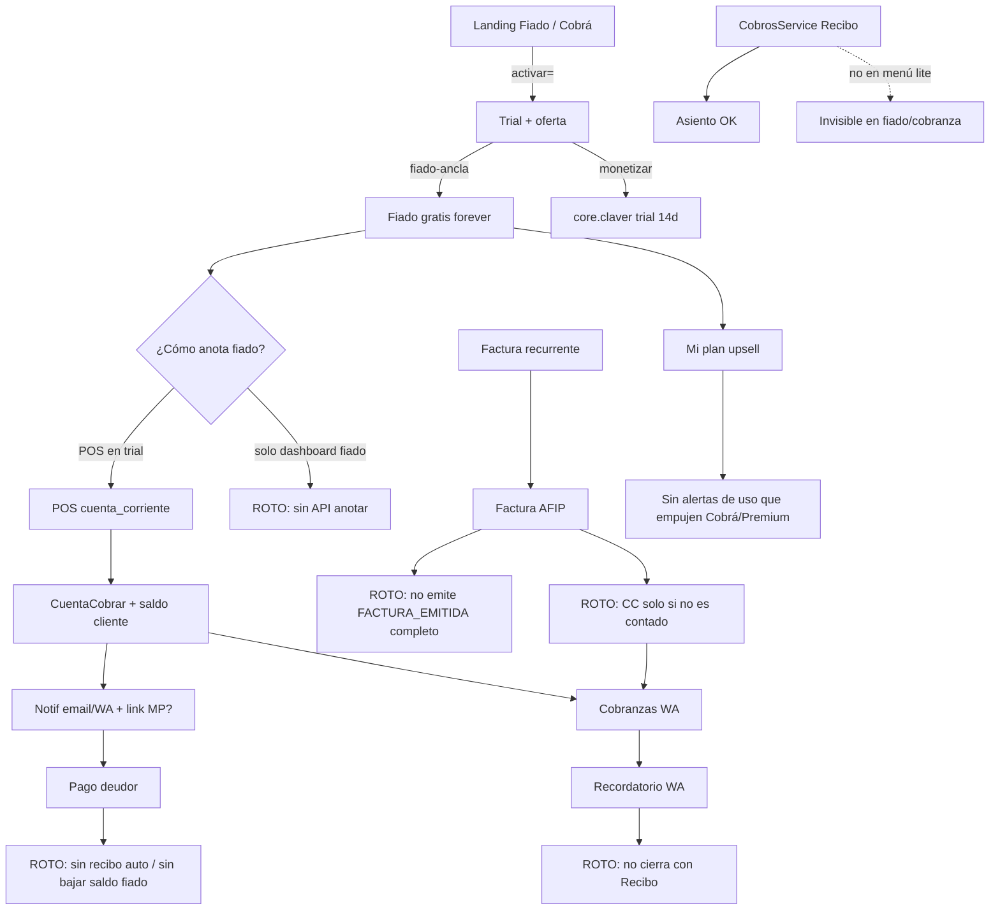

# Auditoría de ingeniería comercial + lógica funcional

> **Fecha:** 2026-07-13  
> **Alcance:** trial → fiado (ancla gratis) → cobranza WA → recibo → factura por servicio recurrente → upsell premium  
> **Objetivo:** diagnóstico fehaciente para alinear producto, catálogo y embudo (no es un plan de implementación ejecutado).

---

## Respuesta corta

**No.** Hoy el sistema **no** está alineado de punta a punta de forma fehaciente, lineal y coherente entre:

- marketing (home / precios),
- oferta comercial (ancla gratis),
- trial / entitlements,
- fiado operativo,
- cobranza WA,
- recibo,
- factura por servicio recurrente,
- upsell a premium por alertas.

Hay **piezas reales y bien hechas**, pero la **cadena de valor se corta en varios eslabones**. Este documento es la fuente de verdad del diagnóstico para el backlog de corrección.

---

## 1. Modelo comercial que el código *pretende*

### 1.1 Ancla “Fiado gratis” (intención correcta)

Fuente: `lib/comercial/ofertas-comerciales.ts`

| Oferta | Ancla gratis | Monetiza | Trial | Precio pack |
|--------|--------------|----------|-------|-------------|
| `fiado-ancla` | `pos.fiado_barrio` | `core.claver` | 14 días solo sobre lo monetizado | **$12.900/mes** |
| `pos-ancla` | `core.claver` | `pos.fiado_barrio` | 14 días | — |
| `clasico-trial` | (nada) | todo el enganche | 14 días todo | — |

**Intención de producto:**

```
Landing Fiado → trial 14d (POS/caja/stock) → Fiado queda gratis para siempre
                                              → upsell a Cobrá WA / ClavPay / Core / Premium
```

- `vigenciaParaSku`: ancla → `vigenciaHasta: null` (permanente); monetizado → fecha de fin de trial.
- `getComercialAccessState` + tests: **si hay ancla gratis, el trial vencido no bloquea todo el tenant**.
- `/dashboard/mi-plan` y `/dashboard/trial-vencido` **sí entienden** “libreta gratis + módulos de pago vencidos”.

### 1.2 Precios y mensajes en catálogo (contradicción)

| Fuente | Fiado | Cobranza WA |
|--------|-------|-------------|
| `ofertas-comerciales` | **Gratis permanente** (ancla) | No es ancla; trial clásico |
| `enganche-catalog` / docs marketplace | **$4.990/mes** | **$20.000/mes** |
| `sub-saas-catalog` | **$4.990/mes** | **$20.000/mes** |
| Home / GTM | “Probar gratis 14 días” (no dice “gratis para siempre”) | Idem |
| FAQ landing | “enganches desde $4.990 (Libreta Fiado)” | — |
| `productoComercial` seed en onboarding | precio **4990** | — |

**Gap comercial #1:** el motor de acceso dice **gratis forever**; el catálogo, SEO y App Store venden **$4.990/mes**. No hay una sola fuente de verdad de precio.

### Referencias de código (ofertas y acceso)

| Pieza | Path |
|-------|------|
| Ofertas ancla | `lib/comercial/ofertas-comerciales.ts` |
| Acceso trial / ancla / upsell | `lib/comercial/comercial-access-service.ts` |
| Trial countdown | `lib/comercial/trial-service.ts` |
| Trial guard | `lib/comercial/trial-guard.ts` |
| Activación `?activar=` | `lib/comercial/activar-producto-service.ts` |
| Onboarding retail + vigencia SKU | `lib/comercial/retail-onboarding-service.ts` |
| Enganches y precios de catálogo | `lib/marketplace/enganche-catalog.ts` |
| Sub-SaaS (precios vitrine) | `lib/comercial/sub-saas-catalog.ts` |
| Docs enganches | `docs/marketplace/12-enganches-comerciales.md` |

---

## 2. Cadena esperada vs cadena real

### A) Trial / activación (`?activar=fiado`)

```
Register/Login → applyActivarIntent
  → setTrial 14d (ParametroFiscal)
  → applyRetailOnboarding
      → modoLite = fiado
      → activar SKUs del enganche
      → resolveOferta → fiado-ancla
      → suscripcionModulo con vigencia por SKU
      → persistOfertaEmpresa
```

**Estado:** **funcional en backend** para el happy path de activación.

| # | Gap | Impacto |
|---|-----|---------|
| A1 | Landing y shell a veces usan `trial=14` genérico sin `activar=` | Entra sin oferta/ancla; cae en `clasico-trial` |
| A2 | `TrialBanner` no usa `access.tieneAnclaGratis` | Mensaje “trial terminó / activá plan” aunque fiado siga gratis |
| A3 | Cobrá (`intang.cobranzas_wa`) **no** tiene oferta ancla; solo trial 14d clásico | Tras 14 días, cobranza debería cortar (si entitlements se respetan) |

---

### B) Fiado operativo: anotar deuda → avisar → cobrar

**Flujo que sí existe (vía POS):**

```
POS venta medio=cuenta_corriente
  → Factura
  → CuentaCobrar (directo en tx)
  → incrementarDeudaCliente (saldo CC del cliente)
  → emitFacturaEmitida
  → enviarNotificacionFiado (email + WA opcional + link MP si hay ClavPay/MP)
```

**Estado de esa rama:** **lineal y creíble**  
Código: `app/api/pos/venta/route.ts` + `lib/fiado/fiado-service.ts`.

| # | Gap | Impacto |
|---|-----|---------|
| B1 | `modoLite: fiado` en sidebar **no incluye POS** ni facturación | Menú: dashboard, fiado, clientes, config (`lib/comercial/lite-sidebar.ts`) |
| B2 | APIs `/api/fiado/*` solo: resumen, deudores, config, alta rápida de cliente | **No hay “anotar fiado” ni “registrar pago” sin POS** |
| B3 | Tras vencer trial de `core.claver`, el ancla deja libreta **sin mostrador** | El producto gratis queda como **visor de deudas** si no se cargaron vía POS en el trial |
| B4 | Link de pago MP depende de `fiscal.clavpay_link` / MP checkout | Upsell real, pero **no hay cierre automático de recibo** al pagar el link |
| B5 | Webhook MP del repo apunta a **suscripción SaaS Claver**, no a cobro de deudor de fiado | Pago del cliente final ≠ baja de deuda + recibo |

**Conclusión B:** la **intención** “fiado gratis y después premium” está en ofertas; la **experiencia lineal de calle** (anotar en libreta sin ERP) **no está cerrada**. Depende del POS de pago en trial.

---

### C) Cobranza WA (`intang.cobranzas_wa`)

**Al activar SKU** (`lib/platform/product-hooks.ts` → `activarSecretariaCobranzas`):

- Crea/actualiza `reglaAlerta` tipo `cxc_vencida`
- Config IA notificaciones + tope diario WA
- Panel ROI: `resumenCobranzasPendientes` lee `cuentaCobrar` vencidas

Fuente: `lib/marketplace/cobranzas-wa-service.ts`

**Estado:** **activación y detección de deuda = OK (parcial)**.

| # | Gap | Impacto |
|---|-----|---------|
| C1 | No genera **recibo** al “cobrar” por WA | Solo recuerda; el cobro formal es otro módulo |
| C2 | No emite **factura** por la cobranza | Correcto contablemente (el cobro no es la factura), pero el marketing “el link cobra” no cierra el circuito contable |
| C3 | `modoLite: cobranza` menú = CxC + clientes | **Sin** recibos, **sin** facturación recurrente, **sin** fiado |
| C4 | Depende de que existan `CuentaCobrar` con teléfono | Si la factura no generó CC, la secretaria **no tiene a quién cobrar** |
| C5 | Cron de cobranzas IA existe; no unificado con “recibo post-pago” | Riesgo de mensajes sin conciliación |

---

### D) Recibo de cobranza

`CobrosService.registrarCobro` (`lib/cobros/cobros-service.ts`):

```
items CC → Recibo + items → actualiza saldos CC → asiento contable → evento RECIBO_EMITIDO
```

**Estado:** **sólido a nivel ERP** (retenciones, cheque, medios de pago).

| # | Gap | Impacto |
|---|-----|---------|
| D1 | No aparece en menú `fiado` ni `cobranza` | Usuario lite no llega al flujo formal de recibo |
| D2 | No se invoca desde fiado ni desde pago MP del deudor | Cadena marketing “cobrá y listo” rota |
| D3 | Fiado usa `saldoCuentaCorriente` del cliente **y** `CuentaCobrar`; el recibo actualiza CC pero no necesariamente resta el saldo de la libreta | Riesgo de **doble libro** (libreta vs CC formal) |

---

### E) Factura por servicio recurrente → cobranza

`lib/ventas/facturacion-recurrente-service.ts` → `procesarFacturasRecurrentes`:

```
FacturaRecurrente vencida
  → crea Factura (pendiente_cae)
  → solicitarCaeFactura
  → onFacturaEmitida (solo asiento contable)
  → actualiza próxima emisión
```

API: `app/api/facturacion-recurrente/route.ts` (acción `procesar` manual).

| # | Gap | Impacto |
|---|-----|---------|
| E1 | **No** llama `emitFacturaEmitida` / event bus completo | No dispara handlers unificados de dominio |
| E2 | `generarCCPorFactura` (`lib/cc-cp/cuentas-service.ts`) **sale si es contado** (`cuotas=1 && dias=0`) | Facturas recurrentes **sin condición de pago a plazo → no generan `CuentaCobrar`** |
| E3 | Sin CC → Cobranza WA **no ve deuda** | Servicio recurrente facturado ≠ cobrable por secretaria |
| E4 | Sin CC → no hay **recibo** aplicable | Cobro del servicio no se cierra en el circuito estándar |
| E5 | No hay cron multi-tenant obvio de `procesarFacturasRecurrentes` (solo API manual) | Emisión “automática” depende de disparo manual o job no unificado |
| E6 | Modo lite cobranza/fiado **no incluyen** `/dashboard/facturacion-recurrente` | El cliente de “servicios recurrentes” no ve el módulo si entró por engache lite |

**Conclusión E:** facturación recurrente **existe como isla**. **No** está cableada de forma lineal a:

`emisión → CxC → alerta/WA → cobro → recibo → (opcional) conciliación`.

---

### F) Upsell a premium por alertas

| Pieza | Estado |
|-------|--------|
| `upsellSkus` en sub-SaaS (fiado → cobranzas_wa, core) | Catálogo OK |
| `comercial-access` arma `upsellSkus` por `modoLite` | OK |
| `mi-plan` muestra upgrade y precio pack | OK |
| Premium ERP 7 activators (reglas de alerta) | OK al activar SKU (`lib/marketplace/premium-activators.ts`) |
| Alertas **in-product** del tipo “tenés $X en deuda vencida → activá Cobrá” | **No hay motor de upsell contextual** ligado a uso de fiado |
| `TrialBanner` | Solo “suscribite / trial”, **no** “fiado gratis + sumá Cobrá por $…” |
| Enganche docs: semana 2 Cobrá si hay deuda | **Documento**, no automatizado en producto |

**Conclusión F:** la **estrategia** de freemium + upsell está en ofertas y en “Mi plan”; **no** hay un sistema de alertas comerciales que convierta uso de fiado en compra de premium de forma fehaciente.

---

## 3. Diagrama de roturas (estado actual)



---

## 4. Matriz “¿está lineal y fehaciente?”

| Tramo | ¿Implementado? | ¿Lineal E2E? | ¿Alineado al discurso comercial? |
|-------|----------------|--------------|----------------------------------|
| Trial 14d al registrarse con `activar` | Sí | Sí (happy path) | Parcial (copy confunde gratis vs trial) |
| Fiado gratis post-trial | Sí (entitlements) | Parcial | **No** (catálogo $4.990) |
| Anotar fiado sin ERP/POS | **No** | **No** | **No** (home promete libreta celular) |
| Notificar deuda | Sí (email/WA condicional) | Parcial | Parcial |
| Link de pago deudor | Parcial (ClavPay/MP) | **No** cierra | “El link cobra” sobredimensionado |
| Cobranza WA sobre CxC | Sí (reglas) | Parcial | Parcial |
| Recibo de cobranza | Sí (ERP) | No en lite | No en embudo engache |
| Factura servicio recurrente | Sí (módulo) | **No** → CC/cobro | No empaquetado en Cobrá |
| Recibo por cobro del recurrente | Solo si hay CC + módulo cobros | **Roto por E2–E4** | No |
| Upsell premium por alertas de uso | Catálogo + mi-plan | **No automatizado** | Intención sí, producto no |

---

## 5. Verdades que sí se pueden afirmar hoy

1. **Existe un diseño de ancla gratis** (`OFERTA_FIADO_ANCLA`) y **tests** de que el trial vencido no aniquila el tenant si hay ancla (`__tests__/comercial/comercial-access-service.test.ts`).
2. **El POS con cuenta corriente** es el único camino robusto fiado → factura → CC → notificación.
3. **Recibos y asientos de cobro** están bien modelados a nivel contable (`lib/cobros/cobros-service.ts`).
4. **Cobranza WA** es un **activador de reglas + panel de deuda**, no un cobrador end-to-end.
5. **Facturación recurrente** emite comprobantes, pero **no cierra el circuito de cobro**.
6. **Upsell** está en datos (`upsellSkus`, mi-plan), no en un **playbook de alertas comerciales** en runtime.

---

## 6. Prioridad de corrección (backlog)

Orden sugerido de ingeniería (**P0** = rompe promesa de venta).

### P0 — Coherencia promesa ↔ producto

1. **Una sola política de precio de Fiado:** gratis forever **o** $4.990; actualizar ofertas, engache, sub-SaaS, FAQ, seed `productoComercial`, landing.
2. **API + UI “anotar fiado / cobrar fiado”** en modo lite (sin exigir POS full).
3. **Al cobrar fiado:** actualizar `saldoCuentaCorriente` **y** `CuentaCobrar` **y** generar **Recibo** (un solo servicio de dominio).
4. **Factura recurrente → siempre generar CC** (aunque sea 1 cuota a N días o vencimiento = día de emisión + N) + `emitFacturaEmitida`.

### P1 — Funnel cobro

5. Webhook/callback de pago MP del **deudor** → aplicar cobro + recibo + baja de libreta.
6. Menú lite `cobranza`: CxC + recibos + (opcional) facturación recurrente.
7. Cron multi-tenant de `procesarFacturasRecurrentes` + job de secretaria WA.

### P2 — Upsell fehaciente

8. Motor de alertas comerciales:
   - “Tenés N deudores / $X vencido → activá Cobrá WA”
   - “Trial POS vence en 3 días; Fiado sigue gratis”
9. `TrialBanner` consciente de ancla (no asustar al usuario de fiado gratis).
10. Oferta explícita `cobra-ancla` o pack “Fiado gratis + Cobrá trial” si ese es el GTM.

### P3 — Hardening

11. Unificar `aplicarRecibo` (hay dos caminos: `CobrosService` vs `CuentasService.aplicarRecibo`).
12. Entitlements: `canUseSku` vs `canWriteSku` — asegurar que cobranzas expiradas no sigan enviando WA.
13. Tests E2E del happy path comercial (sección 7).

---

## 7. Happy path objetivo (definición de “alineado”)

Para dar por **cerrado** el producto en ingeniería comercial:

```
1. Signup ?activar=fiado
2. Oferta fiado-ancla: fiado vigencia null + core trial 14d
3. Anotar fiado en /dashboard/fiado (sin POS)
4. Ver deudor, deuda y límite
5. (Opcional trial) POS también fía y notifica
6. Al día N: alerta in-app “activá Cobrá” si deuda > umbral
7. Activar Cobrá → mensajes WA a morosos
8. Cliente paga (MP o manual) → Recibo + CC pagada + saldo fiado 0
9. Servicio recurrente: alta plan → cron emite Factura + CC → Cobrá avisa → Recibo
10. Trial core vence: fiado sigue; POS bloqueado; mi-plan muestra upgrade claro
```

**Hoy se cumplen de forma confiable aprox. 1–2 y parte de 5;** el resto está **roto, parcial o desconectado**.

---

## 8. Mapa de archivos clave

| Dominio | Archivos |
|---------|----------|
| Ofertas / ancla | `lib/comercial/ofertas-comerciales.ts` |
| Acceso comercial | `lib/comercial/comercial-access-service.ts` |
| Activar intent | `lib/comercial/activar-intent.ts`, `activar-producto-service.ts` |
| Onboarding retail | `lib/comercial/retail-onboarding-service.ts` |
| Menú lite | `lib/comercial/lite-sidebar.ts` |
| Fiado | `lib/fiado/fiado-service.ts`, `fiado-pago-link.ts`, `fiado-provision.ts`, `app/api/fiado/**`, `app/api/pos/venta/route.ts` |
| Cobranza WA | `lib/marketplace/cobranzas-wa-service.ts`, `lib/platform/product-hooks.ts` |
| Recibos | `lib/cobros/cobros-service.ts` |
| CxC | `lib/cc-cp/cuentas-service.ts` |
| Factura recurrente | `lib/ventas/facturacion-recurrente-service.ts`, `app/api/facturacion-recurrente/route.ts` |
| Eventos dominio | `lib/events/emit-domain-event.ts` |
| UI plan / trial | `app/dashboard/mi-plan/page.tsx`, `app/dashboard/trial-vencido/page.tsx`, `components/trial-banner.tsx` |
| Premium 7 | `lib/marketplace/premium-activators.ts`, `lib/marketplace/intangible-premium-7.ts` |

---

## 9. Resumen ejecutivo

| Pregunta | Respuesta |
|----------|-----------|
| ¿Todo corre de forma fehaciente y lineal trial → cobranza → recibo → factura recurrente? | **No** |
| ¿Fiado es gratis con intención de subir a premium? | **En motor de ofertas sí; en catálogo/marketing no; en producto el upsell por alertas es débil** |
| ¿La cobranza genera recibo y cierra factura del servicio recurrente? | **No de forma automática ni cableada** |
| ¿Sirve esta auditoría para corregir? | **Sí** — priorizar P0 (precio + anotar/cobrar fiado + CC desde recurrente) antes de pulir landing |

### Siguiente paso recomendado

Bajar a un **plan de PRs ordenados** (schema/API/UI/tests) empezando por el P0 elegido:

1. Unificar precio/ancla de Fiado, **o**
2. API anotar + cobrar fiado en lite, **o**
3. CC + `emitFacturaEmitida` en factura recurrente.

---

## 10. Changelog del documento

| Fecha | Nota |
|-------|------|
| 2026-07-13 | Primera versión a partir de auditoría de código en `main` (repo local). |
| 2026-07-13 | **Implementación parcial P0–P2:** Fiado precio 0 en catálogos; API `anotar`/`cobrar` + UI libreta; factura recurrente → `emitFacturaEmitida` + CC forzada; menú lite; TrialBanner con ancla; upsell Cobrá en libreta; tests. Pendiente: webhook MP deudor, cron multi-tenant, unificar `aplicarRecibo`, analytics. |
