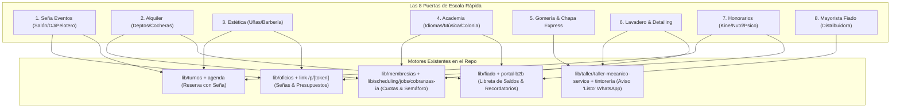

# Las 8 Puertas de Escala Rápida — Reutilización de Motores & Monetización sin Fricción

> **Principio Comercial Rector:**  
> *Ninguna pide AFIP el día uno. Todas se venden con:* **"Gratis anotar → Pagás cuando cobrás o cuando el cliente te deja colgado."**  
> Se ataca el dolor de 5 segundos con motores de software que ya están construidos en el repositorio, empaquetados en mini-portales ultra-enfocados.

---

## 1. Matriz de Reutilización de Motores Existentes

| Puerta (Mini-App) | A quién resuelve | Dolor de 5 Segundos | Motor Existente Reutilizado | Modelo de Monetización | Por qué escala 10x más que un ERP |
|---|---|---|---|---|---|
| **1. Claver Seña Eventos** | Salones, quinchos, peloteros, fotógrafos, catering, DJs | *"Me reservan por WhatsApp y después no aparecen ni pagan"* | `lib/oficios/` + `lib/turnos/` + link de pago `/p/[token]` | Take-rate 2–3% sobre seña cobrada | Ticket alto ($50k-$300k seña). El cliente final ve la marca Claver al pagar. |
| **2. Claver Alquiler** | Dueños de 1 a 8 deptos, cocheras, locales o depósitos | *"El inquilino me debe el mes o las expensas y me da vergüenza cobrar"* | `lib/membresias/` + `lib/scheduling/jobs/cobranzas-ia.ts` | $8.000–$15.000/mes o micro-fee por aviso | Hay 10x más dueños de cocheras/deptos que comercios. Cero complejidad inmobiliaria. |
| **3. Claver Estética** | Uñas, depilación, barbería, cejas, pestañas | *"La clienta no vino y me dejó el hueco de 2 horas sin laburar"* | `lib/peluqueria/` + agenda + Seña 30% | Seña 30% con MP + Recordatorio 24h WhatsApp | Se configura en el celular en 2 minutos. No requiere torniquete ni hardware. |
| **4. Claver Academia** | Apoyo escolar, institutos de idiomas, música, profes particulares, colonias | *"Los padres no pagan la cuota a término y el chico sigue viniendo"* | `lib/escuelas/` + `lib/membresias/` (Semáforo al día / vencido) | Cuota mensual + Aviso WhatsApp automático al padre | El padre prioriza pagar la educación del hijo. Retención altísima (9+ meses). |
| **5. Claver Gomería & Chapa** | Gomerías, chapa y pintura express, alineación y balanceo | *"El auto ya está listo ocupando espacio y el cliente no viene a retirarlo"* | `lib/taller/taller-mecanico-service.ts` (Aviso "Auto Listo" 1-click) | Aviso WhatsApp gratis + Take-rate si paga el saldo online | Rotación en el día. 10x más simple que un taller industrial. |
| **6. Claver Lavadero & Detailing** | Lavaderos de autos, detailing, estética vehicular | *"Clientes que meten el auto al box sin saber si tienen saldo o abono"* | `lib/tintoreria/` (Prenda Lista) + `lib/membresias/` (Abono mensual) | Abono mensual recurrente + Ticket suelto | Modelo recurrente tipo gym pero con autos. Se entiende en un video de 15 segundos. |
| **7. Claver Honorarios** | Kinesiólogos, nutricionistas, psicólogos, odontólogos particulares, abogados | *"Me cancelan el turno a último momento y perdí 40 minutos de honorarios"* | `lib/historia-clinica/` + `lib/turnos/` + Seña de turno | Seña por turno o Pack de 4/8 sesiones por adelantado | Particular sin obra social. 100% cobro directo y protección de agenda. |
| **8. Claver Mayorista Fiado** | Distribuidoras chicas, pinturerías, dietéticas, corralones de 1 mostrador | *"Le fío a 40 almacenes/talleres y no sé quién me debe ni cuánto"* | `lib/fiado/` + `lib/portal-b2b/` (Libreta mayorista) | Cobro por WhatsApp + Take-rate del link de pago | Mismo motor de fiado, pero los deudores son comercios (LTV y ticket 5-10x mayor). |

---

## 2. Mapa Técnico de Procesos y Motores a Reutilizar (Zero Rewrite)



---

## 3. Arquitectura del Flujo Lineal (Landing ➔ Registro ➔ Aha Moment en 30 Segs)

Para cada una de estas 8 puertas:
1. **Sub-Landing dedicada ultra-simple:** Con el dolor de 5 segundos (*"¿Te clavan con los turnos de uñas? Cobrá seña del 30% antes de reservar"*).
2. **Registro Instantáneo:** `/login/register?activar=[puerta_id]` (Crea usuario + empresa en 1 toque con Google o Email).
3. **Primer Valor (Aha Moment en 30 segundos):**
   * Ya viene con 1 registro demo listo para enviar el primer WhatsApp de prueba a su propio celular.
   * Cero pantallas de configuración fiscal ni pedidos de CUIT.

---

## 4. Economía del Negocio & Retorno para el Inversor

```
                ┌──────────────────────────────────────────────┐
                │          8 Puertas Virales (Costo $0)        │
                │        Tráfico orgánico + boca en boca       │
                └──────────────────────┬───────────────────────┘
                                       │
                    ┌──────────────────┴──────────────────┐
                    ▼                                     ▼
        ┌───────────────────────┐             ┌───────────────────────┐
        │  Monetización Pasiva  │             │   Monetización VIP    │
        │  Take-rate 2-3% señas │             │   Packs Especialista  │
        │   + Abonos $8k-$15k   │             │     $35k - $75k       │
        │   Margen Neto >90%    │             │   Margen Neto >75%    │
        └───────────────────────┘             └───────────────────────┘
```

* **Costo Marginal del Servidor:** ~$0.02 USD / mes por usuario activo.
* **Ingreso Promedio por Usuario Monetizado:** $8.000 a $45.000 ARS / mes.
* **CAC (Costo de Adquisición):** Tendiente a $0 gracias a que el cliente final (el que paga la seña o el alquiler) ve *"Cobrado con Claver"* y se viraliza solo.
