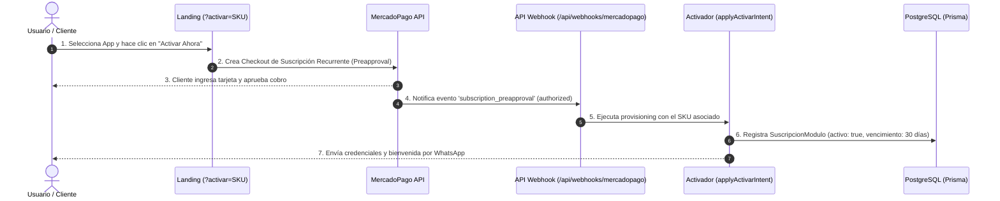

# 📘 Blueprint Técnico, Comercial & Plan de Marketing: Nueva Suite 10 Apps SaaS Grupo Claver

Documento de especificación para el lanzamiento de la **Nueva Suite de 10 Aplicaciones SaaS por Suscripción**, apalancada al 100% sobre la infraestructura técnica, procesos y servicios existentes del monolito **Grupo Claver** (Next.js 15, Prisma ORM, PostgreSQL, Webservices AFIP, MercadoPago Suscripciones, Bot de WhatsApp, Graphify / Cerebro Engine y Clav Sheets).

---

## 📑 ÍNDICE GENERAL

1. **Estrategia de Reciclaje de Procesos Existentes**
2. **Especificación Técnica & Comercial de las 10 Nuevas Apps**
3. **Flujo de Activación Autónoma 1-Click (`?activar=SKU`) & MercadoPago Webhook**
4. **Plan de Marketing, Adquisición (PLG) & Comisiones de Partners**

---

## 1. ♻️ ESTRATEGIA DE RECICLAJE DE PROCESOS EXISTENTES

Cada una de las 10 nuevas aplicaciones reutiliza componentes, modelos y APIs que ya están implementadas y probadas en producción dentro de la plataforma:

| Componente / Infraestructura Existente | Módulo / Servicio Reutilizado | Nuevas Apps que lo Aprovechan |
| :--- | :--- | :--- |
| **Historia Clínica & Fichas Médicas** | `lib/veterinaria/`, `prisma.paciente`, `prisma.historiaClinica` | **1. Claver Health ERP** |
| **Webservices AFIP (A, B, C, E, LPG)** | `lib/afip/`, `lib/fiscal/`, `AFIPWS` | **1. Health**, **2. Factura Monotributo**, **4. Logistics**, **5. Cobro Recurrente** |
| **Cuentas por Cobrar & Deuda** | `lib/cobranzas/`, `prisma.cuentaCorriente` | **3. Claver Dunning Bot** |
| **Logística POD & Geo Distance** | `lib/logistica/`, `prisma.remito`, `prisma.vehiculo` | **4. Claver Logistics & Fleet** |
| **MercadoPago Preapproval / Suscripción** | `lib/mercadopago/`, `app/api/webhooks/mercadopago/` | **Todas las 10 Apps (Cobro mensual automático)** |
| **Token JWT & Generador PDF** | `lib/auth/token-cookie.ts`, `lib/pdf/` | **6. Claver Firma Digital** |
| **Graphify / Cerebro RAG Engine** | `lib/cerebro/graphrag-service.ts`, `lib/cerebro/graph-projector.ts` | **7. Claver BI Executive** |
| **Presupuestos & Links Dinámicos** | `lib/ventas/presupuestos.ts`, `lib/comercial/` | **8. Claver Presupuesto Express** |
| **EventBus Post-Venta & Sentiment** | `lib/events/`, `lib/ai/` | **9. Claver Reputación Google** |
| **Multi-Tenant `whereEmpresa` & Cloud Ops** | `lib/auth/empresa-guard.ts`, `lib/ops/` | **10. Claver Franchise Hub** |

---

## 2. 🚀 ESPECIFICACIÓN TÉCNICA & COMERCIAL DE LAS 10 APPS

---

### 1️⃣ Claver Health ERP
* **SKU:** `health.enterprise`
* **Categoría:** Enterprise High-Ticket.
* **Descripción:** Sistema integral para clínicas, sanatorios y centros de diagnóstico. Gestiona turnos médicos, fichas clínicas estructuradas, trazabilidad de insumos y facturación automática a Obras Sociales (OSDE, Swiss Medical, IOMA).
* **Procesos Reciclados:**
  - `prisma.paciente` / `prisma.consultaMedica` (adaptado de historia clínica veterinaria).
  - API de facturación AFIP WSFE (Factura A / B a Obras Sociales).
  - Reportes en Clav Sheets para análisis de ocupación de quirófanos.
* **Modelo Comercial & MercadoPago:**
  - **Suscripción Recurrente:** `$350.000 ARS / mes` (vía MercadoPago Suscripción).
  - **Setup Fee (Implementación):** `$450.000 ARS` (pago único).

---

### 2️⃣ Claver Factura Monotributo 1-Click
* **SKU:** `autonomo.factura_monotributo`
* **Categoría:** Autónomos / Monotributistas (Masivo).
* **Descripción:** Emisión de Factura C en 2 toques desde el celular sin pasar por la web caótica de AFIP. Carga automática de CUIT desde padrón AFIP y envío instantáneo del comprobante en PDF por WhatsApp.
* **Procesos Reciclados:**
  - WSFE AFIP (`lib/afip/wsfe-service.ts`).
  - Motor de generación de PDF con código QR fiscal obligatorio AFIP.
  - Integración de envío de mensajes de WhatsApp (`lib/events/whatsapp-event-handler.ts`).
* **Modelo Comercial & MercadoPago:**
  - **Suscripción Recurrente:** `$6.900 ARS / mes` (sin setup fee, activación inmediata).

---

### 3️⃣ Claver Dunning — Bot Negociador de Mora
* **SKU:** `fin.dunning_bot`
* **Categoría:** PyME / Comercial.
* **Descripción:** Bot autónomo de negociación de deuda morosa que contacta a los clientes deudores por WhatsApp, ofrece planes de pago o quitas por pago contado y genera links de cobro directos de MercadoPago.
* **Procesos Reciclados:**
  - `prisma.cuentaCorrienteCliente` y antigüedad de saldo.
  - Creación dinámica de Preferencias de Pago en MercadoPago API (`/api/mercadopago/preference`).
  - Bot de conversación interactivo por WhatsApp (`lib/comercial/dunning-service.ts`).
* **Modelo Comercial & MercadoPago:**
  - **Suscripción Recurrente:** `$22.000 ARS / mes`.

---

### 4️⃣ Claver Logistics & Fleet
* **SKU:** `logistics.fleet_enterprise`
* **Categoría:** Enterprise High-Ticket.
* **Descripción:** Plataforma de control de flotas pesadas y logística de entregas. Telemetría de consumo de combustible por km, emisión de Carta de Porte Digital AFIP/SISA y firma de remitos de entrega (POD) en el celular del chofer.
* **Procesos Reciclados:**
  - `prisma.vehiculo` / `prisma.hojaRuta` / `prisma.remito`.
  - Geo Distance Calculator & Google Maps API.
  - Generador de Carta de Porte Electrónica AFIP.
* **Modelo Comercial & MercadoPago:**
  - **Suscripción Recurrente:** `$480.000 ARS / mes` + **Setup:** `$500.000 ARS`.

---

### 5️⃣ Claver Cobro Recurrente de Honorarios
* **SKU:** `autonomo.cobro_honorarios`
* **Categoría:** Autónomos / Profesionales.
* **Descripción:** Automatización total de cobro de abonos mensuales para psicólogos, entrenadores, contadores y profesores. Realiza el débito automático en tarjeta vía MercadoPago y emite la Factura C automática al acreditarse el pago.
* **Procesos Reciclados:**
  - Motor de Facturación Recurrente (`lib/comercial/facturacion-recurrente-service.ts`).
  - MercadoPago Preapproval API.
* **Modelo Comercial & MercadoPago:**
  - **Suscripción Recurrente:** `$7.900 ARS / mes`.

---

### 6️⃣ Claver Firma Digital
* **SKU:** `service.firma_digital`
* **Categoría:** PyME / Servicios.
* **Descripción:** Firma digital segura de contratos de alquiler, recibos de sueldo, solicitudes y presupuestos desde WhatsApp o celular con validación por token JWT y huella táctil.
* **Procesos Reciclados:**
  - Token JWT firmado (`lib/auth/token-cookie.ts`).
  - Motor de renderizado PDF con estampas digitales e ISO timestamps.
  - Notificador de eventos por WhatsApp.
* **Modelo Comercial & MercadoPago:**
  - **Suscripción Recurrente:** `$18.500 ARS / mes`.

---

### 7️⃣ Claver BI Executive & Cerebro Directorio
* **SKU:** `ai.cerebro_executive`
* **Categoría:** Enterprise High-Ticket.
* **Descripción:** Torre de control ejecutiva con Cerebro Visual en tiempo real. Permite al dueño o directorio hacer preguntas en lenguaje natural por WhatsApp y recibir análisis financieros, proyecciones de cashflow y alertas de riesgo.
* **Procesos Reciclados:**
  - Motor Graphify / Cerebro RAG (`lib/cerebro/graphrag-service.ts`).
  - Proyector de grafo de entidades (`lib/cerebro/graph-projector.ts`).
  - Reportes dinámicos pivotantes en Clav Sheets.
* **Modelo Comercial & MercadoPago:**
  - **Suscripción Recurrente:** `$280.000 ARS / mes` + **Setup:** `$350.000 ARS`.

---

### 8️⃣ Claver Presupuesto Express & Señas
* **SKU:** `autonomo.presupuesto_express`
* **Categoría:** Autónomos / Oficios.
* **Descripción:** Generador instantáneo de presupuestos en PDF con diseño profesional para plomeros, electricistas y técnicos. Incluye botón de pago de seña del 30%/50% por MercadoPago para confirmar el trabajo.
* **Procesos Reciclados:**
  - Presupuesto Service (`lib/ventas/presupuestos.ts`).
  - MercadoPago Payment Link Generator.
* **Modelo Comercial & MercadoPago:**
  - **Suscripción Recurrente:** `$5.900 ARS / mes`.

---

### 9️⃣ Claver Reputación Google Maps
* **SKU:** `mkt.reputacion_google`
* **Categoría:** PyME Comercio.
* **Descripción:** Automatización de opiniones post-venta por WhatsApp. Solicita calificación del 1 al 5; si la opinión es de 5 estrellas redirige al perfil de Google Maps del comercio, y si es negativa la canaliza a un buzón privado de reclamos.
* **Procesos Reciclados:**
  - Handler de eventos post-venta (`lib/events/ventas-events.ts`).
  - Filtro de Sentimiento de IA (`lib/ai/sentiment-service.ts`).
* **Modelo Comercial & MercadoPago:**
  - **Suscripción Recurrente:** `$12.500 ARS / mes`.

---

### 🔟 Claver Franchise Hub
* **SKU:** `franchise.enterprise`
* **Categoría:** Enterprise High-Ticket.
* **Descripción:** Consola centralizada para cadenas y marcas con franquicias. Audita las ventas brutas de cada franquiciado en tiempo real, calcula y factura automáticamente las regalías mensuales y unifica catálogos de productos.
* **Procesos Reciclados:**
  - Aislamiento Multi-tenant y alcance por empresa (`whereEmpresa`).
  - Consola de Operaciones Claver Cloud (`app/claver-cloud/`).
  - Engine de Cálculo de Regalías.
* **Modelo Comercial & MercadoPago:**
  - **Suscripción Recurrente:** `$550.000 ARS / mes` + **Setup:** `$700.000 ARS`.

---

## 3. 💳 FLUJO DE ACTIVACIÓN AUTÓNOMA & MERCADOPAGO WEBHOOK

El ciclo de vida comercial de todas las aplicaciones es **100% autoservicio y automático**:

---

## 4. 📢 PLAN DE MARKETING & ESTRATEGIA DE ADQUISICIÓN (PLG)

---

### A. Segmentación de Canales de Venta

1. **Segmento Autónomos (PLG - Product Led Growth):**
   - **Canales principales:** Instagram Ads, TikTok Ads y Google Search Ads.
   - **Palabras Clave de Búsqueda:** *"hacer factura c rapido"*, *"cobrar honorarios mercadopago"*, *"presupuesto pdf whatsapp"*.
   - **Estrategia:** Trial gratis de 14 días sin tarjeta. Al día 12, el bot de WhatsApp recuerda la activación de la suscripción de $4.900 a $7.900 ARS.

2. **Segmento PyME Comercial (Inbound Marketing):**
   - **Canales principales:** Meta Ads (Facebook/Instagram), LinkedIn y Alianzas con Cámaras de Comercio locales.
   - **Gancho Comercial:** Demo interactiva en vivo del bot negociador de deudas y generador de firma digital.

3. **Segmento Enterprise / High-Ticket (Outbound & Red de Partners):**
   - **Canales principales:** Venta consultiva por ejecutivos de cuenta, Webinars ejecutivos y Red de Partners Implementadores.
   - **Comisión de Partners:** 25% recurrente mensual de la suscripción + 100% del Fee de Setup para el implementador local.

---

### B. Métricas Clave de Rendimiento (KPIs)

* **CAC (Costo de Adquisición de Cliente):**
  - Autónomos: `< $2.500 ARS`
  - PyMEs: `< $9.000 ARS`
  - Enterprise: `< $45.000 ARS`
* **LTV (Valor de Vida del Cliente):**
  - Autónomos: `~$95.000 ARS` (14 meses retención promedio)
  - PyMEs: `~$320.000 ARS` (18 meses retención promedio)
  - Enterprise: `~$12.000.000 ARS` (36+ meses retención promedio)
* **Objetivo de Retención (Churn Mensual):** `< 1.5%` global.
