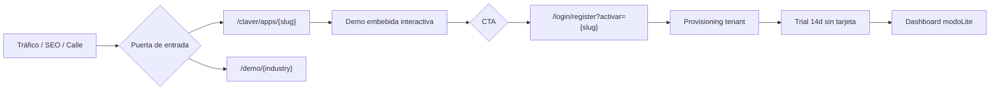
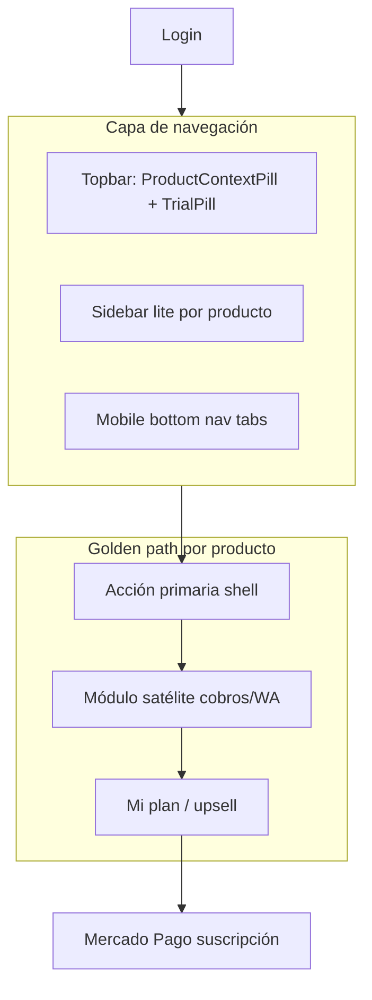
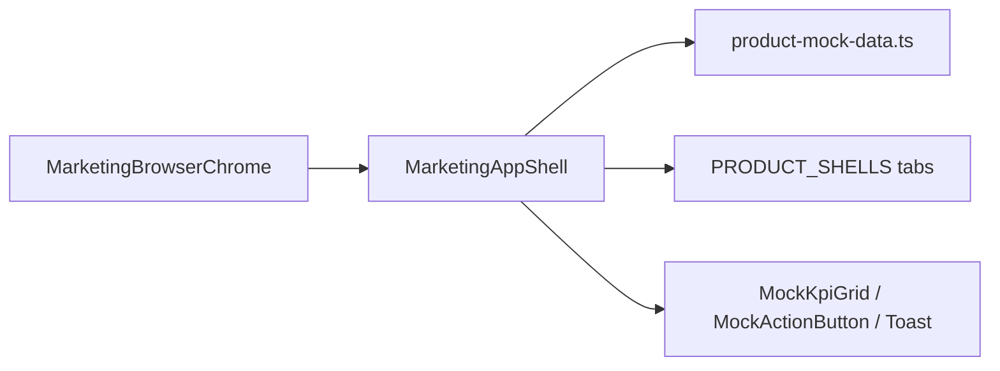
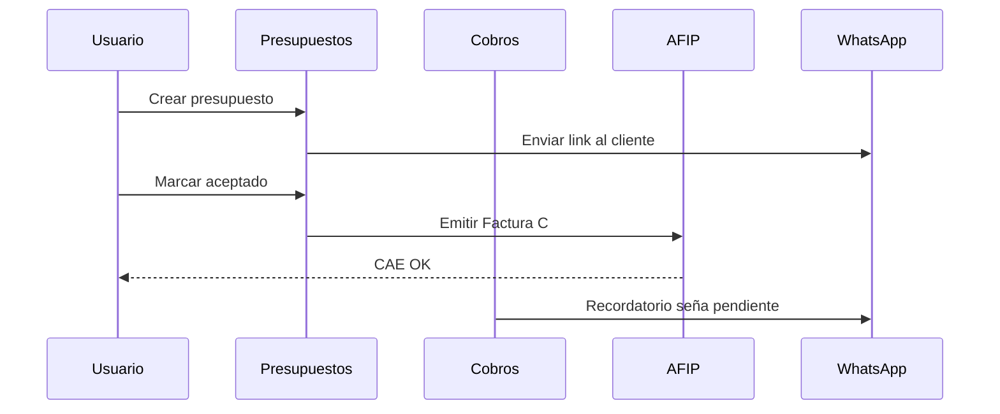
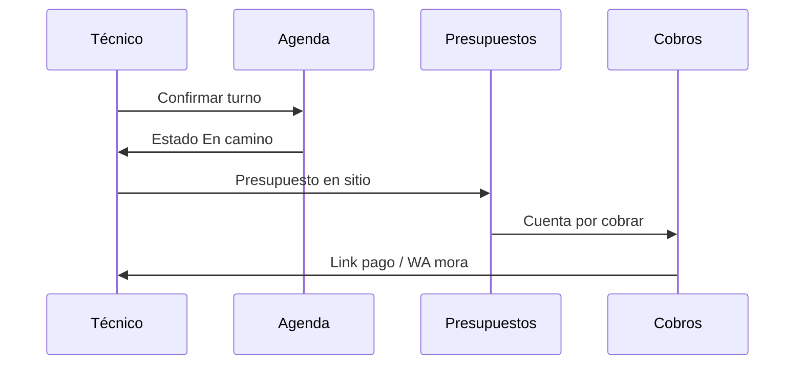
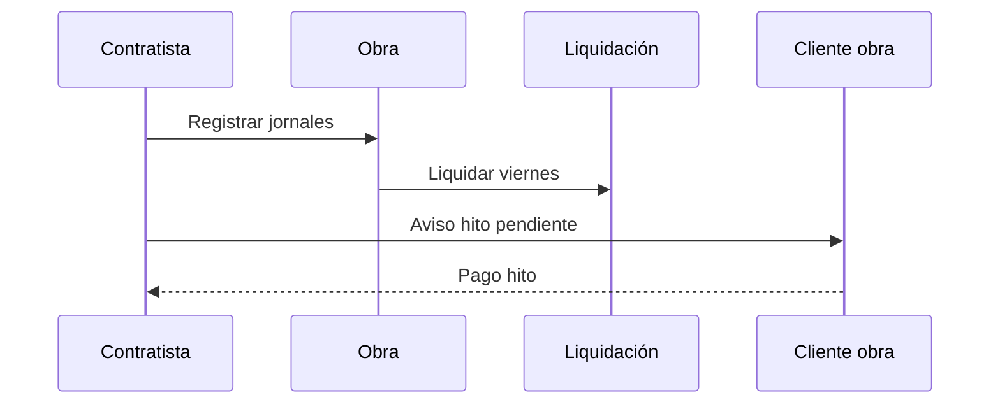
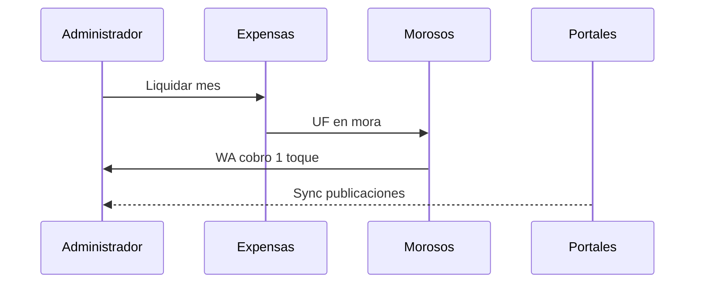

# Flujos SaaS — Servicios intangibles (Claver combate)

Documento de referencia para producto, ventas y UX. Cubre el recorrido **prospecto → trial → activación → retención** de los 8 productos combate.

## Productos combate y packs

| Slug | Marca | Pack pool | Golden path post-login |
|------|-------|-----------|------------------------|
| fiado | Claver Fiado | pool-calle | `/dashboard/fiado` |
| cobra | Claver Cobrá | pool-cobranza | `/dashboard/cuentas-cobrar` |
| monotributo | Claver Monotributo | pool-monotributo | `/dashboard/ventas/presupuestos` |
| servicios | Claver Servicios Pro | pool-servicios-pro | `/dashboard/agenda` |
| obra | Claver Obra | pool-obra | `/dashboard/nicho/obras` |
| propiedad | Claver Propiedad | pool-propiedad | `/dashboard/nicho/consorcios` |
| turnos | Claver Turnos | pool-turnos | `/dashboard/agenda` |
| pos | Claver POS | pool-pos | `/dashboard/pos` |

## Flujo comercial (prospecto)

### Momentos críticos de conversión

1. **Hero + mockup** — el prospecto debe poder *tocar* la app (tabs, WA, liquidar) sin salir de la landing.
2. **Registro con intent** — `activar-intent` resuelve slug → pack + `modoLite` correcto.
3. **Primer login** — sidebar lite + bottom nav con tabs del producto (no el ERP completo).
4. **Día 11–14 trial** — pill en topbar + upsell en `/dashboard/mi-plan`.

## Flujo post-login (tenant activo)

## Demo embebida (landings)

Arquitectura actual:

**Patrón gold:** POS (`claver-pos-mockup`) y ahora todos los combate vía `MarketingAppShell`:
- Mini-sidebar + tabs móvil
- Datos mock es-AR (CUIT, ARS, mora, AFIP)
- Acciones con loading → toast de éxito
- Trial pill simulado

## Gaps UX resueltos (jul 2026)

| Gap | Solución |
|-----|----------|
| Mockups estáticos sin interactividad | `MarketingAppShell` + datos centralizados |
| Usuario no sabe qué producto usa | `ProductContextPill` en topbar |
| 8 productos sin hub claro | Dropdown → Mi plan / Más apps / catálogo |
| Documentación dispersa | Este doc + runbooks marketplace |

## Gaps UX pendientes (prioridad)

| Prioridad | Gap | Propuesta |
|-----------|-----|-----------|
| P1 | Onboarding vacío día 1 | Checklist por `modoLite` (ya existe widget; falta seed por pack servicios) |
| P1 | Breadcrumb oculto en lite | Mostrar `Marca › Módulo` en móvil cuando `modoLite !== completo` |
| P2 | Command palette no prioriza shell | Filtrar acciones por `getActiveProductShell` |
| P2 | Marketing nav sin mega-menú productos | Dropdown "Apps" en `claver-shell` con los 8 slugs |
| P3 | Sin diagrama en app | Tooltips contextuales en primer uso (ProductTour) |

## Flujo por vertical — Servicios intangibles

### Monotributo / freelance

### Servicios Pro (agenda + presupuesto + cobro)

### Obra (jornales + hitos)

### Propiedad (expensas + portales)

## Métricas sugeridas (instrumentación)

- `landing_mock_interaction` — tab cambiado, botón WA, liquidar
- `signup_activar_slug` — slug en registro
- `trial_day_n_active` — módulos visitados por día
- `product_switcher_open` — uso del pill en topbar
- `upgrade_click_mi_plan` — desde trial pill

## Referencias en código

- Mock data: `lib/marketing/product-mock-data.ts`
- Shell demo: `components/marketing/marketing-app-shell.tsx`
- Product shells: `lib/comercial/product-shell.ts`
- GTM vitrine: `lib/comercial/go-to-market-vitrine.ts`
- Activación: `lib/comercial/activar-intent.ts`
- Nav post-login: `components/dashboard/product-context-pill.tsx`