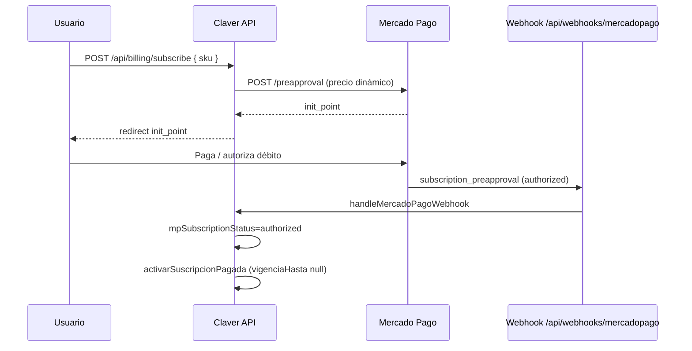

# Mercado Pago — links dinámicos de cobro (instructivo)

Guía para cerrar el circuito **oferta comercial → link de pago → webhook → módulos activos** en producción.

## Estado actual en el repo

| Pieza | Estado | Archivo |
|-------|--------|---------|
| Crear suscripción (preapproval) | ✅ | `lib/billing/mercadopago-subscription.ts` |
| Checkout por SKU | ✅ | `app/api/billing/subscribe/route.ts` |
| Checkout por oferta activa | ✅ | `app/api/billing/create-subscription/route.ts` |
| Webhook handler | ✅ | `app/api/webhooks/mercadopago/route.ts` |
| Activar módulos post-pago | ✅ | `activarSuscripcionPagada()` |
| Middleware sin JWT en webhooks | ✅ | `middleware.ts` → `/api/webhooks/` |
| Mock dev (sin tarjeta) | ✅ | `app/api/billing/confirm-mock/route.ts` |

## Flujo objetivo en producción



## Variables de entorno requeridas

```env
# Obligatorias para links reales (no mock)
MP_ACCESS_TOKEN=APP_USR-xxxxxxxx          # Access token producción o TEST
MP_WEBHOOK_SECRET=xxxxxxxx                # Secret para validar x-signature
NEXT_PUBLIC_APP_URL=https://tu-dominio.com

# Opcional dev
# MP_ACCESS_TOKEN=TEST-mock               # Activa modo simulación
# FORCE_MOCK_MP_PROD=true                   # Mock incluso en prod (solo QA)
```

## 1. Credenciales Mercado Pago

1. [Mercado Pago Developers](https://www.mercadopago.com.ar/developers) → Tu aplicación.
2. Copiar **Access Token** de producción (o TEST para staging).
3. Configurar en Vercel/hosting como `MP_ACCESS_TOKEN`.

## 2. Webhook de suscripciones

1. En MP → Webhooks → URL de notificación:
   ```
   https://tu-dominio.com/api/webhooks/mercadopago
   ```
2. Eventos: **Planes y suscripciones** (`subscription_preapproval`).
3. Copiar el **secret** del webhook → `MP_WEBHOOK_SECRET`.
4. El handler valida firma con `validarFirmaWebhook()` (`lib/auth/webhook-guard.ts`).

### Verificar que llega el webhook

```bash
# Logs en Vercel / servidor tras un pago de prueba
# Debe actualizar empresas.mpSubscriptionStatus → "authorized"
```

## 3. Generar link dinámico desde la app

### Por SKU (un módulo)

```http
POST /api/billing/subscribe
Authorization: Bearer <jwt>
Content-Type: application/json

{ "sku": "core.claver" }
```

Respuesta:

```json
{
  "success": true,
  "init_point": "https://www.mercadopago.com.ar/subscriptions/checkout?...",
  "precioArs": 12900,
  "plan": "Claver POS"
}
```

### Por oferta activa del tenant (fiado-ancla → pack POS)

```http
POST /api/billing/create-subscription
Authorization: Bearer <jwt>
```

Usa `getOfertaEmpresa()` y `precioOfertaMonetizada()` — hoy **fiado-ancla** cobra $12.900/mes por `core.claver`.

### Precio $0 (módulo gratis)

`subscribe` activa el SKU sin MP (`free: true`).

## 4. Referencia externa (trazabilidad)

Cada preapproval lleva:

```
external_reference = claver-empresa-{empresaId}-sku-{sku}
```

Pack multi-SKU: `sku-core.claver+pos.fiado_barrio`

Tras `authorized`, `activarSuscripcionPagada()` extiende `vigenciaHasta: null` en los SKUs de la oferta.

## 5. URLs de retorno

| Entorno | back_url / mock |
|---------|-----------------|
| Prod real | `{APP_URL}/dashboard/apps?subscription=ok` |
| Mock dev | `{APP_URL}/dashboard/apps?mp_mock=1&ref=...` → `confirm-mock` |

## 6. Checklist pre-lanzamiento cobro

- [ ] `MP_ACCESS_TOKEN` producción en Vercel
- [ ] `MP_WEBHOOK_SECRET` configurado
- [ ] Webhook MP apuntando a `/api/webhooks/mercadopago`
- [ ] `NEXT_PUBLIC_APP_URL` = dominio final (sin barra final)
- [ ] Probar: registro `?activar=fiado` → upsell → subscribe → pago TEST → webhook → POS habilitado
- [ ] Verificar `suscripcionModulo.vigenciaHasta = null` en SKUs pagos
- [ ] Verificar POST `/api/pos/*` permitido tras pago, bloqueado antes (402)

## 7. Qué falta opcional (mejoras)

| Mejora | Prioridad | Notas |
|--------|-----------|-------|
| Preference API (pago único) además de preapproval | Media | Para cobros one-shot marketplace |
| Múltiples suscripciones MP por empresa | Baja | Hoy 1 `mpSubscriptionId` por tenant |
| Facturación / IVA en MP | Media | `transaction_amount` ya en ARS |
| Panel Claver Cloud: ver init_point y estado MP | Baja | Ops ya tiene billing page parcial |
| Retry webhook idempotente | Media | Guardar `mp_webhook_event_id` |

## 8. Credenciales TEST en `.env.local`

```env
MP_PUBLIC_KEY="TEST-..."      # Panel → Credenciales → Prueba → Public Key
MP_ACCESS_TOKEN="TEST-..."    # Panel → Credenciales → Prueba → Access Token
NEXT_PUBLIC_APP_URL="http://localhost:3000"
```

- **Access Token** → solo servidor (`MP_ACCESS_TOKEN`). Crea suscripciones y llama a `/preapproval`.
- **Public Key** → frontend (Checkout Bricks / tokenizar tarjeta). El flujo actual de suscripciones con `init_point` **no la usa**.
- Con token `TEST-...` (no `TEST-mock`) se llama a la API real de sandbox de MP.

Tarjetas de prueba: [documentación MP](https://www.mercadopago.com.ar/developers/es/docs/your-integrations/test/accounts).

## 9. Prueba local rápida (mock)

```bash
# .env.local
MP_ACCESS_TOKEN=TEST-mock
JWT_SECRET=dev-secret
DATABASE_URL=...
```

1. Registrate con `/login/register?activar=fiado`
2. Dashboard → panel upsell → **Suscribirse**
3. Redirige a `/dashboard/apps?mp_mock=1` → confirma automático
4. `mpSubscriptionStatus` = `authorized`, POS desbloqueado

## 10. Prueba staging con MP TEST

1. Usar `MP_ACCESS_TOKEN` de credenciales TEST
2. Tarjetas de prueba MP Argentina
3. Webhook: usar ngrok o deploy preview con URL pública
4. Sin `confirm-mock` — solo webhook real

---

**Contacto técnico:** revisar logs `[activar-intent]`, `Error processing MP webhook`, y tabla `empresas.mpSubscriptionStatus`.