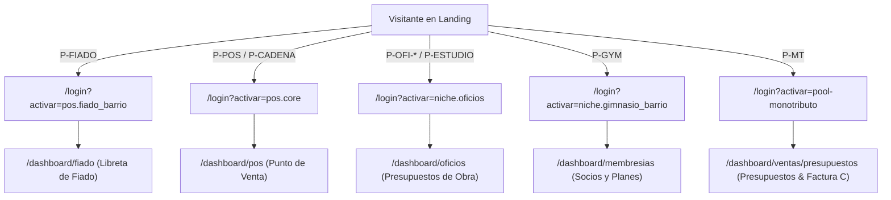

# Matriz Canónica de Puertas de Entrada — Claver ERP

> **Fecha:** 2026-08-24  
> **Estado:** Canónico / Verificado contra código  
> **Referencias:** `docs/GO_LIVE_PRD.md`, `lib/comercial/go-live-packs.ts`, `lib/comercial/sub-saas-catalog.ts`, `lib/comercial/activar-intent.ts`

---

## 1. Tesis: "Una sola fábrica, 12 puertas de entrada"

Claver no es un conjunto de 50 aplicaciones dispersas ni un fork de software por rubro: es un núcleo único (POS, Stock, Caja, Facturación AFIP, Libreta de Fiado, Cuentas por Cobrar y Oficios).

Cada puerta cambia:
1. **Comprador y Dolor:** Copy específico en español argentino (`es-AR`) orientado al problema directo de dinero (cobrar, seña, fiado, factura, stock).
2. **CTA y Modelo:** Trial self-serve, ancla gratuita, agenda de implementación con horas o canal de partners.
3. **Parámetro `?activar={sku}`:** Inicializa el `modoLite` y el `landingPath` específico.
4. **Primera pantalla (Golden Path):** El usuario aterriza directo en la herramienta de su dolor, no en un ERP genérico.

---

## 2. Mapa Canónico de las 12 Puertas Autorizadas

| ID Puerta | Comprador / Segmento | URL / Slug | SKU `?activar=` | Primera Ruta (Golden Path) | CTA Primario | Existe Hoy (Landing / Activar / Menú) | Riesgo Comercial / Promesa NO |
|---|---|---|---|---|---|---|---|
| **P-OFI-ELEC** | Electricista / Instalador técnico | `/claver/apps/oficios` (o skin `?oficio=electricista`) | `niche.oficios` | `/dashboard/oficios` | Probar 7 días gratis | Landing: **Sí** · Activar: **Sí** · Menú: **Sí** (aislado en su sección) | **Medio:** Promesa NO: cálculo de secciones, planos CIRSOC, CAD. Solo presupuesto 3 niveles, seña y cuadrilla. |
| **P-OFI-PLOM** | Plomero / Gasista / Sanitarista | `/claver/apps/oficios` (skin `?oficio=plomero`) | `niche.oficios` | `/dashboard/oficios` | Probar 7 días gratis | Landing: **Sí** · Activar: **Sí** · Menú: **Sí** | **Bajo:** Mismo motor de presupuestos y certificados de obra particular. |
| **P-FIADO** | Kiosco, almacén de barrio | `/claver/apps/fiado` | `pos.fiado_barrio` | `/dashboard/fiado` | Empezar gratis (Ancla) | Landing: **Sí** · Activar: **Sí** · Menú: **Sí** | **Bajo (PRD):** Promesa NO: no requiere Twilio obligatorio para cobro presencial; WhatsApp usa link directo. |
| **P-POS** | Mostrador 1 local / Comercio retail | `/claver/apps/pos` | `pos.core` | `/dashboard/pos` | Probar 14 días | Landing: **Sí** · Activar: **Sí** · Menú: **Sí** | **Bajo (PRD):** Promesa NO: AFIP automática sin CUIT/Certificado. |
| **P-CADENA** | Cadena 2 a 20 sucursales / franquicias | `/claver/claverp/pos-afip` (copy cadena) | `pos.core` (`+ sucursales`) | `/dashboard/pos` (con selector local) | **Agendar Implementación** | Landing: **Spec Grok** · Activar: **Sí** · Menú: **Sí** | **Medio:** Requiere horas de setup (`svc.implementacion`). Promesa NO: holding internacional, offline multinodal. |
| **P-STOCK** | Dueño de comercio con dolor de inventario | `/claver/apps/stock` | `core.claver` | `/dashboard/productos` | Probar 14 días | Landing: **Sí** (`listoPct: 55`) · Activar: **Sí** · Menú: **Sí** | **Alto:** Promesa NO: No es WMS avanzado, ni radiofrecuencia industrial ni picking con sorter. Es conteo, CSV y stock mínimo. |
| **P-MT** | Monotributista / Profesional independiente | `/claver/apps/monotributo` | `pool-monotributo` | `/dashboard/ventas/presupuestos` | Probar gratis | Landing: **Sí** · Activar: **Sí** · Menú: **Sí** | **Bajo (PRD):** Promesa NO: No reemplaza al contador para DDJJ complejas; emite Factura C y presupuestos. |
| **P-GYM** | Gimnasio, club de barrio, academia | `/claver/apps/puntos` (o `/membresias`) | `niche.gimnasio_barrio` | `/dashboard/membresias` | Probar 14 días | Landing: **Sí** · Activar: **Sí** · Menú: **Sí** | **Medio (PRD acotado):** Promesa NO: torniquete físico / control biométrico por hardware sin partner local. |
| **P-HORAS** | PyME / Comercio que pide "instálamelo llave en mano" | `/claver/contacto?pack=implementacion` | `svc.implementacion` | Formulario de reserva / contacto | Contratar Horas | Landing: **Spec Grok** · Activar: **N/A** (Servicio) · Menú: **N/A** | **Bajo:** Venta de servicios profesionales de configuración e importación CSV. |
| **P-PARTNER** | Implementador informático / Freelancer Fiverr | `/claver/partners` | `partner.programa` | `/claver-cloud/partners` | Registrarme como Partner | Landing: **Sí** · Activar: **Sí** · Menú: **Sí** | **Bajo:** Canal de reventa y puesta en marcha (30% recurrente + 100% de su tarifa de setup). |
| **P-ESTUDIO** | Ingeniero / Arquitecto / Constructor independiente | `/claver/apps/oficios` (skin estudio) | `niche.oficios` | `/dashboard/oficios` | Agendar Demo 20 min | Landing: **Spec Grok** · Activar: **Sí** · Menú: **Sí** | **Medio:** Promesa NO: CYPE, AutoCAD, cálculo estructural CIRSOC. Promesa OK: Cobro, seña, certificación de hitos y cuadrilla. |
| **P-TURNOS** | Peluquería, estética, consultorio liviano | `/claver/apps/turnos` | `pool-servicios-pro` | `/dashboard/agenda` | Probar 14 días | Landing: **Sí** · Activar: **Sí** · Menú: **Sí** | **Medio (Piloto):** Promesa NO: Historia clínica hospitalaria compleja; Promesa OK: Turnos, agenda WhatsApp y cobro. |

---

## 3. Diagnóstico de Gaps y Estado Actual ("Existe Hoy = No")

| Puerta | Elemento Faltante | Acción Requerida (Pair Grok) |
|---|---|---|
| **P-CADENA** | Landing dedicada con copy multilocales y CTA "Agendar Implementación" en lugar de trial directo. | Crear `/claver/claverp/pos-cadena` o adaptar `/claver/claverp/pos-afip` con bloque de cálculo de horas de setup. |
| **P-HORAS** | Formulario con selector de horas de setup (4h, 8h, 16h) y agenda Calendly / WhatsApp directo. | Habilitar `pack=implementacion` en `/claver/contacto` conectado al catálogo de horas de setup. |
| **P-ESTUDIO** | Skin de copy para arquitectos/ingenieros en `/claver/apps/oficios?skin=estudio` que resalte hitos y seña sin jerga de plomería ni promesas de cálculo estructural. | Adaptar render dinámico por query param `?oficio=estudio` o `?oficio=arquitectura` en la landing de oficios. |

---

## 4. Landings y Slugs Terminantemente PROHIBIDOS de Publicar como Puertas

Las siguientes rutas **no deben tener landing pública de venta directa** por no cumplir los criterios de PRD, generar falsas expectativas técnicas o ser módulos complementarios internos:

1. ❌ **`/dashboard/grow` (404/desarticulado):** Debe redirigir siempre a `/dashboard/agro/cannabis`. No vender como "Software Growshop general".
2. ❌ **Fumigación / Control de Plagas (`/dashboard/fumigacion`):** No vender como vertical independiente tipo HIS. Es una funcionalidad de nicho operativa.
3. ❌ **Catálogo de 47 Demos (`/demo/*` sin filtro):** No presentar las 47 demos como productos independientes listos para comprar. La vitrina pública debe limitar a las 12 puertas oficiales.
4. ❌ **Cálculo de Ingeniería / CIRSOC / CYPE:** Prohibido publicitar cálculo estructural o modelado CAD. Claver resuelve la gestión financiera, presupuestaria y de cobros del contratista/estudio.
5. ❌ **WMS / Radiofrecuencia / Logística 3D:** El módulo de stock resuelve inventario, código de barras, puntos de reposición y valorización, no automatización de almacenes multinivel robotizados.
6. ❌ **Fiverr como "Rubro":** Fiverr es un canal comercial de distribución para freelancers/partners (Negocio C), no un rubro de negocio.

---

## 5. Matriz de Coherencia de Menú y Primera Pantalla

Cada puerta tiene garantizada su ruta de bienvenida directa evitando el rebote del usuario y manteniendo la promesa comercial 100% alineada con la pantalla post-login.
