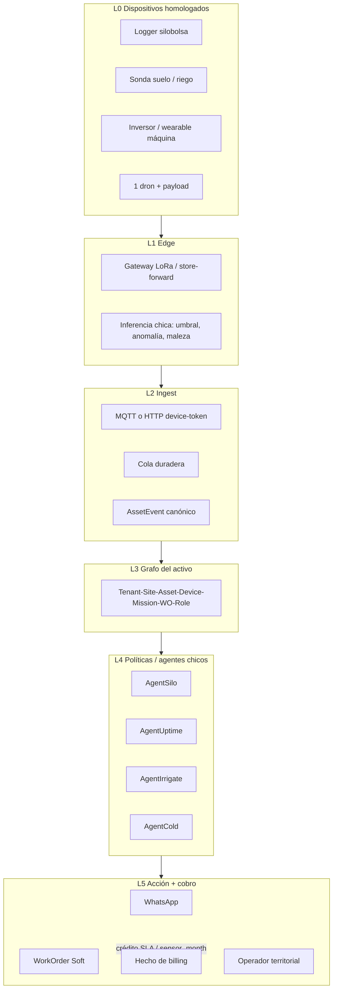

# Tesis — Capa AIoT del conglomerado Claver

**Tipo:** tesis de negocio + arquitectura **previa a implementar**  
**Fecha:** 2026-09-14  
**Fuente del brief:** `conglo.txt` (prompt dual: directorio + arquitecto)  
**Estado:** papel de diseño. No es PRD de sprint. No toca Soft POS/fiado/AFIP.  
**Criterio de no-go (ingeniería):** si a 90 días un evento no produce WorkOrder, SLA o factura, se para el feature y se arregla L5.

---

## Cómo leer este documento

Hay dos voces. Nunca se mezclan en el mismo párrafo.

| Rol | Pregunta que responde | Qué no hace |
|-----|----------------------|-------------|
| **A. Directorio** | ¿Quién paga el mes 18 y por qué no se da de baja? | Inventar gadgets, OS de drones, “smart city” de slide |
| **B. Arquitecto** | ¿Qué capa conecta dispositivo → evento → gente → cobro, reusando Claver? | Framework para developers, foundation model, 40 conectores |

**Relación con el resto del grupo**

| Pilar ya vivo | Qué es | Rol en esta tesis |
|---------------|--------|-------------------|
| **Claver Soft** | ERP/POS, CxC, presupuestos, OT, oficios, mantenimiento | Cobra, factura, despacha humano. **No se reescribe.** |
| **Claver Works Energy** | Broker solar: lead → seña → match EPC | Cuña comercial. El AIoT entra **después** de Entregado. |
| **Clavergrow** | Lotes, agro, IoT de campo (hoy stub) | Vertical 1 de sensores, no demo vacía. |
| **Automation Hub / NOP** | Eventos firmados + playbooks + n8n | Bus de políticas. Hoy no conoce IoT ni Works. |
| **Cloud / analista** | Provisioning, SLA, tickets | Mesa que vende el fee de uptime. |

**Pregunta de supervivencia (toda línea):** *¿el cliente nos paga el mes 18 aunque el hardware ya esté amortizado?* Si no, se convierte a hardware-as-a-service o se descarta.

**Lo que esta tesis no es**

- Un plan para que Claver fabrique paneles, drones o medidores.
- Vigilancia predictiva de personas como producto.
- Un segundo ERP.
- La lista de 40 módulos IoT que ya están dibujados en el schema y no ingestan nada.

---

# 0. Estado de partida (realidad del repo, no el pitch)

Antes de diseñar el portafolio hay que decir qué existe y qué miente. Si se implementa encima del teatro, se escala el teatro.

## 0.1 Lo que ya se puede operar

| Pieza | Evidencia | Sirve para |
|-------|-----------|------------|
| Works Energy FSM | `WorksLead` / `WorksProject` / partners `epc_solar`, `/energy`, Cloud bandeja | Intake y cobro de seña (manual) |
| Soft CxC / presupuesto / MP | Motor existente; Works solo pega una URL stub | Facturar seña, hitos, comisión |
| `DispositivoIoT` + lecturas + alertas | Schema industrial + UI `/dashboard/iot` | Catálogo. **No es ingest.** |
| `OrdenTrabajo` + `OficioTrabajo` + planes de mantenimiento | Prisma + servicios | L5 (acción humana) ya tiene tabla |
| Automation Hub | Eventos NOP, playbooks, HMAC, n8n templates | L4/L5 si se emite `ALERTA_IOT` / `WORKS_LEAD_CREADO` |
| WhatsApp / Leo / tickets Cloud | Canales y mesa | Canal de usuario y SLA |
| Red de oficios / operadores | Pack oficios, cuadrillas, partners EPC | Semilla de la red territorial |

## 0.2 Lo que está dibujado y no cierra

| Pieza | Mentira actual | Riesgo si se vende |
|-------|----------------|-------------------|
| SKU `ops.iot_kit` | “Ingesta MQTT / credenciales MQTT” — no hay broker ni device token | Cobrar ARS 25.000 por vapor |
| `POST /api/iot/lecturas` | Exige JWT de usuario; no llama a umbrales de `IoTService` | Sensor de campo no puede empujar kWh |
| Lecturas/alertas | Sin `whereEmpresa` en GET | Fuga multi-tenant |
| Agro IoT Center | UI viva; APIs en `_backup_rutas_rotas` + store in-memory | Demo Clavergrow que falla |
| Tom IoT | Playbook `iot_alert_dispatcher` → `TareaPendiente`; worker `activo: false` | Extra ENLISTA, no loop |
| Cerraduras hotel | PIN mock `"123456"` | No es AIoT |
| Tipo `energia` | Un float | No sirve para inversor (kW, kWh, SOC, string) |
| Enum de 9 protocolos | MQTT/Modbus/OPC-UA/LoRa/Zigbee… | Teatro industrial |

## 0.3 Decisión de diseño (obedecer)

```
SÍ  = una capa de orquestación (AssetEvent → política → WorkOrder → billing)
NO  = OS de drones, foundation model, 40 conectores, SCADA, NDVI año 1
Año 1 = 3 familias IoT + 1 dron homologado + WhatsApp + ticket + factura
Soft POS/fiado/AFIP = intocable
Works Energy = broker; Claver no instala paneles
```

Veredicto sobre el conglomerado **dentro de Claver**: el holding ya tiene software, canal de oficios, Energy como match EPC y un IoT de catálogo. El foso no se construye fabricando hardware. Se construye haciendo que **el mismo `asset_id`** viva en Soft (factura), Works (proyecto), Grow (lote) y campo (sensor/dron).

---

# PARTE I — NEGOCIO

*Voz: directorio. Caja recurrente, soporte eterno, red territorial.*

---

## I.1 Tesis de 8 líneas

1. El sensor se commoditiza; el chatbot se copia; el **uptime con gente que llega** no.
2. Un conglomerado argentino gana más alquilando **decisión + SLA + operador** que vendiendo un logger a un productor que después no calibra.
3. El cliente no paga por “ver un dashboard”. Paga para no perder grano, no parar una línea, no cortar frío, no dejar a un adulto en el piso, no tener un inversor mudo.
4. El hardware en comodato es el anzuelo; la cuota del mes 18 es **conectividad + plataforma + mesa + recertificación + dato histórico**.
5. La IA organiza (prioriza, redacta, estima si vale volar o mandar cuadrilla). El humano del territorio ejecuta y es el renglón que justifica el fee.
6. Cada activo ocioso (silobolsa, heladera, medidor, inversor, persona sin oficio) es un contrato potencial: hay merma o regulación, hay quién firma, hay técnico formable.
7. El foso es el **grafo del activo** (historial unificado) más la **red que atiende el ticket**, no el modelo de visión.
8. Si un módulo no termina en WorkOrder, crédito de SLA o factura, no es línea de este conglomerado: es slide.

## I.2 Portafolio año 1–3 (8 productos-servicio)

Filtro aplicado: millón de activos análogos **o** regulación/merma; buyer con caja; mes 18 cobrable; oficio (no PhD) en el loop.

Precios 2026 LatAm. Donde no hay lista pública cerrada se marca **SUPUESTO**. TC de trabajo para anclas: no convertir a ARS rígido; cotizar USD o UVA/ajuste. Inflación AR = reprecio trimestral o contrato en USD.

### P1 — Claver SiloGuard (silobolsa inteligente)

| | |
|--|--|
| **Buyer** | Acopio, productor mediano-grande, cooperativa, aseguradora agrícola |
| **Unidad** | bolsa/mes (o bolsa/campaña con fee de conectividad mensual) |
| **Ancla** | **SUPUESTO** USD 12–22 / bolsa / mes (logger + satelital/LoRa + alerta). Setup USD 80–150 / bolsa (instalación). Seguro paramétrico: take-rate 8–15% sobre prima. |
| **One-shot vs recurrente** | Instalación + QR + geofence una vez. Mensual: conectividad, plataforma, mesa, recambio batería, recertificación. |
| **Switching cost** | Historial de CO₂/temp/humedad atado a nro. de bolsa y partida; póliza que exige el logger; crédito de acopio que mira el score. |
| **Soporte** | Técnico rural (instala/calibra), analista de alertas 6–22 h, operador WhatsApp, recambio de sonda. |
| **KPI 90 días** | Alertas con visita en <12 h; merma estimada evitada vs baseline de campaña (kg o USD); % bolsas con heartbeat >95%. |
| **Mes 18** | Sí: la bolsa siguiente sigue necesitando sonda + seguro. El dato de campañas previas no se lleva el cliente a un Excel. |

### P2 — Claver Riego WA (suelo + LoRa + WhatsApp)

| | |
|--|--|
| **Buyer** | Productor de riego (Córdoba, Mendoza, Río Negro, NOA), cooperativa de canal, empresa de pivotes |
| **Unidad** | ha/mes en campaña; mínimo 20–50 ha |
| **Ancla** | **SUPUESTO** USD 4–9 / ha / mes campaña (8 meses) + setup USD 25–40 / ha. Fuera de campaña: fee hibernación USD 1–2 / ha / mes para no perder historial. |
| **One-shot vs recurrente** | Sensores y gateway en comodato. Mensual: LoRa/backhaul, asistente WA, receta de riego, técnico. |
| **Switching cost** | Curva de humedad del lote + programas de válvula; perder eso es volver a regar a ojo. |
| **Soporte** | Instalador de sondas, operador de riego (capataz con WA), técnico de bomba/válvula partner, capacitador pre-campaña. |
| **KPI 90 días** | mm aplicados vs recomendados; energía/gasoil de bomba; 0 eventos “suelo < umbral crítico” sin acción. |
| **Mes 18** | Sí vía hibernación + renovación de campaña. Si solo se vende el sensor, **descartar**. |

### P3 — Claver FríoContinuo (cadena de frío)

| | |
|--|--|
| **Buyer** | Frigorífico, packing de fruta, laboratorio/vacuna, operador logístico, marca CPG con heladeras en punto de venta |
| **Unidad** | cámara/mes, o pallet-viaje, o heladera POS/mes |
| **Ancla** | **SUPUESTO** cámara: USD 60–140 / mes. Heladera CPG: USD 18–35 / activo / mes (comodato logger). Viaje export: USD 8–15 / contenedor / tramo. |
| **One-shot vs recurrente** | Logger una vez (leasing). Mensual: torre 24/7, seguro de merma, recambio. |
| **Switching cost** | Trazas exigidas por comprador UE / ANMAT; un corte a las 3 AM sin torre = reclamo de exportación. |
| **Soporte** | Técnico de frío (oficio), NOC noche, analista de deriva de temperatura, recambio de logger. |
| **KPI 90 días** | Minutos fuera de rango; % viajes con cadena intacta; MTTR < 4 h en P1. |
| **Mes 18** | Sí: el próximo contenedor y la próxima inspección piden el mismo historial. |

### P4 — Claver Uptime (máquina / línea / inversor)

| | |
|--|--|
| **Buyer** | PyME industrial, parque solar (post Works Energy), cooperativa eléctrica, planta alimenticia |
| **Unidad** | máquina/mes o inversor/mes |
| **Ancla** | **SUPUESTO** wearable/vibración: USD 45–110 / máquina / mes. Inversor solar residencial/PyME: USD 8–22 / inversor / mes (post-obra Works). Parque >100 kWp: USD 3–8 / kWp / año equivalente mensualizado. |
| **One-shot vs recurrente** | Sensor en comodato. Mensual: anomalía, ticket, técnico, firmware. |
| **Switching cost** | Baseline de vibración/energía de 6–12 meses; sin eso el “predictivo” del competidor arranca de cero. |
| **Soporte** | Técnico electromecánico, analista de alertas, partner EPC (solar) para el arreglo físico. |
| **KPI 90 días** | Horas de parada evitadas; kWh no generados detectados; % alertas con OT cerrada en SLA. |
| **Mes 18** | Sí: el activo sigue girando. Works Energy **abre** la puerta; Uptime **cobra el resto de la vida del parque**. |

### P5 — Claver PuntoFrio / Heladera CPG (retail)

| | |
|--|--|
| **Buyer** | Marca de bebidas/lácteos/helados que pone heladera en kiosco; cadena; distribuidora |
| **Unidad** | activo en calle / mes |
| **Ancla** | **SUPUESTO** USD 15–28 / heladera / mes (stock + falla + energía + visita). Take-rate opcional sobre reposición. |
| **One-shot vs recurrente** | Tag/logger. Mensual: ruta de reposición, falla, merchandising. |
| **Switching cost** | Mapa de activos + historial de quiebre; la marca no quiere otro vendor con 4.000 puertas. |
| **Soporte** | Repositor (oficio retail), técnico de frío, operador WA al preventista. |
| **KPI 90 días** | % puertas con stock < umbral sin visita; energía kWh/puerta; fallas P1 < 24 h. |
| **Mes 18** | Sí mientras la marca tenga la puerta en el kiosco. Encaja con Soft POS del kiosquero (otro contrato, mismo grupo). |

### P6 — Claver AquaNodo (pérdida de agua — utility / distrito)

| | |
|--|--|
| **Buyer** | Cooperativa, municipio, empresa provincial de agua, consorcio de riego |
| **Unidad** | punto de medición / mes (AMI) o distrito / mes (logger de caudal + cuadrilla) |
| **Ancla** | **SUPUESTO** USD 2.5–6 / medidor / mes (leasing AMI + plataforma). Distrito rural: USD 400–1.200 / nodo / mes. Referencia de escala: EPEC AMI ~200 mil puntos; Sabesp licitaciones de millones — **no es el ticket año 1**, es el techo. |
| **One-shot vs recurrente** | Medidor homologado de tercero. Mensual: lectura, fuga, cuadrilla, recertificación metrológica. |
| **Switching cost** | El municipio no “se da de baja” del cobro de agua; el historial de fugas es argumento tarifario. |
| **Soporte** | Fontanero/cuadrilla municipal (oficio), lector, mesa de reclamos, metrólogo partner. |
| **KPI 90 días** | NRW (agua no facturada) Δ puntos; fugas P1 con cierre; % medidores con lectura válida. |
| **Mes 18** | Sí: es infraestructura. Año 1 = 1 cooperativa o 1 distrito, no 200 mil medidores. |

### P7 — Claver BarrioLimpio (residuos / basural — municipio)

| | |
|--|--|
| **Buyer** | Municipio, PPP de residuos, consorcio regional |
| **Unidad** | nodo municipal / mes (barrio o basural) + vuelo despachado |
| **Ancla** | **SUPUESTO** USD 900–2.400 / nodo / mes (plataforma + 2–4 vuelos + cuadrilla coordinada). Vuelo extra USD 120–280. |
| **One-shot vs recurrente** | Mapeo inicial. Mensual: detección de basural nuevo, orden a cuadrilla, evidencia para el intendente. |
| **Switching cost** | Serie de polígonos + evidencia fotográfica de gestión (re-elección, convenio provincial). |
| **Soporte** | Piloto homologado (1 marca de dron), cuadrilla municipal o microfranquicia, operador que cierra con foto. |
| **KPI 90 días** | Basurales detectados vs cerrados; tiempo detección→retiro; vuelos que pagaron (no turismo aéreo). |
| **Mes 18** | Sí si hay contrato de mantenimiento de servicio, no “un mapeo”. Smart city de semáforo lindo = **descartado**. |

### P8 — Claver Compañía (adulto mayor) — segunda fila año 2

| | |
|--|--|
| **Buyer** | Familia, obra social, geriátrico, prepaga |
| **Unidad** | adulto / mes |
| **Ancla** | **SUPUESTO** USD 28–55 / mes (dispositivo + mesa + escalamiento). Instalación USD 40–80. |
| **One-shot vs recurrente** | Wearable/hub. Mensual: heartbeat, caída/inactividad, operador humano obligatorio. |
| **Switching cost** | Rutina del adulto + contactos + historial de episodios; cambiar es volver a enseñar al usuario. |
| **Soporte** | Operador 144/WA (oficio de cuidado, no médico), instalador en domicilio, supervisor de escalamiento. |
| **KPI 90 días** | % heartbeats; episodios con contacto humano < 5 min; NPS del familiar (no del geriátrico). |
| **Mes 18** | Sí. **PII y consentimiento son bloqueantes.** Año 1 solo piloto cerrado; no es cuña de caja. |

**Fuera de portafolio año 1 (existen, se anotan, no se venden):** pulverización selectiva con dron propio, collares de hurto masivo BR, minería/O&G, flota nacional, data centers, “predecir delito”, chatbots genéricos, fabricar el dron o el medidor.

**Puente Energy (no es un 9º SKU suelto):** todo parque o techo que Works cierre **debe** nacer con oferta P4 (Uptime inversor) a 30 días de Entregado. Comisión de obra = one-shot. Monitoreo = ARR. Eso convierte el broker solar en conglomerado, no en inmobiliaria de leads.

## I.3 Red de operadores territoriales (empleo que es foso)

Tesis social del brief, convertida en P&L: gente ociosa no se “incluye” con un curso. Se **contrata contra un ticket con SLA**.

### Roles (oficio, no PhD)

| Rol | Qué hace | De dónde sale | Cómo cobra |
|-----|----------|---------------|------------|
| **Instalador** | Sonda, logger, heladera, inversor-monitor, QR | Electricista, gasista, técnico rural, ex repositores | Viaje + comisión por activo vivo a 30 días |
| **Operador de alerta (L1)** | WhatsApp 6–22 o 24/7 frío | Recapacitación 4–6 semanas; perfil de call center / comercio | Sueldo base + bono por OT cerrada en SLA |
| **Técnico de campo (L2)** | Arregla, calibra, cambia batería | Oficio con matrícula cuando aplica | Mix sueldo / fee por visita / microfranquicia zonal |
| **Capacitador** | Pre-campaña riego, uso WA, recertificación anual | Docente técnico / capataz | Por jornada + recurrente por sede |
| **Piloto de dron** | 1 flota homologada | Curso ANAC + recertificación | Por misión que el agente autorizó |
| **Analista de políticas (L3)** | Ajusta umbrales, no vuela el dron | 1–2 personas internas Claver | Sueldo; no se escala con volumen de activos |

### Formación

- Ruta corta: 2 semanas aula (activo, alerta, foto de cierre, no tocar lo prohibido) + 2 semanas sombra.
- Matching: misma lógica que oficios Soft (zona, skill, disponibilidad). No es LinkedIn.
- Recertificación anual paga (línea de ingreso, no costo hundido).
- Prohibido: “tutor de IA” que no cierra WorkOrder.

### Pago (mix)

**SUPUESTO** de estructura para un nodo provincial (p.ej. sur de Santa Fe):

| Componente | Orden de magnitud | Condición |
|------------|-------------------|-----------|
| Básico L1 | 1.1–1.4× SMVM | Asistencia y NPS WA |
| Comisión instalación | 15–25% del setup | Activo con heartbeat 30 días |
| Fee visita L2 | USD 18–40 / visita | Cierre con foto + geopunto |
| Microfranquicia zonal | 8–12% del ARR del nodo | Churn < 3% mensual, MTTR en banda |
| Penalidad | Crédito de SLA sale del bono, no del sueldo mínimo | No trasladar 100% al operador precario |

### Cómo baja ociosidad **y** se factura

El municipio o el acopio no compra “empleo joven”. Compra **MTTR**. El joven es el costo variable del SLA. El conglomerado vende el sistema; la red es el switching cost (otro vendor no tiene 40 instaladores en el departamento). Eso no es RSE: es COGS de servicio.

Encaje Claver: `OficioTrabajo` / cuadrillas / partners EPC ya modelan “humano en territorio”. No crear una app de gig-work paralela el año 1. Extender asignación + foto de cierre + comisión sobre el OT existente.

## I.4 Arquitectura de ingresos recurrentes (stack)

Toda cuota se descompone. El cliente ve un precio. El directorio ve capas.

| Capa | Qué es | Margen bruto **SUPUESTO** | % del ARR a 36 meses |
|------|--------|---------------------------|----------------------|
| **1. Hardware leasing / comodato** | Logger, sonda, gateway, tag | 25–40% (se compra, no se fabrica) | 12–18% |
| **2. Conectividad** | LoRa, celular, satelital (Iridium/Starlink rural) | 15–30% (resale) | 8–12% |
| **3. Plataforma SaaS** | Grafo, políticas, WA, dashboard admin | 70–85% | 28–35% |
| **4. SLA / mesa / NOC** | Gente + runbook | 35–50% | 18–24% |
| **5. Seguro / crédito / certificación** | Dato → prima o score | 60–80% take-rate fino | 8–14% |
| **6. Capacitación / recertificación** | Jornada + sello anual | 50–70% | 3–6% |
| **7. Marketplace insumos y cuadrillas** | Química, batería, visita extra, repuesto | 10–20% take-rate | 5–10% |

**Regla:** si el mix se va >40% a hardware one-shot, el mes 18 muere. Forzar comodato + fee de plataforma+SLA ≥ 50% del ticket.

**Energy:** comisión 15–30% del ticket de obra es **no-ARR**. Se contabiliza aparte (Works). El ARR del techo es P4. No mezclar en el mismo KPI de NRR.

## I.5 Flywheel de datos (sin producto policial)

```
activo conectado → evento → acción humana → resultado
        ↑                                      ↓
        └──── historial del asset_id ←─────────┘
                     ↓
     merma / uptime / cumplimiento / score de campo
                     ↓
     seguro, crédito, certificación, recertificación, upsell
```

| Dato | De quién es | Cómo se vuelve a vender | Prohibido |
|------|-------------|-------------------------|-----------|
| Serie CO₂/temp silobolsa | Productor; Claver licencia de procesamiento | Prima de seguro, evidencia a acopio | Vender lista de campos a terceros |
| Humedad de suelo + riego | Productor | Receta, hibernación, benchmark anónimo zonal | Precio de commodity especulativo con dato no consentido |
| Uptime máquina / kWh inversor | Industria / dueño del techo | Mantenimiento, recambio, crédito de eficiencia | Scoring de empleados |
| Cadena de frío | Exportador | Reclamo, seguro, premium UE | Geolocalización de chofer como producto de vigilancia laboral (solo safety/robo de carga con contrato) |
| Polígono basural | Municipio | Contrato de limpieza, evidencia de gestión | Reconocimiento facial, “barrios peligrosos” |
| Heartbeat adulto mayor | Familia / OS | Continuidad del cuidado | Venta a aseguradora de vida sin consentimiento explícito |

**De quién es:** el tenant es dueño del dato de negocio. Claver es procesador. Agregados anónimos (merma zonal, uptime por marca de inversor) solo con contrato y opt-in. No hay línea “IA para predecir delincuentes”.

## I.6 Go-to-market Argentina, 12 meses

### Tres cuñas (en este orden)

| # | Cuña | Por qué ahora | Quién pone el canal en el grupo | Meta 12 meses **SUPUESTO** |
|---|------|---------------|----------------------------------|------------------------------|
| **1** | **Works Energy → Uptime de inversor** | El FSM de leads ya existe; el techo queda con un activo de 20 años | Claver Energy (comercial) + partner EPC (instala el logger junto con el string) | 1 deal papel + 20–50 inversores en monitoreo (piloto) |
| **2** | **Riego WA / SiloGuard en 1 zona** | Clavergrow ya tiene UI; hay que dejar de mentir el stub | Clavergrow + un acopio/cooperativa (no 10 provincias) | 1 cooperativa o 1 productor 200–800 ha **o** 50–200 bolsas |
| **3** | **Heladera CPG o frío de 1 packing** | Soft ya está en kiosco/distribuidora; el logger es el mismo patrón | Soft retail + preventa de marca **o** 1 packing export | 100–400 puertas **o** 5–15 cámaras |

Cuña social (empleo): operadores se forman **contra la cuña 2 o 3**, no contra un programa municipal abstracto. BarrioLimpio y Compañía = año 2.

### Qué empresa pone la red

Dentro de Claver hoy no hay telco ni aseguradora propia. El canal real es:

1. **Comercial Energy / Cloud** — leads y partners EPC.  
2. **Implementadores Soft / oficios** — instaladores.  
3. **Partner externo** — LoRa (cooperativa / telco regional), seguro agrícola, EPC solar.  
4. **No inventar** una “telco Claver” año 1.

### Qué NO hacer el año 1

- Ads masivo Energy/Infra/Blockchain (PRD Works).
- Fabricar dron, medidor, inversor.
- 9 protocolos en el enum IoT.
- Agro IoT en 7 provincias.
- Minería, Vaca Muerta, flota nacional, smart city de semáforo.
- OS de drones, foundation model, GraphRAG como producto.
- Vigilancia de personas.
- Vender `ops.iot_kit` como MQTT hasta que exista ingest.
- Mezclar hero Soft (fiado/kiosco) con hero Energy.
- OT Field de cuadrillas Claver instalando paneles.

## I.7 Riesgos y cómo se cobran igual

| Riesgo | Cómo se cobra / se cubre |
|--------|---------------------------|
| **Brecha digital** | WhatsApp voz, no dashboard. Operador lee la alerta al capataz. Capacitación en el precio. |
| **Robo de dispositivo** | Depósito / seguro del hardware; `asset_id` sobrevive; IMEI a denelist; reposición facturable. |
| **Desconfianza al dato** | Foto de evidencia + visita; los primeros 90 días el humano confirma; después el umbral se endurece. |
| **Sesgo del modelo** | LLM no controla válvula ni dron. Umbrales deterministas. Auditoría de quién autorizó pulverizar/volar. |
| **Tipo de cambio AR** | Contrato USD o UVA; hardware en USD; SaaS reprecio trimestral; no ARR en pesos fijos a 18 meses. |
| **Estacionalidad campo** | Fee de hibernación; cobro post-cosecha (canje / retención acopio) con contrato; mix con frío/energy que no para. |
| **Offline** | Store-and-forward 7–30 días; el dron deja artefacto, no stream. |
| **Incumplimiento SLA** | Crédito en factura (visible). Eso vende el mes 18: hay alguien a quien reclamar. |
| **Lead Energy spam** | Rate-limit del form público (hoy abierto). |
| **PII cuidado** | Consentimiento, retención corta, escalamiento humano obligatorio. Sin eso no hay P8. |

## I.8 Tablero para el directorio

Separar **Soft ARR** (POS, fiado, Leo) de **AIoT ARR**. Mezclarlos miente el NRR.

| KPI | Definición | Norte año 1 **SUPUESTO** |
|-----|------------|---------------------------|
| **ARR AIoT** | 12× MRR de P1–P7 activos (sin comisión Works) | Probar unidad de cobro, no vanidad |
| **Churn mensual logo** | Tenants que dejan de pagar capa 3+4 | < 3% cuando hay >50 activos |
| **NRR** | Expansión (más bolsas, más inversores, add-on seguro) | > 110% a mes 18 del piloto |
| **Activos conectados** | Devices con heartbeat en ventana | Heartbeat ≥ 95% del parque cobrado |
| **Tickets / activo / mes** | Mesa | Bajar después de mes 3; si sube, umbrales mal |
| **MTTR** | P1 por vertical | Silo < 12 h; frío < 4 h; inversor < 24 h; persona < 5 min |
| **Ahorro demostrado** | USD merma / parada / kWh recuperado, con método | 1 página por tenant a los 90 días |
| **Operadores activos** | Con OT cerrada últimos 30 días | ≥ 1 L2 cada 150–300 activos |
| **NPS WhatsApp** | Quien recibe el mensaje (capataz, familiar, preventista) | No el gerente de IT |
| **% alertas con WO cerrado en SLA** | Métrica de ingeniería **ligada a caja** | ≥ 70% a día 90 de la cuña |
| **Works** (aparte) | Leads → seña → cobrado; comisión | 1 deal; no inflar ARR AIoT |

Si `% alertas con WO` < 40% a 90 días: **no-go de features**. Se arregla L5 (gente, runbook, WhatsApp), no se agrega NDVI.

## I.9 One-pager de negocio

**Frase de posicionamiento**

> Claver no vende sensores. Alquila uptime: el activo avisa, la IA prioriza, alguien del territorio llega, y se factura todos los meses.

**4 líneas de ARR que deben explicar el 80% de la caja AIoT a 36 meses**

1. **Campo vigilado:** SiloGuard + Riego WA (comodato + LoRa + WhatsApp + técnico).  
2. **Frío y calle:** cámaras/heladeras CPG (torre 24/7 + reposición).  
3. **Uptime de máquina y solar:** post-obra Works + industria (inversor/máquina / mes).  
4. **SLA territorial:** mesa + operadores + recertificación (el renglón que el cliente no puede internalizar barato).

Seguro/crédito/certificación y AquaNodo son el 20% de expansión, no el cimiento año 1.

---

# PARTE II — INGENIERÍA DEL FRAMEWORK DE CONEXIÓN

*Voz: arquitecto. Orquestación, no paper. Si no termina en WorkOrder / SLA / factura, no se propone.*

---

## II.1 Problema de ingeniería que se resuelve

Hoy en el repo cada superficie habla un idioma:

```
WorksProject (cuid)     ≠  DispositivoIoT.id (int)  ≠  AgroLote.id  ≠  OrdenTrabajo.id
Lead Energy             ≠  lectura float            ≠  stub in-memory ≠  TareaPendiente
```

La alerta muere en un PDF, una tabla o un post-it. El sistema que se va a construir garantiza:

**mismo ID de activo → mismo bus de eventos → misma política → misma acción humana → mismo ítem facturable.**

No se construye un OS. Se construye un **contrato de evento** y **cinco conectores**.

## II.2 Arquitectura — 6 capas



### L0 — Dispositivos

**Homologación máxima año 1 (tres familias + un dron):**

| Familia | Ejemplos | Telemetría mínima | Heartbeat | Offline |
|---------|----------|-------------------|-----------|---------|
| Campo | silobolsa, suelo/riego | valor, unidad, batería, RSSI | 15–60 min | 7–30 días buffer |
| Planta / retail / energy | wearable máquina, heladera, **inversor** | kW, kWh o vibración, temp, estado | 1–5 min | 7 días |
| Dron | **una** marca/modelo | artefacto (mapa, polígono, foto), no video continuo | por misión | SD → ingest al aterrizar |

**Se COMPRA:** logger, sonda, gateway, dron, inversor-logger del EPC.  
**Se CONSTRUYE:** contrato de firmware (telemetría mínima, heartbeat, batería, firma, denelist).  
**No se fabrica** el hardware.

Firmware: OTA firmado. Secretos por tenant. Kill switch por flota (si un lote de loggers se roba, se apaga la cola).

### L1 — Edge

| Se infiere EN dispositivo/gateway | NUNCA viaja crudo a la nube |
|-----------------------------------|------------------------------|
| Umbral CO₂/temp/humedad | Video continuo |
| Anomalía de vibración / kW=0 | PII de adulto mayor (solo evento “caída/inactividad”) |
| Humedad de suelo vs setpoint | Stream del dron |
| Deriva de frío | Caras, placas, “persona sospechosa” |

Requisito argentino: si no hay 4G, el nodo guarda y sincroniza. El dron deja **producto del vuelo** (ortomosaico chico, polígono, alerta), no la película.

LLM **prohibido** en L1. Umbral y modelo chico on-device (visión de maleza o anomalía). Si no hay modelo listo, umbral determinista: **igual se cobra**.

### L2 — Ingest y normalización

Un solo esquema. Todo lo demás es transporte.

```text
AssetEvent
  event_id          uuid
  asset_id          ulid        // estable, NO el IMEI
  tenant_id         int         // Empresa.id Soft
  ts                datetime    // UTC del device; si falta, ts_ingest
  ts_ingest         datetime
  source            drone | iot | human | agent
  type              telemetry | inference | alert | action | ticket
  payload           { value, unit, confidence 0-1, extra }
  geo               { lat, lon, site_id?, polygon_id? }
  device_id         ulid        // el chip; se puede cambiar
  idempotency_key   string      // tenant+device+ts+type+value_hash
  schema_version    int
```

**Caños año 1:** HTTP ingest con device token **o** MQTT a un broker **comprado** (no embebido en Vercel). LoRa / celular / satelital / SD del dron = transportes.

**Deduplicación:** unique `(tenant_id, idempotency_key)`.  
**Fuera de orden:** se acepta si `ts` ∈ [now−30d, now+10min]; se aplica al grafo por `ts`, no por llegada.  
**Retención:**

| Tipo | Caliente | Frío | Agregado |
|------|----------|------|----------|
| Telemetría | 30–90 días series | object/parquet 24 meses | 5 min / 1 h para billing y KPI |
| Alertas / acciones | 36 meses relacional | — | — |
| Foto evidencia | 12 meses object | — | — |
| Video | **no** año 1 | — | — |

**Qué se COMPRA:** cola managed (SQS/PubSub/Redis stream), broker MQTT si hace falta, object store.  
**Qué se CONSTRUYE:** validador Zod/JSON Schema, idempotencia, mapeo a `tenant_id`.

**Aterrizaje Claver (primer corte, no NASA):**

- Extender `LecturaIoT` no alcanza (un float, sin `asset_id`, sin idempotencia, sin empresa en la fila).
- Nueva tabla `AssetEvent` (o `EventoActivo`) + `Asset` + `Device`.
- `DispositivoIoT` puede migrar a `Device` o quedar como vista de catálogo industrial. No llenar 25 campos ATEX.
- `POST /api/iot/ingest` con token de dispositivo. JWT de usuario **no** es el camino de campo.
- Cron de `timeoutDesconexion` → evento `alert` `device_offline`.

### L3 — Grafo del activo (el foso)

```text
Tenant (Empresa)
  └── Site (campo / planta / techo / local / barrio)
        └── Asset (lote | silobolsa | máquina | inversor | heladera | animal | nodo)
              ├── Device (montado_en)     // chip reemplazable
              ├── Mission (cubre)         // vuelo
              ├── Alert → WorkOrder
              └── WorkOrder → PersonRole (operador)
```

Relaciones mínimas año 1: `Device—montado_en→Asset`; `Alert—abre→WorkOrder`; `WorkOrder—asignado_a→Operador`.

Historial unificado del lote: riego + vuelo + clima + gente. Sin esto el switching cost es cero.

**Se CONSTRUYE** (Postgres basta; no Neo4j año 1). Soft ya tiene `Empresa`, depósitos, lotes agro, `OrdenTrabajo`. El grafo es **una tabla de activos + FKs**, no un producto GraphRAG.

### L4 — Políticas + agentes (no un chat general)

Agentes chicos, herramienta y techo de autoridad. LLM solo: priorizar, redactar WA, resumir misión. **Nunca** control en tiempo real del dron ni de la válvula salvo política explícita firmada.

| Agente | Trigger | Tools permitidas | Prohibido | SLA | Traza |
|--------|---------|------------------|-----------|-----|-------|
| **AgentSilo** | CO₂/temp/humedad cruza umbral o heartbeat perdido | WA al capataz, abrir WO, ofertar seguro (link) | Abrir la bolsa, llamar al seguro sin consentimiento | P1 merma: contacto < 30 min, visita < 12 h | event_id → wo_id → msg_id |
| **AgentIrrigate** | suelo < umbral o bomba off | WA receta, WO técnico, **válvula solo si policy.auto_valve=true** | Químico, vuelo | P2: receta < 2 h | igual |
| **AgentUptime** | kW=0 en solar diurno, vibración, heladera off | WO mantenimiento, WA, sugerir ventana | Parar línea sola, resetear inversor remoto año 1 | P1 planta < 4 h; inversor < 24 h | igual |
| **AgentCold** | temp fuera de rango N minutos | WA 24/7, WO técnico frío, flag de seguro | Apagar cámara | P1 < 4 h | igual |
| **AgentWeed** | cobertura maleza > umbral (vuelo o cámara) | mapa de prescripción, “pedir vuelo” no | Disparar químico solo | Prescripción < 24 h post-vuelo | igual |
| **AgentMunicipal** | polígono basural nuevo | WO cuadrilla, evidencia | Scoring de vecinos | Detección→orden < 48 h | igual |
| **AgentCare** | caída / inactividad | Contacto familiar + operador **obligatorio** | Decidir internación, vender dato | < 5 min humano | igual + consentimiento |

Mapeo al hub actual: cada agente es un **playbook** con techo, no un empleado digital con nombre. Tom IoT se reemplaza por AgentUptime/AgentSilo que **abren OT**, no `TareaPendiente` a depósito.

### L5 — Acción + cobro

Canales: WhatsApp (usuario), válvula/PLC (opt-in), WorkOrder Soft, despacho operador, “pedir vuelo”.

Toda acción **cerrada** genera hecho de billing:

| Hecho | Qué cobra |
|-------|-----------|
| `sensor_month` | Activo vivo con heartbeat ≥ umbral del mes |
| `drone_mission` | Vuelo autorizado por política “vale volar” |
| `sla_credit` | Incumplimiento (negativo en factura) |
| `add_on` | Seguro, certificación, químico, repuesto, visita extra |
| `works_sena` / `works_commission` | Fuera del ARR AIoT; mismo tenant opcional |

Si el módulo no emite uno de esos hechos, **no entra al roadmap**.

## II.3 Identidad (`asset_id` estable)

```
asset_id = ulid  // no IMEI, no nro. de serie del logger, no id autoincrement del ERP
```

| Evento del mundo real | Qué se hace |
|-----------------------|-------------|
| Cambio de chip / logger robado | Nuevo `device_id`; `asset_id` igual; device viejo denelist |
| Cambio de silobolsa en el mismo geofence | Nuevo `asset_id` (la bolsa es el activo); se linkea `replaces` |
| Re-geofence del lote | `asset_id` del lote igual; polígono versionado |
| Venta del campo | Transferencia de tenant o archivo; no se mezclan historiales |
| Techo solar Works → Soft | Al Entregado se crea `Asset(inversor)` en el tenant Soft del cliente o en tenant “monitoreo Claver” según contrato |

IDs del mundo real (**SUPUESTO legal, validar**): partida provincial, nro. de máquina OEM, RENSPA/SENASA, CUIT tenant, nro. de medidor de cooperativa. Se guardan como `external_ids[]`, no como PK.

## II.4 Misiones de dron como ciudadano de primera

```text
Mission {
  id, asset_ids[], purpose, payload,   // RGB | multispectral | thermal
  pilot | autonomy, window,
  result_artifacts[],                  // object store
  derived_events[]                     // AssetEvents sobre LOS MISMOS asset_id
}
```

**Regla económica:** IoT vigila barato 24/7; el dron se despacha cuando la IA estima que el vuelo **paga**.

**Política “¿cuándo vale volar?” (año 1, determinista):**

Volar si **alguna** es verdadera:

1. Alerta de silo/riego/basural con confianza ≥ 0.7 y sin visita humana en ventana.  
2. Cliente pagó pack “misión mensual” y hay ventana meteorológica.  
3. Prescripción de maleza vencida > N días y ha en riesgo × precio químico > **3×** costo de misión (**SUPUESTO** umbral 3×).

No volar: “contenido para redes”, mapa lindo, demo a intendente sin WO.

Año 1: **un** piloto homologado, no autonomía de flota.

## II.5 Stack de referencia año 1

| Pieza | Decisión | Comprar vs construir |
|-------|----------|----------------------|
| Mensajería | HTTP ingest primero; MQTT managed si el logger lo exige | Comprar broker/cola |
| DB eventos | Postgres `asset_events` + Timescale o partición por mes si crece | Construir schema; no NASA |
| Grafo | Tablas relacionales | Construir |
| Object store | S3-compatible (ortomosaicos, fotos WO) | Comprar |
| Edge | Gateway LoRa de tercero | Comprar |
| Cloud | Misma región Soft (Vercel+Supabase o el stack actual). On-prem liviano **solo** si industria piloto lo exige | No segundo cloud |
| App usuario | WhatsApp Business Cloud API | Comprar API; construir plantillas y deep link |
| Dashboard | Cloud/admin existente; **no** app nueva para el productor año 1 | Reusar |
| Identidad | Roles: productor, capataz, técnico, operador, auditor, analista Cloud | Extender JWT Soft |
| Observabilidad | Heartbeat device, lag de cola, % eventos sin acción, MTTR | Construir tablero mínimo en Cloud |

**No:** Kubernetes de edge, data lake, feature store, vector DB, OS de drones.

## II.6 Contratos de integración — máximo 5 conectores año 1

Un conector = adaptador que **solo** traduce a `AssetEvent`.

| # | Conector | Para cuña | Notas |
|---|----------|-----------|-------|
| 1 | **HTTP device-token** (familia genérica) | Inversor, heladera, logger que hable HTTPS | El único obligatorio en Q1 |
| 2 | **LoRaWAN network server** (ChirpStack u operador) | Riego / silo | Transporte, no producto |
| 3 | **Dron ingest** (zip/SD → artefactos + eventos) | 1 modelo | Manual al principio |
| 4 | **Soft WorkOrder / OficioTrabajo** | L5 | Outbound: evento → OT; inbound: cierre OT → `action` |
| 5 | **WhatsApp Cloud API** | Todas las cuñas | Plantillas; no LLM suelto |

**No año 1:** John Deere Ops Center, TTLock real, Modbus/OPC-UA, Mercado Libre, 9 protocolos del enum.

Versionado: `schema_version` en el evento; firmware OTA firmado; secretos por tenant (vault que ya usa integraciones); kill switch por `device_id` prefix / flota.

## II.7 Offline, campo argentino, seguridad

- Store-and-forward 7–30 días en gateway.  
- Voz/WhatsApp en manga: el capataz no abre dashboard.  
- Robo: asset sigue, device denelist, depósito/seguro.  
- No producto de predecir delincuentes. Safety industrial = tag de caída/choque persona-vehículo **en planta con contrato**, no en la calle.  
- Minimización PII; video no año 1; cuidado de personas = consentimiento + retención corta + humano obligatorio.  
- Auditoría: quién autorizó pulverizar / abrir ticket / volar / crédito de SLA.  
- Multi-tenant: **toda** lectura/alerta/evento con `tenant_id`. Hoy lecturas IoT no cumplen: es P0 de seguridad **antes** de ingest masivo.  
- Form público Works: rate-limit (P0 comercial, no AIoT).

## II.8 SRE y soporte (esto vende el fee)

| Device | Heartbeat esperado | Si falta |
|--------|-------------------|----------|
| Silo / suelo | 15–60 min | P2 a 2× intervalo; P1 a 6 h |
| Inversor / heladera / cámara frío | 1–5 min | P1 a 15 min en horario de producción / sol |
| Gateway | 2 min | P1 (cae el lote entero) |
| Wearable cuidado | 1–5 min | P1 inmediato |

**Severidades**

| Sev | Ejemplos | MTTR objetivo |
|-----|----------|---------------|
| P1 | Merma inminente silo, parada de planta, corte de frío, caída de persona, inversor 0 kW en pico solar | ver I.8 |
| P2 | Calibración, batería < 20%, maleza, basural nuevo | 24–48 h |
| P3 | Firmware, recertificación, hibernación | 7–15 días |

**Créditos de SLA (SUPUESTO, fijar legal):** P1 incumplido = 10–25% del fee mensual de ese activo. Visible en factura Soft.

**Runbook genérico**

1. Agente dispara alerta + WA.  
2. L1 confirma o descarta (foto / “¿hay humo?”).  
3. Si P1: WO a L2; timer de SLA.  
4. L2 cierra con foto + geo; evento `action`.  
5. Billing: `sensor_month` sigue; visita extra = `add_on` si está fuera de pack.  
6. Si SLA roto: `sla_credit`.

**Métrica de ingeniería = caja:** `% de alertas con WorkOrder cerrado en SLA`.

## II.9 Plan de ingeniería 12 meses (anclado al repo)

| Trimestre | Objetivo | Código Claver que se toca | No-go |
|-----------|----------|---------------------------|-------|
| **Q1** | 1 vertical: **Uptime inversor post-Energy** *o* **Riego WA** (elegir **una**). Schema `Asset`+`AssetEvent`. HTTP ingest. WhatsApp. 1 WO. | `lib/iot`, `app/api/iot/ingest`, cron desconexión, playbook nuevo, OT mantenimiento, **no** 25 campos ATEX | Evento sin acción facturable |
| **Q2** | Grafo de activo + `sensor_month` billing + 2º conector (LoRa **o** heladera) | Billing Soft / marketplace SKU real; `ops.iot_kit` deja de ser vapor | SKU MQTT sin broker |
| **Q3** | Política “cuándo volar” + segundo vertical (silo **o** frío) | Mission + object store; 1 piloto | Dron sin `asset_id` compartido |
| **Q4** | Red de operadores en app: asignación, foto de cierre, comisión | Extender oficios/OT; microfranquicia zonal | App gig-work paralela |

**Criterio de no-go permanente:** día 90 de la cuña, si el evento no produce acción humana facturable, se para el desarrollo de features y se arregla L5.

**Orden respecto de Soft go-live:** esta tesis **no bloquea** kiosco/POS/fiado/AFIP. ENLISTA sigue: IoT es Extra hasta que L5 cobre. El trabajo Q1 de ingest+tenant-scope es **higiene** (seguridad + dejar de vender vapor), no un pivot.

### Corte de implementación mínimo (cuando se autorice código)

1. Scope tenant en lecturas/alertas + rate-limit `/api/public/works/leads`.  
2. `Asset` + `Device` + `AssetEvent` + ingest token.  
3. Umbrales vía un solo servicio (el de ahora está huérfano).  
4. Evento NOP `ALERTA_IOT` → WO, no `TareaPendiente`.  
5. Heartbeat cron.  
6. SKU `ops.iot_kit` apunta a ingest real o se baja del marketplace.  
7. Energy: al Entregado, alta de `Asset(inversor)` opcional.  
8. Agro: o se restauran rutas como **demo declarada**, o se esconde el menú.

Eso es el puente entre esta tesis y el primer PR. No es la tesis completa en un sprint.

## II.10 Entregables de ingeniería (esta tesis ya cubre)

### Spec `AssetEvent`

Ver §II.2 L2. Validación: JSON Schema versionado; rechazo 400 si falta `asset_id`/`tenant_id`/`idempotency_key`.

### Tabla de agentes

Ver §II.4.

### Conectores año 1

Ver §II.6 (cinco).

### Amenazas y controles

| Amenaza | Control |
|---------|---------|
| IDOR lecturas | `getAuthContext` + `tenant_id` en cada fila (P0 ahora) |
| Device token robado | Rotación, scope por device, rate-limit ingest |
| Replay | idempotency_key + ventana ts |
| Firmware malo | Firma OTA, kill switch flota |
| LLM dispara válvula | Agente sin tool; policy flag default false |
| PII cuidado | Consentimiento, no video, humano obligatorio |
| Spam leads Energy | Rate-limit + honeypot |
| Cola caída | Heartbeat de cola en Cloud; crédito SLA si se pierde P1 |
| Vendor lock MQTT | Evento canónico; conector reemplazable |

### Equipo (roles, no nombres de moda) — **SUPUESTO**

| Rol | Cantidad año 1 | Para qué |
|-----|----------------|----------|
| Backend eventos / billing | 1 | L2–L5 |
| Firmware/gateway (partner o 1 interno) | 0.5–1 | L0–L1 |
| Visión/edge | 0 hasta Q3; entonces 0.5 | Solo si hay dron de verdad |
| Fullstack WhatsApp + Cloud | 1 | L5 + tablero |
| SRE / soporte N1 playbook | 0.5 | Heartbeat, MTTR |
| PM de vertical (campo **o** energy) | 1 | Una cuña, no ocho |
| Operadores L1/L2 | variables | COGS, no R&D |

Total R&D: **3–4 FTE** + partners de hardware. Más que eso año 1 es NASA.

### Costo infra **SUPUESTO** (orden de magnitud 2026)

| Escala | Telemetría | Cola+DB+store | WA | Total infra / mes |
|--------|------------|---------------|----|-------------------|
| 1.000 activos, 1 msg / 5–15 min | ~3–10 M eventos/mes downsample | USD 150–400 | USD 50–150 | **USD 250–600** |
| 100 misiones/mes (fotos/ortos chicos) | — | + USD 40–120 storage egress | — | **+ USD 40–120** |

Margen de plataforma (capa 3) aguanta si el fee es USD 8–20 / activo. Si el fee es USD 2 / medidor AMI, hay que agregar y negociar conectividad: **no es el primer piloto**.

---

# PARTE III — Mapa “prompt → Claver → no construir”

| Pedido del brief | En Claver hoy | Hacer | No hacer |
|------------------|---------------|-------|----------|
| Capa de conexión drones+IoT+IA | No existe; IoT es CRUD | AssetEvent + 5 conectores | OS de drones |
| Red territorial | Oficios, OT, partners EPC, Cloud | Foto de cierre + comisión sobre OT | App de changas |
| Recurrente | Soft SKU + Works comisión one-shot | `sensor_month` + SLA | Vender logger |
| Silobolsa / riego | Stub agro + UI rota | Una cuña, APIs de verdad o esconder | NDVI satelital año 1 |
| Solar | Works broker | Uptime post-Entregado | Claver instala paneles |
| n8n / empleados digitales | Hub + Tom IoT off | Agentes = playbooks con WO | Roster de mascotas |
| MQTT kit | SKU vapor | HTTP ingest o bajar SKU | Broker en Vercel |
| Empleo / ociosidad | Tesis social | Operadores contra ticket SLA | RSE, scoring de delito |

**Conflicto explícito con ENLISTA:** el core vendible de Soft es POS/fiado/AFIP. Esta tesis es **holding AIoT**, Extra hasta que L5 cobre. Un agente de código que implemente Q1 no debe tocar caja ni CAE.

---

# PARTE IV — Apéndice de nichos (misma fórmula, otro `asset_type`)

No son productos año 1. Son el menú 2027–2030 si el grafo y la red existen. Mismos `AssetEvent`, mismos agentes, misma red.

| Nicho | Activo | Buyer mes 18 | Copiar de | Región que paga volumen |
|-------|--------|--------------|-----------|-------------------------|
| Agua AMI / distrito | Medidor, caudalímetro | Utility / cooperativa | Riego WA | BR ( Sabesp escala ), AR (EPEC AMI) |
| Cold chain export | Cámara, pallet, contenedor | Frigorífico / packing | Heladera CPG | BR 48% cold chain regional |
| Flota + combustible | Vehículo | Logística / seguro | Uptime | BR parque vehicular |
| Pecuaria + trazabilidad | Animal | Frigorífico / UE | Silobolsa que camina | BR, copiable PY/UY/AR |
| Minería / O&G | Correa, relave, pozo | Operadora | Uptime hostil + satelital | AR litio-cobre, Vaca Muerta; CL/PE cobre |
| Energía AMI / renovables | Medidor, aerogenerador, inversor | Coop. / IPP | P4 Uptime | Patagonia / Nordeste |
| Contenedor / puerto | Contenedor | Terminal + seguro | Frío + geo | Rosario–Santos |
| Incendio paramétrico | Polígono | Aseguradora | Dron “vale volar” | Caña, cordillera |
| MRV / EUDR | Lote | Trader | Grafo + vuelo | Soja/carne a UE |
| Data center agua/energía | Circuito | Operador campus | Uptime | Hyperscalers AR/BR/CL |

**Test de admisión (idéntico):** ID de activo; IoT barato 24/7 y dron/técnico cuando paga; regulación o merma; operadores de oficio; canal en el grupo.

Brasil = volumen. Argentina = caso difícil (FX, satelital, campo) que después se vende en PY, UY, interior BR y Andes. No hace falta otro país el año 1.

---

# CIERRE

## a) Frase de posicionamiento

> Claver no vende sensores. Alquila uptime: el activo avisa, la IA prioriza, alguien del territorio llega, y se factura todos los meses.

## b) 4 líneas de ARR (80% de la caja AIoT a 36 meses)

1. Campo vigilado (silo + riego).  
2. Frío y heladera en calle.  
3. Uptime de máquina e inversor (incluido post-Energy).  
4. SLA territorial (mesa + operadores + recertificación).

## c) Frase de ingeniería (una línea)

> **La capa es el sistema operativo del activo (evento canónico → política → WorkOrder → factura); no es un OS de drones, ni un LLM, ni un dashboard de sensores.**

## d) Prompt operativo — 12 viñetas (producto + platform)

1. Un `asset_id` estable por silobolsa, lote, máquina, inversor, heladera o nodo; el chip se puede cambiar.  
2. Todo entra como `AssetEvent`; LoRa/MQTT/SD/dron son caños, no productos.  
3. Año 1: 3 familias IoT + 1 dron homologado + WhatsApp + ticket + factura.  
4. Agentes chicos con techo: alertan y abren OT; no abren la bolsa ni pulverizan solos.  
5. LLM solo redacta y prioriza; umbrales deterministas en el edge.  
6. IoT vigila barato; el dron vuela si la política estima que paga.  
7. Toda acción cerrada emite `sensor_month`, `drone_mission`, `sla_credit` o `add_on`.  
8. El productor usa WhatsApp; el dashboard es de admin y mesa.  
9. Operador territorial = COGS del SLA (instalación, foto de cierre, comisión), no RSE.  
10. Hardware en comodato; si no se cobra el mes 18, no se lanza.  
11. Soft POS/fiado/AFIP no se toca; Works Energy abre el techo; AIoT cobra el uptime.  
12. Día 90: si el evento no produce WO facturable, se para el feature y se arregla L5.

---

## Autorización para implementar

Este archivo es tesis. El primer PR, cuando se pida, es el **corte Q1 de §II.9** (higiene tenant + ingest + un agente → OT), no el portafolio de 8 productos.

Pendiente **humano:** precio ancla, piloto (cooperativa vs techo solar vs packing), legal de dato/seguro, depósito de hardware.
)
