# Auditoría Estratégica de Infraestructura y Costos Operativos SaaS

**Proyecto:** ERP SaaS Argentina Multi-Tenant (`pos-system-argentina`)  
**Autor:** Senior Cloud Architect & Financial Product Auditor  
**Fecha:** 22 de Julio de 2026  
**Objetivo:** Determinar la combinación óptima de proveedores para minimizar costos fijos, garantizar cero mantenimiento operativo (DevOps) y lograr máxima estabilidad en punto de venta (POS) y facturación AFIP.

---

## 1. Vedicto Ejecutivo: ¿Es Vercel + Supabase la mejor opción?

### **SÍ, ROTUNDAMENTE (para las etapas de Bootstrap, Launch y Scale: 0 a 500+ tenants)**

Utilizar **Vercel Pro** junto con **Supabase Pro** constituye la arquitectura **"Golden Standard"** para un SaaS construido sobre **Next.js 15 App Router + Prisma + PostgreSQL**.

### ¿Por qué NO conviene un servidor propio (Hetzner / VPS / Docker / AWS crudo) al inicio?
1. **Cero Horas de DevOps:** Administrar una base de datos PostgreSQL propia en un VPS (ej. Hetzner con Coolify) ahorra ~$30 USD/mes, pero exige de 10 a 20 horas mensuales en parches de seguridad del SO, tuning de PgBouncer, backups SSL, failovers y monitoreo de discos. Un solo fallo en un VPS propio a las 11:00 AM paraliza las cajas de todos los comercios clientes (POS mostrador).
2. **Next.js 15 App Router Nativo:** Vercel es el creador de Next.js. Las funcionalidades de Server Actions, streaming, compilación en Edge, revalidación ISR y optimización automática de imágenes funcionan sin fricciones ni configuraciones complejas de Nginx.
3. **Supabase incluye todo el ecosistema Backend:** No es solo PostgreSQL; incluye **Supavisor (pooler serverless)**, **Supabase Storage (S3-compatible)** para certificados AFIP y logos, **Supabase Realtime (WebSockets)** para presencia de usuarios, y copias de seguridad automáticas con Point-in-Time Recovery (PITR).

---

## 2. Inventario Completo de Servicios Requeridos y Costos Mensuales

Para operar el sistema ERP SaaS en producción de punta a punta (comercio, facturación AFIP, cobros SaaS, email, soporte), se requiere contratar la siguiente matriz de proveedores:

### A) Servicios Core Obligatorios (Infraestructura Base)

| Servicio | Proveedor | Función en el ERP | Plan Recomendado | Costo Fijo Mensual | Costo Variable |
|:---|:---|:---|:---|:---:|:---:|
| **Compute / Hosting** | **Vercel** | Hosting Next.js 15, Serverless Functions, Vercel Cron. | **Pro** ($20 / seat) | **$20 USD** | $0 (hasta 1TB ancho banda) |
| **Base de Datos & Storage** | **Supabase** | PostgreSQL 15, Pooler Supavisor, Storage (logos/certificados). | **Pro** ($25 / proyecto) | **$25 USD** | $0 (incluye 8GB DB + 100GB Storage) |
| **Cobro del SaaS** | **Mercado Pago** | Cobro recurrente suscripciones ARS y pagos one-shot. | **Cuenta MP Argentina** | **$0 USD** | ~3.99% - 5.99% + IVA por cobro |
| **CDN & DNS & WAF** | **Cloudflare** | DNS ultrarrápido, WAF Anti-DDoS, SSL Wildcard. | **Free** | **$0 USD** | $0 |
| **Dominio Web** | **NIC.ar** / Registrar | Dominio `.com.ar` (ej: `claver.com.ar`). | Anual | **~$1 USD** (~$8.500 ARS/año) | $0 |
| **Facturación Fiscal** | **AFIP WSFE/CAEA** | Emisión legal de comprobantes A/B/C. | **Web Services AFIP** | **$0 USD** | $0 (Gratuito de AFIP) |

**Costo Fijo Infraestructura Base (Etapa 0 a 50 clientes):** **~$46 USD / mes**

---

### B) Servicios Integrados según Módulo Comercial Activo

| Servicio | Proveedor | Función en el ERP | Plan / Mapeo | Costo Fijo | Costo Variable |
|:---|:---|:---|:---|:---:|:---:|
| **Email Transaccional** | **Resend** | Notificaciones de Libreta Fiado, reseteo clave, dunning. | **Free** (3.000 mails/mes) → **Pro** | **$0 USD** | $20 USD/mo al superar 3.000 mails |
| **WhatsApp Business** | **Twilio** / Meta | Recordatorios automáticos de cobranza a deudores. | Pay-as-you-go | **$0 USD** | ~$0.035 USD / conversación (refacturable al cliente) |
| **Inteligencia Artificial** | **Google Gemini** | Asistente IA, onboarding de industria, auditorías. | Pay-as-you-go (`gemini-2.0-flash`) | **$0 USD** | ~$0.0001 USD / 1.000 tokens (insignificante) |
| **Observabilidad** | **Sentry** | Detección de errores fatales en tiempo real (frontend/API). | **Free** (5k eventos/mes) | **$0 USD** | $0 |

---

## 3. Evolución de Costos por Etapa de Crecimiento (Financial Roadmap)

```mermaid
gantt
    title Proyección de Costos de Infraestructura por Etapa
    dateFormat  X
    axisFormat %s
    section Fase 1: Bootstrap (0 - 20 Tenants)
    Vercel Pro ($20) + Supabase Pro ($25) :0, 1
    section Fase 2: Crecimiento (20 - 100 Tenants)
    Vercel Pro ($20) + Supabase Pro ($25) + Resend Pro ($20) :1, 2
    section Fase 3: Escala (100 - 500+ Tenants)
    Vercel Pro ($40) + Supabase Pro + Addons ($75) + Resend ($20) + Twilio ($50) :2, 3
```

### Tabla Comparativa de Costos vs Ingresos Estimados (en USD)

| Etapa | Cantidad Tenants | Ingreso Mensual Estimado (Ticket promedio $25 USD/mo) | Costo Infra Total (USD/mes) | % Infra sobre Ingresos | Margen Bruto Infra |
|:---|:---:|:---:|:---:|:---:|:---:|
| **Fase 1: Bootstrap** | 10 tenants | **$250 USD** | **$46 USD** | 18.4% | **81.6%** |
| **Fase 2: Crecimiento** | 50 tenants | **$1.250 USD** | **$66 USD** (incluye Resend Pro) | 5.2% | **94.8%** |
| **Fase 3: Consolidación**| 200 tenants | **$5.000 USD** | **$135 USD** (incluye compute extra + Sentry) | 2.7% | **97.3%** |
| **Fase 4: Escala** | 1.000 tenants | **$25.000 USD** | **$380 USD** (Supabase Scale + Vercel Enterprise) | 1.5% | **98.5%** |

---

## 4. Reglas Críticas de Configuración para Evitar Sobrecostos y Caídas

Para garantizar que esta arquitectura de **~$46 USD/mes** sea ultra-estable y no sufra sobrecostos inesperados, se deben aplicar estrictamente las siguientes reglas en el código e infraestructura:

### 1. **Uso Obligatorio de Pooler de Conexiones en Prisma**
   - **Riesgo:** Las Serverless Functions de Vercel se crean y destruyen dinámicamente. Sin pooler, agotan las conexiones de PostgreSQL en segundos.
   - **Configuración:**
     - `DATABASE_URL`: Debe apuntar al **Pooler de Supabase** (puerto `6543` con `?pgbouncer=true`).
     - `DIRECT_URL`: Debe apuntar a la **Conexión Directa** (puerto `5432`) para que `npx prisma migrate` ejecute migraciones de DDL sin bloqueos.

### 2. **Configuración del Plan Supabase Pro ($25/mo)**
   - **Regla:** **NUNCA usar el plan Free de Supabase en producción**. El plan Free congela (*pause*) la base de datos tras 7 días de inactividad, lo que provocaría que un comercio al abrir su caja un lunes a la mañana encuentre el sistema caído.
   - El plan Pro de $25/mo elimina el auto-pause, habilita backups automáticos con retención de 7 días y otorga 8GB de almacenamiento en base de datos.

### 3. **Configuración de Vercel Pro ($20/mo)**
   - **Regla:** El plan Hobby corta las funciones serverless a los 10 segundos. La generación de PDFs de facturas pesadas o sincronizaciones masivas de AFIP pueden requerir más tiempo.
   - Con Vercel Pro se obtiene un límite de timeout de hasta 60 segundos por request y ejecución ilimitada de Vercel Crons.

### 4. **Optimización de Imágenes de Productos (Supabase Storage + Cloudflare)**
   - **Regla:** No guardar imágenes de productos como base64 ni en el sistema de archivos local.
   - Subir las imágenes a **Supabase Storage** y servirlas comprimidas en formato WebP mediante `next/image` con dominios permitidos en `next.config.ts`.

---

## 5. Resumen de Checkouts y Cuentas a Crear para Go-Live

Para dejar la infraestructura lista para producción en menos de 2 horas, el equipo debe registrar y configurar:

1. **Cuenta Vercel:** Crear equipo Pro ($20 USD/mes). Vincular el repositorio de GitHub `pos-system-argentina`.
2. **Cuenta Supabase:** Crear proyecto en región `sa-east-1` (São Paulo, Brasil) para menor latencia con Argentina. Activar plan Pro ($25 USD/mes).
3. **Cuenta Cloudflare:** Apuntar los Nameservers del dominio `.com.ar` a Cloudflare.
4. **Cuenta Mercado Pago Argentina:** Configurar las credenciales de Producción (`APP_USR-...`) y la firma de webhook `MP_WEBHOOK_SECRET`.
5. **Cuenta Resend:** Crear API Key y verificar el dominio de envío (ej: `no-reply@claver.com.ar`).

---

## 6. Capacidad Técnica Máxima con el Plan Pro Estándar ($46 USD/mes)

Con los planes estandar **Vercel Pro ($20)** + **Supabase Pro ($25)** en su cómputo inicial sin upgrades, los límites métricos y de concurrencia del sistema son:

### A) Métricas de Capacidad Soportada
- **Usuarios Activos Simultáneos (Cajeros cobrando al mismo segundo):** **300 a 500 usuarios concurrentes reales**.
- **Comercios / Tenants Activos (Clientes operando diariamente):** **150 a 300 empresas/locales**.
- **Ventas POS / Facturas AFIP por Día:** **30.000 a 50.000 comprobantes diarios**.
- **Peticiones HTTP/API por Mes:** **10 a 20 Millones de requests / mes** (Vercel Pro incluye 1 TB de ancho de banda).
- **Facturación SaaS Máxima con $46 USD de Infra:** **$3.750 a $7.500 USD/mes de MRR** (asumiendo un abono promedio de $25 USD/mes por cliente).

### B) ¿Qué ocurre al superar los 300 clientes activos?
No requiere migrar la infraestructura ni cambiar el código. Se escala verticalmente con 1-click desde el panel de Supabase:
- **Supabase Compute Upgrade (Small Compute 2GB RAM / 2 vCPU):** +$10 USD/mes. Elevación inmediata de capacidad a **600+ comercios activos**.
- **Almacenamiento Adicional DB:** $0.125 USD por GB adicional tras superar los 8GB incluidos (ej. 50GB extra = +$5.25 USD/mes).

---

### **Conclusión**
La arquitectura **Vercel Pro + Supabase Pro** es la alternativa **más económica, segura y escalable del mercado** para operar este ERP SaaS en Argentina. Otorga un margen bruto de infraestructura superior al **90%** desde el primer mes y libera al equipo de ingeniería al 100% del mantenimiento de servidores.
