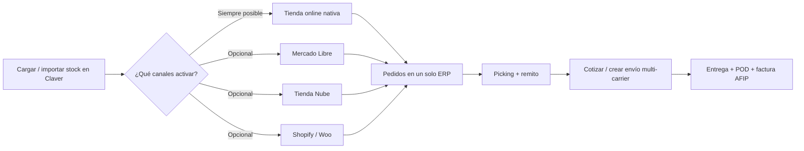
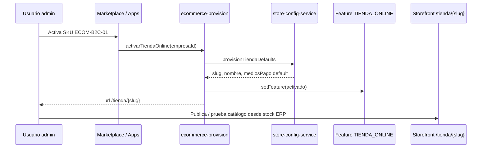
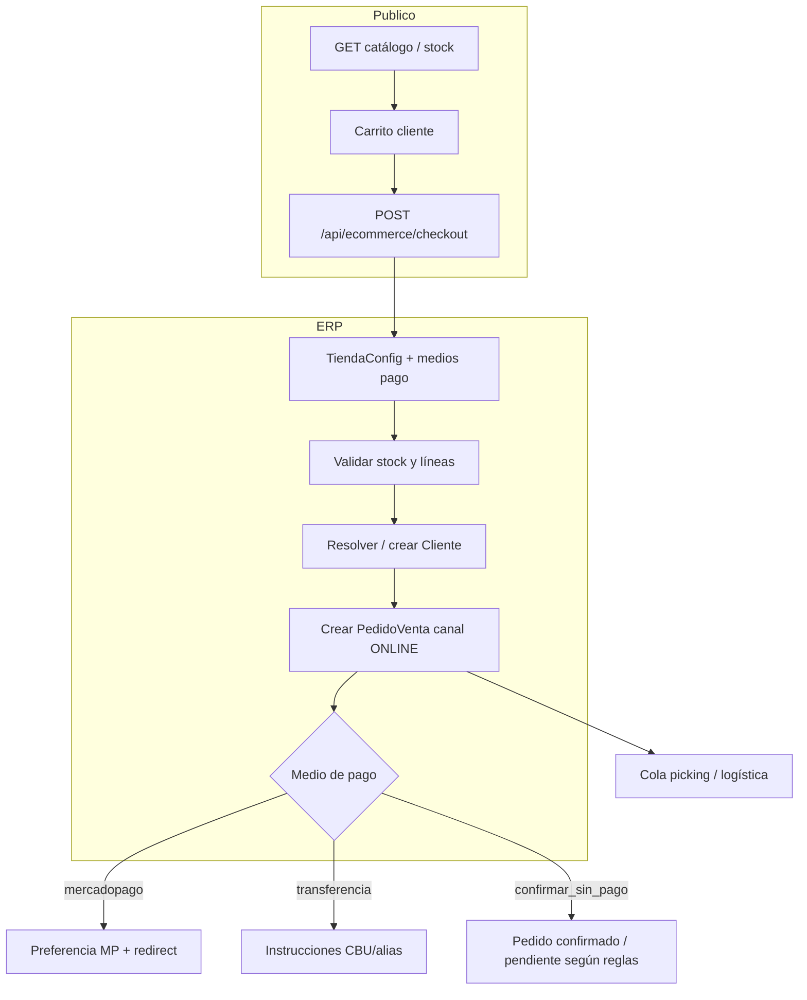
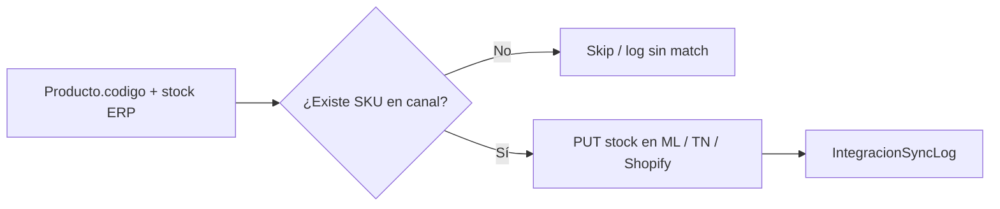
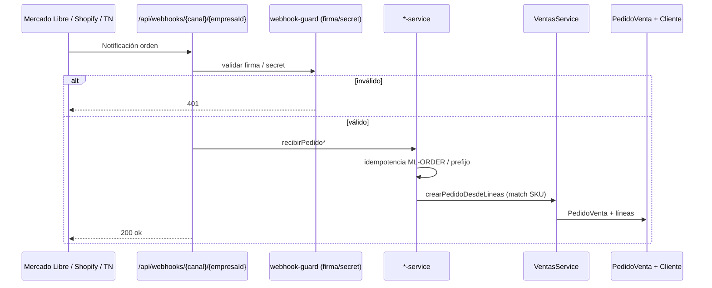
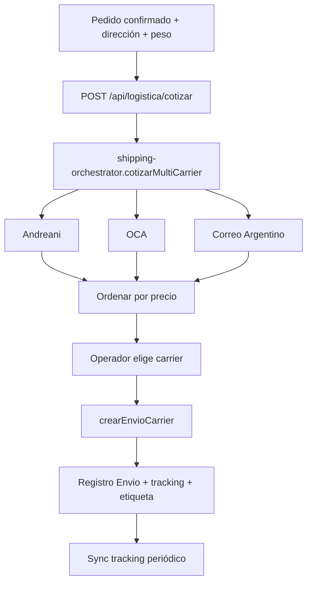
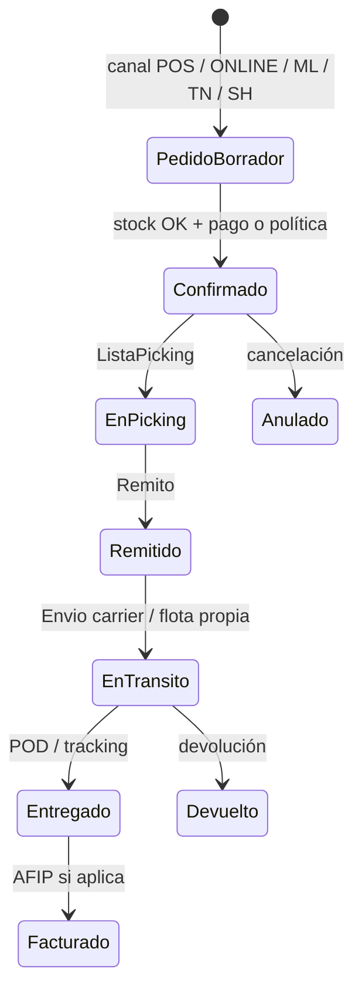

# Omnicanal Claver: stock central, e-commerce nativo, envíos y marketplaces

> **Audiencia:** comercial, implementación (analistas Claver Cloud), desarrollo y partners.  
> **Producto:** Claver / ClavERP — ERP + POS + canales online para PyMEs Argentina.  
> **Relacionados:**  
> - [`logistica-distribucion-ecommerce.md`](./logistica-distribucion-ecommerce.md) — circuito operativo picking/remito/envío  
> - [`docs/marketplace/07-bundles-comerciales.md`](../marketplace/07-bundles-comerciales.md) — packs Conecta AR / Global  
> - [`COMERCIAL.md`](../../COMERCIAL.md) — ficha de valor comercial  
> - [`docs/GO_LIVE_PRD.md`](../GO_LIVE_PRD.md) — qué se vende en PRD vs promesa

---

## 1. Resumen ejecutivo

**Propuesta en una frase:** el cliente carga el stock una sola vez en Claver y, desde ese mismo maestro, puede:

1. **Emitir / activar una tienda online propia** (e-commerce B2C nativo).
2. **Operar envíos con cotización y generación multi-carrier** (Correo Argentino, Andreani, OCA) más logística interna.
3. **Conectar marketplaces y tiendas externas** (Mercado Libre, Tienda Nube, Shopify, WooCommerce) de forma **opcional**, con sync de stock y pedidos hacia el ERP.

No es “otro e-commerce desconectado del POS”: el **stock unificado** es el centro; los canales son periféricos.

| Capacidad | ¿Nativo en Claver? | ¿Requiere cuenta externa? |
|-----------|--------------------|---------------------------|
| Catálogo + stock ERP | Sí | No |
| Tienda pública `/tienda/{slug}` | Sí | No (opcional MP) |
| Portal B2B | Sí | No |
| Cotizar / crear envíos multi-carrier | Sí (orquestador) | Sí (credenciales carrier) |
| Mercado Libre | Integración | Sí (OAuth / tokens) |
| Tienda Nube | Integración | Sí (OAuth) |
| Shopify | Integración | Sí (OAuth / token + dominio) |
| WooCommerce | Integración | Sí (site + keys) |

---

## 2. Valor que se entrega al cliente

### 2.1 Dolor que resuelve

| Dolor típico de la PyME | Con Claver |
|-------------------------|------------|
| Stock del local desfasado de la web / Meli | Un stock maestro; sync por SKU hacia canales |
| “Tengo productos en el sistema, ¿cómo vendo online?” | Activar tienda nativa sobre el mismo catálogo |
| Pedidos de Meli/TN en Excel o WhatsApp | Webhook → `PedidoVenta` en el ERP |
| Cotizar envíos a mano en 3 sitios | Orquestador multi-carrier (precio ordenado) |
| Factura, stock y despacho en sistemas distintos | Mismo pedido → picking → remito → envío → AFIP |
| Pagar 3 “islas” (POS + TN + Excel logística) | Un ERP omnicanal + integraciones opcionales |

### 2.2 Beneficios de negocio

1. **Time-to-online corto:** con productos y stock cargados, la tienda B2C se provisiona (slug, config, feature flag) sin reconstruir el catálogo.
2. **Menos quiebres y overselling:** el stock del mostrador y del online comparten la misma fuente; los canales externos se actualizan por sync (SKU = `Producto.codigo`).
3. **Escalabilidad de canales:** el cliente empieza solo con tienda Claver; suma Meli/TN/Shopify cuando el volumen lo justifica, sin cambiar de sistema.
4. **Operación de depósito unificada:** pedidos de cualquier canal entran al mismo circuito de picking, remito, envío y hoja de ruta.
5. **Cobranza y fiscal en el mismo stack:** Mercado Pago / transferencia en e-commerce; facturación AFIP en el flujo de ventas del ERP.

### 2.3 Valor por perfil

| Perfil | Qué gana |
|--------|----------|
| **Dueño / dueña** | Visibilidad de stock y ventas multicanal; menos errores caros |
| **Encargado de depósito** | Una cola de pedidos; menos “¿esto ya se vendió en Meli?” |
| **Admin comercial** | Listas de precio B2B + canal ONLINE + markups por canal |
| **Implementador / partner** | Runbooks y SKUs de marketplace (`integ.*`, `ECOM-B2C-01`) con activación guiada |

### 2.4 Monetización orientativa (packs)

Fuente de bundles: `lib/marketplace/bundles.ts` / docs marketplace.

| Pack / SKU | Rol | Precio orientativo |
|------------|-----|--------------------|
| `ECOM-B2C-01` (Claver Tienda) | Tienda online nativa | ~$34.900/mes (sub-SaaS) |
| `pool-conecta-ar` | TN + Mercado Libre + WhatsApp | ~$34.900/mes (−20%) |
| `pool-conecta-global` | Shopify + WooCommerce + pixel ads | ~$29.900/mes |
| `pool-impl-ecommerce` | Migración TN + integ + pixel | ~$49.900 mixto |
| Carriers / envíos pro | Cotización y creación de envíos | Según suscripción logística / Centro de Conexiones |

> Los precios son comerciales y pueden cambiar; validar en App Store / GO_LIVE_PRD al vender.

---

## 3. Explicación teórica del modelo

### 3.1 Principio: stock maestro, canales satélite

```
                    ┌─────────────────────────┐
                    │   MAESTRO PRODUCTO      │
                    │   (código/SKU, stock,   │
                    │    precio, activo)      │
                    │   empresaId + depósito  │
                    └───────────┬─────────────┘
                                │
          ┌─────────────────────┼─────────────────────┐
          │                     │                     │
          ▼                     ▼                     ▼
   ┌─────────────┐      ┌──────────────┐      ┌────────────────┐
   │ Canal POS   │      │ Canal ONLINE │      │ Canales externos│
   │ (mostrador) │      │ Tienda Claver│      │ ML / TN / SH /  │
   │             │      │ Portal B2B   │      │ Woo            │
   └─────────────┘      └──────────────┘      └────────────────┘
          │                     │                     │
          └─────────────────────┴─────────────────────┘
                                │
                                ▼
                    ┌─────────────────────────┐
                    │ PedidoVenta (ERP)       │
                    │ + reserva / baja stock  │
                    │ → picking → remito      │
                    │ → Envío / carrier       │
                    │ → factura / cobranza    │
                    └─────────────────────────┘
```

**Reglas teóricas:**

1. **Una verdad de inventario:** el stock “oficial” vive en Claver (`Producto` / movimientos de stock). Los marketplaces son copias sincronizadas, no dueños del stock.
2. **Matching por SKU:** el puente ERP ↔ canal es `Producto.codigo` ↔ SKU externo (ML `seller_custom_field`, variante TN/Shopify, etc.). Sin código alineado, no hay sync confiable.
3. **Pedido canónico:** todo pedido de canal se materializa (o debería materializarse) como `PedidoVenta` con canal de venta (`CanalVenta`: ONLINE, B2B, ML, etc.), para no tener “pedidos huérfanos” fuera del ERP.
4. **Idempotencia de importación:** los webhooks marcan el origen (`ML-ORDER:…`, prefijos por canal) para no duplicar pedidos al reintentar notificaciones.
5. **Envío es un servicio de salida:** cotizar y despachar no es parte del catálogo; es post-venta logística sobre un pedido ya confirmado (con dirección y peso/bultos).

### 3.2 Capas lógicas

| Capa | Responsabilidad | Ejemplo en código |
|------|-----------------|-------------------|
| **Maestros** | Productos, clientes, depósitos, listas de precio | Prisma `Producto`, `Cliente` |
| **Comercio** | Carrito, checkout, medios de pago tienda | `lib/ecommerce/*` |
| **Ventas** | Pedido, confirmación, vínculo a factura | `lib/ventas/ventas-service` |
| **Integraciones** | Credenciales, OAuth, webhooks, sync | `lib/integrations/*`, `lib/{ml,tn,shopify}` |
| **Logística** | Envíos, carriers, tracking | `lib/logistica/*` |
| **Distribución** | Hojas de ruta, POD | `app/api/distribucion/*` |
| **Fiscal** | AFIP CAE / NC | `lib/afip/*` |

### 3.3 Diferencia tienda nativa vs marketplace

| | **Tienda Claver** | **Marketplace / TN / Shopify** |
|--|-------------------|--------------------------------|
| Dueño de la UX de compra | Claver (`/tienda/{slug}`) | La plataforma externa |
| Catálogo | Lectura directa del ERP | Sync / publicación en la otra plataforma |
| Checkout | API propia + MP / transferencia | Checkout del canal externo |
| Pedido en ERP | Checkout crea `PedidoVenta` | Webhook / pull de órdenes |
| Branding | Logo, color, textos de envío | Branding del marketplace o tema TN/Shopify |
| Comisión plataforma | No (salvo MP) | Sí (ML, etc.) |

El cliente puede usar **solo nativo**, **solo externos**, o **ambos** (omnicanal real).

---

## 4. Diagramas de flujo

### 4.1 Visión de valor (cliente)



### 4.2 Activación de tienda nativa (implementación)



### 4.3 Checkout e-commerce B2C (runtime)



### 4.4 Sync de stock hacia canal externo



**Mensaje de producto (ML):** si no hay coincidencias, el servicio responde guía del tipo:  
*usá `seller_custom_field` = código producto*.

### 4.5 Pedido entrante desde marketplace (webhook)



### 4.6 Envío multi-carrier



### 4.7 Circuito end-to-end omnicanal (operación)



---

## 5. Implementación en el código (mapa de desarrollo)

### 5.1 E-commerce nativo

| Pieza | Ruta |
|-------|------|
| Provision al activar tienda | `lib/ecommerce/ecommerce-provision.ts` → `activarTiendaOnline` |
| Config tienda (slug, logo, medios, texto envío) | `lib/ecommerce/store-config-service.ts` |
| Checkout (cliente, pedido, pagos) | `lib/ecommerce/checkout-service.ts` |
| Tipos / medios de pago | `lib/ecommerce/types.ts` |
| MP en checkout | `lib/ecommerce/payment-providers/mercadopago-checkout.ts` |
| Transferencia | `lib/ecommerce/payment-providers/transferencia.ts` |
| Storefront público | `app/tienda/[slug]/page.tsx`, `components/ecommerce/tienda-storefront` |
| Dashboard config | `app/dashboard/ecommerce/page.tsx` |
| Landing comercial | `app/claver/ecommerce/page.tsx` |
| API config / checkout / tienda | `app/api/ecommerce/*` |

**Feature flag:** `FEATURES.TIENDA_ONLINE` vía `lib/config/rubro-config-service.ts`.

**SKU comercial:** `ECOM-B2C-01` (Claver Tienda).

### 5.2 Integraciones de marketplace / tienda externa

| Canal | Service | API / Webhook | `integracionId` |
|-------|---------|---------------|-----------------|
| Mercado Libre | `lib/mercadolibre/mercadolibre-service.ts` | `app/api/mercadolibre`, `app/api/webhooks/mercadolibre/[empresaId]` | `mercado_libre` |
| Tienda Nube | `lib/tiendanube/tiendanube-service.ts` | webhooks TN + Centro de Conexiones | `tienda_nube` |
| Shopify | `lib/shopify/shopify-service.ts` | `app/api/webhooks/shopify/[empresaId]` | `shopify` |
| WooCommerce | `lib/woocommerce/woocommerce-service.ts` | helpers ecommerce | `woocommerce` |

**Credenciales unificadas:** `lib/integrations/credentials.ts` + `ConexionIntegracion`.  
**Catálogo de integraciones (meta, OAuth hints):** `lib/integrations/integration-meta.ts`.  
**Estado de conexión:** `lib/integrations/connection-service.ts`.  
**Helpers de pedidos por canal:** `lib/integrations/ecommerce-helpers.ts`  
(`resolverClienteCanal`, `crearPedidoDesdeLineas`, `pedidoCanalYaImportado`).

**Seguridad webhooks:** `lib/auth/webhook-guard.ts`  
- ML: secret / bearer (`ML_WEBHOOK_SECRET` en deploy).  
- Shopify / TN / MP: HMAC según plataforma (ver runbooks de seguridad).

### 5.3 Logística y envíos

| Pieza | Ruta |
|-------|------|
| Orquestador multi-carrier | `lib/logistica/shipping-orchestrator.ts` |
| Registry carriers | `lib/logistica/carriers/registry.ts` |
| Adapters | `andreani.ts`, `oca.ts`, `correo-argentino.ts` |
| API cotizar | `app/api/logistica/cotizar/route.ts` |
| API carrier / envío | `app/api/logistica/carrier/route.ts` |
| Servicio envíos genérico | `lib/logistica/logistica-service.ts` |
| UI logística | `app/dashboard/logistica/page.tsx` |
| Distribución / hojas de ruta | `app/api/distribucion/*` |

**Carrier IDs:** `andreani` | `oca` | `correo_argentino`.

### 5.4 Tests de referencia

| Área | Test |
|------|------|
| Tienda Nube | `__tests__/tiendanube/tiendanube-service.test.ts` |
| Shopify | `__tests__/shopify/shopify-service.test.ts` |
| Checkout e-com | `__tests__/ecommerce/checkout-service.test.ts` |
| Shipping orchestrator | `__tests__/logistica/shipping-orchestrator.test.ts` |
| Webhook guard | `__tests__/auth/webhook-guard.test.ts` |
| Provision SKU integ | `__tests__/marketplace/provision-service.test.ts` |

### 5.5 Variables de entorno relevantes

Ver también `docs/deploy/VERCEL_ENV.md`.

| Variable | Uso |
|----------|-----|
| `ML_WEBHOOK_SECRET` | Validar webhooks Mercado Libre |
| (tokens por empresa) | Guardados en `ConexionIntegracion` / credentials (no solo env global) |
| `NEXT_PUBLIC_ECOMMERCE_EMPRESA_ID` | Demo storefront default (no multi-tenant prod) |
| Credenciales MP | Checkout tienda nativa |
| Credenciales carriers | Por empresa en Centro de Conexiones |

---

## 6. APIs y superficies de usuario

### 6.1 APIs e-commerce

| Método | Ruta | Función |
|--------|------|---------|
| GET | `/api/ecommerce/config` | Config tienda (auth empresa) |
| GET/PUT | `/api/ecommerce/tienda` / `[slug]` | Resolución pública por slug |
| POST | `/api/ecommerce/checkout` | Checkout unificado B2C/B2B |
| (catálogo) | endpoints de catálogo / productos filtrados | Stock y precio para storefront |

### 6.2 APIs logística

| Método | Ruta | Función |
|--------|------|---------|
| POST | `/api/logistica/cotizar` | Cotización multi-carrier |
| * | `/api/logistica/carrier` | Crear / operar envío carrier |
| * | `/api/logistica` | Envíos y transportistas |

### 6.3 Pantallas

| URL | Actor |
|-----|--------|
| `/dashboard/ecommerce` | Admin: branding, medios de pago, texto envío |
| `/tienda/{slug}` | Cliente final B2C |
| `/portal` | Cliente B2B (mismo checkout/canal) |
| `/dashboard/logistica` | Operaciones de envío |
| `/dashboard/apps` / Claver Apps | Activar SKUs e integ |
| Centro de Conexiones (integraciones) | OAuth / tokens ML, TN, Shopify, carriers |

---

## 7. Guía de implementación (go-live cliente)

### Fase 0 — Prerrequisitos de datos

- [ ] Empresa creada, usuarios y roles.
- [ ] Productos con **código/SKU único y estable**.
- [ ] Stock inicial cargado (o importación masiva).
- [ ] Precios y, si aplica, listas B2B.
- [ ] Condición IVA / datos fiscales para facturar después.

### Fase 1 — Tienda nativa (mínimo vendible online)

1. Activar `ECOM-B2C-01` / feature tienda online.  
2. Verificar slug y URL `/tienda/{slug}`.  
3. Configurar logo, color, `textoEnvio`, footer.  
4. Habilitar medios de pago (MP / transferencia / confirmar sin pago según política).  
5. Smoke test: catálogo visible → carrito → checkout → `PedidoVenta` en ERP.  
6. Probar que una venta en POS descuenta stock y el storefront refleja disponibilidad.

### Fase 2 — Logística de envíos

1. Alta de direcciones / datos de origen (depósito).  
2. Conectar 1+ carriers (Correo / Andreani / OCA) en Centro de Conexiones.  
3. Cotizar un CP de prueba; crear envío de un pedido real de staging.  
4. Verificar tracking y registro `Envio`.  
5. (Opcional) Hojas de ruta + POD para flota propia.

### Fase 3 — Marketplaces (opcional, por demanda)

**Mercado Libre**

1. OAuth / tokens + `sellerId`.  
2. Alinear `seller_custom_field` (o SKU) con `Producto.codigo`.  
3. Sync stock de prueba; webhook `…/api/webhooks/mercadolibre/{empresaId}`.  
4. Pedido test → aparece como `PedidoVenta` sin duplicar reintentos.

**Tienda Nube**

1. OAuth / storeId + token.  
2. Mapear variantes por SKU.  
3. Sync stock + pedidos.  
4. Monitoreo 48 h (runbook `integ.tienda_nube`).

**Shopify**

1. Dominio `*.myshopify.com` + access token / OAuth.  
2. Location activa para inventory.  
3. Sync stock por `inventory_item_id` + SKU.  
4. Webhook de órdenes → `recibirPedidoShopify`.

### Fase 4 — Hipercare

- [ ] Alertas de desfase de stock (> umbral % en runbook).  
- [ ] Logs `IntegracionSyncLog` y reintentos.  
- [ ] Capacitación depósito: un solo tablero de pedidos.  
- [ ] Checklist fiscal: pedidos online facturados cuando corresponda.

---

## 8. Contratos de datos clave

### 8.1 TiendaConfig (concepto)

| Campo | Uso |
|-------|-----|
| `empresaId` | Multi-tenant |
| `slug` | URL pública |
| `nombreTienda`, `logoUrl`, `colorPrimario` | Branding |
| `mediosPago` | MP / transferencia / confirmar sin pago |
| `textoEnvio` | Condiciones de envío mostradas al comprador |
| `activa` | Publicación |

### 8.2 Matching SKU

| Origen | Campo recomendado |
|--------|-------------------|
| ERP | `Producto.codigo` |
| Mercado Libre | `seller_custom_field` / SKU publicación |
| Tienda Nube | `variant.sku` |
| Shopify | `variant.sku` + inventory item |

### 8.3 Envío (concepto)

| Campo | Uso |
|-------|-----|
| `carrierIntegracionId` | `andreani` / `oca` / `correo_argentino` |
| `trackingExterno` | Tracking del carrier |
| `etiquetaUrl` | Etiqueta de despacho |
| `costoEnvio` | Costo cotizado/creado |
| `pedidoVentaId` / `remitoId` | Trazabilidad |
| `estado` | pendiente → en_transito → entregado / devuelto |

---

## 9. Límites, supuestos y honestidad de producto

Para no overpromise en venta:

1. **La tienda nativa no reemplaza el ecosistema de apps de Shopify/TN** (temas, apps de marketing avanzadas). Compite por **integración al ERP + stock único + AFIP + POS**, no por “builder de landing infinito”.
2. **Sync de stock depende del SKU bien cargado.** Sin disciplina de códigos, el canal externo no se actualiza.
3. **Carriers requieren cuentas y credenciales del cliente** (o del operador logístico); Claver orquesta, no es el correo.
4. **“Envíos automáticos”** = cotización + creación de guía + tracking + circuito de depósito; **no** implica que cada orden elija carrier y pague flete sin reglas de negocio configuradas.
5. **Algunos caminos de catálogo/checkout** pueden evolucionar (ver auditorías comerciales históricas); el núcleo de pedido + integración + orquestador de envíos está en el monorepo y con tests.
6. **Multi-tenant:** nunca hardcodear `empresaId` en producción; el storefront usa slug → `TiendaConfig`.

---

## 10. Argumentario comercial (elevator pitch)

> “Con Claver cargás el stock una vez. Ese mismo stock alimenta tu caja del local, tu tienda online propia y, si querés, Mercado Libre, Tienda Nube o Shopify. Los pedidos caen al ERP, el depósito los prepara y los envíos se cotizan y generan con Correo, Andreani u OCA — sin planillas y sin pelear tres inventarios.”

**Objeciones frecuentes**

| Objeción | Respuesta |
|----------|-----------|
| “Ya tengo Tienda Nube” | Perfecto: no te pedimos abandonarla; la conectamos y unificamos stock/pedidos. Pack `pool-impl-ecommerce` / `integ.tienda_nube`. |
| “Solo quiero Meli” | Activás ML + stock maestro + logística; la tienda nativa es opcional. |
| “No quiero integraciones caras al inicio” | Empezás con POS + stock + tienda Claver; sumás canales después. |
| “¿Y si vendo en el local y en la web a la vez?” | Ese es el caso de uso principal: un stock, dos (o N) canales. |

---

## 11. Checklist de desarrollo (extensión futura)

Prioridades técnicas si se profundiza el producto:

| Prioridad | Mejora |
|-----------|--------|
| P1 | Cotización de flete **en el checkout** de tienda nativa (hoy más fuerte en backoffice logística + `textoEnvio`) |
| P1 | Publicación masiva ERP → ML/TN (hoy el foco fuerte es sync stock + import pedidos) |
| P2 | Reglas de stock por canal (reservas / buffer por marketplace) |
| P2 | Dashboard omnicanal unificado (pedidos de todos los canales en una grilla) |
| P3 | Carriers adicionales (Crucero del Norte, Andreani full features, etc.) |
| P3 | SLA de sync y alertas automáticas de desfase de stock |

---

## 12. Referencia rápida de archivos

```
lib/ecommerce/           # Tienda nativa, checkout, provision
lib/mercadolibre/        # ML API + service
lib/tiendanube/          # TN API + service
lib/shopify/             # Shopify API + service
lib/woocommerce/         # Woo bridge
lib/integrations/        # Credenciales, meta, helpers, connection
lib/logistica/           # Envíos + carriers + orchestrator
app/api/ecommerce/       # APIs tienda
app/api/logistica/       # Cotizar / carrier
app/api/webhooks/        # ML, Shopify, …
app/tienda/              # Storefront público
app/dashboard/ecommerce/ # Config tienda
docs/funcional/logistica-distribucion-ecommerce.md
docs/marketplace/07-bundles-comerciales.md
docs/marketplace/17-runbooks-tier1-diagramas.md
```

---

## 13. Conclusión

Claver entrega un **modelo omnicanal de stock maestro**:

| Entrega | Estado conceptual en producto |
|---------|-------------------------------|
| E-commerce desde stock propio | Sí — tienda nativa + catálogo ERP |
| Formas de envío automatizables | Sí — orquestador multi-carrier + logística |
| Proveedores Meli / TN / Shopify | Sí — integraciones opcionales con sync y webhooks |
| Valor al cliente | Menos fricción, un inventario, operación y fiscal en un solo sistema |

Este documento es la fuente de verdad **funcional + de implementación** para esa narrativa. Para el detalle de estados de picking/remito/POD, ver [`logistica-distribucion-ecommerce.md`](./logistica-distribucion-ecommerce.md). Para precios y packs de venta, validar App Store y `GO_LIVE_PRD`.
`)