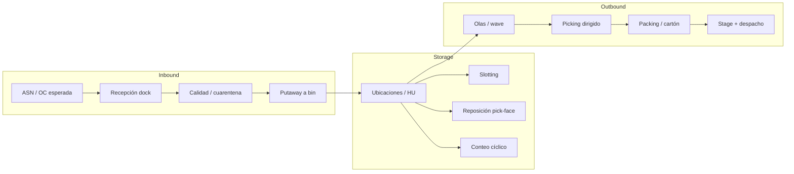
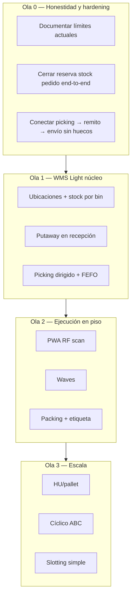
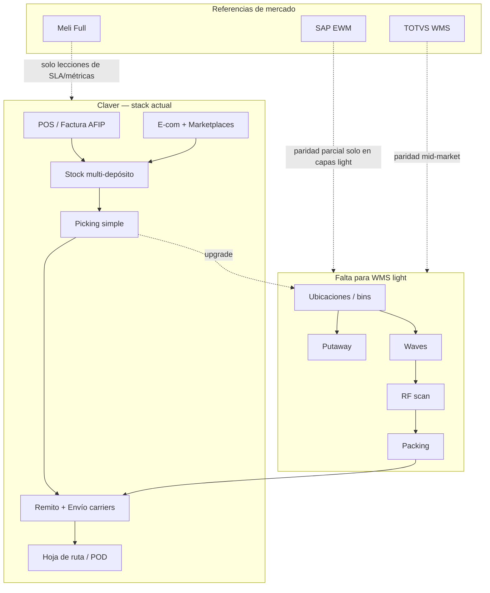

# WMS en Claver — qué hay, qué falta y cómo se compara con SAP, TOTVS y Mercado Libre

> **Audiencia:** producto, desarrollo, implementación, comercial (sin overpromise).  
> **Fecha:** 2026-07-29  
> **Alcance:** Warehouse Management System (gestión de almacén / depósito), no solo “stock contable”.  
> **Relacionados:**  
> - [`logistica-distribucion-ecommerce.md`](./logistica-distribucion-ecommerce.md)  
> - [`ecommerce-omnicanal-stock-envios-marketplaces.md`](./ecommerce-omnicanal-stock-envios-marketplaces.md)  
> - Schema: `Deposito`, `StockDeposito`, `ListaPicking`, `Lote`, `MovimientoStock`  
> - Código: `lib/stock/*`, `lib/picking/*`, `lib/logistica/*`

---

## 1. Definición: stock ERP ≠ WMS

| Concepto | Pregunta que responde | Ejemplo |
|----------|----------------------|---------|
| **Stock / inventario ERP** | *¿Cuántas unidades tengo y de qué valor?* | 120 cajas de aceite en depósito “Central” |
| **WMS** | *¿Dónde está cada unidad, en qué tarea, con qué orden de trabajo y reglas de movimiento?* | Caja en pasillo A-03-12, lote 2025-08, tarea de putaway #441, pick path optimizado |

**Claver hoy es fuerte en ERP de stock + logística de salida liviana.**  
**No es aún un WMS de clase enterprise** (SAP EWM / TOTVS WMS / motor Full de Meli).

```
                    ┌──────────────────────────────────────┐
                    │           WMS “completo”             │
                    │  layout · tareas · HU · RF · olas    │
                    │  putaway · slotting · packing        │
                    └──────────────────┬───────────────────┘
                                       │
              ┌────────────────────────┼────────────────────────┐
              │                        │                        │
              ▼                        ▼                        ▼
     SAP EWM / TOTVS WMS      Claver (hoy)              ML Full / 3PL
     depósito industrial      stock multi-depósito      fulfillment
     + reglas profundas       + picking simple          + SLAs plataforma
                              + remito/envío
```

---

## 2. Qué tiene Claver hoy (baseline real del monorepo)

### 2.1 Capacidades implementadas o parcialmente implementadas

| Capacidad | Estado | Evidencia en código / schema |
|-----------|--------|------------------------------|
| Multi-depósito | **Sí** | `Deposito`, tipos: principal, tránsito, consignación, devoluciones, cuarentena, merma |
| Stock por depósito | **Sí** | `StockDeposito` (`cantidad`, `reservado`) |
| Movimientos de stock | **Sí** | `MovimientoStock` (entrada, salida, ajuste, transferencias) |
| Baja/alta automática por venta/compra/NC | **Sí (parcial)** | `lib/stock/stock-service.ts` + event bus |
| Reserva en pedidos | **Parcial** | Campo `reservado` en `StockDeposito`; no es motor de tareas WMS |
| Transferencia entre depósitos | **Sí** | `TransferenciaDeposito` + `transferencia-deposito-service.ts` |
| Toma de inventario / conciliación | **Sí** | `toma-inventario-service.ts` (crear → conteo → ajustes) |
| Lotes con vencimiento | **Parcial (maestro)** | `Lote` (estado, FEFO no forzado en pick) |
| Ubicación libre en producto | **Muy liviano** | `Producto.ubicacionDeposito` string (`A-03-12`); **no hay maestro de ubicaciones** |
| Lista de picking | **Básico** | `ListaPicking` / `LineaPicking`; genera desde pedido; picado por cantidad |
| Zona de almacén en lista | **Texto libre** | `ListaPicking.zonaAlmacen` string opcional |
| Remito de despacho | **Sí** | `Remito` + COT |
| Envío + carriers (Correo/Andreani/OCA) | **Sí** | `shipping-orchestrator` + adapters |
| Hoja de ruta / POD distribución | **Sí (logística last-mile)** | Distribución, no layout de depósito |
| Recepción de compras / OC | **Parcial ERP** | Compras OC → recepción; no putaway dirigido a bin |
| Industria / BOM / OP | **MRP liviano** | No reemplaza WMS de producción avanzada |
| IoT sensores en almacén | **Diferenciador** | Temperatura, peso, etc. — no es RF de picking |

### 2.2 Picking actual (honestidad técnica)

```text
PedidoVenta
    → PickingService.generarDesdesPedido()
    → ListaPicking (pendiente)
    → LineaPicking (cantidadPedida, ubicacion=null al crear)
    → actualizarLineaPicking(cantidadPicada)
    → estado completo / lista completada
```

**Qué no hace el picking actual:**

- No resuelve bin óptimo ni path de pasillos.
- No agrupa olas (wave) ni batch multi-pedido.
- No controla FEFO/FIFO por lote al picar.
- No genera packing list / cartón / SSCC.
- No asigna tarea a operario con cola RF.
- No valida scan de ubicación + SKU + lote en terminal.

Conclusión: es un **preparado de pedido ERP**, no un **motor WMS de ejecución**.

### 2.3 Mapa de archivos relevantes

```
lib/stock/stock-service.ts
lib/stock/toma-inventario-service.ts
lib/stock/transferencia-deposito-service.ts
lib/picking/picking-service.ts
lib/logistica/shipping-orchestrator.ts
lib/logistica/logistica-service.ts
app/api/picking/
app/api/stock/
app/dashboard/picking/
app/dashboard/logistica/
prisma: Deposito, StockDeposito, ListaPicking, LineaPicking, Lote, MovimientoStock, Remito, Envio
```

---

## 3. Qué es un WMS “de verdad” (marco teórico)

Procesos canónicos (entrada → almacenaje → salida):



| Bloque | Qué decide el sistema |
|--------|------------------------|
| **Layout** | Depósito → zona → pasillo → estante → bin (y a veces HU/pallet encima) |
| **Inbound** | Qué llegó vs qué se esperaba (ASN); a qué bin va (putaway) |
| **Inventory control** | Stock **por ubicación y por HU**, no solo por depósito |
| **Outbound** | Cómo agrupar pedidos, en qué orden picar, cómo embalar |
| **Labor** | Quién hace qué tarea, productividad, interleaving |
| **Exceptions** | Faltante en bin, daño, reubicación, short pick |

---

## 4. Benchmark: SAP EWM vs TOTVS WMS vs Mercado Libre vs Claver

### 4.1 Tabla comparativa de capacidades

Leyenda: ✅ nativo maduro · 🟡 parcial / simple · ❌ ausente o no WMS · ⚪ N/A (no es el producto)

| Capacidad WMS | **SAP EWM** | **TOTVS WMS** | **Meli Full / fulfillment** | **Claver hoy** |
|---------------|-------------|---------------|-----------------------------|----------------|
| Stock multi-depósito | ✅ | ✅ | ✅ (sus CDs) | ✅ |
| Stock por **ubicación (bin)** | ✅ | ✅ | ✅ (interno) | ❌ (solo string en producto/línea) |
| Maestro de layout (pasillo/rack/bin) | ✅ | ✅ | ✅ interno | ❌ |
| Handling Unit / pallet / LPN / SSCC | ✅ | ✅ | ✅ | ❌ |
| ASN / preaviso de llegada | ✅ | ✅ | ✅ (inbound Full) | ❌ formal |
| Recepción dock + discrepancia | ✅ | ✅ | ✅ | 🟡 recepción OC ERP |
| Putaway dirigido (estrategias) | ✅ | ✅ | ✅ | ❌ |
| Slotting / reubicación de ABC | ✅ | 🟡 | ✅ interno | ❌ |
| Reserva de stock por tarea | ✅ | ✅ | ✅ | 🟡 `reservado` a nivel depósito |
| Picking por pedido | ✅ | ✅ | ✅ | 🟡 lista simple |
| **Wave / olas** de picking | ✅ | ✅ | ✅ | ❌ |
| Batch / multi-order pick | ✅ | ✅ | ✅ | ❌ |
| Path optimization | ✅ | 🟡–✅ | ✅ | ❌ (order by `ubicacion` string) |
| FEFO/FIFO forzado en salida | ✅ | ✅ | ✅ (alimentos) | ❌ no en ejecución de pick |
| Packing station / cartonización | ✅ | ✅ | ✅ | ❌ |
| Etiquetas carrier + stage door | ✅ | ✅ | ✅ | 🟡 envío carrier post-remito |
| RF / terminal handheld | ✅ | ✅ | ✅ (ops Meli) | ❌ |
| Voice picking | ✅ / partners | 🟡 partners | ⚪ | ❌ |
| Conteo cíclico ABC | ✅ | ✅ | ✅ | 🟡 toma inventario full/simple |
| Cross-docking | ✅ | ✅ | ✅ | ❌ |
| Yard management (camiones/muelles) | ✅ | 🟡 | ✅ | ❌ |
| Labor management (KPIs operario) | ✅ | 🟡–✅ | ✅ | ❌ |
| 3PL multi-cliente en un CD | ✅ | ✅ | ⚪ (es el 3PL) | ❌ |
| SLA promesa de entrega plataforma | ⚪ | ⚪ | ✅ (Full) | ⚪ |
| Integración ERP contable/fiscal | ✅ SAP | ✅ Protheus | vía seller | ✅ (fortaleza Claver) |
| POS + e-com + AFIP en el mismo stack | ⚪ | 🟡 | ⚪ | ✅ |
| IoT almacén (temp, etc.) | partners | partners | interno | 🟡 sensores IoT |

### 4.2 Qué “tiene el otro” que el cliente compara verbalmente

#### SAP EWM (Extended Warehouse Management)

Referencia de **almacén industrial / 3PL / alta complejidad**.

| Tienen | Para qué sirve | Gap Claver |
|--------|----------------|------------|
| Storage types / sections / bins | Layout formal del depósito | No hay entidad `UbicacionAlmacen` |
| Putaway strategies (fixed bin, empty bin, bulk, pallet…) | Sistema elige **dónde guardar** al recibir | Hoy: “entró al depósito”, sin bin |
| Wave management | Agrupa órdenes por ruta, carrier, prioridad, cutoff | Una lista por pedido, sin olas |
| Slotting & rearrangement | Fast movers cerca del muelle / pick-face | Ubicación estática opcional en producto |
| HU (Handling Units) | Pallet y cajas con ID escaneable en todo el flujo | No existe LPN/HU |
| Task & resource management | Cola de tareas para operarios RF | UI web de lista; no RF task engine |
| VAS / kitting en depósito | Armado de kits en outbound | Solo BOM/industria separado |
| Integration con TM / shipping | Stage por puerta, olas de carga | Remito + Envio + hoja de ruta last-mile |

**No copiar SAP entero:** es un producto de otra escala de precio y proyecto (meses/años). Claver debe tomar **capas WMS light** alineadas a PyME AR.

#### TOTVS WMS (y Protheus + WMS)

Referencia **LATAM / Brasil–Argentina industrial y distribuidora**.

| Tienen | Para qué sirve | Gap Claver |
|--------|----------------|------------|
| WMS como módulo/suite de almacén | Separado o acoplado al ERP TOTVS | Claver mezcla stock ERP + picking liviano |
| Endereçamento (enderezos) | Bin structure BR-style | Falta maestro de endereços |
| Conferência cega / cega de entrada | Recibe sin ver OC (reduce fraude) | No hay flujo ciego formal |
| Separação por rota / onda | Similar a waves | No |
| Inventário rotativo | Conteo cíclico por ABC | Solo toma de inventario clásica |
| Integração com coletores | Handheld Android típico TOTVS | No hay app RF |
| Unitizadores (palete/caixa) | Equivalente HU | No |

TOTVS vende **WMS como producto con nombre**. Claver vende **ERP con stock y picking**; el cliente enterprise pregunta “¿tienen WMS?” y hoy la respuesta honesta es: **inventario + picking básico + logística de salida, no WMS full**.

#### Mercado Libre (Full / fulfillment / WMS de plataforma)

No es un WMS que el cliente “instala”: es un **operador logístico + motor de promesa**.

| Tienen | Para qué sirve | Gap Claver |
|--------|----------------|------------|
| Inbound programado a CD Meli | Seller manda stock a Full | Claver no es CD de terceros |
| Slotting masivo + densificación | Millones de SKUs | Escala irrelevante para PyME |
| Picking densificado + packing industrial | SLA Full / Flex | No hay packing station |
| Promesa de entrega al comprador | Diferenciador marketplace | En Claver: texto envío + carriers del cliente |
| Score logístico del seller | Penaliza mal despacho | No aplica (no es marketplace) |
| Devoluciones inbound al CD | Reverse logistics escala | Claver: NC + depósito devoluciones (ERP) |

**Lección de Meli para Claver (no copiar el CD):**

1. **SLA y cutoff** visibles en el pedido (hoy → mañana 12:00).  
2. **Etiqueta + estado de despacho** sin fricción.  
3. **Stock confiable** (over-sell = muerte del canal).  
4. **Métricas de depósito** (órdenes a tiempo, short picks).

Claver puede **conectarse a Meli** (ya hay integración de pedidos/stock) sin ser Full; el WMS del seller sigue siendo su depósito.

---

## 5. Gaps priorizados para Claver (backlog WMS)

### 5.1 Matriz impacto × esfuerzo

| ID | Gap | Impacto cliente | Esfuerzo | Prioridad sugerida | Notas |
|----|-----|-----------------|----------|--------------------|-------|
| WMS-01 | Maestro `UbicacionAlmacen` (depósito → zona → pasillo → bin) | Alto | Medio | **P0** | Base de todo WMS light |
| WMS-02 | Stock por ubicación (`StockUbicacion`) + movimientos bin-to-bin | Alto | Medio-Alto | **P0** | Sin esto no hay directed pick |
| WMS-03 | Putaway al recibir OC/ASN (sugerir bin) | Alto | Medio | **P1** | Cierra inbound |
| WMS-04 | Picking dirigido (ruta ordenada por bin + scan) | Alto | Medio | **P1** | Upgrade de `ListaPicking` |
| WMS-05 | FEFO/FIFO al picar (elegir lote) | Alto (alim./farma) | Medio | **P1** | Ya existe `Lote` |
| WMS-06 | App / modo RF (PWA handheld) | Alto | Alto | **P1** | Escaneo barcode ubicación+SKU |
| WMS-07 | Wave / olas (agrupar pedidos por carrier/ruta/cutoff) | Medio-Alto | Medio | **P2** | Distribuidoras |
| WMS-08 | Packing station + peso/dimensiones + etiqueta | Medio-Alto | Medio | **P2** | Cierra con carriers |
| WMS-09 | HU / pallet / LPN | Medio | Alto | **P2** | Mayoristas / beverage |
| WMS-10 | ASN formal + recepción cega | Medio | Medio | **P2** | Anti-fraude inbound |
| WMS-11 | Conteo cíclico ABC + conteo por bin | Medio | Medio | **P2** | Mejora toma inventario |
| WMS-12 | Reposición automática pick-face | Medio | Medio | **P3** | Tras slotting básico |
| WMS-13 | Slotting ABC (regla simple) | Medio | Medio | **P3** | No ML |
| WMS-14 | Cross-dock | Bajo-Medio PyME | Medio | **P3** | Solo volumen alto |
| WMS-15 | Labor KPIs / interleaving | Bajo PyME | Alto | **P3** | Enterprise |
| WMS-16 | Yard / docks | Bajo PyME | Alto | **P4** | SAP-like |

### 5.2 Modelo de datos mínimo propuesto (WMS light)

```text
Deposito (ya existe)
  └── ZonaAlmacen          // picking, bulk, staging, muelle, cuarentena
        └── UbicacionAlmacen  // codigo "A-03-12", tipo bin/pick/bulk, capacidad
              └── StockUbicacion  // productoId, loteId?, cantidad, huId?
                    └── (movimientos) MovimientoUbicacion

HU / LPN (opcional fase 2)
  └── conteniendo StockUbicacion o líneas

TareaWms
  tipo: putaway | pick | move | count | replenish
  estado, operarioId, prioridad, fromBin, toBin, productoId, cantidad

OlaPicking (wave)
  └── N ListaPicking o N TareaWms pick

PackingList
  pedidoId, bultos, peso, dimensiones, etiquetaUrl
```

### 5.3 Roadmap de oleadas (sugerido)



**Ola 0 (ya parcialmente en docs de logística):** sin layout, al menos el circuito pedido → reserva → pick → remito → envío debe ser confiable. Eso es “ERP de depósito bueno”, no WMS.

**Ola 1:** lo mínimo para decir con honestidad: **“WMS light / depósito dirigido”**.

**Ola 2:** lo que el cliente de distribuidora compara con TOTVS “en el día a día del operario”.

**Ola 3:** acercamiento a features tipo SAP/TOTVS enterprise, solo si hay demanda paga.

---

## 6. Posicionamiento comercial (cómo hablarlo)

### 6.1 Qué decir hoy

> “Claver gestiona **inventario multi-depósito, reservas, toma de inventario, picking de pedidos, remitos, envíos multi-carrier y rutas de entrega**, todo integrado a POS, e-commerce, marketplaces y AFIP.  
> No es un SAP EWM: si tenés un CD con 50 operarios RF y 20.000 ubicaciones, necesitás un WMS industrial o un proyecto de WMS light por fases.  
> Para la PyME y la distribuidora mediana, el valor está en **un solo stock, un solo pedido y salida logística**, no en slotting de machine learning.”

### 6.2 Qué no prometer

| Frase peligrosa | Realidad |
|-----------------|----------|
| “Tenemos WMS completo tipo SAP” | No |
| “Optimizamos el path del operario como Meli Full” | No |
| “Putaway automático a la mejor ubicación” | No (aún) |
| “Control de pallets/HU end-to-end” | No |

### 6.3 Pack de producto futuro (idea)

| SKU tentativo | Incluye | Competencia que ataca |
|---------------|---------|------------------------|
| `wms.light` | Ubicaciones + stock bin + pick dirigido + FEFO | TOTVS entry / Excel de depósito |
| `wms.rf` | PWA scan + tareas | Coletores TOTVS |
| `wms.waves` | Olas + packing + etiqueta | Distribuidora mid-market |
| `wms.hu` | Pallet/LPN | Bebidas / mayorista |

---

## 7. Diferenciadores Claver (no copiar al revés)

Aunque falte WMS deep, Claver tiene piezas que **SAP EWM / TOTVS WMS puros no resuelven solos en AR**:

| Diferenciador | Por qué importa al cliente |
|---------------|----------------------------|
| POS + stock unificado | El mostrador y el depósito no pelean |
| AFIP nativo | El remito/factura salen del mismo mundo |
| E-com + Meli/TN/Shopify | Pedidos multicanal al mismo picking |
| Carriers AR (Correo/Andreani/OCA) | Última milla local |
| Fiado / retail barrio / hospitalidad | Verticales que un WMS genérico ignora |
| Precio y time-to-value PyME | Semanas, no 12 meses de implantación EWM |
| IoT sensores | Cámaras de frío, peso — complemento WMS |

**Estrategia:**  
WMS light **dentro del ERP**, no un segundo sistema; integración fuerte a canales y fiscal Argentina.

---

## 8. Checklist de madurez WMS (scorecard interno)

Puntuar 0–2 por ítem (0 no · 1 parcial · 2 maduro). Máx. 40.

| # | Ítem | Score Claver (est.) |
|---|------|---------------------|
| 1 | Multi-depósito | 2 |
| 2 | Stock por depósito + movimientos | 2 |
| 3 | Reserva confiable | 1 |
| 4 | Layout / ubicaciones | 0 |
| 5 | Stock por bin | 0 |
| 6 | Inbound ASN | 0 |
| 7 | Putaway dirigido | 0 |
| 8 | Picking por pedido | 1 |
| 9 | Wave / batch | 0 |
| 10 | FEFO/FIFO ejecución | 0 |
| 11 | Packing / carton | 0 |
| 12 | HU/LPN | 0 |
| 13 | RF / scan | 0 |
| 14 | Inventario cíclico | 1 |
| 15 | Transferencias / bin moves | 1 (solo depósito) |
| 16 | Outbound remito+carrier | 2 |
| 17 | Last-mile hoja de ruta | 2 |
| 18 | KPIs depósito (OTIF pick) | 0 |
| 19 | Integración omnicanal pedidos | 2 |
| 20 | Multi-tenant SaaS WMS | 1 (ERP multi-tenant) |

**Total estimado: ~14 / 40 (~35%) → “ERP de inventario + outbound logistics”, no WMS enterprise.**

Meta Ola 1: **~22–24 / 40**.  
Meta Ola 2: **~28–30 / 40** (“WMS light vendible a distribuidora”).

---

## 9. Casos de uso: cuándo alcanza Claver y cuándo no

| Escenario | ¿Claver alcanza hoy? | ¿Necesita WMS light / industrial? |
|-----------|----------------------|-----------------------------------|
| Almacén / kiosco 1 depósito, 1–3 personas | ✅ sí | No |
| Distribuidora 500–2000 SKU, 5 operarios, un piso | 🟡 con dolor | **Sí WMS light (Ola 1–2)** |
| CD con racks, RF, 20+ operarios, 3PL | ❌ | WMS industrial (SAP/TOTVS) o proyecto grande |
| Seller que manda todo a Meli Full | ✅ (canal + stock en Full) | WMS propio opcional |
| Alimentos con vencimiento estricto | 🟡 lotes existen | FEFO en pick (Ola 1) |
| Bebidas con pallets y vacíos | 🟡 envases retail | HU + retornables WMS |
| Farmacia / trazabilidad unidad | ❌ | Series unitarias + WMS regulado |

---

## 10. Diagrama: frontera Claver vs SAP/TOTVS vs Meli



---

## 11. Plan de implementación técnica (resumen para devs)

### Fase A — Schema y servicios

1. `UbicacionAlmacen` + `StockUbicacion` + movimientos.  
2. Migrar `Producto.ubicacionDeposito` → default bin opcional.  
3. Extender recepción de compras: al confirmar ingreso, crear tarea putaway o auto-ubicar por regla simple (fixed bin del producto).  
4. Extender `generarDesdesPedido`: completar `ubicacion` desde stock bin + orden de path.  
5. Al picar: descontar `StockUbicacion` y liberar `reservado`.

### Fase B — UX

1. Dashboard mapa de ubicaciones (tabla + filtros; mapa 2D opcional).  
2. Pantalla RF: scan ubicación → scan SKU → cantidad.  
3. Packing: bultos + link a etiqueta carrier existente.

### Fase C — Inteligencia liviana

1. Wave por `carrier` + `cutoff` + `prioridad`.  
2. ABC por rotación 30/90 días → sugerir reubicación.  
3. Alertas: bin negativo, short pick, lotes a vencer en pick-face.

### Tests mínimos

- Putaway aumenta stock en bin y depósito.  
- Pick FEFO elige lote correcto.  
- Transferencia bin-to-bin no cambia stock depósito total.  
- Wave genera N tareas sin duplicar líneas.

---

## 12. Conclusión

| Pregunta | Respuesta |
|----------|-----------|
| ¿Claver tiene WMS? | **Tiene inventario multi-depósito + picking ERP + logística de salida.** No un WMS enterprise. |
| ¿Qué falta vs SAP EWM? | Layout, putaway, waves, HU, RF, slotting, labor, yard… casi toda la **capa de ejecución de almacén**. |
| ¿Qué falta vs TOTVS WMS? | Endereçamento, coletores, ondas, unitizadores, inventário rotativo, conferencia cega. |
| ¿Qué falta vs Meli? | No ser un CD Full; falta **packing industrial, promesa SLA y densificación** — no es el mercado objetivo. |
| ¿Qué implementar primero? | **Ubicaciones + stock por bin + putaway + picking dirigido + FEFO** (WMS light). |
| ¿Valor al cliente? | Dejar de buscar mercadería “a ojo”, bajar overselles y acortar el ciclo pedido → despacho sin implantar SAP. |

**Frase de cierre para producto:**

> Claver no compite con SAP EWM en el CD de 100.000 m². Compite en la PyME y la distribuidora que hoy vive en Excel + Tango/sistemas sueltos, y que necesita **depósito dirigido + omnicanal + AFIP** en un solo SaaS. El camino es un **WMS light por oleadas**, no reimplementar EWM.

---

## 12.bis Estado de implementación (2026-07-29)

Se implementó **WMS light** en el monorepo (no paridad SAP EWM):

| Ítem gap | Estado |
|----------|--------|
| WMS-01 Ubicaciones | ✅ `UbicacionAlmacen` + UI seed |
| WMS-02 Stock por bin | ✅ `StockUbicacion` + API |
| WMS-03 Putaway | ✅ servicio + RF |
| WMS-04 Picking dirigido | ✅ FEFO + path |
| WMS-05 FEFO | ✅ `lib/wms/fefo.ts` |
| WMS-06 RF handheld | ✅ `/dashboard/wms/rf` |
| WMS-07 Waves | ✅ `OlaPicking` + API |
| WMS-08 Packing | ✅ packing list + bultos |
| WMS-09 HU/LPN | ✅ `HandlingUnit` |
| WMS-10 ASN + cega | ✅ `AsnRecepcion` |
| WMS-11 Conteo cíclico | ✅ `ConteoCiclico` |
| WMS-12 Reposición pick-face | ✅ slotting reponer |
| WMS-13 Slotting ABC | ✅ recalcular + sugerir |
| WMS-14 Cross-dock | ❌ no |
| WMS-15 Labor KPIs | ❌ no |
| WMS-16 Yard | ❌ no |

Detalle operativo: [`wms-light-implementacion.md`](./wms-light-implementacion.md).

---

## 13. Anexos

### A. Glosario rápido

| Término | Significado |
|---------|-------------|
| **Bin / ubicación** | Posición física exacta (pasillo-rack-nivel-celda) |
| **Putaway** | Guardar mercadería recibida en un bin |
| **Pick-face** | Ubicaciones de picking rápido (frente de picking) |
| **Wave** | Ola: agrupación de órdenes a picar juntas |
| **HU / LPN** | Unidad de manejo (pallet/caja) con ID único |
| **ASN** | Advanced Shipping Notice — aviso de mercadería en camino |
| **FEFO** | First Expired, First Out |
| **Slotting** | Asignar productos a ubicaciones según rotación/volumen |
| **Cross-dock** | Entrar y salir sin almacenar largo plazo |
| **RF** | Terminal radiofrecuencia / handheld de almacén |

### B. Referencias internas de código (snapshot)

| Tema | Ubicación |
|------|-----------|
| Picking | `lib/picking/picking-service.ts` |
| Stock | `lib/stock/stock-service.ts` |
| Inventario físico | `lib/stock/toma-inventario-service.ts` |
| Transferencias | `lib/stock/transferencia-deposito-service.ts` |
| Lotes | `prisma` model `Lote` |
| Depósitos | `prisma` model `Deposito`, `StockDeposito` |
| Gap histórico ubicaciones | `introspeccion.md` — `UbicacionAlmacen` ausente P1/P2 |

### C. Próximo documento sugerido

- Spec de implementación: `docs/funcional/wms-light-spec-ola1.md` (modelos Prisma, APIs, pantallas, criterios de aceptación).
`)