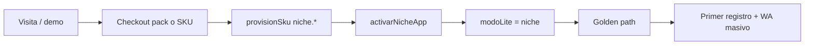

# 19 — Claver Nicho LATAM (11 mini-SaaS)

> Fuente: `lib/niche/niche-apps-catalog.ts` · AutoPool nicho: `nicho_latam`  
> Lema portfolio: *Tu nicho en el bolsillo. Sin Excel. Con WhatsApp.*

## Audiencia

| Rol | Uso |
|-----|-----|
| Vendedor calle | Demo en `/dashboard/nicho` + packs `pool-*-nicho` |
| Cliente tenant | Golden path post-activación |
| Analista | Runbooks en `lib/niche/niche-runbooks.ts` |

## Apps disponibles

| App | SKU | Precio/mes | Engine | Golden path |
|-----|-----|------------|--------|-------------|
| Consorcios | `niche.consorcios` | $8.900 | consorcio | `/dashboard/nicho/consorcios` |
| Club | `niche.club_barrio` | $3.990 | cuotas | `/dashboard/nicho/club` |
| Feria | `niche.feria_puesto` | $3.990 | movimientos | `/dashboard/nicho/feria` |
| Prestamista | `niche.prestamo_barrio` | $5.990 | libreta → fiado (auto) | `/dashboard/fiado` |
| Obras | `niche.obra_changas` | $4.990 | movimientos | `/dashboard/nicho/obras` |
| Acopio | `niche.acopio_grano` | $6.990 | movimientos | `/dashboard/nicho/acopio` |
| Remis | `niche.base_remis` | $4.990 | movimientos | `/dashboard/nicho/remis` |
| Plancha | `niche.tintoreria` | $3.990 | movimientos | `/dashboard/nicho/plancha` |
| Consultorio | `niche.consultorio_solo` | $6.900 | agenda | `/dashboard/agenda` |
| Garantía | `niche.inmo_garantia` | $7.900 | movimientos | `/dashboard/nicho/garantia` |
| Mutuo | `niche.cooperativa_cuotas` | $4.990 | cuotas | `/dashboard/nicho/mutuo` |

## Flujo comercial (happy path)



1. Cliente compra SKU o pack en marketplace / vendedor calle.
2. `provisionSku` activa `SuscripcionModulo` (GLOBAL_AUTO).
3. Hook `activarNicheApp` setea `empresa.modoLite = "niche"` y feature `niche_apps`.
4. Login → hub `/dashboard/nicho` o golden path directo.
5. Alta cliente → registro → WhatsApp masivo a pendientes (requiere `com.whatsapp`).

## Bundles recomendados

| Pack | SKUs | Precio | Target |
|------|------|--------|--------|
| `pool-claver-nicho` | consorcios + WA | $19.900 | Administración edificio |
| `pool-propiedad` | consorcios + garantía + cobranzas WA + WA | $29.900 | Inmobiliaria / admin |
| `pool-calle-nicho` | fiado + feria + plancha + WA | $24.900 | Comercio mixto |

Ver detalle en [07-bundles-comerciales](./07-bundles-comerciales.md).

## Entitlements

- Cada app valida `canUseSku(empresaId, app.sku)` en layout y API.
- Prestamista **auto-provisiona** `pos.fiado_barrio` al activar (sin cobrar doble en hook).
- Prestamista redirige a `/dashboard/fiado` con `modoLite: fiado`.
- Consultorio requiere `niche.consultorio_solo` o `core.claver` para `/dashboard/agenda`.

## Checklist demo vendedor (5 min)

- [ ] `/claver/apps?nicho=nicho_latam` muestra las 11 apps
- [ ] Tenant demo con SKU activo
- [ ] Alta cliente con teléfono (selector en app)
- [ ] Primer registro (cuota / ticket / gasto consorcio)
- [ ] WhatsApp masivo — mostrar encolados u omitidos sin WA
- [ ] Pitch upsell: Legacy Bridge si menciona Protheus

## Código clave

```
lib/niche/                    # catálogo, servicios, provision
app/dashboard/nicho/          # hub + apps
app/api/niche/[appId]/         # API genérica
components/niche/             # shell UI + cliente picker
prisma → NicheMovimiento      # migración niche_movimientos
```

## Upsell enterprise

Clientes con Protheus: `lib/legacy-bridge/` — Claver Edge UI sin tocar el core ERP.

| Superficie | Ruta |
|------------|------|
| Demo visual (tenant) | `/dashboard/nicho` → tarjeta «Legacy Bridge» |
| API benchmark | `GET /api/legacy-bridge/benchmark?entity=Customer&fast=1` |
| Contratos Edge | `GET /api/legacy-bridge/contracts` |
| Boletín técnico | `GET /api/legacy-bridge/contracts?sku=edge.approvals&format=bulletin` |
| Wizard analista | Claver Cloud → tenant → pestaña Legacy Bridge |