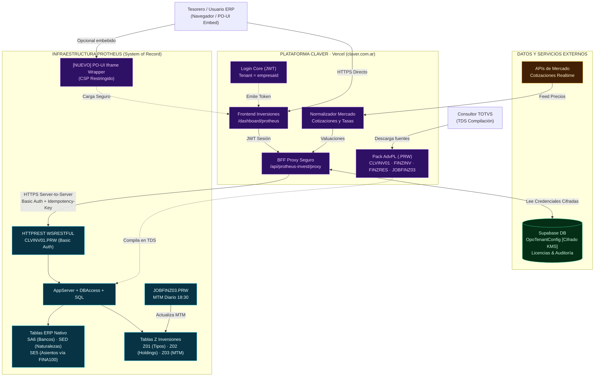

# Auditoría Técnica Senior de Arquitectura: Claver Inversiones × TOTVS Protheus

> **Documento:** Auditoría de Diseño, Infraestructura y Seguridad  
> **Ámbito:** Integración Claver (`claver.com.ar` en Vercel) ↔ TOTVS Protheus (AppServer AdvPL)  
> **Modo de evaluación:** Red Team & Resiliencia Operativa  

---

## Preguntas Bloqueantes (Máx 8)

1. **Topología de red del cliente**: ¿El AppServer de Protheus del cliente está en TOTVS Cloud con IP pública/DNS y certificado SSL válido, o corre on-premise detrás de firewall/NAT sin IP pública fija (requiriendo agente local tipo Cloudflare Tunnel / Edge Agent)?
2. **Autenticación en AppServer**: ¿El endpoint `HTTPREST` utiliza Basic Auth nativo de AdvPL (usuario/contraseña del ERP) o requiere OAuth2 de TOTVS RAC / Mingle?
3. **Multi-filial en Protheus**: Al hacer un POST a `/api/claver/v1/investments/holdings`, ¿cómo sabe el AppServer en qué `Empresa` y `Filial` (ej. `01/01`) operar? ¿Se asume la del usuario del REST o debe viajar en header/body (`TenantId` / `xFilial`)?
4. **Idempotencia en FINA100**: Si la llamada HTTP entre BFF y Protheus hace timeout a los 30s pero el AppServer ejecutó el `MSExecAuto(FINA100)` generando la ND en `SE5`, ¿cómo evita el sistema generar movimientos duplicados en el reintento?
5. **Aislamiento de cookies/sesión en PO-UI**: Si se embebe la UI de Claver vía iframe dentro de PO-UI o SmartClient HTML, ¿las cookies de sesión del ERP interfieren con el JWT de Claver (`SameSite=None; Secure`)?
6. **Timezone y calendario del Job MTM**: ¿`JOBFINZ03` toma la fecha del sistema operativo o `dDataBase` de Protheus? ¿Qué ocurre sábados, domingos o feriados bancarios argentinos si no hay rueda bursátil?
7. **Consistencia MTM frente a cortes de mercado**: Si la API de cotizaciones externa falla a las 18:30, ¿se congela la valuación del día anterior, se aborta el lote, o se marca flag de advertencia en `Z03`?
8. **Manejo de licencias en vuelo**: Si la licencia `edge.investments` vence en Supabase mientras un usuario está completando un rescate (`FINZRES`), ¿el frontend bloquea antes de enviar o el proxy aborta la confirmación?

---

## A. Mapa mental de lo que realmente hace el sistema

- **Front & Identidad en la Nube**: El usuario (tesorero) interactúa exclusivamente con `claver.com.ar` (`/dashboard/protheus`) servido por Vercel. La autenticación y multi-tenancy se resuelven en Claver vía JWT + Supabase (`empresaId`).
- **Protheus como System of Record**: Protheus (AppServer + DBAccess + SQL) es el único dueño de la plata, los saldos bancarios (`SA6`), las naturalezas contables (`SED`) y los movimientos de caja (`SE5` vía `FINA100`). Claver no almacena saldos maestros ni ejecuta asientos en paralelo.
- **Tablas Z como Extensión de Dominio**: Como SIGAFIN no soporta mark-to-market nativo en la localización argentina, se crearon tablas estándar en Protheus: `Z01` (maestro tipos de instrumento), `Z02` (cabecera de contratos/operaciones) y `Z03` (historial de valuaciones diarias MTM).
- **Cero acceso directo desde el Navegador**: El navegador del usuario **nunca** se comunica directo con el AppServer de Protheus. Toda interacción pasa obligatoriamente por el BFF/Proxy seguro de Claver (`/api/protheus-invest/proxy`).
- **Inyección dinámica de credenciales por Tenant**: En cada request, el BFF lee de Supabase (`OpoTenantConfig`) la URL del cliente (`restDirectUrl`) y sus credenciales de AppServer, inyectando el header `Authorization: Basic ...` de forma invisible al cliente.
- **Pack AdvPL Compilable**: Claver no compila código en Vercel; provee un paquete estático de 4 fuentes AdvPL (`CLVINV01.PRW`, `FINZINV.PRW`, `FINZRES.PRW`, `JOBFINZ03.PRW`) que el consultor de Protheus compila en TDS (TOTVS Developer Studio).
- **Normalización de Mercado desacoplada**: Claver consume y normaliza las cotizaciones de mercado (PPI, BYMA, Rofex, MEP) en Node.js; el AppServer de Protheus no actúa como cliente HTTP hacia brokers en tiempo real.
- **Valuación Asíncrona (Job 18:30)**: El mark-to-market se ejecuta internamente en Protheus mediante el schedule `JOBFINZ03.PRW` al cierre del mercado (18:30 hs), actualizando `Z03` y recalculando la posición sin bloquear el front interactivo.
- **Embebido Opcional (PO-UI)**: Para clientes que no quieren salir del entorno Protheus, la UI de Claver se expone dentro del ERP mediante un componente web/iframe integrado al menú de TOTVS.

---

## B. Hallazgos de auditoría

| ID | Severidad | Componente | Hallazgo | Impacto | Evidencia en el chat/diagrama |
|:---|:---:|:---|:---|:---|:---|
| **SEC-01** | **P0** | BFF / Supabase | **Credenciales de AppServer en texto claro / descifrado en memoria**. Si la tabla `OpoTenantConfig` almacena `restAuthPassword` en plano, cualquier fuga de DB expone el acceso administrativo a los ERPs de todos los clientes. | Compromiso total del AppServer y base de datos Protheus de los clientes. | `forwardToProtheus` hace `Buffer.from(user:password).toString("base64")` asumiendo contraseña reversible. |
| **TEN-01** | **P0** | BFF Proxy | **Falta de contexto de Empresa/Filial Protheus en requests**. El proxy reenvía `path` y `body`, pero no garantiza header de multi-empresa TOTVS (`TenantId` / `xFilial`). En ambientes multi-filial, Protheus puede escribir en la filial por defecto del usuario técnico. | Corrupción cruzada de saldos bancarios entre filiales de un mismo cliente. | `CLVINV01.PRW` usa `xFilial("Z02")` sin seteo explícito vía `RpcSetEnv` previo por request. |
| **OPS-01** | **P0** | AppServer / BFF | **Falta de Idempotencia en Altas y Rescates (`FINA100`)**. El POST a `/holdings` o `/rescue` llama a `MSExecAuto(FINA100)`. Si la conexión cae por timeout de Vercel (10s–30s) pero Protheus confirmó la transacción, el retry automático duplica el débito/crédito en `SE5`. | Pérdida o desbalance contable y duplicación de movimientos de caja. | `CLVINV01.PRW` no implementa `X-Idempotency-Key` ni verificación de hash de transacción previa. |
| **SEC-02** | **P1** | PO-UI / Next.js | **Riesgo de Clickjacking y Cookie Dropping en iframe PO-UI**. Si el front de Claver se embebe en PO-UI sin cabeceras `Content-Security-Policy (frame-ancestors)` específicas, queda vulnerable a incrustación en sitios maliciosos o rechazo de cookies de sesión. | Robo de tokens JWT o pantalla en blanco en navegadores modernos (bloqueo de cookies third-party). | Diagrama original `POUI <--> CLAVER` sin definición de política CSP ni control de origen. |
| **NET-01** | **P1** | Red / TOTVS Cloud | **Incompatibilidad con Protheus On-Premise sin IP pública**. Claver en Vercel requiere que `restDirectUrl` sea accesible vía HTTPS público. Muchos clientes Protheus corren on-premise con IPs privadas y puertos HTTPREST bloqueados. | Imposibilidad de conectar el producto a más del 50% de clientes PyME de Argentina. | Supuesto de `restDirectUrl` accesible desde Vercel sin contemplar tunnel/edge agent. |
| **DAT-01** | **P1** | Job MTM / Core | **Ausencia de control de feriados y reentrancia en `JOBFINZ03`**. Si el job se dispara dos veces o corre un día no hábil sin cotización oficial, puede duplicar registros diarios en `Z03` o calcular valuaciones con base cero. | Distorsión de reportes de rentabilidad y desbalance en la evolución de la cartera. | `JOBFINZ03.PRW` no valida existencia previa en `Z03` para `(Z03_FILIAL + Z03_IDINV + DTOS(dDataBase))`. |
| **OBS-01** | **P1** | BFF Logging | **Riesgo de registro de Basic Auth y payloads con CBU en logs**. Si ocurre un error en `forwardToProtheus`, el log de Vercel/Datadog puede registrar URLs, headers con credenciales Base64 o datos sensibles de cuentas (`SA6_NUMCON`, `CBU`). | Incumplimiento normativo y exposición de datos financieros de clientes. | `forwardToProtheus` captura `error` de fetch sin sanitizar URLs con querystrings o headers. |
| **LIC-01** | **P2** | Licencias / BFF | **Corte abrupto de sesión por vencimiento durante operación en vuelo**. `protheusAccessBlocked` rechaza el request antes de iniciar, pero no maneja estado de gracia para operaciones de rescate en curso. | Bloqueo al cliente para rescatar fondos si su licencia venció mientras operaba. | `app/api/protheus-invest/proxy/route.ts` retorna 402 plano sin permitir modo "solo lectura / solo rescates". |
| **MAP-01** | **P2** | AdvPL / Diccionario | **Incompatibilidad de nombres de campos CBU en localización AR**. `SA6` en Argentina varía según el release de Protheus (`A6_CBU`, `A6_XCCBU`, o memo). Si el campo no existe en el diccionario del cliente, el endpoint `/banks` falla con error de sintaxis SQL. | Error 500 al listar bancos en el primer onboarding de clientes con diccionarios no estándar. | `CLVINV01.PRW` asume estructura fija de columnas de `SA6`. |

---

## C. Mejoras recomendadas

### 1. [P0] Idempotencia en operaciones financieras (`FINA100`)
- **Cambio exacto**: Modificar [data/protheus/advpl/edge/investments/CLVINV01.PRW](file:///C:/Users/Pablo%20Clavero/Downloads/pos-system-argentina/data/protheus/advpl/edge/investments/CLVINV01.PRW) y [lib/protheus-invest/forward.ts](file:///C:/Users/Pablo%20Clavero/Downloads/pos-system-argentina/lib/protheus-invest/forward.ts).
  - En el BFF: generar y enviar el header `X-Idempotency-Key: <uuid>`.
  - En `CLVINV01.PRW`: crear campo `Z02_IDEMP` en `Z02` o tabla de control. Antes de invocar `FINA100`, buscar si la clave ya fue procesada en las últimas 24 horas; si existe, devolver la respuesta guardada sin re-ejecutar `MSExecAuto`.
- **Por qué**: Vercel tiene timeouts duros. Un reintento automático de red puede duplicar transferencias y asientos bancarios reales.
- **Esfuerzo**: **M** (1 día).
- **Alternativa si no toca AppServer**: El BFF debe hacer un `GET /holdings/{id}` de verificación previa antes de emitir cualquier reintento ciego.

### 2. [P0] Especificación explícita de Tenant / Empresa / Filial
- **Cambio exacto**: [app/api/protheus-invest/proxy/route.ts](file:///C:/Users/Pablo%20Clavero/Downloads/pos-system-argentina/app/api/protheus-invest/proxy/route.ts) y `CLVINV01.PRW`.
  - En `OpoTenantConfig`: agregar campos `protheusCompany` (ej. `"01"`) y `protheusBranch` (ej. `"01"`).
  - En el BFF: inyectar el header `X-TOTVS-Branch: 0101` o `TenantId: 01,01`.
  - En `CLVINV01.PRW`: al inicio del request, invocar `RpcSetType(3)`, validar y posicionar la filial con `RpcSetEnv(cEmp, cFil)`.
- **Por qué**: En Protheus multi-empresa, una llamada REST sin filial explícita escribe en la empresa asignada al usuario por defecto, mezclando contabilidad de diferentes razones sociales.
- **Esfuerzo**: **S** (medio día).
- **Alternativa si no toca AppServer**: Configurar en Protheus un usuario técnico por cada filial/empresa con permisos restringidos exclusivamente a su grupo de empresas.

### 3. [P0] Cifrado KMS de credenciales en Supabase
- **Cambio exacto**: `lib/opo/opo-config-service.ts` y tabla `OpoTenantConfig`.
  - Cifrar `restAuthPassword` en reposo usando AES-256-GCM con una clave maestra (`OPO_ENCRYPTION_KEY` en variables de entorno Vercel).
  - El descifrado ocurre en memoria únicamente durante la ejecución de `forwardToProtheus`.
- **Por qué**: Previene filtraciones masivas de accesos a los ERPs ante accesos no autorizados a la base de datos de Supabase.
- **Esfuerzo**: **S** (2-3 horas).
- **Alternativa**: Utilizar Supabase Vault si está activo en la instancia PostgreSQL.

### 4. [P1] Hardening de iframe PO-UI (CSP y Frame Ancestors)
- **Cambio exacto**: [next.config.ts](file:///C:/Users/Pablo%20Clavero/Downloads/pos-system-argentina/next.config.ts).
  - Configurar encabezados de respuesta para la ruta `/dashboard/protheus/*`:
    ```http
    Content-Security-Policy: frame-ancestors 'self' https://*.totvs.com.ar https://*.protheuscloud.com.ar;
    X-Content-Type-Options: nosniff
    X-Frame-Options: SAMEORIGIN (o remover si se usa CSP frame-ancestors)
    ```
- **Por qué**: Evita que terceros carguen el módulo financiero en iframes maliciosos y asegura que SmartClient HTML o Mingle puedan incrustarlo sin bloqueos.
- **Esfuerzo**: **S** (1 hora).
- **Alternativa**: Apertura en ventana emergente/pestaña nueva independiente con SSO token en vez de iframe embebido.

### 5. [P1] Reentrancia e Idempotencia en `JOBFINZ03.PRW`
- **Cambio exacto**: [data/protheus/advpl/edge/investments/JOBFINZ03.PRW](file:///C:/Users/Pablo%20Clavero/Downloads/pos-system-argentina/data/protheus/advpl/edge/investments/JOBFINZ03.PRW).
  - Antes de insertar en `Z03`, ejecutar `Z03->(DbSetOrder(1))` y verificar si ya existe registro para `Z03_FILIAL + Z03_IDINV + DTOS(dDataBase)`. Si existe, hacer `RECLOCK("Z03", .F.)` (update) en lugar de `RECLOCK("Z03", .T.)` (insert).
  - Validar si el día es no hábil o feriado (consultando calendario `SM2` o tabla de feriados).
- **Por qué**: Si el administrador de Protheus ejecuta el job manualmente para reprocesar o se dispara dos veces el schedule, no debe duplicar las filas históricas de valuación.
- **Esfuerzo**: **S** (2 horas).
- **Alternativa**: Manejar clave única compuesta en el diccionario SIX de Protheus para evitar duplicados a nivel SQL.

---

## D. Contrato de integración mínimo (BFF ↔ CLVINV01)

### 1. Endpoints y Verbos
- `GET  /api/claver/v1/investments/health`: Healthcheck, versión de Protheus y estado de tablas Z.
- `GET  /api/claver/v1/investments/instruments`: Catálogo de tipos de instrumento (`Z01`).
- `GET  /api/claver/v1/investments/banks`: Lista de cuentas bancarias habilitadas (`SA6`).
- `GET  /api/claver/v1/investments/holdings`: Listado consolidado de tenencias activas (`Z02`).
- `GET  /api/claver/v1/investments/holdings/{id}`: Detalle de contrato e historial de MTM (`Z03`).
- `POST /api/claver/v1/investments/holdings`: Alta de inversión con generación de débito bancario vía `FINA100`.
- `POST /api/claver/v1/investments/holdings/{id}/rescue`: Rescate total/parcial con acreditación de capital e intereses.

### 2. Encabezados Obligatorios
```http
Authorization: Basic <base64(user:password)>
Accept: application/json
Content-Type: application/json
X-TOTVS-Company: <empresaProtheus>
X-TOTVS-Branch: <filialProtheus>
X-Idempotency-Key: <uuid_v4_generado_por_claver>
```

### 3. Formato Estándar de Payload y Respuestas
**POST `/api/claver/v1/investments/holdings` (Request):**
```json
{
  "idempotencyKey": "9b1deb4d-3b7d-4bad-9bdd-2b0d7b3dcb6d",
  "codigoInstrumento": "001",
  "banco": "001",
  "agencia": "0001",
  "cuenta": "12345678",
  "moneda": 1,
  "montoCapital": 5000000.00,
  "tasaNominalAnual": 45.50,
  "fechaInicio": "2026-09-17",
  "fechaVencimiento": "2026-12-17",
  "observaciones": "Constitución Plazo Fijo Digital"
}
```

**Respuesta Exitosa (201 Created):**
```json
{
  "ok": true,
  "id": "INV-2026-00042",
  "numeroAsiento": "00098412",
  "montoDebitado": 5000000.00,
  "bancoAfectado": "001/0001/12345678",
  "status": "ACTIVA"
}
```

**Respuesta de Error Estándar (4xx / 5xx):**
```json
{
  "ok": false,
  "code": "PROTHEUS_FINA100_ERROR",
  "message": "Saldo insuficiente en cuenta bancaria seleccionada o cuenta bloqueada.",
  "detail": "Saldo actual: $ 1.200.000,00 | Requerido: $ 5.000.000,00",
  "timestamp": "2026-09-17T19:15:00Z"
}
```

### 4. Parámetros Operativos: Timeouts y Reintentos
- **Timeout en BFF**: 15 segundos para operaciones `GET`, 25 segundos para `POST`.
- **Reintentos en GET**: Hasta 2 reintentos con backoff exponencial (500ms, 1500ms) solo ante errores de red o HTTP 502/503/504.
- **Reintentos en POST**: **0 reintentos automáticos a ciegas**. Si ocurre timeout, el BFF consulta `GET /holdings?idempotencyKey=...` para conocer si la transacción fue grabada antes de retornar error al usuario.

---

## E. Diagrama de Arquitectura Corregido



---

## F. Backlog MVP vs Post-MVP

### 5 Items Críticos para el MVP (Entran Ya)
1. **Idempotency-Key en operaciones FINA100**: Blindar `CLVINV01.PRW` y el proxy para que un timeout de conexión nunca duplique un asiento bancario ni un contrato de inversión.
2. **Cifrado KMS de contraseñas de AppServer**: Cifrar el campo `restAuthPassword` en `OpoTenantConfig` para no almacenar contraseñas de producción en texto plano.
3. **Paso de parámetros Empresa/Filial en el BFF**: Garantizar que el proxy inyecte `X-TOTVS-Branch` y `CLVINV01` establezca el entorno con `RpcSetEnv` para evitar contaminación multi-filial.
4. **Reentrancia segura en `JOBFINZ03.PRW`**: Evitar duplicados diarios en la tabla `Z03` verificando la clave `Z03_FILIAL + Z03_IDINV + DTOS(dDataBase)` antes de insertar.
5. **Configuración de CSP para PO-UI**: Incorporar `frame-ancestors` en los headers de Next.js para proteger la UI contra clickjacking y habilitar su incrustación segura en TOTVS Mingle o SmartClient HTML.

### 5 Items Post-MVP (Pasan a Fase 2)
1. **Agente Local / Tunnel para Protheus On-Premise**: Desarrollar o empaquetar el agente Edge (`opo-edge-agent`) para clientes sin IP pública fija.
2. **Integración Directa Broker API (PPI / BYMA)**: Conexión FIX/REST automatizada directa desde Claver para órdenes de compra/venta de bonos y acciones.
3. **Soporte OAuth2 / RAC TOTVS**: Migrar de Basic Auth a autenticación delegada por tokens RAC/Mingle.
4. **Rescate en Moneda Extranjera Multidivisa**: Ajustes por diferencia de cambio automática en cuentas bimonetarias (`SM2` Moneda 2/3/4 con FINA100).
5. **Conciliación Automática Bancaria con Extracto**: Comparar automáticamente los asientos generados en `SE5` con extractos bancarios CBU/MT940.
