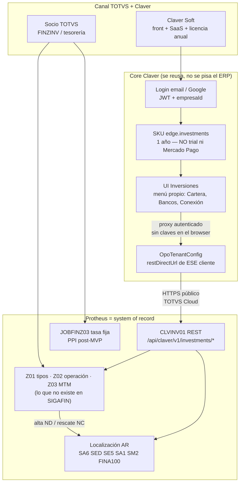
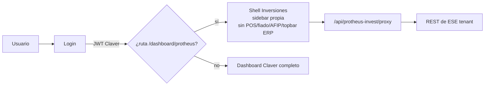
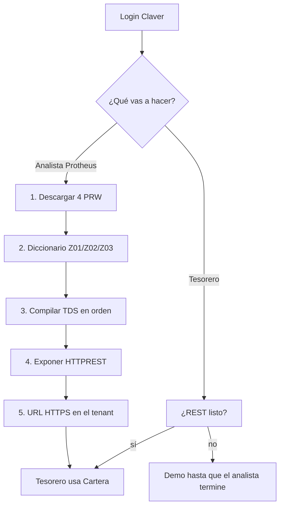

# Boletín de implementación MVP — Claver Inversiones × Protheus

**SKU:** `edge.investments`  
**Por cliente:** un tenant Claver = un AppServer.  
**Producto:** `/dashboard/protheus` (login Claver, **UI propia**: no mezcla menú POS/fiado/AFIP).  
**Fuentes:** `data/protheus/advpl/edge/investments/`  
**Alineamientos socio TOTVS:** carpeta `alineamientos` (FINZINV MVC, Z01/Z02/Z03, FINA100, rescate, job Z03 / PPI).

---

## Diagrama de flujo — qué es de Claver, qué es de Protheus, qué pidió el socio



### Qué pidió el socio (TOTVS investing) y cómo lo montamos

| Pedido del socio | Dónde queda |
|------------------|-------------|
| Módulo inversiones con cotizaciones + tenencias del cliente | Front Claver **Cartera** + Z02/Z03 |
| MVC cabecera/detalle (Z02 + grid Z03) | `FINZINV.PRW` — el tesorero Claver no ve esa pantalla AdvPL |
| Alta que mueva banco en el momento Confirmar | Commit `FINA100` ND (nunca INSERT a SE5) |
| Rescate separando capital e interés | `FINZRES.PRW` + POST `.../rescue` |
| Job 18:30 mark-to-market / PPI | `JOBFINZ03.PRW` (tasa fija ya; PPI fase 2) |
| Diccionario Z01/Z02/Z03 exacto (Excel alineamientos) | Sección 1 de este boletín |
| Apps Claver empaquetables para el canal | `docs/partners/TOTVS_PROTHEUS_APPS.md` |
| No canibalizar Protheus | SIGAFIN no se toca; Claver es overlay |

### Quién ve qué (front no mezclado)



Claver pone: identidad, tenant, licencia anual, proxy, UI tesorería.  
Protheus pone: plata, bancos, naturalezas, asientos.  
El menú del add-on habla de **Cartera / Bancos / Movimientos**, no de códigos SX3.

### Primer ingreso (lineal)



### URL fija del tenant y login de subusuarios

Al crear el tenant se genera `https://claver.com.ar/p/{slug}/login`.

Esa ruta **solo** autentica usuarios del AppServer (OAuth2 password grant o token Bearer; fallback Basic). No es el login email/Google de Claver. El JWT de Claver se emite después, JIT, con rol tesorero.

El analista sigue usando `/login` de Claver para implementar. Los subusuarios Protheus entran por `/p/{slug}/login`.

---


## 0. Qué reusa localización Argentina (no crear)

| Tabla / campo | Uso en el MVP |
|---------------|----------------|
| **SA6** `A6_COD` `A6_AGENCIA` `A6_NUMCON` `A6_NREDUZ` | Banco / broker de donde sale y vuelve la plata |
| **SA6 CBU** (campo loc. AR, p. ej. `A6_CBU` / `A6_XCCBU` si existe en el diccionario del cliente) | Mostrar CBU; no se inventa otro maestro de bancos |
| **SED** naturalezas | `Z01_NATCAP` / `Z01_NATINT` apuntan acá |
| **SE5** vía **FINA100** (`MSExecAuto`) | ND al constituir, NC capital + NC/ND interés al rescatar. **Nunca INSERT a SE5** |
| **SA1** `A1_CGC` / CUIT loc. AR | Riesgo / padrón (pantalla Riesgo BCRA) |
| **SM2** / moneda 1=ARS 2=USD | `Z02_MOEDA` usa el nro. de moneda Protheus |
| **SIGAFIN** FINA100 ya homologado en AR | Movimiento de caja bancaria nativo |

No se pisa facturación electrónica AR (CAE), padrones IIBB ni FINA716 de Brasil.

---

## 1. Qué SÍ hay que crear (solo esto)

Protheus **no** tiene cartera mark-to-market. Tres tablas Z en Configurador (SX2 + SX3 + SIX + SX9). Filial = `xFilial`.

### Z01 — tipos de instrumento

| Campo | Tipo | Tam | Dec | Notas |
|-------|------|-----|-----|--------|
| Z01_FILIAL | C | 2 | 0 | |
| Z01_CODIGO | C | 3 | 0 | PK. 001 Acción, 002 FCI, 003 PF, 004 Letra, 005 Bono |
| Z01_DESCRI | C | 30 | 0 | |
| Z01_TIPO | C | 1 | 0 | F fija / V variable / M mixta |
| Z01_USAAPI | C | 1 | 0 | 1=API (post-MVP) 2=cálculo |
| Z01_NATCAP | C | 10 | 0 | FK SED capital |
| Z01_NATINT | C | 10 | 0 | FK SED interés |

Índice: `Z01_FILIAL+Z01_CODIGO`

### Z02 — operación

| Campo | Tipo | Tam | Dec | Notas |
|-------|------|-----|-----|--------|
| Z02_FILIAL | C | 2 | 0 | |
| Z02_NUMERO | C | 10 | 0 | GetSXENum |
| Z02_TIPO | C | 3 | 0 | FK Z01 |
| Z02_TICKER | C | 15 | 0 | |
| Z02_BANCO | C | 3 | 0 | FK A6_COD |
| Z02_AGENCI | C | 5 | 0 | FK A6_AGENCIA |
| Z02_CUENTA | C | 10 | 0 | FK A6_NUMCON |
| Z02_DTINV | D | 8 | 0 | |
| Z02_DTVENC | D | 8 | 0 | Vacío FCI/acciones |
| Z02_MOEDA | N | 1 | 0 | 1 ARS 2 USD |
| Z02_CAPINI | N | 14 | 2 | Capital → ND FINA100 |
| Z02_CANTID | N | 14 | 4 | |
| Z02_PRECOM | N | 14 | 4 | CAPINI/CANTID |
| Z02_TASA | N | 8 | 4 | TNA si F |
| Z02_STATUS | C | 1 | 0 | 1 activa 2 rescatada 3 cancelada |

Índices: `FILIAL+NUMERO` · `FILIAL+TICKER` · `FILIAL+STATUS+DTOS(DTVENC)`

### Z03 — valuación diaria

| Campo | Tipo | Tam | Dec | Notas |
|-------|------|-----|-----|--------|
| Z03_FILIAL | C | 2 | 0 | |
| Z03_NUMERO | C | 10 | 0 | FK Z02 |
| Z03_FECHA | D | 8 | 0 | |
| Z03_PRECIO | N | 14 | 4 | |
| Z03_VALOR | N | 14 | 2 | PRECIO×CANTID |
| Z03_RENDIM | N | 14 | 2 | vs día anterior |
| Z03_ORIGEN | C | 1 | 0 | A API / C cálculo / M manual |

Índice: `FILIAL+NUMERO+DTOS(FECHA)`  
SX9: Z02_TIPO→Z01_CODIGO · Z03_NUMERO→Z02_NUMERO

**Parámetros SX6:** `MV_CLVINV` = `.T.` · `MV_CLVINVU` = usuario REST.

**SED a dar de alta (ejemplo):** INVPF / INTPF, INVFCI / INTFCI, INVLET / INTLET.

Actualizar base (Configurador → Actualizar diccionario) en VAL y luego PRD.

---

## 2. Compilar (TDS / RPO)

Descarga desde el tenant: pestaña Boletín o `GET /api/public/protheus-invest?file=CLVINV01.PRW`

| Orden | Archivo | Qué hace |
|------|---------|----------|
| 1 | FINZINV.PRW | MVC Z02/Z03 + commit FINA100 ND |
| 2 | FINZRES.PRW | Rescate NC/ND |
| 3 | CLVINV01.PRW | REST que consume Claver |
| 4 | JOBFINZ03.PRW | Job Z03 tasa fija |

Compilar en el RPO del **mismo** AppServer que atiende REST. Restart AppServer.

---

## 3. Disponer el REST

`appserver.ini` del REST:

```
[HTTPV11]
Enable=1
Sockets=HTTPREST

[HTTPREST]
Port=8404
URIs=HTTPURI
SECURITY=1

[HTTPURI]
URL=/rest
Instances=1,10
CORSEnable=1
AllowOrigin=*
PrepareIn=01
Stateless=1
```

Usuario REST (no el tesorero) con permiso Z01/Z02/Z03 + FINA100.

**TOTVS Cloud:** pedir al CST la URL HTTPS pública del REST. Esa es la que va a Claver.  
**On-prem LAN:** `http://10.x:8404/rest` **no** llega a Vercel. Para MVP usar Cloud o publicar HTTPS. Edge Agent queda para fase 2.

Probar:

```
GET {base}/api/claver/v1/investments/health
```

Base ejemplo Cloud: `https://rest-XXXX.totvscloud.com.br/rest`  
On-prem (solo VAL local): `http://SERVIDOR:8404/rest`

---

## 4. Apuntar el front (por cliente)

1. Crear / usar el **tenant Claver** de ese cliente.
2. Claver Cloud → ese tenant → **Legacy Bridge**:
   - origen = `protheus`
   - canal = `rest_directo`
   - `restDirectUrl` = URL del paso 3 (sin barra final de más)
   - usuario / password REST
   - Guardar (queda en OpoTenantConfig de **esa** empresaId)
3. El tesorero entra a [claver.com.ar/dashboard/protheus](https://claver.com.ar/dashboard/protheus) con su usuario.
4. El front llama `POST /api/protheus-invest/proxy` **sin** mandar claves; el server usa el REST del JWT.

Cliente A y B no se cruzan.

Dueño/admin también puede guardar el REST desde la propia pantalla (panel superior) si `canManageUsers`.

---

## 5. Checklist por cliente (copiar)

```
Cliente / CUIT: ____________________
Empresa Claver (id): _______________
Protheus versión / Cloud u on-prem: _______________
Grupo/filial PrepareIn: _______________
URL REST HTTPS: ____________________
Usuario REST: ______________________
Z01/Z02/Z03 publicados VAL: [ ]
PRW compilados orden 1-4: [ ]
Health 200: [ ]
Legacy Bridge guardado: [ ]
Login tesorero → Live SIGAFIN: [ ]
Alta PF prueba + ND en SE5: [ ]
Rescate prueba + NC: [ ]
GMUD VAL→PRD: [ ]
```

---

## 6. Alcance MVP (qué sí / qué no)

**Sí:** login Claver, REST por tenant, listar holdings, MTM tasa fija (JOBFINZ03), constituir, rescatar, descargar PRW, ayuda in-app.

**No (fase 2):** PPI/BYMA en vivo, eCheq nativo Protheus, asiento CT2, AppServer solo LAN vía Edge Agent, Fluig.
