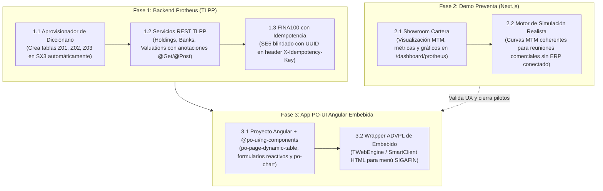

# Documento de Estado de Situación y Auditoría Técnica: Ecosistema TOTVS Protheus & Módulo Inversiones

> **Fecha:** 20 de Septiembre de 2026  
> **Ámbito:** Auditoría técnica de código, verificación de componentes funcionales vs simulados (*humo*), arquitectura de backend ADVPL vs TLPP, y hoja de ruta para la app PO-UI Angular embebible en TOTVS Protheus.  
> **Destinatarios:** Equipo de Arquitectura Claver & Partners Implementadores TOTVS.

---

## 1. Resumen Ejecutivo: Diagnóstico de Realidad

Se ha auditado integralmente la infraestructura incorporada para **TOTVS Protheus** en el repositorio. El estado actual es un **híbrido entre un andamiaje técnico prometedor y una maqueta funcional simulada (mock/in-memory)**:

1. **La infraestructura web y el proxy existen y están bien diseñados**: Next.js, autenticación JWT, aislamiento multi-tenant (`OpoTenantConfig` en Supabase), proxy BFF con Basic Auth hacia Protheus, y UI pulida con estética institucional (`/dashboard/protheus`).
2. **El código ADVPL no es texto vacío**: Los 4 archivos `.PRW` (`CLVINV01.PRW`, `FINZINV.PRW`, `FINZRES.PRW`, `JOBFINZ03.PRW`) tienen código ADVPL real, usan `MSExecAuto(FINA100)`, transacciones `Begin Transaction` / `DisarmTransaction`, `RecLock` y modelos MVC. **No son humo sintáctico.**
3. **Puesto en un Protheus real hoy falla inmediatamente (gaps críticos)**:
   - **Falta instalador de diccionario**: No hay script ni rutina de creación de diccionario de datos (`SX2`, `SX3`, `SIX`) para las tablas `Z01`, `Z02`, `Z03`. Si se compilan los fuentes en un Protheus virgen sin crear a mano decenas de campos en `SIGACFG`, la rutina MVC aborta con error de estructura.
   - **Bancos ciegos**: `CLVINV01.PRW` devuelve saldos bancarios en `$ 0,00` y CBUs vacíos porque no consulta `SE8` ni los saldos reales.
   - **Simulación en el frontend**: Si no hay conexión configurada con el ERP, corre al 100% con datos de prueba (`seed.ts`). E incluso conectado, tras enviar el POST a Protheus, el estado local sigue inyectando asientos ficticios (`se5-XX`) en memoria en vez de sincronizar el estado real de la base de datos.
   - **Falta la app PO-UI (Angular)**: Existe el repositorio conceptual `poui-ai/` con catálogo y prompts, pero aún no se ha construido la aplicación Angular compilada ni el wrapper ADVPL para embeberla en Protheus.

---

## 2. Matriz de Verificación: Funcional vs "Humo"

| Componente | Archivo / Ubicación | Estado Real | Dictamen |
| :--- | :--- | :--- | :--- |
| **BFF Proxy Next.js** | [`app/api/protheus-invest/proxy/route.ts`](file:///c:/Users/Pablo%20Clavero/Downloads/pos-system-argentina/app/api/protheus-invest/proxy/route.ts) <br> [`lib/protheus-invest/forward.ts`](file:///c:/Users/Pablo%20Clavero/Downloads/pos-system-argentina/lib/protheus-invest/forward.ts) | **Funcional**. Realiza peticiones HTTP reales con Basic Auth, timeout de 20s, whitelist de rutas y resolución por tenant. | **Real** |
| **Aislamiento Multi-tenant** | [`lib/opo/opo-config-service.ts`](file:///c:/Users/Pablo%20Clavero/Downloads/pos-system-argentina/lib/opo/opo-config-service.ts) | **Funcional**. Persiste y recupera `restDirectUrl`, usuario y contraseña por `empresaId`. | **Real** |
| **Lógica Financiera Core** | [`lib/protheus-invest/invest.ts`](file:///c:/Users/Pablo%20Clavero/Downloads/pos-system-argentina/lib/protheus-invest/invest.ts) | **Funcional**. Fórmulas matemáticas de devengamiento TNA, rescate de capital e interés y Mark-to-Market (MTM). | **Real** |
| **Fuentes ADVPL MVC & Rescate** | [`FINZINV.PRW`](file:///c:/Users/Pablo%20Clavero/Downloads/pos-system-argentina/data/protheus/advpl/edge/investments/FINZINV.PRW) <br> [`FINZRES.PRW`](file:///c:/Users/Pablo%20Clavero/Downloads/pos-system-argentina/data/protheus/advpl/edge/investments/FINZRES.PRW) | **Funcional con dependencias**. Usa `MPFormModel`, `FWFormView`, y `MSExecAuto(FINA100)`. Solo funciona si las tablas Z ya existen en el diccionario Protheus. | **Real pero incompleto** |
| **Servicio REST ADVPL** | [`CLVINV01.PRW`](file:///c:/Users/Pablo%20Clavero/Downloads/pos-system-argentina/data/protheus/advpl/edge/investments/CLVINV01.PRW) | **Semi-funcional**. Declara múltiples métodos con el mismo verbo general `WSMETHOD GET WSSERVICE CLVINV01` y parseo manual de URL `If $ cPath`. Retorna bancos en $0, CBU vacío y no extrae logs de error de `FINA100`. | **Frágil / Requiere Refactor** |
| **Datos en Frontend (Cartera/Bancos)** | [`lib/protheus-invest/store.ts`](file:///c:/Users/Pablo%20Clavero/Downloads/pos-system-argentina/lib/protheus-invest/store.ts) <br> [`seed.ts`](file:///c:/Users/Pablo%20Clavero/Downloads/pos-system-argentina/lib/protheus-invest/seed.ts) | **Maqueta / Simulación**. Los bancos ("Galicia", "Santander", "Mercado Pago CVU") y tenencias ("YPFD", "AL30") son datos estáticos en memoria. Si no hay conexión, todo corre en Zustand local. | **Simulado / Demo** |
| **Conexión a Brokers (PPI / BYMA)** | Switch en pantalla / [`JOBFINZ03.PRW`](file:///c:/Users/Pablo%20Clavero/Downloads/pos-system-argentina/data/protheus/advpl/edge/investments/JOBFINZ03.PRW) | **100% Simulado**. El switch de la UI dispara una función matemática aleatoria con `Math.random()`. En el job ADVPL solo hay un `ConOut("espera API")`. No hay conexión a APIs reales de brokers. | **Humo actual** |
| **Instalador de Tablas Z** | Diccionario Protheus | **Inexistente**. No hay fuente `U_CLVUPD`, ni script SQL ni migrador de `SX3/SIX`. Requiere carga manual campo por campo en Protheus. | **Faltante Crítico** |
| **App PO-UI Angular Embebida** | Carpeta `poui-ai/` | **No construida**. Hay blueprints, prompts y catálogos de componentes PO-UI, pero no está creada la app Angular de inversiones para compilar ni el `.PRW` para embeberla (`TWebEngine` / SmartClient HTML). | **Pendiente** |

---

## 3. ¿Qué se está encarando mal y qué debemos corregir?

### A. La Trampa de la "Doble Arquitectura" (Next.js vs PO-UI)
Actualmente conviven dos modelos que chocan entre sí:
1. **SaaS Externo (Next.js en Vercel)**: El usuario accede a `claver.com.ar/dashboard/protheus`. La app web se comunica con el BFF en Vercel, y este BFF invoca el AppServer de Protheus del cliente mediante credenciales guardadas en Supabase.
2. **App Embebida en Protheus (PO-UI / Angular)**: Una app Angular que corre dentro del entorno de TOTVS Protheus (SmartClient HTML, Mingle o menú Protheus).

**El error de enfoque**: Si el objetivo comercial con los canales de TOTVS es venderles una app **embebida en PO-UI dentro de Protheus**, **no se necesita Vercel ni Supabase como proxy intermedio**.  
En una app PO-UI embebida:
- Angular se compila a estáticos (`dist/`) y se aloja en el propio AppServer de Protheus (carpeta `/http-root/` o `web/app-invest/`).
- La app Angular consume **directamente** los servicios REST locales (`/rest/api/...`) bajo el mismo dominio/puerto y con la sesión activa del usuario Protheus.
- No hay problemas de firewall corporativo, no se requiere exponer puertos a internet con IP pública fija, ni existen costos recurrentes de Vercel/Supabase.
- **Estrategia recomendada**: Mantener el dashboard actual en Next.js como la **Demo Comercial / Showroom Web** para deslumbrar a directores en la primera reunión (sin esperar a conectar su ERP), pero el producto final que se implanta en el cliente debe ser la app PO-UI directa sobre el AppServer.

### B. Usar ADVPL `WSRESTFUL` clásico en vez de TLPP Core
Se está programando con `WSRESTFUL` en sintaxis clásica de ADVPL (`CLVINV01.PRW`). Esto presenta serias limitaciones en versiones modernas de Protheus (12.1.33+ / 12.1.2210+ / 12.1.2410):
- **Sintaxis arcaica y propensa a fallos**: En `CLVINV01.PRW` se declararon 7 métodos GET y se implementó un único bloque `WSMETHOD GET WSSERVICE CLVINV01` con un selector manual `If "HEALTH" $ cPath`, `ElseIf "BANKS" $ cPath`. Si el path cambia o se agregan query strings, el ruteo se rompe.
- **TLPP es el estándar moderno de TOTVS**: Con **TLPP (TOTVS Language Plus Plus)** se obtiene:
  - Anotaciones nativas: `@Get("/api/v1/investments/holdings")`, `@Post(...)`.
  - Serialización y deserialización automática de JSON (`jBody := oRest:getBodyRequest()`).
  - Inyección de dependencias, tipado estricto y manejo robusto de excepciones (`try / catch`).
  - Documentación Swagger / OpenAPI generada automáticamente por el propio AppServer en `/tlpp/rest/v1/swagger`.
- **Acción recomendada**: Migrar el backend REST de `.prw` a **TLPP** (`.tlpp`). Es más mantenible, más rápido y el estándar aceptado por los consultores TOTVS.

### C. Ausencia de Idempotencia en Operaciones Financieras (`FINA100`)
En `CLVINV01.PRW`, al recibir un POST de alta o rescate, se ejecuta `MSExecAuto({|x, y| FINA100(x, y)}, 0, aAutoFIN, 3)` para generar una Nota de Débito (ND) o Crédito (NC) en la tabla de movimientos de caja (`SE5`).
- **El riesgo operativo**: Si la conexión HTTP hace timeout a los 15 segundos y el frontend o el usuario reintenta la operación, Protheus ejecutará nuevamente el `FINA100`, **duplicando el débito o crédito de dinero en el banco**.
- **Solución requerida**: Exigir el header `X-Idempotency-Key: <UUID>`. Almacenar esta clave en el campo `Z02_IDEMP`. Si el endpoint recibe una clave ya procesada en las últimas 24 horas, retorna el registro previamente generado sin reejecutar `MSExecAuto`.

### D. Inexistencia de Consulta Real de Saldos Bancarios
`CLVINV01.PRW` responde actualmente en `/banks`:
```advpl
oItem["cbu"] := ""
oItem["saldo"] := 0
oItem["pendiente"] := 0
```
Cualquier tesorero o gerente financiero que pruebe el sistema y vea que sus cuentas bancarias figuran con saldo `$ 0,00` detectará de inmediato que es una simulación. Protheus registra los saldos bancarios en la tabla `SE8` y cuenta con la función estándar `SaldoBanc(cBanco, cAgencia, cConta)`. Es indispensable consultar el saldo real de Protheus.

---

## 4. Hoja de Ruta de Implementación Técnica



---

## 5. Especificación del Backend en TLPP (El Estándar Correcto)

En lugar de continuar parchando `Restful.ch` de ADVPL clásico, el backend para exponer servicios a PO-UI debe estructurarse en **TLPP**.

### Estructura de Paquetes TLPP Recomendada:
```
src/
├── investments/
│   ├── api/
│   │   ├── InvestmentsRest.tlpp    -> Endpoints @Get / @Post de cartera y rescates
│   │   └── BanksRest.tlpp          -> Endpoints de cuentas y saldos reales (SE8)
│   ├── service/
│   │   ├── InvestmentService.tlpp  -> Reglas de negocio y cálculo MTM
│   │   └── BankingService.tlpp     -> Integración con FINA100 y SE8
│   ├── repository/
│   │   ├── Z01Dao.tlpp             -> Maestro de instrumentos financieros
│   │   ├── Z02Dao.tlpp             -> Operaciones y contratos de inversión
│   │   └── Z03Dao.tlpp             -> Histórico de valuaciones diarias
│   └── setup/
│       └── ClvDictSetup.tlpp       -> Auto-creación de tablas Z en SX2/SX3/SIX
```

### Ejemplo de Endpoint Real en TLPP (`InvestmentsRest.tlpp`):
```tlpp
#include "tlpp-core.th"
#include "tlpp-rest.th"

namespace claver.investments.api

using namespace claver.investments.service

class InvestmentsRest
    public method new()
    
    @Get("/api/v1/investments/holdings")
    public method getHoldings()
    
    @Post("/api/v1/investments/holdings")
    public method createHolding()
    
    @Post("/api/v1/investments/holdings/:id/rescue")
    public method rescueHolding()
endclass

method new() class InvestmentsRest
return self

method getHoldings() class InvestmentsRest
    local jResponse as json
    local oService  as object
    
    oService  := InvestmentService():new()
    jResponse := oService:listActiveHoldings()
    
    oRest:setStatusCode(200)
    oRest:setResponse(jResponse:toJson())
return .T.

method createHolding() class InvestmentsRest
    local jBody     as json
    local jResult   as json
    local oService  as object
    local cIdempKey as character
    
    jBody     := jsonObject():new()
    jBody:fromJson(oRest:getBodyRequest())
    cIdempKey := oRest:getHeaderRequest("X-Idempotency-Key")
    
    oService := InvestmentService():new()
    jResult  := oService:processInvestment(jBody, cIdempKey)
    
    if jResult["ok"]
        oRest:setStatusCode(201)
    else
        oRest:setStatusCode(400)
    endif
    
    oRest:setResponse(jResult:toJson())
return .T.
```

---

## 6. La Estrategia de la App PO-UI (Angular)

Para comercializar con éxito en el canal TOTVS, el cliente espera ver la aplicación integrada en su menú estándar de Protheus (utilizando el Design System oficial de TOTVS: **PO-UI**).

### Arquitectura de la App PO-UI:
1. **Frontend**: Proyecto Angular standalone con librerías `@po-ui/ng-components`.
   - **Pantalla Principal**: `po-page-dynamic-table` con el listado de inversiones activas (`Z02`), filtros por tipo de instrumento y semáforo de rendimientos acumulados.
   - **Formulario de Constitución**: `po-widget` y `po-combo` reactivos para constituir nuevas inversiones (consumiendo en tiempo real `/banks` y `/instruments`).
   - **Modal de Rescate**: Cuadro de diálogo con cálculo automático del devengamiento de intereses y desglose de capital.
2. **Distribución en Protheus**:
   - Compilación de Angular: `ng build --configuration production --base-href /app-invest/`.
   - La carpeta resultante `dist/` se ubica en la ruta `web/app-invest/` del AppServer de Protheus.
   - Se crea un programa ejecutable `.PRW` de una sola pantalla (`CLVINVAPP.PRW`):
     ```advpl
     #Include "Protheus.ch"
     
     User Function CLVINVAPP()
         Local oWebEngine
         Local oWnd
         
         DEFINE WINDOW oWnd TITLE "Gestión Integral de Inversiones" FROM 0,0 TO 600,1000 PIXEL
         oWebEngine := TWebEngine():New(oWnd, 0, 0, 1000, 600, "http://localhost:8404/app-invest/index.html")
         ACTIVATE WINDOW oWnd MAXIMIZED
     Return NIL
     ```
   - Al incorporar `U_CLVINVAPP()` en el menú del módulo `SIGAFIN`, el usuario hace doble clic y se abre la interfaz PO-UI moderna de forma transparente sin salir de Protheus.

---

## 7. Plan de Acción Inmediato

1. **Paso 1 (Cerrar el Backend TLPP)**:
   - Desarrollar la rutina de auto-creación de diccionario (`SX2`/`SX3`) para garantizar instalación en un solo paso.
   - Implementar los servicios REST en TLPP incorporando lectura de saldos reales (`SE8`) y clave de idempotencia en `FINA100`.
2. **Paso 2 (Optimizar la Demo Web para Preventa)**:
   - Mantener el frontend Next.js en `/dashboard/protheus` como la herramienta de preventa comercial para presentar la propuesta en reuniones con clientes sin depender de tener conectado su ERP en la primera llamada.
3. **Paso 3 (Generar el Proyecto Angular PO-UI)**:
   - Utilizar el motor y catálogo de `poui-ai` presente en el repositorio para generar la plantilla Angular con componentes oficiales `@po-ui/ng-components`.
   - Conectar el frontend Angular con los endpoints TLPP locales.
